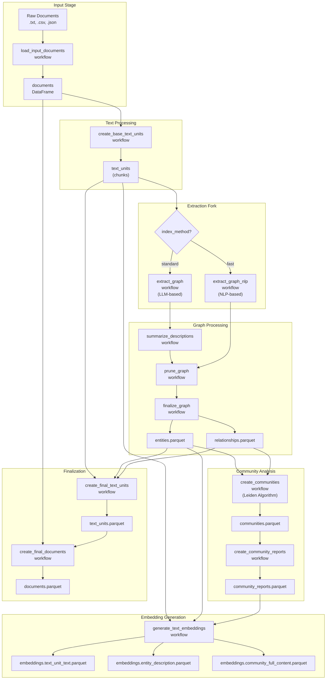
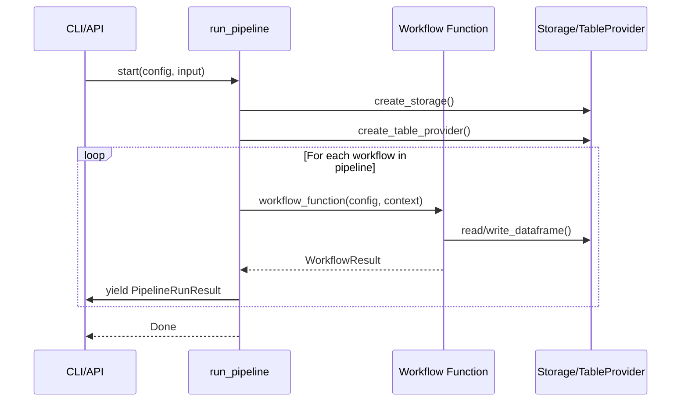
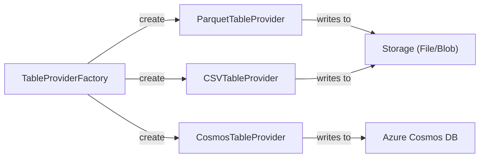

<!-- source: DeepWiki mcp.deepwiki.com · repo microsoft/graphrag · page 4 Indexing Pipeline · fetched 2026-10-26 -->

# Indexing Pipeline

Relevant source files

The following files were used as context for generating this wiki page:

- [docs/config/yaml.md](docs/config/yaml.md)
- [docs/examples_notebooks/drift_search.ipynb](docs/examples_notebooks/drift_search.ipynb)
- [docs/examples_notebooks/global_search.ipynb](docs/examples_notebooks/global_search.ipynb)
- [docs/examples_notebooks/global_search_with_dynamic_community_selection.ipynb](docs/examples_notebooks/global_search_with_dynamic_community_selection.ipynb)
- [docs/examples_notebooks/local_search.ipynb](docs/examples_notebooks/local_search.ipynb)
- [docs/index/architecture.md](docs/index/architecture.md)
- [docs/index/default_dataflow.md](docs/index/default_dataflow.md)
- [docs/index/inputs.md](docs/index/inputs.md)
- [docs/index/outputs.md](docs/index/outputs.md)
- [packages/graphrag-storage/graphrag_storage/tables/table_provider_config.py](packages/graphrag-storage/graphrag_storage/tables/table_provider_config.py)
- [packages/graphrag-storage/graphrag_storage/tables/table_provider_factory.py](packages/graphrag-storage/graphrag_storage/tables/table_provider_factory.py)
- [packages/graphrag-storage/graphrag_storage/tables/table_type.py](packages/graphrag-storage/graphrag_storage/tables/table_type.py)
- [packages/graphrag/graphrag/index/run/run_pipeline.py](packages/graphrag/graphrag/index/run/run_pipeline.py)
- [packages/graphrag/graphrag/index/run/utils.py](packages/graphrag/graphrag/index/run/utils.py)

The Indexing Pipeline is the core data processing system in GraphRAG that transforms raw documents into a queryable knowledge graph with hierarchical community structure. This page documents the complete indexing process, from document loading through embedding generation, covering both Standard (LLM-based) and Fast (NLP-based) extraction methods.

For information about configuring the indexing pipeline, see [Configuration System](#3). For details about querying indexed data, see [Query System](#5). For prompt customization, see [Prompt Management](#6).

## Overview

The indexing pipeline processes documents through a series of configurable workflows to produce a knowledge graph with entities, relationships, hierarchical communities, and embeddings. The system is designed to be extensible, idempotent through LLM caching, and resilient to failures.

**Key Outputs:**
- Entities and relationships extracted from text
- Hierarchical community structure using Leiden clustering
- LLM-generated community summaries
- Text embeddings for retrieval

**Indexing Methods:**
- **Standard GraphRAG**: LLM-based extraction with high quality.
- **FastGraphRAG**: NLP-based extraction using NLTK/spaCy with lower cost and quality.

Sources: [docs/index/default_dataflow.md:1-52](), [packages/graphrag/graphrag/index/run/run_pipeline.py:30-106]()

## Pipeline Architecture

**Pipeline Workflow System**

The indexing pipeline is implemented as a series of named workflows that execute sequentially. The orchestration is handled by `run_pipeline` [packages/graphrag/graphrag/index/run/run_pipeline.py:30-37]() which initializes a `PipelineRunContext` to manage storage, caching, and state across steps.

Sources: [docs/index/default_dataflow.md:19-52](), [packages/graphrag/graphrag/index/run/run_pipeline.py:116-151](), [packages/graphrag/graphrag/index/run/utils.py:23-46]()

## Pipeline Execution Model

### PipelineRunContext

The `PipelineRunContext` [packages/graphrag/graphrag/index/typing/context.py:1-50]() is the central object passed between workflows. It encapsulates the operational environment:

| Component | Code Entity | Description |
|-----------|-------------|-------------|
| **Input Storage** | `input_storage` | Source for raw data (file, blob, etc.) |
| **Output Storage** | `output_storage` | Destination for parquet artifacts |
| **Table Provider** | `output_table_provider` | Handles dataframe serialization (Parquet/CSV/Cosmos) |
| **Cache** | `cache` | LLM response caching layer |
| **Callbacks** | `callbacks` | Progress and event reporting |
| **Stats** | `stats` | Runtime metrics and profiling |

Sources: [packages/graphrag/graphrag/index/run/run_pipeline.py:82-107](), [packages/graphrag/graphrag/index/run/utils.py:23-46]()

### Workflow Orchestration

The pipeline executes by iterating through workflows defined in the configuration. The `_run_pipeline` [packages/graphrag/graphrag/index/run/run_pipeline.py:117-121]() function manages the execution loop, calling each workflow function and capturing results in `PipelineRunResult` [packages/graphrag/graphrag/index/typing/pipeline_run_result.py:1-15]().

Sources: [packages/graphrag/graphrag/index/run/run_pipeline.py:117-158]()

## Document Loading and Input Processing

### Input Formats and Loading

The `load_input_documents` workflow reads documents from configured storage and produces a standardized `documents` DataFrame [docs/index/inputs.md:7-16](). GraphRAG supports `.txt`, `.csv`, `.json`, `.jsonl`, `.parquet`, and MarkItDown formats [docs/config/yaml.md:75-94]().

**Input Schema:**

| Column | Type | Description |
|--------|------|-------------|
| `id` | str | Document ID (hash of text content) |
| `text` | str | Full text content |
| `title` | str | Document title |
| `creation_date` | str | ISO8601 creation timestamp |
| `raw_data` | dict | Optional source object data |

Sources: [docs/index/inputs.md:7-16](), [docs/index/outputs.md:64-73]()

### Table Providers and Data Serialization

The pipeline uses `TableProvider` [packages/graphrag-storage/graphrag_storage/tables/table_provider.py:1-20]() abstractions to handle data persistence. Supported types include Parquet, CSV, and CosmosDB [packages/graphrag-storage/graphrag_storage/tables/table_type.py:10-15]().

Sources: [packages/graphrag-storage/graphrag_storage/tables/table_provider_factory.py:41-109](), [packages/graphrag-storage/graphrag_storage/tables/table_type.py:10-15]()

## Text Chunking

### Chunking Workflow

The `create_base_text_units` workflow segments documents into smaller chunks (TextUnits) to fit within LLM context windows. The default chunk size is typically 1200 tokens [docs/index/default_dataflow.md:58-58](). Metadata from the source document can be prepended to each chunk using the `prepend_metadata` setting [docs/index/inputs.md:57-61]().

Sources: [docs/index/default_dataflow.md:54-71](), [docs/index/outputs.md:98-108](), [docs/index/inputs.md:85-100]()

## Extraction and Graph Construction

### Extraction Methods

The pipeline supports two primary extraction paths [docs/index/default_dataflow.md:106-106]():

1.  **Standard (LLM-based)**: Uses `extract_graph` to identify entities and relationships using LLM prompts. This is followed by `summarize_descriptions` to consolidate multiple descriptions [docs/index/default_dataflow.md:108-117]().
2.  **Fast (NLP-based)**: Performs extraction using traditional NLP techniques to conserve LLM resources.

Sources: [docs/index/default_dataflow.md:92-123]()

## Community Detection and Reporting

### Hierarchical Clustering

GraphRAG uses the **Leiden Algorithm** via the `create_communities` workflow to cluster the entity-relationship graph into a hierarchical structure [docs/index/default_dataflow.md:136-140]().

### Community Reports

The `create_community_reports` workflow generates comprehensive summaries for each detected community [docs/index/default_dataflow.md:141-145](). These reports are the primary source for **Global Search** [docs/examples_notebooks/global_search.ipynb:40-43]().

Sources: [docs/index/default_dataflow.md:124-150](), [docs/index/outputs.md:13-47]()

## Embeddings and Vector Storage

### Embedding Generation

The `generate_text_embeddings` workflow creates vector representations for Text Units, Entity descriptions, and Community reports [docs/index/default_dataflow.md:47-52](). These embeddings enable similarity-based retrieval in **Local Search** [docs/examples_notebooks/local_search.ipynb:42-44]().

Sources: [docs/index/default_dataflow.md:47-52](), [docs/examples_notebooks/local_search.ipynb:100-108]()

## Incremental Indexing

GraphRAG supports updating existing indexes through the `is_update_run` flag in `run_pipeline` [packages/graphrag/graphrag/index/run/run_pipeline.py:34-34](). This mode:
1.  Detects new/changed documents.
2.  Copies previous output to a "previous" storage location for backup [packages/graphrag/graphrag/index/run/run_pipeline.py:73-73]().
3.  Processes deltas and merges them with the previous index [packages/graphrag/graphrag/index/run/run_pipeline.py:54-90]().

Sources: [packages/graphrag/graphrag/index/run/run_pipeline.py:54-90](), [packages/graphrag/graphrag/index/run/utils.py:59-75]()

## Detailed Child Pages

For deep dives into specific pipeline stages, refer to the following child pages:

- **[Pipeline Architecture and Workflow System](#4.1)**: Orchestration, context management, and the execution model.
- **[Document Loading and Chunking](#4.2)**: Input handling, file formats, and text unit creation.
- **[Entity and Relationship Extraction](#4.3)**: LLM and NLP extraction workflows.
- **[Community Detection and Clustering](#4.4)**: Leiden algorithm and hierarchy generation.
- **[Community Reports Generation](#4.5)**: LLM summarization of graph clusters.
- **[Text Embeddings Generation](#4.6)**: Vectorization of knowledge model entities.
- **[Incremental Indexing and Updates](#4.7)**: Managing index deltas and merging state.
- **[Indexing Methods Comparison](#4.8)**: Choosing between Standard and Fast indexing.
- **[Graph Pruning and Finalization](#4.9)**: Cleaning and validating the knowledge graph.
- **[Pipeline Artifacts and Output Format](#4.10)**: Parquet schemas and GraphML exports.
- **[Table Providers and Data Serialization](#4.11)**: Dataframe handling and storage abstractions.

---

