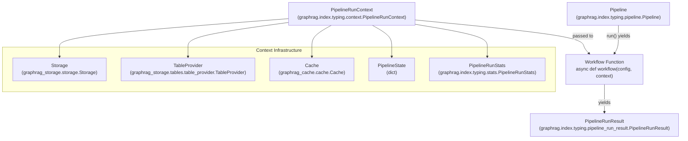
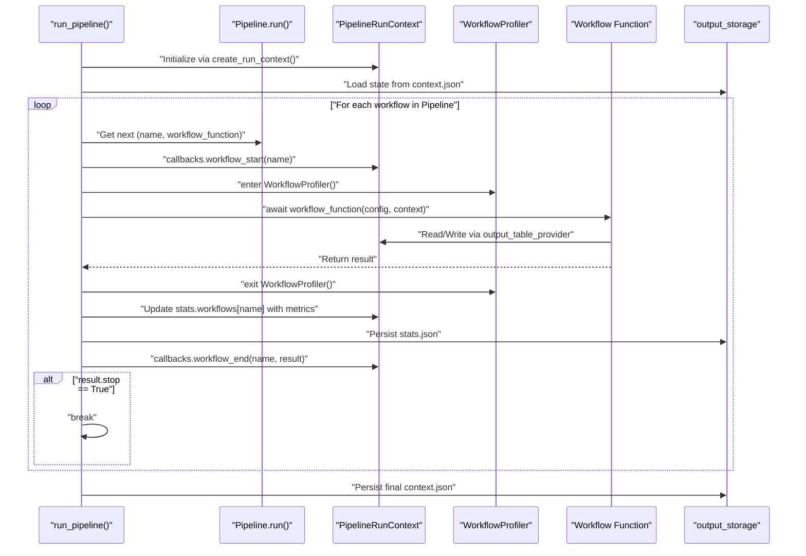
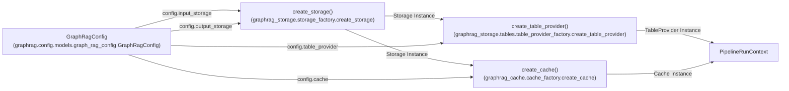

<!-- source: DeepWiki mcp.deepwiki.com · repo microsoft/graphrag · page 4.1 Pipeline Architecture and Workflow System · fetched 2026-10-26 -->

# Pipeline Architecture and Workflow System

Relevant source files

The following files were used as context for generating this wiki page:

- [packages/graphrag-storage/graphrag_storage/tables/table_provider_config.py](packages/graphrag-storage/graphrag_storage/tables/table_provider_config.py)
- [packages/graphrag-storage/graphrag_storage/tables/table_provider_factory.py](packages/graphrag-storage/graphrag_storage/tables/table_provider_factory.py)
- [packages/graphrag-storage/graphrag_storage/tables/table_type.py](packages/graphrag-storage/graphrag_storage/tables/table_type.py)
- [packages/graphrag/graphrag/index/run/profiling.py](packages/graphrag/graphrag/index/run/profiling.py)
- [packages/graphrag/graphrag/index/run/run_pipeline.py](packages/graphrag/graphrag/index/run/run_pipeline.py)
- [packages/graphrag/graphrag/index/run/utils.py](packages/graphrag/graphrag/index/run/utils.py)
- [packages/graphrag/graphrag/index/typing/stats.py](packages/graphrag/graphrag/index/typing/stats.py)
- [tests/unit/indexing/test_profiling.py](tests/unit/indexing/test_profiling.py)

This document describes the architecture of GraphRAG's indexing pipeline orchestration system, including the workflow execution model, pipeline context management, and the mechanisms for running both standard and incremental indexing operations.

For details about individual workflow implementations and their operations, see pages [4.2]() through [4.6](). For information about incremental indexing workflows, see [4.7](). For table storage abstractions used by workflows, see [4.11]().

## Core Architecture Components

The pipeline architecture is built around three primary abstractions that enable modular, stateful workflow execution:

### Pipeline Class

The `Pipeline` class represents an ordered sequence of named workflow functions. Each workflow is registered with a unique name and executes in the order it was added to the pipeline [packages/graphrag/graphrag/index/run/run_pipeline.py:131-132]().

**Key Operations:**
- `run()`: Returns an iterator of `(name, workflow_function)` tuples for sequential execution [packages/graphrag/graphrag/index/run/run_pipeline.py:131]().
- `remove(name)`: Removes a workflow by name, typically used to skip loading steps if dataframes are provided directly [packages/graphrag/graphrag/index/run/run_pipeline.py:80-98]().

### PipelineRunContext

The `PipelineRunContext` is the central execution context passed to every workflow function [packages/graphrag/graphrag/index/typing/context.py:17-35](). It provides access to:

| Context Property | Type | Purpose |
|-----------------|------|---------|
| `input_storage` | `Storage` | Read-only access to input documents [packages/graphrag/graphrag/index/typing/context.py:21-22]() |
| `output_storage` | `Storage` | Long-term storage for pipeline verbs to persist results [packages/graphrag/graphrag/index/typing/context.py:23-24]() |
| `output_table_provider` | `TableProvider` | Interface for reading and writing Parquet/CSV/Cosmos tables [packages/graphrag/graphrag/index/typing/context.py:25-26]() |
| `previous_table_provider` | `TableProvider` | Access to previous index state for incremental updates [packages/graphrag/graphrag/index/typing/context.py:27-28]() |
| `cache` | `Cache` | Caching layer for LLM responses [packages/graphrag/graphrag/index/typing/context.py:29-30]() |
| `callbacks` | `WorkflowCallbacks` | Event handlers for progress and lifecycle reporting [packages/graphrag/graphrag/index/typing/context.py:31-32]() |
| `state` | `PipelineState` | Mutable dictionary for runtime state and persistent pre-computes [packages/graphrag/graphrag/index/typing/context.py:33-34]() |
| `stats` | `PipelineRunStats` | Profiling metrics and document counts for the run [packages/graphrag/graphrag/index/typing/context.py:20]() |

### Workflow Execution Result

Each workflow function is expected to return a result that includes a `stop` flag. The execution loop processes this to determine if the pipeline should continue or halt [packages/graphrag/graphrag/index/run/run_pipeline.py:144-146]().

Title: Pipeline Execution Entities

Sources: [packages/graphrag/graphrag/index/run/run_pipeline.py:131-147](), [packages/graphrag/graphrag/index/typing/context.py:17-35](), [packages/graphrag/graphrag/index/typing/stats.py:27-43]()

## Pipeline Execution Model

The pipeline executes workflows sequentially in a single async loop. The execution model is synchronous at the workflow level—each workflow completes before the next begins [packages/graphrag/graphrag/index/run/run_pipeline.py:131-146]().

Title: Workflow Orchestration Sequence

Sources: [packages/graphrag/graphrag/index/run/run_pipeline.py:117-152](), [packages/graphrag/graphrag/index/run/run_pipeline.py:160-179](), [packages/graphrag/graphrag/index/run/profiling.py:14-50]()

## Run Context Creation

The pipeline context is initialized differently depending on whether it is a standard indexing run or an incremental update run. The `run_pipeline` function implements this branching logic [packages/graphrag/graphrag/index/run/run_pipeline.py:30-107]().

### Standard vs. Update Runs

| Component | Standard Run [packages/graphrag/graphrag/index/run/run_pipeline.py:93-107]() | Update Run [packages/graphrag/graphrag/index/run/run_pipeline.py:54-90]() |
|-----------|-----------------------------------------------------------------------------|---------------------------------------------------------------------------|
| **Output Storage** | `config.output_storage` | `config.update_output_storage` (timestamped) |
| **Delta Storage** | N/A | Sub-child "delta" of timestamped storage |
| **Previous Provider** | `None` | `previous_table_provider` pointing to backup of old index |
| **Initial Step** | Standard loading | `_copy_previous_output` to backup old tables |

The `_copy_previous_output` function ensures that before an update run modifies data, the existing state is safely backed up to a "previous" directory [packages/graphrag/graphrag/index/run/run_pipeline.py:182-190]().

Sources: [packages/graphrag/graphrag/index/run/run_pipeline.py:30-115](), [packages/graphrag/graphrag/index/run/utils.py:23-46]()

## Persistence and State Management

The system persists two primary JSON files to the `output_storage` to ensure observability and resume-capability:

1.  **`stats.json`**: Stores timing and performance metrics for every workflow executed [packages/graphrag/graphrag/index/run/run_pipeline.py:160-164]().
2.  **`context.json`**: Stores the `PipelineState` dictionary. This includes the `update_timestamp` for incremental runs and any persistent pre-computes [packages/graphrag/graphrag/index/run/run_pipeline.py:167-179]().

### Workflow Profiling
Execution time and memory usage for each workflow is captured using the `WorkflowProfiler` context manager [packages/graphrag/graphrag/index/run/profiling.py:14-50](). It uses `tracemalloc` to track peak memory and memory deltas [packages/graphrag/graphrag/index/run/profiling.py:48-49](). These metrics are mapped to the workflow name in the `context.stats` object [packages/graphrag/graphrag/index/run/run_pipeline.py:142]().

Sources: [packages/graphrag/graphrag/index/run/run_pipeline.py:127-151](), [packages/graphrag/graphrag/index/run/run_pipeline.py:160-179](), [packages/graphrag/graphrag/index/typing/stats.py:10-24]()

## Storage and Table Provider Factories

The pipeline uses a factory pattern to decouple the execution logic from specific storage implementations (e.g., local file system vs. Azure Blob Storage vs. Cosmos DB).

Title: Pipeline Storage Initialization

Sources: [packages/graphrag/graphrag/index/run/run_pipeline.py:39-45](), [packages/graphrag-storage/graphrag_storage/tables/table_provider_factory.py:41-109](), [packages/graphrag-cache/graphrag_cache/cache_factory.py:41-89]()

The `TableProvider` (typically `ParquetTableProvider`, `CSVTableProvider`, or `CosmosTableProvider`) is responsible for the actual serialization of DataFrames to the underlying `Storage` [packages/graphrag-storage/graphrag_storage/tables/table_provider_factory.py:62-80](). For `CosmosDB`, the provider extracts connection details from the affiliated `Storage` instance to simplify configuration [packages/graphrag-storage/graphrag_storage/tables/table_provider_factory.py:92-107]().

## Summary of Execution Flow

1.  **Initialization**: `run_pipeline` creates storage, table providers, and cache based on `GraphRagConfig` [packages/graphrag/graphrag/index/run/run_pipeline.py:39-45]().
2.  **State Loading**: Existing state is read from `context.json` in the output storage [packages/graphrag/graphrag/index/run/run_pipeline.py:48-49]().
3.  **Context Setup**: A `PipelineRunContext` is instantiated with all required providers and initial state [packages/graphrag/graphrag/index/run/utils.py:23-46]().
4.  **Workflow Loop**: The pipeline iterates through registered workflows, profiling each one with `WorkflowProfiler` and yielding results [packages/graphrag/graphrag/index/run/run_pipeline.py:131-147]().
5.  **Finalization**: Final stats and context state are dumped to storage [packages/graphrag/graphrag/index/run/run_pipeline.py:150-151]().

Sources: [packages/graphrag/graphrag/index/run/run_pipeline.py:30-157]()

---

