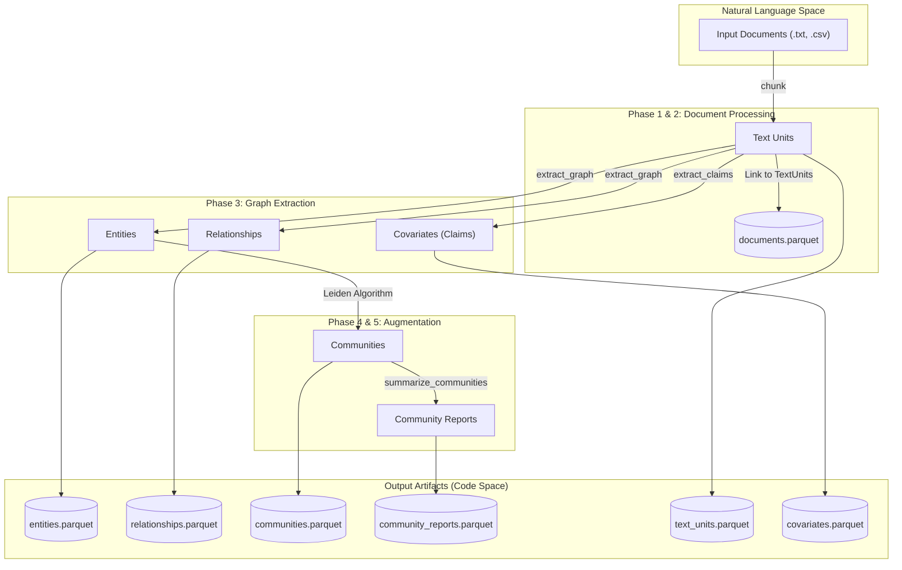
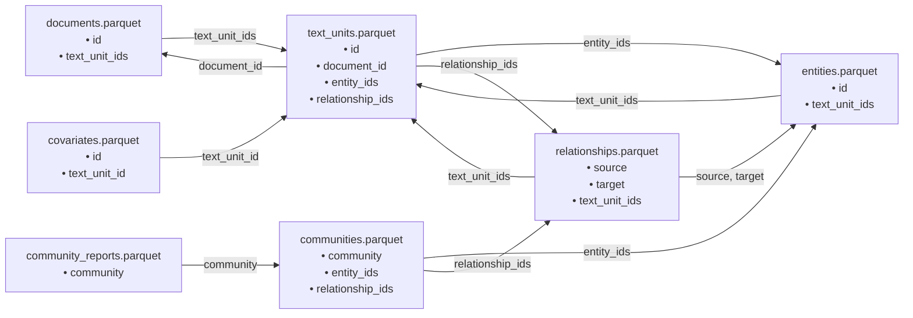
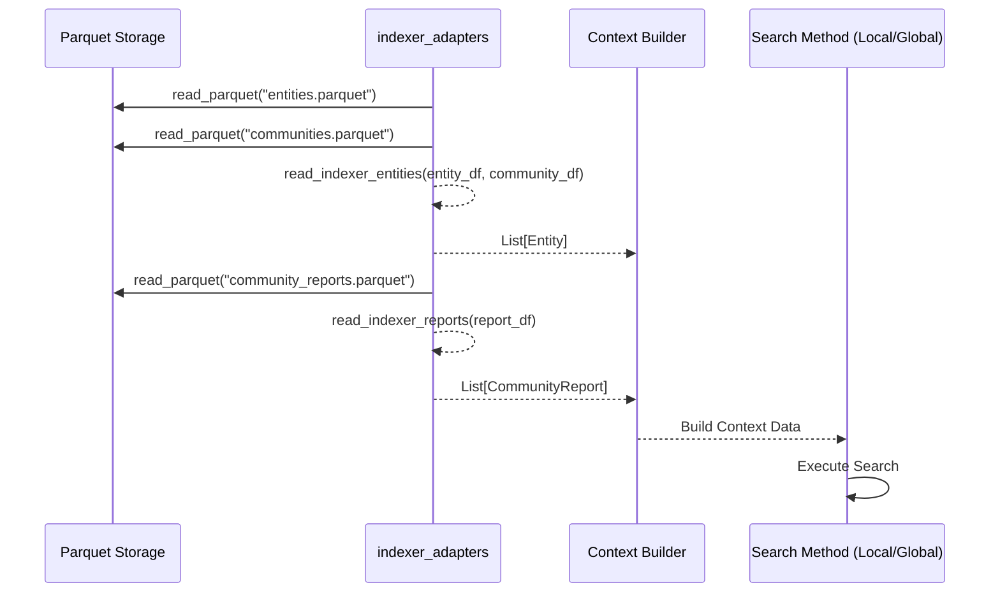

<!-- source: DeepWiki mcp.deepwiki.com · repo microsoft/graphrag · page 4.10 Pipeline Artifacts and Output Format · fetched 2026-10-26 -->

# Pipeline Artifacts and Output Format

Relevant source files

The following files were used as context for generating this wiki page:

- [docs/examples_notebooks/drift_search.ipynb](docs/examples_notebooks/drift_search.ipynb)
- [docs/examples_notebooks/global_search.ipynb](docs/examples_notebooks/global_search.ipynb)
- [docs/examples_notebooks/global_search_with_dynamic_community_selection.ipynb](docs/examples_notebooks/global_search_with_dynamic_community_selection.ipynb)
- [docs/examples_notebooks/local_search.ipynb](docs/examples_notebooks/local_search.ipynb)
- [docs/index/default_dataflow.md](docs/index/default_dataflow.md)
- [docs/index/outputs.md](docs/index/outputs.md)
- [tests/verbs/data/communities.parquet](tests/verbs/data/communities.parquet)
- [tests/verbs/data/community_reports.parquet](tests/verbs/data/community_reports.parquet)
- [tests/verbs/data/covariates.parquet](tests/verbs/data/covariates.parquet)
- [tests/verbs/data/documents.parquet](tests/verbs/data/documents.parquet)
- [tests/verbs/data/entities.parquet](tests/verbs/data/entities.parquet)
- [tests/verbs/data/relationships.parquet](tests/verbs/data/relationships.parquet)
- [tests/verbs/data/text_units.parquet](tests/verbs/data/text_units.parquet)

This page documents the data artifacts produced by the GraphRAG indexing pipeline, their schemas, file formats, and serialization details. These artifacts conform to the GraphRAG Knowledge Model, which serves as the foundation for all downstream query operations.

## Purpose and Scope

The indexing pipeline processes input documents and produces a structured knowledge graph represented as a collection of interconnected tables. This page covers:

- **Output artifacts**: The complete set of Parquet files produced by indexing.
- **Schemas**: Column definitions and data types for each artifact.
- **File formats**: Parquet (default) and GraphML export options.
- **Serialization**: How complex types (lists, nested objects) are stored.
- **Relationships**: Foreign key relationships between artifacts.

## Overview of Pipeline Artifacts

The indexing pipeline produces several primary artifacts representing the knowledge graph. The following diagram maps the logical dataflow to the specific output tables and the code entities responsible for their creation.

### Dataflow to Code Entity Mapping

**Sources:**
- [docs/index/default_dataflow.md:19-52]()
- [docs/index/default_dataflow.md:5-13]()
- [docs/index/outputs.md:3-4]()

## Artifact Relationships

The artifacts form a connected graph through ID references. These references allow query engines (Local, Global, and DRIFT) to traverse the knowledge graph.

**Sources:**
- [docs/index/outputs.md:13-109]()
- [docs/index/default_dataflow.md:72-74]()
- [docs/examples_notebooks/local_search.ipynb:72-78]()

## Artifact Schemas

All tables share two identifier fields: `id` (a generated UUID) and `human_readable_id` (an incremented short ID used for citations).

### entities.parquet
List of all entities found in the data by the LLM.

| Column | Type | Description |
|--------|------|-------------|
| `title` | str | Name of the entity |
| `type` | str | Entity type (e.g., "organization", "person") |
| `description` | str | LLM-derived summary of all descriptions |
| `text_unit_ids` | str[] | List of the text units containing the entity |
| `frequency` | int | Count of text units the entity was found within |
| `degree` | int | Node degree (connectedness) in the graph |

**Sources:**
- [docs/index/outputs.md:75-86]()
- [docs/index/default_dataflow.md:110-113]()

### relationships.parquet
List of all entity-to-entity relationships. This serves as the edge list for the graph.

| Column | Type | Description |
|--------|------|-------------|
| `source` | str | Name of the source entity |
| `target` | str | Name of the target entity |
| `description` | str | LLM-derived description of the relationship |
| `weight` | float | Summed LLM-derived "strength" measure |
| `text_unit_ids` | str[] | List of text units where the relationship was found |

**Sources:**
- [docs/index/outputs.md:87-98]()
- [docs/index/default_dataflow.md:110-113]()

### communities.parquet
List of final communities generated by the Leiden algorithm.

| Column | Type | Description |
|--------|------|-------------|
| `community` | int | Leiden-generated cluster ID |
| `parent` | int | Parent community ID |
| `children` | int[] | List of child community IDs |
| `level` | int | Depth of the community in the hierarchy |
| `title` | str | Friendly name of the community |
| `entity_ids` | str[] | List of member entities |
| `relationship_ids` | str[] | List of relationships wholly within the community |

**Sources:**
- [docs/index/outputs.md:13-28]()
- [docs/index/default_dataflow.md:136-138]()

### community_reports.parquet
Summarized reports for each community, used primarily by Global Search.

| Column | Type | Description |
|--------|------|-------------|
| `community` | int | Short ID of the associated community |
| `title` | str | LLM-generated title for the report |
| `summary` | str | LLM-generated summary |
| `full_content` | str | Complete report text |
| `rank` | float | Relevance ranking based on entity salience |
| `findings` | dict[] | List of top insights (summary and explanation) |
| `full_content_json` | json | Raw JSON output from the LLM |

**Sources:**
- [docs/index/outputs.md:29-47]()
- [docs/examples_notebooks/global_search.ipynb:133-148]()

### text_units.parquet
Chunks of text used for graph extraction and as source references.

| Column | Type | Description |
|--------|------|-------------|
| `text` | str | Raw full text of the chunk |
| `n_tokens` | int | Number of tokens in the chunk |
| `document_id` | str | ID of the source document |
| `entity_ids` | str[] | List of entities found in the unit |
| `relationship_ids` | str[] | List of relationships found in the unit |

**Sources:**
- [docs/index/outputs.md:99-109]()
- [docs/index/default_dataflow.md:54-59]()

### covariates.parquet
Optional list of extracted claims (factual statements with status and time-bounds).

| Column | Type | Description |
|--------|------|-------------|
| `type` | str | Nature of the claim type |
| `description` | str | LLM-generated description of the behavior |
| `subject_id` | str | Name of the source entity |
| `object_id` | str | Name of the target entity |
| `status` | str | Assessment [TRUE, FALSE, SUSPECTED] |
| `source_text` | str | Original text snippet for the claim |

**Sources:**
- [docs/index/outputs.md:48-63]()
- [docs/index/default_dataflow.md:118-123]()

## Serialization and Consumption

Downstream search methods consume these artifacts by reading the Parquet files into DataFrames and then into structured objects.

### Data Loading Flow

**Sources:**
- [docs/examples_notebooks/local_search.ipynb:22-35]()
- [docs/examples_notebooks/global_search.ipynb:22-30]()
- [docs/examples_notebooks/drift_search.ipynb:23-32]()

### Implementation Details
The `graphrag.query.indexer_adapters` module provides the standard functions for converting Parquet DataFrames into the internal knowledge model:
- `read_indexer_entities`: Merges entity and community data [docs/examples_notebooks/local_search.ipynb:98-98]().
- `read_indexer_reports`: Filters reports by community level [docs/examples_notebooks/global_search.ipynb:90-90]().
- `read_indexer_relationships`: Loads edge lists [docs/examples_notebooks/local_search.ipynb:125-125]().
- `read_indexer_text_units`: Loads text chunks [docs/examples_notebooks/local_search.ipynb:181-181]().

**Sources:**
- [docs/examples_notebooks/local_search.ipynb:22-29]()
- [docs/examples_notebooks/global_search.ipynb:22-26]()

---

