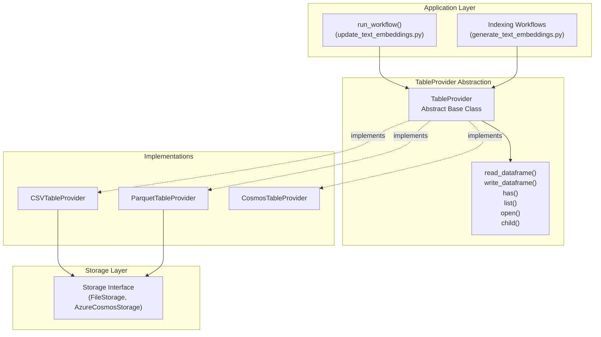
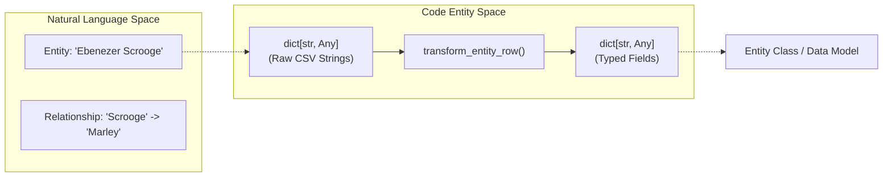
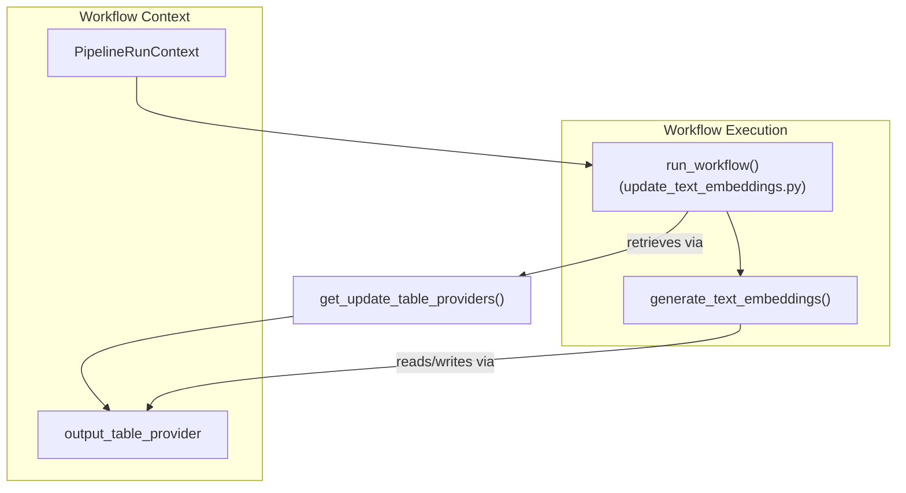

<!-- source: DeepWiki mcp.deepwiki.com · repo microsoft/graphrag · page 4.11 Table Providers and Data Serialization · fetched 2026-10-26 -->

# Table Providers and Data Serialization

Relevant source files

The following files were used as context for generating this wiki page:

- [docs/examples_notebooks/index_migration_to_v1.ipynb](docs/examples_notebooks/index_migration_to_v1.ipynb)
- [packages/graphrag-storage/COSMOS_TABLE_PROVIDER_DESIGN.md](packages/graphrag-storage/COSMOS_TABLE_PROVIDER_DESIGN.md)
- [packages/graphrag-storage/graphrag_storage/azure_cosmos_storage.py](packages/graphrag-storage/graphrag_storage/azure_cosmos_storage.py)
- [packages/graphrag-storage/graphrag_storage/tables/cosmos_table.py](packages/graphrag-storage/graphrag_storage/tables/cosmos_table.py)
- [packages/graphrag-storage/graphrag_storage/tables/cosmos_table_provider.py](packages/graphrag-storage/graphrag_storage/tables/cosmos_table_provider.py)
- [packages/graphrag-storage/graphrag_storage/tables/csv_table.py](packages/graphrag-storage/graphrag_storage/tables/csv_table.py)
- [packages/graphrag-storage/graphrag_storage/tables/csv_table_provider.py](packages/graphrag-storage/graphrag_storage/tables/csv_table_provider.py)
- [packages/graphrag-storage/graphrag_storage/tables/parquet_table_provider.py](packages/graphrag-storage/graphrag_storage/tables/parquet_table_provider.py)
- [packages/graphrag-storage/graphrag_storage/tables/table_provider.py](packages/graphrag-storage/graphrag_storage/tables/table_provider.py)
- [packages/graphrag/graphrag/data_model/dfs.py](packages/graphrag/graphrag/data_model/dfs.py)
- [packages/graphrag/graphrag/data_model/row_transformers.py](packages/graphrag/graphrag/data_model/row_transformers.py)
- [packages/graphrag/graphrag/index/workflows/update_text_embeddings.py](packages/graphrag/graphrag/index/workflows/update_text_embeddings.py)
- [tests/unit/indexing/operations/__init__.py](tests/unit/indexing/operations/__init__.py)
- [tests/unit/indexing/operations/embed_text/__init__.py](tests/unit/indexing/operations/embed_text/__init__.py)
- [tests/unit/storage/test_csv_table.py](tests/unit/storage/test_csv_table.py)
- [tests/verbs/data/covariates.csv](tests/verbs/data/covariates.csv)
- [tests/verbs/data/entities.csv](tests/verbs/data/entities.csv)
- [tests/verbs/data/relationships.csv](tests/verbs/data/relationships.csv)
- [tests/verbs/data/text_units.csv](tests/verbs/data/text_units.csv)
- [tests/verbs/test_update_text_embeddings.py](tests/verbs/test_update_text_embeddings.py)

This page documents the table provider abstraction layer that handles data serialization and deserialization for GraphRAG's pipeline artifacts. Table providers offer both bulk DataFrame operations and memory-efficient row-by-row streaming access to tabular data stored as CSV, Parquet, or in Cosmos DB. For information about the underlying storage backends (file, blob, cosmos), see [7.1 Storage Architecture and Factory Pattern](). For details on the pipeline artifacts themselves (entities, relationships, etc.), see [4.10 Pipeline Artifacts and Output Format]().

## Overview

The table provider system consists of two abstraction layers that work together to provide flexible data access patterns:

1.  **TableProvider Layer**: Handles bulk read/write operations with pandas DataFrames, suitable for loading entire tables into memory.
2.  **Table Layer**: Provides streaming row-by-row access for memory-efficient processing of large datasets.

Both CSV and Parquet formats are supported through concrete implementations, along with a specialized provider for Azure Cosmos DB. The system integrates with the `Storage` abstraction layer to work across different storage backends.

**Sources:** [packages/graphrag-storage/graphrag_storage/tables/table_provider.py:14-103](), [packages/graphrag-storage/graphrag_storage/tables/table_provider.py:104-122]()

## Architecture Overview

**Diagram: Table Provider Architecture**

This architecture separates concerns between bulk DataFrame operations and streaming row access, allowing workflows to choose the appropriate access pattern based on their memory and performance requirements.

**Sources:** [packages/graphrag-storage/graphrag_storage/tables/table_provider.py:14-122](), [packages/graphrag-storage/graphrag_storage/tables/csv_table_provider.py:21-41](), [packages/graphrag-storage/graphrag_storage/tables/parquet_table_provider.py:20-37](), [packages/graphrag-storage/graphrag_storage/tables/cosmos_table_provider.py:48-75]()

## TableProvider Interface

The `TableProvider` abstract base class defines the contract for bulk DataFrame operations. It provides methods for reading and writing entire tables as pandas DataFrames, as well as checking for table existence and listing available tables.

### Core Methods

| Method | Description | Return Type |
| :--- | :--- | :--- |
| `read_dataframe(table_name)` | Load entire table as pandas DataFrame | `pd.DataFrame` |
| `write_dataframe(table_name, df)` | Write entire DataFrame to storage | `None` |
| `has(table_name)` | Check if table exists | `bool` |
| `list()` | List all table names (without extensions) | `list[str]` |
| `open(table_name, transformer, truncate)` | Open table for row-by-row streaming operations | `Table` |
| `child(name)` | Create a namespaced child provider for isolation | `TableProvider` |

The `child()` method is critical for incremental indexing, allowing the pipeline to isolate "delta", "previous", and timestamped table sets [packages/graphrag-storage/graphrag_storage/tables/table_provider.py:104-121]().

**Sources:** [packages/graphrag-storage/graphrag_storage/tables/table_provider.py:14-122]()

## CosmosTableProvider and Namespace Partitioning

The `CosmosTableProvider` allows GraphRAG to store tabular data in Azure Cosmos DB natively as documents, eliminating Parquet serialization overhead [packages/graphrag-storage/graphrag_storage/tables/cosmos_table_provider.py:4-19]().

### Document Schema and Partitioning
Each row is stored as a Cosmos document with the following routing fields:
*   **Partition Key (`/namespace`)**: Used for isolation (e.g., `output`, `delta`, `previous`) [packages/graphrag-storage/graphrag_storage/tables/cosmos_table_provider.py:11-15]().
*   **Document ID**: Formatted as `{table_name}:{row_key}` [packages/graphrag-storage/graphrag_storage/tables/cosmos_table_provider.py:12]().
*   **Table Name**: A discriminator for per-table queries within a single partition [packages/graphrag-storage/graphrag_storage/tables/cosmos_table_provider.py:16]().

### Namespace Isolation
When `child(name)` is called, `CosmosTableProvider` returns a new instance sharing the same `CosmosClient` but with an extended namespace string [packages/graphrag-storage/graphrag_storage/tables/cosmos_table_provider.py:110-111](). This ensures all queries target a single namespace partition, avoiding expensive cross-partition fan-outs [packages/graphrag-storage/graphrag_storage/tables/cosmos_table_provider.py:18]().

**Sources:** [packages/graphrag-storage/graphrag_storage/tables/cosmos_table_provider.py:1-19](), [packages/graphrag-storage/graphrag_storage/tables/cosmos_table_provider.py:48-111](), [packages/graphrag-storage/COSMOS_TABLE_PROVIDER_DESIGN.md:44-60]()

## CSV and Parquet Implementations

### CSVTableProvider
*   **Requirement**: Currently only works with `FileStorage` backends [packages/graphrag-storage/graphrag_storage/tables/csv_table_provider.py:38-40]().
*   **Behavior**: Converts between pandas DataFrames and CSV format. It handles empty CSV data by returning an empty DataFrame [packages/graphrag-storage/graphrag_storage/tables/csv_table_provider.py:71-73]().
*   **Streaming**: The `CSVTable` implementation uses `csv.DictReader` for row-by-row iteration and supports `truncate=True` by writing to a temporary file before moving it to the final destination [packages/graphrag-storage/graphrag_storage/tables/csv_table.py:155-169]().

### ParquetTableProvider
*   **Requirement**: Works with any `Storage` instance [packages/graphrag-storage/graphrag_storage/tables/parquet_table_provider.py:37]().
*   **Behavior**: Uses `BytesIO` to read and write Parquet files via pandas `read_parquet` and `to_parquet` [packages/graphrag-storage/graphrag_storage/tables/parquet_table_provider.py:65-67](), [packages/graphrag-storage/graphrag_storage/tables/parquet_table_provider.py:82]().

**Sources:** [packages/graphrag-storage/graphrag_storage/tables/csv_table_provider.py:21-150](), [packages/graphrag-storage/graphrag_storage/tables/parquet_table_provider.py:20-144](), [packages/graphrag-storage/graphrag_storage/tables/csv_table.py:50-191]()

## Row Transformers and Type Conversion

Row transformers enable type-safe processing of table data by converting raw dictionary rows (where values may be strings from CSV) into properly typed fields.

### Specialized Row Transformers
The `graphrag.data_model.row_transformers` module provides functions that mirror the DataFrame-level typing helpers in `dfs.py`, but operate on single rows for streaming reads [packages/graphrag/graphrag/data_model/row_transformers.py:3-11]().

**Diagram: Bridging Raw Data to Typed Code Entities**

| Transformer Function | Key Conversions |
| :--- | :--- |
| `transform_entity_row` | `human_readable_id` → int, `text_unit_ids` → list, `frequency` → int, `degree` → int [packages/graphrag/graphrag/data_model/row_transformers.py:73-89]() |
| `transform_relationship_row` | `weight` → float, `combined_degree` → int, `text_unit_ids` → list [packages/graphrag/graphrag/data_model/row_transformers.py:105-127]() |
| `transform_community_row` | `community` → int, `level` → int, `children` → list, `size` → int [packages/graphrag/graphrag/data_model/row_transformers.py:133-160]() |
| `transform_text_unit_row` | `n_tokens` → int, `entity_ids` → list, `relationship_ids` → list [packages/graphrag/graphrag/data_model/row_transformers.py:208-228]() |

**Sources:** [packages/graphrag/graphrag/data_model/row_transformers.py:1-228](), [packages/graphrag/graphrag/data_model/dfs.py:31-153]()

## Integration with Workflows

Workflows like `update_text_embeddings` use table providers to load data for processing and write back updated artifacts.

**Diagram: Table Provider Integration in update_text_embeddings**

In the `update_text_embeddings` workflow, the `output_table_provider` is retrieved using `get_update_table_providers` to facilitate the generation and storage of text embeddings [packages/graphrag/graphrag/index/workflows/update_text_embeddings.py:29-49]().

**Sources:** [packages/graphrag/graphrag/index/workflows/update_text_embeddings.py:22-52](), [packages/graphrag/graphrag/index/run/utils.py:12]()

---

