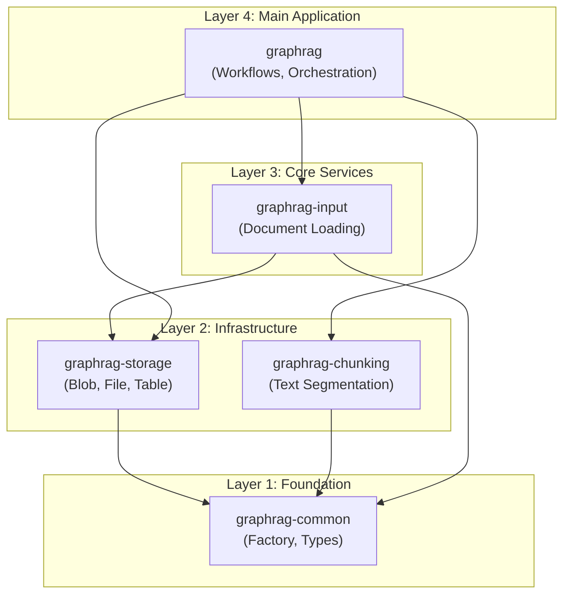
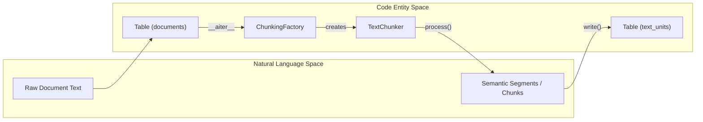

<!-- source: DeepWiki mcp.deepwiki.com · repo microsoft/graphrag · page 4.2 Document Loading and Chunking · fetched 2026-10-26 -->

# Document Loading and Chunking

<details>
<summary>Relevant source files</summary>

The following files were used as context for generating this wiki page:

- [packages/graphrag-input/graphrag_input/csv.py](packages/graphrag-input/graphrag_input/csv.py)
- [packages/graphrag-input/graphrag_input/input_reader.py](packages/graphrag-input/graphrag_input/input_reader.py)
- [packages/graphrag-input/graphrag_input/input_reader_factory.py](packages/graphrag-input/graphrag_input/input_reader_factory.py)
- [packages/graphrag-input/graphrag_input/input_type.py](packages/graphrag-input/graphrag_input/input_type.py)
- [packages/graphrag-input/graphrag_input/jsonl.py](packages/graphrag-input/graphrag_input/jsonl.py)
- [packages/graphrag-input/graphrag_input/parquet.py](packages/graphrag-input/graphrag_input/parquet.py)
- [packages/graphrag-storage/graphrag_storage/file_storage.py](packages/graphrag-storage/graphrag_storage/file_storage.py)
- [packages/graphrag-storage/graphrag_storage/tables/parquet_table.py](packages/graphrag-storage/graphrag_storage/tables/parquet_table.py)
- [packages/graphrag-storage/graphrag_storage/tables/table.py](packages/graphrag-storage/graphrag_storage/tables/table.py)
- [packages/graphrag/graphrag/index/workflows/load_input_documents.py](packages/graphrag/graphrag/index/workflows/load_input_documents.py)
- [packages/graphrag/graphrag/index/workflows/load_update_documents.py](packages/graphrag/graphrag/index/workflows/load_update_documents.py)
- [tests/unit/indexing/input/data/jsonl-with-invalid-and-blank-lines/input.jsonl](tests/unit/indexing/input/data/jsonl-with-invalid-and-blank-lines/input.jsonl)
- [tests/unit/indexing/input/data/one-parquet/input.parquet](tests/unit/indexing/input/data/one-parquet/input.parquet)
- [tests/unit/indexing/input/test_csv_loader.py](tests/unit/indexing/input/test_csv_loader.py)
- [tests/unit/indexing/input/test_jsonl_loader.py](tests/unit/indexing/input/test_jsonl_loader.py)
- [tests/unit/indexing/input/test_parquet_loader.py](tests/unit/indexing/input/test_parquet_loader.py)

</details>


This page describes the first stage of the GraphRAG indexing pipeline: loading raw documents from various input formats and splitting them into processable text units (chunks). These text units serve as the foundational units for all downstream graph extraction and embedding operations.

---

## Overview

Document loading and chunking are implemented through sequential workflows in the GraphRAG pipeline, utilizing specialized packages from the monorepo structure:

1.  **`load_input_documents`**: Parses raw files into a standardized `documents` table. It uses the `graphrag-input` package to handle various file formats.
2.  **`load_update_documents`**: A specialized version for incremental indexing that identifies new or changed documents by comparing against previous runs.
3.  **`create_base_text_units`**: Splits documents into smaller "text units" (chunks) using the `graphrag-chunking` package.

**Monorepo Package Architecture for Input & Chunking**



Sources: [packages/graphrag-input/graphrag_input/input_reader.py:1-20](), [packages/graphrag-common/graphrag_common/factory/factory.py:1-15]()

---

## Document Loading

### Input Reader System

The `graphrag-input` package provides an extensible system for reading documents from storage. The core abstraction is the `InputReader` abstract base class [packages/graphrag-input/graphrag_input/input_reader.py:23-24](). It provides an asynchronous iterator interface `__aiter__` to yield documents one by one as they are loaded from the underlying storage [packages/graphrag-input/graphrag_input/input_reader.py:41-43]().

**Input Loading Logic Flow**

```mermaid
graph TD
    subgraph "Code Entity Space"
        Factory["create_input_reader()<br/>graphrag_input.input_reader_factory"]
        Reader["InputReader<br/>__aiter__ / _iterate_files()"]
        Storage["Storage (FileStorage/BlobStorage)<br/>find() / get()"]
        CSVReader["CSVFileReader"]
        TextReader["TextFileReader"]
        ParquetReader["ParquetFileReader"]
        JSONLReader["JSONLinesFileReader"]
    end

    Factory -- "instantiates" --> Reader
    Reader -- "scans" --> Storage
    Reader <|-- CSVReader
    Reader <|-- TextReader
    Reader <|-- ParquetReader
    Reader <|-- JSONLReader
    
    CSVReader -- "yields" --> Doc["TextDocument"]
    Storage -- "find(re.Pattern)" --> Files["File List"]
```

The `create_input_reader` function [packages/graphrag-input/graphrag_input/input_reader_factory.py:44-58]() initializes the appropriate reader based on the `InputType` [packages/graphrag-input/graphrag_input/input_type.py:9-24](). It uses a factory pattern to register and instantiate specific implementations like `CSVFileReader` or `ParquetFileReader` [packages/graphrag-input/graphrag_input/input_reader_factory.py:62-88]().

### Supported Formats

GraphRAG supports several input types out-of-the-box:

| Input Type | Enum Value | Reader Class | Description |
| :--- | :--- | :--- | :--- |
| **CSV** | `csv` | `CSVFileReader` | Reads rows as individual documents. Supports `title_column` and `text_column` mapping [packages/graphrag-input/graphrag_input/csv.py:22-45](). |
| **Text** | `text` | `TextFileReader` | Reads each `.txt` file as a single document. |
| **JSON** | `json` | `JSONFileReader` | Parses JSON structures into `TextDocument` objects. |
| **JSONL** | `jsonl` | `JSONLinesFileReader` | Parses line-delimited JSON. Skips malformed lines or non-object rows [packages/graphrag-input/graphrag_input/jsonl.py:38-60](). |
| **Parquet** | `parquet` | `ParquetFileReader` | Reads Apache Parquet files using `pyarrow` [packages/graphrag-input/graphrag_input/parquet.py:17-39](). |
| **MarkItDown** | `markitdown` | `MarkItDownFileReader` | Converts complex formats (PDF, DOCX) to markdown. |

Sources: [packages/graphrag-input/graphrag_input/input_reader_factory.py:60-88](), [packages/graphrag-input/graphrag_input/input_type.py:9-24](), [packages/graphrag-input/graphrag_input/csv.py:31-45](), [packages/graphrag-input/graphrag_input/jsonl.py:15-61]()

### The `load_input_documents` Workflow

The primary entry point for loading is the `run_workflow` function in `load_input_documents.py` [packages/graphrag/graphrag/index/workflows/load_input_documents.py:20-40]().

1.  **Reader Creation**: Calls `create_input_reader` with the provided `config.input` and `context.input_storage` [packages/graphrag/graphrag/index/workflows/load_input_documents.py:25]().
2.  **Iteration**: Iterates asynchronously over the reader using `async for doc in input_reader` [packages/graphrag/graphrag/index/workflows/load_input_documents.py:50]().
3.  **Table Writing**: Writes each document to the `documents` table via the `output_table_provider` [packages/graphrag/graphrag/index/workflows/load_input_documents.py:55](). If the provider is `ParquetTable`, rows are accumulated and written to the underlying storage [packages/graphrag-storage/graphrag_storage/tables/parquet_table.py:122-150]().
4.  **Stats**: Updates `context.stats.num_documents` with the total count of loaded files [packages/graphrag/graphrag/index/workflows/load_input_documents.py:38]().

### Incremental Document Loading

For update runs, the `load_update_documents` workflow [packages/graphrag/graphrag/index/workflows/load_update_documents.py:22-46]() is used. It identifies "delta" documents—new or modified files—by comparing current inputs against the `previous_table_provider` using the `get_delta_docs` utility [packages/graphrag/graphrag/index/workflows/load_update_documents.py:61]().

Sources: [packages/graphrag/graphrag/index/workflows/load_input_documents.py:20-60](), [packages/graphrag/graphrag/index/workflows/load_update_documents.py:49-63](), [packages/graphrag-storage/graphrag_storage/tables/parquet_table.py:38-48]()

---

## Document Chunking

Once documents are loaded into the `documents` table, they are processed into "Text Units" (chunks). This ensures that the text segments are small enough for LLM context windows and provides a granular basis for graph extraction.

### The `create_base_text_units` Workflow

This workflow orchestrates the transformation from `documents` to `text_units`.

**Chunking Process Data Flow**



### Chunking Strategies

The `graphrag-chunking` package supports different strategies for splitting text, configured via the pipeline settings:

*   **Tokens**: Splits text based on token counts using `tiktoken`. This is the default strategy for LLM-based pipelines to ensure chunks fit within model context limits.
*   **Sentences**: Splits text at sentence boundaries using NLP libraries like NLTK or spaCy to preserve semantic integrity.

The `Table` abstraction facilitates this by providing a simulated streaming interface [packages/graphrag-storage/graphrag_storage/tables/table.py:15-30](), allowing the chunker to process rows one by one.

Sources: [packages/graphrag-storage/graphrag_storage/tables/parquet_table.py:89-100](), [packages/graphrag/graphrag/index/workflows/load_input_documents.py:1-60]()

---

## Data Schema

### Documents Table
The result of the loading workflow is a standardized table (usually Parquet) with the following key fields:

| Field | Description |
| :--- | :--- |
| `id` | Unique identifier for the document. |
| `text` | The raw content of the document. |
| `title` | The title or filename (derived from file path or specific column). |
| `metadata` | A dictionary of additional attributes. |
| `human_readable_id` | An integer index for easy reference [packages/graphrag/graphrag/index/workflows/load_input_documents.py:52](). |
| `raw_data` | The original raw dictionary from the input reader [packages/graphrag/graphrag/index/workflows/load_input_documents.py:53-54](). |

### Text Units Table
The chunking process generates the `text_units` table, which serves as the primary input for Entity Extraction:

| Field | Description |
| :--- | :--- |
| `id` | Unique identifier for the chunk. |
| `text` | The chunked text segment. |
| `n_tokens` | The number of tokens in the chunk. |
| `document_ids` | A list of source document IDs contributing to this chunk (enabling multi-document chunks). |

Sources: [packages/graphrag/graphrag/index/workflows/load_input_documents.py:50-60](), [packages/graphrag/graphrag/index/workflows/load_update_documents.py:54-58](), [packages/graphrag-storage/graphrag_storage/tables/parquet_table.py:122-132]()

---

