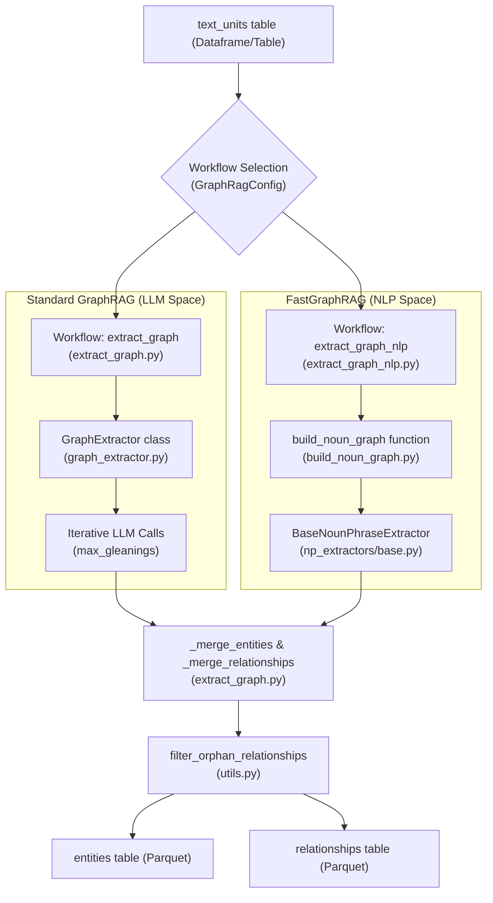
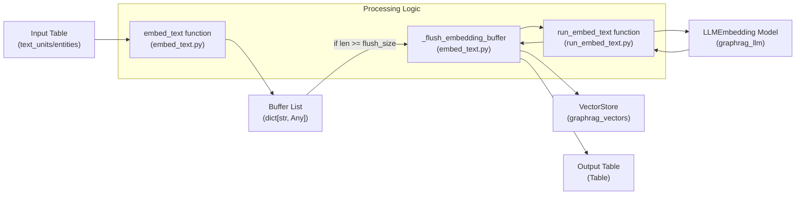

<!-- source: DeepWiki mcp.deepwiki.com · repo microsoft/graphrag · page 4.3 Entity and Relationship Extraction · fetched 2026-10-26 -->

# Entity and Relationship Extraction

Relevant source files

The following files were used as context for generating this wiki page:

- [packages/graphrag/graphrag/index/operations/build_noun_graph/build_noun_graph.py](packages/graphrag/graphrag/index/operations/build_noun_graph/build_noun_graph.py)
- [packages/graphrag/graphrag/index/operations/embed_text/embed_text.py](packages/graphrag/graphrag/index/operations/embed_text/embed_text.py)
- [packages/graphrag/graphrag/index/operations/extract_graph/extract_graph.py](packages/graphrag/graphrag/index/operations/extract_graph/extract_graph.py)
- [packages/graphrag/graphrag/index/operations/extract_graph/utils.py](packages/graphrag/graphrag/index/operations/extract_graph/utils.py)
- [packages/graphrag/graphrag/index/workflows/create_community_reports_text.py](packages/graphrag/graphrag/index/workflows/create_community_reports_text.py)
- [packages/graphrag/graphrag/index/workflows/extract_covariates.py](packages/graphrag/graphrag/index/workflows/extract_covariates.py)
- [packages/graphrag/graphrag/index/workflows/extract_graph.py](packages/graphrag/graphrag/index/workflows/extract_graph.py)
- [packages/graphrag/graphrag/index/workflows/extract_graph_nlp.py](packages/graphrag/graphrag/index/workflows/extract_graph_nlp.py)
- [packages/graphrag/graphrag/index/workflows/update_entities_relationships.py](packages/graphrag/graphrag/index/workflows/update_entities_relationships.py)
- [tests/unit/indexing/operations/embed_text/test_embed_text.py](tests/unit/indexing/operations/embed_text/test_embed_text.py)
- [tests/unit/indexing/operations/test_extract_graph.py](tests/unit/indexing/operations/test_extract_graph.py)
- [tests/unit/indexing/update/__init__.py](tests/unit/indexing/update/__init__.py)
- [tests/unit/indexing/update/test_update_relationships.py](tests/unit/indexing/update/test_update_relationships.py)

This page describes the graph extraction phase of the GraphRAG indexing pipeline, which transforms chunked text into structured entity and relationship data. This phase processes text units (chunks) to identify entities, their relationships, and associated descriptions.

## Purpose and Scope

Entity and relationship extraction is the core graph construction step in GraphRAG indexing. This phase identifies:
- **Entities**: Named entities such as people, organizations, locations, and events.
- **Relationships**: Semantic connections between entity pairs.
- **Descriptions**: Textual summaries for each entity and relationship instance.

GraphRAG supports two primary extraction workflows:
- **Standard GraphRAG**: LLM-based extraction using `extract_graph` [packages/graphrag/graphrag/index/operations/extract_graph/extract_graph.py:23-34]().
- **FastGraphRAG**: NLP-based extraction using `extract_graph_nlp` [packages/graphrag/graphrag/index/workflows/extract_graph_nlp.py:29-58]().

**Sources**: [packages/graphrag/graphrag/index/operations/extract_graph/extract_graph.py:23-34](), [packages/graphrag/graphrag/index/workflows/extract_graph_nlp.py:29-58]()

## Extraction Method Selection

The indexing pipeline selects the extraction method based on the configuration provided in `GraphRagConfig`.

### Workflow Selection Logic
The pipeline orchestrates the flow from raw text units to structured tables. The diagram below associates the logical extraction steps with specific code entities.

**Diagram: Natural Language Space to Code Entity Space (Extraction)**

**Sources**: [packages/graphrag/graphrag/index/workflows/extract_graph_nlp.py:29-58](), [packages/graphrag/graphrag/index/operations/extract_graph/extract_graph.py:23-73](), [packages/graphrag/graphrag/index/operations/extract_graph/utils.py:13-53]()

## Standard GraphRAG Extraction (LLM)

The standard extraction method uses an `LLMCompletion` model to identify entities and relationships within each text unit.

### Extraction Logic
The `extract_graph` operation [packages/graphrag/graphrag/index/operations/extract_graph/extract_graph.py:23-73]() iterates over text units and calls `GraphExtractor` [packages/graphrag/graphrag/index/operations/extract_graph/extract_graph.py:13](). 

1.  **Per-Unit Extraction**: Each text unit is sent to the LLM with a prompt via `_run_extract_graph` [packages/graphrag/graphrag/index/operations/extract_graph/extract_graph.py:42-49]().
2.  **Gleaning**: The system supports `max_gleanings` [packages/graphrag/graphrag/index/operations/extract_graph/extract_graph.py:31](), where the LLM is prompted iteratively to find entities it might have missed.
3.  **Merging**: Once all units are processed, results are aggregated:
    *   `_merge_entities`: Groups entities by `title` and `type`, aggregating descriptions into a list and counting frequency [packages/graphrag/graphrag/index/operations/extract_graph/extract_graph.py:104-115]().
    *   `_merge_relationships`: Groups relationships by `source` and `target`, summing weights and aggregating descriptions [packages/graphrag/graphrag/index/operations/extract_graph/extract_graph.py:118-129]().
4.  **Orphan Filtering**: Dangling relationships referencing non-existent entities are removed via `filter_orphan_relationships` [packages/graphrag/graphrag/index/operations/extract_graph/utils.py:13-53]().

### Description Summarization
After merging, entities and relationships have lists of descriptions. In the `update_entities_relationships` workflow, the system uses `get_summarized_entities_relationships` to synthesize these into a single coherent summary [packages/graphrag/graphrag/index/workflows/update_entities_relationships.py:102-111]().

**Sources**: [packages/graphrag/graphrag/index/operations/extract_graph/extract_graph.py:23-129](), [packages/graphrag/graphrag/index/operations/extract_graph/utils.py:13-53](), [packages/graphrag/graphrag/index/workflows/update_entities_relationships.py:89-111]()

## FastGraphRAG Extraction (NLP)

FastGraphRAG uses local NLP libraries (spaCy or TextBlob) to build a noun-phrase co-occurrence graph.

### NLP Extraction Workflow
The `extract_graph_nlp` workflow [packages/graphrag/graphrag/index/workflows/extract_graph_nlp.py:29-58]() orchestrates the process:

1.  **Noun Phrase Extraction**: Uses a `BaseNounPhraseExtractor` [packages/graphrag/graphrag/index/operations/build_noun_graph/np_extractors/base.py:17-19]() created via a factory [packages/graphrag/graphrag/index/workflows/extract_graph_nlp.py:37]().
2.  **Node Creation**: `_extract_nodes` [packages/graphrag/graphrag/index/operations/build_noun_graph/build_noun_graph.py:56-96]() maps phrases to the text unit IDs where they appear, utilizing a `Cache` to skip repeated work [packages/graphrag/graphrag/index/operations/build_noun_graph/build_noun_graph.py:80-84]().
3.  **Edge Creation**: `_extract_edges` [packages/graphrag/graphrag/index/operations/build_noun_graph/build_noun_graph.py:99-143]() creates edges between phrases that co-occur in the same text unit using `combinations` [packages/graphrag/graphrag/index/operations/build_noun_graph/build_noun_graph.py:123]().
4.  **Weighting**: If `normalize_edge_weights` is enabled, weights are calculated using Pointwise Mutual Information (PMI) via `calculate_pmi_edge_weights` [packages/graphrag/graphrag/index/operations/build_noun_graph/build_noun_graph.py:141]().

**Sources**: [packages/graphrag/graphrag/index/workflows/extract_graph_nlp.py:29-58](), [packages/graphrag/graphrag/index/operations/build_noun_graph/build_noun_graph.py:23-143]()

## Incremental Updates

When performing incremental indexing, the `update_entities_relationships` workflow [packages/graphrag/graphrag/index/workflows/update_entities_relationships.py:30-58]() handles merging new extractions with existing data.

1.  **Data Reading**: Reads previous entities/relationships and new delta entities/relationships using `DataReader` [packages/graphrag/graphrag/index/workflows/update_entities_relationships.py:70-79]().
2.  **Entity Resolution**: `_group_and_resolve_entities` [packages/graphrag/graphrag/index/workflows/update_entities_relationships.py:73]() merges old and new entities.
3.  **Relationship Merging**: `_update_and_merge_relationships` [packages/graphrag/graphrag/index/workflows/update_entities_relationships.py:80]() combines relationship records, averaging weights for overlapping pairs [tests/unit/indexing/update/test_update_relationships.py:93-94]().
4.  **Re-Summarization**: The merged descriptions are sent back through the summarization model to ensure the updated entities reflect the new context [packages/graphrag/graphrag/index/workflows/update_entities_relationships.py:102-111]().

**Sources**: [packages/graphrag/graphrag/index/workflows/update_entities_relationships.py:30-120](), [tests/unit/indexing/update/test_update_relationships.py:67-94]()

## Covariate (Claim) Extraction

In addition to entities and relationships, GraphRAG can extract "covariates" (claims). This is handled by the `extract_covariates` workflow [packages/graphrag/graphrag/index/workflows/extract_covariates.py:39-71](). It identifies specific claims or events associated with entities using an LLM [packages/graphrag/graphrag/index/workflows/extract_covariates.py:91-103]().

**Sources**: [packages/graphrag/graphrag/index/workflows/extract_covariates.py:39-108]()

## Text Embedding for Entities

Extracted text (descriptions) can be embedded to support vector-based retrieval.

### Embedding Data Flow
The `embed_text` operation [packages/graphrag/graphrag/index/operations/embed_text/embed_text.py:23-35]() manages the flow from an input `Table` to a `VectorStore`.

**Diagram: Natural Language Space to Code Entity Space (Embedding)**

1.  **Buffering**: Rows are buffered to reach a `flush_size` (calculated as `batch_size * num_threads`) [packages/graphrag/graphrag/index/operations/embed_text/embed_text.py:47-59]().
2.  **Concurrency**: `run_embed_text` [packages/graphrag/graphrag/index/operations/embed_text/embed_text.py:110]() dispatches batches to the embedding model.
3.  **Vector Storage**: Results are loaded into a `VectorStore` [packages/graphrag/graphrag/index/operations/embed_text/embed_text.py:136]() and optionally written to an output `Table` [packages/graphrag/graphrag/index/operations/embed_text/embed_text.py:151]().

**Sources**: [packages/graphrag/graphrag/index/operations/embed_text/embed_text.py:23-153](), [tests/unit/indexing/operations/embed_text/test_embed_text.py:106-150]()

---

