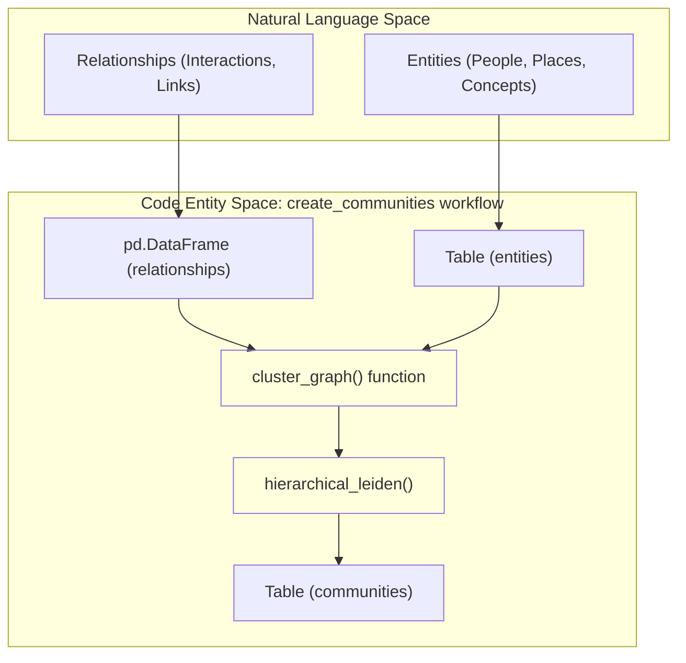
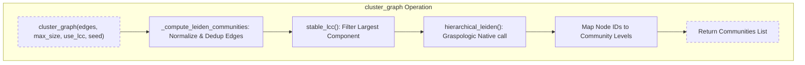

<!-- source: DeepWiki mcp.deepwiki.com · repo microsoft/graphrag · page 4.4 Community Detection and Clustering · fetched 2026-10-26 -->

# Community Detection and Clustering

Relevant source files

The following files were used as context for generating this wiki page:

- [cspell.config.yaml](cspell.config.yaml)
- [packages/graphrag/graphrag/graphs/__init__.py](packages/graphrag/graphrag/graphs/__init__.py)
- [packages/graphrag/graphrag/graphs/compute_degree.py](packages/graphrag/graphrag/graphs/compute_degree.py)
- [packages/graphrag/graphrag/graphs/connected_components.py](packages/graphrag/graphrag/graphs/connected_components.py)
- [packages/graphrag/graphrag/graphs/edge_weights.py](packages/graphrag/graphrag/graphs/edge_weights.py)
- [packages/graphrag/graphrag/graphs/hierarchical_leiden.py](packages/graphrag/graphrag/graphs/hierarchical_leiden.py)
- [packages/graphrag/graphrag/graphs/stable_lcc.py](packages/graphrag/graphrag/graphs/stable_lcc.py)
- [packages/graphrag/graphrag/index/operations/cluster_graph.py](packages/graphrag/graphrag/index/operations/cluster_graph.py)
- [packages/graphrag/graphrag/index/workflows/create_communities.py](packages/graphrag/graphrag/index/workflows/create_communities.py)
- [tests/unit/indexing/test_cluster_graph.py](tests/unit/indexing/test_cluster_graph.py)
- [tests/unit/indexing/test_create_communities.py](tests/unit/indexing/test_create_communities.py)

## Purpose and Scope

This page explains the graph clustering workflow in GraphRAG's indexing pipeline, specifically focusing on the hierarchical Leiden algorithm implementation. Community detection transforms the extracted entity-relationship graph into hierarchical clusters that enable efficient holistic reasoning over large datasets by creating summarizable units for the query system.

---

## Overview

Community detection is a critical workflow in the GraphRAG indexing pipeline that partitions the entity-relationship graph into hierarchical groups of closely related entities. These communities represent thematic clusters within the data—groups of entities that are densely interconnected and share semantic relationships.

**Why Communities Matter:**
- **Holistic Reasoning**: They enable summarization of large datasets into manageable units.
- **Map-Reduce Patterns**: They support global search by providing discrete contexts for parallel LLM processing. [packages/graphrag/graphrag/index/workflows/create_communities.py:113-116]()
- **Multi-level Abstraction**: The hierarchical nature allows querying at different levels of granularity. [packages/graphrag/graphrag/index/operations/cluster_graph.py:34-47]()

GraphRAG uses the **Leiden algorithm** via the `graspologic-native` library to produce high-quality, hierarchical partitions. [packages/graphrag/graphrag/graphs/hierarchical_leiden.py:11-26]()

Sources: [packages/graphrag/graphrag/index/workflows/create_communities.py:25-52](), [packages/graphrag/graphrag/graphs/hierarchical_leiden.py:11-26]()

---

## Workflow Position and Data Flow

Community detection occurs after entities and relationships have been extracted and finalized. It consumes the relationship data to identify clusters and outputs a hierarchy of communities.

### Natural Language to Code Entity Space: Clustering Flow

This diagram bridges the conceptual "Community" with the specific code entities and data structures used during the `create_communities` workflow.

Sources: [packages/graphrag/graphrag/index/workflows/create_communities.py:25-52](), [packages/graphrag/graphrag/index/operations/cluster_graph.py:20-47]()

---

## Leiden Algorithm Implementation

The core clustering logic resides in `cluster_graph.py`, which wraps the `hierarchical_leiden` implementation from the `graspologic-native` package. [packages/graphrag/graphrag/index/operations/cluster_graph.py:86-91]()

### Algorithm Characteristics

| Property | Description |
|----------|-------------|
| **Algorithm** | Hierarchical Leiden [packages/graphrag/graphrag/graphs/hierarchical_leiden.py:11-26]() |
| **Input** | Edge list (source, target, weight) [packages/graphrag/graphrag/index/operations/cluster_graph.py:77-84]() |
| **Output** | List of `(level, community_id, parent, nodes)` tuples [packages/graphrag/graphrag/index/operations/cluster_graph.py:14-14]() |
| **Determinism** | Seed-controlled via `random_seed` [packages/graphrag/graphrag/index/operations/cluster_graph.py:24-24]() |
| **LCC Filtering** | Optional restriction to the Largest Connected Component [packages/graphrag/graphrag/index/operations/cluster_graph.py:69-70]() |

### Implementation Flow

The clustering process follows a strict pipeline of normalization, filtering, and hierarchical partitioning:

Sources: [packages/graphrag/graphrag/index/operations/cluster_graph.py:20-47](), [packages/graphrag/graphrag/index/operations/cluster_graph.py:51-99]()

---

## Graph Utilities and Modularity

GraphRAG includes specialized utilities for graph analysis and modularity calculation to evaluate clustering quality.

### Connectivity Utilities
The system provides robust utilities for analyzing graph structure directly from DataFrames:
*   **Connected Components**: Identifies all isolated subgraphs using union-find. [packages/graphrag/graphrag/graphs/connected_components.py:9-32]()
*   **Largest Connected Component (LCC)**: Extracts the single largest subgraph to reduce noise. [packages/graphrag/graphrag/graphs/connected_components.py:65-93]()
*   **Degree Computation**: Calculates the degree of each node (number of connected edges) while treating the graph as undirected. [packages/graphrag/graphrag/graphs/compute_degree.py:9-43]()

### Edge Weight Strategies
The system supports advanced edge weighting beyond simple counts:
*   **Pointwise Mutual Information (PMI)**: Accounts for bias towards low-frequency events by calculating `p(x,y) * log2(p(x,y) / (p(x)*p(y)))`. [packages/graphrag/graphrag/graphs/edge_weights.py:10-25]()
*   **Reciprocal Rank Fusion (RRF)**: Combines PMI weights and raw frequencies to produce a fused edge weight. [packages/graphrag/graphrag/graphs/edge_weights.py:65-78]()

### Graph Stability
To ensure deterministic results, `stable_lcc` performs normalization:
1.  **Node Normalization**: HTML unescape, uppercase, and strip whitespace. [packages/graphrag/graphrag/graphs/stable_lcc.py:73-75]()
2.  **Edge Stabilization**: Sorts edges so the alphabetically lesser node is always the source. [packages/graphrag/graphrag/graphs/stable_lcc.py:60-64]()
3.  **Deterministic Sorting**: Final alphabetical sort of the edge list. [packages/graphrag/graphrag/graphs/stable_lcc.py:69-70]()

Sources: [packages/graphrag/graphrag/graphs/connected_components.py:9-93](), [packages/graphrag/graphrag/graphs/edge_weights.py:10-102](), [packages/graphrag/graphrag/graphs/stable_lcc.py:22-70](), [packages/graphrag/graphrag/graphs/compute_degree.py:9-43]()

---

## Configuration

Clustering behavior is tuned via the `cluster_graph` settings in `GraphRagConfig`. [packages/graphrag/graphrag/index/workflows/create_communities.py:34-36]()

| Field | Type | Default | Description |
|-------|------|---------|-------------|
| `max_cluster_size` | `int` | 10 | Maximum number of entities per community at each hierarchical level. [packages/graphrag/graphrag/index/workflows/create_communities.py:34-34]() |
| `use_lcc` | `bool` | `True` | If true, clusters only the largest connected component of the graph. [packages/graphrag/graphrag/index/workflows/create_communities.py:35-35]() |
| `seed` | `int` | `0xDEADBEEF` | Random seed for deterministic Leiden results. [packages/graphrag/graphrag/index/operations/cluster_graph.py:24-24]() |

Sources: [packages/graphrag/graphrag/index/workflows/create_communities.py:34-36](), [packages/graphrag/graphrag/index/operations/cluster_graph.py:20-25]()

---

## The `create_communities` Workflow

The workflow `run_workflow` in `create_communities.py` manages the data transformation from raw relationships to the final `communities` table. [packages/graphrag/graphrag/index/workflows/create_communities.py:25-52]()

### Execution Logic

1.  **Read Data**: Loads relationships and entities from the `PipelineRunContext`. [packages/graphrag/graphrag/index/workflows/create_communities.py:31-41]()
2.  **Cluster**: Invokes `cluster_graph` to generate the raw hierarchy. [packages/graphrag/graphrag/index/workflows/create_communities.py:86-91]()
3.  **Map Entities**: Iterates through the `entities` table to map entity titles to their internal IDs. [packages/graphrag/graphrag/index/workflows/create_communities.py:93-95]()
4.  **Aggregate Relationships**: For each community level, it identifies intra-community edges where both source and target belong to the same community. [packages/graphrag/graphrag/index/workflows/create_communities.py:117-140]()
5.  **Calculate Metadata**:
    *   **Size**: Calculated based on the number of `entity_ids` in the community. [packages/graphrag/graphrag/index/workflows/create_communities.py:182-182]()
    *   **Children**: Aggregates community IDs that list the current community as their `parent`. [packages/graphrag/graphrag/index/workflows/create_communities.py:166-175]()
6.  **Sanitize and Write**: Converts numpy types to native Python types via `_sanitize_row` and writes to the output table. [packages/graphrag/graphrag/index/workflows/create_communities.py:187-192](), [packages/graphrag/graphrag/index/workflows/create_communities.py:195-200]()

### Relationship Aggregation Detail

To keep memory usage low, the workflow processes relationship IDs and text unit IDs level-by-level:
1.  Filter communities for the current level. [packages/graphrag/graphrag/index/workflows/create_communities.py:119-119]()
2.  Merge relationships with community assignments for both source and target. [packages/graphrag/graphrag/index/workflows/create_communities.py:120-125]()
3.  Filter for `community_x == community_y` (intra-community). [packages/graphrag/graphrag/index/workflows/create_communities.py:126-126]()
4.  Group and aggregate `relationship_ids` and `text_unit_ids`. [packages/graphrag/graphrag/index/workflows/create_communities.py:129-138]()

Sources: [packages/graphrag/graphrag/index/workflows/create_communities.py:55-200]()

---

## Output Schema

The workflow produces a `communities` table with the following final columns defined in `COMMUNITIES_FINAL_COLUMNS`. [packages/graphrag/graphrag/index/workflows/create_communities.py:184-184]()

| Column | Description |
|--------|-------------|
| `id` | Unique UUID string for the community. [packages/graphrag/graphrag/index/workflows/create_communities.py:159-159]() |
| `human_readable_id` | Integer ID based on the community index. [packages/graphrag/graphrag/index/workflows/create_communities.py:160-160]() |
| `title` | Defaulted to "Community {id}". [packages/graphrag/graphrag/index/workflows/create_communities.py:161-163]() |
| `level` | Hierarchy level (0 is most granular). [packages/graphrag/graphrag/index/workflows/create_communities.py:139-139]() |
| `parent` | The community ID of the parent cluster. [packages/graphrag/graphrag/index/workflows/create_communities.py:164-164]() |
| `children` | List of child community IDs. [packages/graphrag/graphrag/index/workflows/create_communities.py:177-179]() |
| `entity_ids` | List of entity IDs belonging to this community. [packages/graphrag/graphrag/index/workflows/create_communities.py:109-109]() |
| `relationship_ids` | List of unique relationship IDs within the community. [packages/graphrag/graphrag/index/workflows/create_communities.py:150-152]() |
| `text_unit_ids` | List of unique text unit IDs associated with the community's edges. [packages/graphrag/graphrag/index/workflows/create_communities.py:153-155]() |
| `size` | Count of entities in the community. [packages/graphrag/graphrag/index/workflows/create_communities.py:182-182]() |
| `period` | ISO format date of community creation. [packages/graphrag/graphrag/index/workflows/create_communities.py:181-181]() |

Sources: [packages/graphrag/graphrag/index/workflows/create_communities.py:158-185]()

---

