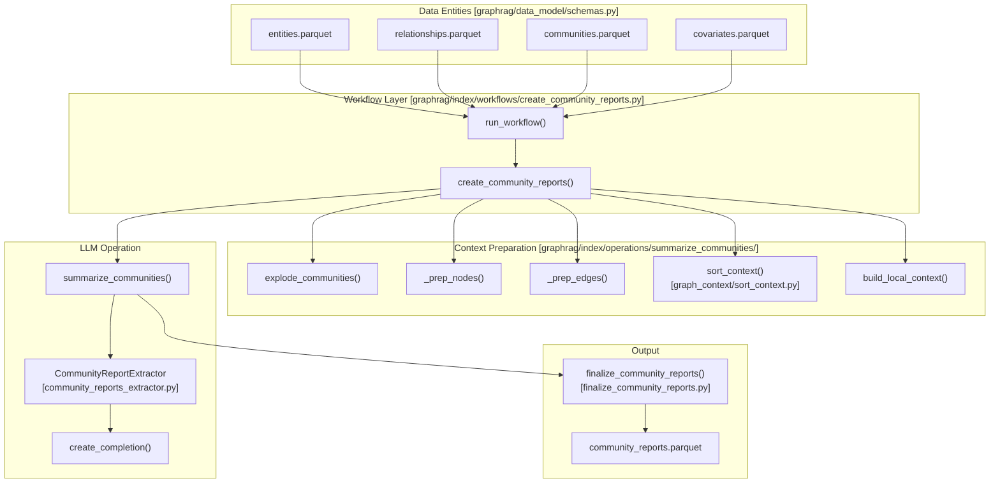
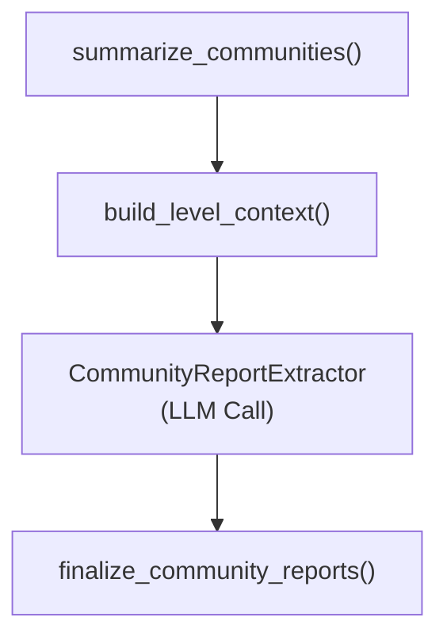

<!-- source: DeepWiki mcp.deepwiki.com · repo microsoft/graphrag · page 4.5 Community Reports Generation · fetched 2026-10-26 -->

# Community Reports Generation

<details>
<summary>Relevant source files</summary>

The following files were used as context for generating this wiki page:

- [docs/examples_notebooks/api_overview.ipynb](docs/examples_notebooks/api_overview.ipynb)
- [docs/examples_notebooks/input_documents.ipynb](docs/examples_notebooks/input_documents.ipynb)
- [packages/graphrag/graphrag/index/operations/finalize_community_reports.py](packages/graphrag/graphrag/index/operations/finalize_community_reports.py)
- [packages/graphrag/graphrag/index/workflows/create_final_documents.py](packages/graphrag/graphrag/index/workflows/create_final_documents.py)
- [tests/verbs/test_create_community_reports.py](tests/verbs/test_create_community_reports.py)
- [unified-search-app/app/app_logic.py](unified-search-app/app/app_logic.py)

</details>


Community Reports are LLM-generated hierarchical summaries of graph communities. The `create_community_reports` workflow invokes the `summarize_communities()` operation to produce natural language descriptions of each community by analyzing entities, relationships, and text units. These reports serve as the primary data source for Global Search and DRIFT Search.

## Overview

After Leiden clustering partitions the graph into hierarchical communities (page 4.4), this workflow generates structured summaries at each hierarchy level using an LLM-based strategy.

### Code Architecture



**Workflow Registration**: The `create_community_reports` workflow is a standard part of the indexing pipeline.

**Data Flow**: The workflow uses a `DataReader` to pull entities, relationships, and communities from the `output_table_provider`. If enabled, it also incorporates claims/covariates.

Sources: `[packages/graphrag/graphrag/index/workflows/create_community_reports.py:41-89]()`, `[packages/graphrag/graphrag/index/workflows/create_community_reports.py:92-140]()`

## Core Operation: `create_community_reports()`

The entry point for generating reports is the `create_community_reports` function. It orchestrates the preparation of graph data and the execution of the LLM summarization.

### Data Preparation
Before calling the LLM, the graph data is transformed into structured dictionaries for the prompt:
- **Nodes**: Prepared via `_prep_nodes` to include a `NODE_DETAILS` dictionary containing `short_id`, `title`, `description`, and `degree` `[packages/graphrag/graphrag/index/workflows/create_community_reports.py:143-161]()`.
- **Edges**: Prepared via `_prep_edges` to include `EDGE_DETAILS` with source, target, and description `[packages/graphrag/graphrag/index/workflows/create_community_reports.py:164-180]()`.
- **Claims**: Prepared via `_prep_claims` if covariates are enabled `[packages/graphrag/graphrag/index/workflows/create_community_reports.py:183-199]()`.

### Context Building and Sorting
The system uses `build_local_context` to group these prepared details by community and ensure they fit within the `max_input_length`. A critical component is `sort_context`, which prioritizes graph elements based on node degree and edge combined degree to ensure the most relevant information is included in the LLM prompt when context windows are limited `[tests/unit/indexing/graph/extractors/community_reports/test_sort_context.py:6-8]()`.

Sources: `[packages/graphrag/graphrag/index/workflows/create_community_reports.py:107-123]()`, `[packages/graphrag/graphrag/index/workflows/create_community_reports.py:143-199]()`, `[tests/unit/indexing/graph/extractors/community_reports/test_sort_context.py:13-34]()`

## LLM Summarization: `summarize_communities()`

The LLM interaction is managed by `summarize_communities`. It processes communities level-by-level, allowing higher-level communities to potentially leverage context from lower levels via `build_level_context` `[packages/graphrag/graphrag/index/workflows/create_community_reports.py:125-138]()`.

### LLM Completion Setup
The workflow initializes an `LLMCompletion` instance using the configured `completion_model_id`. This instance handles:
- **Caching**: Results are stored in a child cache named after the model instance `[packages/graphrag/graphrag/index/workflows/create_community_reports.py:65]()`.
- **Tokenization**: Uses the model's native tokenizer (e.g., via `get_tokenizer`) to respect context limits `[tests/unit/indexing/graph/extractors/community_reports/test_sort_context.py:9]()`.

### Execution Flow



Sources: `[packages/graphrag/graphrag/index/workflows/create_community_reports.py:58-84]()`, `[packages/graphrag/graphrag/index/workflows/create_community_reports.py:125-140]()`

## Report Structure

Community reports follow a strict schema defined by `COMMUNITY_REPORTS_FINAL_COLUMNS` `[packages/graphrag/graphrag/data_model/schemas.py:8]()`.

### Data Model

| Column | Type | Description |
|--------|------|-------------|
| `community` | int | Community ID from Leiden algorithm |
| `level` | int | Hierarchical level (0 = leaf) |
| `title` | string | LLM-generated descriptive title |
| `summary` | string | Executive summary of the community |
| `rank` | float | Importance rating (typically 1-10) |
| `rating_explanation`| string | Justification for the importance rating |
| `findings` | list | Structured list of key insights (summary + explanation) |
| `id` | string | Unique SHA-512 hash generated from content |

### Mock Implementation for Testing
Tests utilize a `CommunityReportResponse` and `FindingModel` to validate the schema and data flow `[tests/verbs/test_create_community_reports.py:6-9]()`.

```python
# Example Mock Response Structure from tests/verbs/test_create_community_reports.py:23-36
CommunityReportResponse(
    title="<report_title>",
    summary="<executive_summary>",
    rating=2,
    rating_explanation="<rating_explanation>",
    findings=[
        FindingModel(
            summary="<insight_1_summary>", 
            explanation="<insight_1_explanation"
        )
    ],
)
```

Sources: `[tests/verbs/test_create_community_reports.py:5-37]()`, `[tests/verbs/test_create_community_reports.py:66-70]()`

## Finalization and Output

After the LLM generates the raw reports, the `finalize_community_reports` operation is called to clean and format the data into the final output table `[packages/graphrag/graphrag/index/workflows/create_community_reports.py:140]()`.

This function performs a merge with the `communities` table to add metadata like `parent`, `children`, `size`, and `period` `[packages/graphrag/graphrag/index/operations/finalize_community_reports.py:18-22]()`. It also generates a unique `id` using a SHA-512 hash of the `full_content` `[packages/graphrag/graphrag/index/operations/finalize_community_reports.py:26-28]()`.

The resulting DataFrame is written to storage using the `write_dataframe` method of the `output_table_provider` `[packages/graphrag/graphrag/index/workflows/create_community_reports.py:86]()`.

### Downstream Usage
These reports are critical for:
1. **Global Search**: Loaded into memory to answer high-level thematic queries `[docs/examples_notebooks/api_overview.ipynb:123-125]()`, `[unified-search-app/app/app_logic.py:132]()`.
2. **Local Search**: Used to provide context for specific entities `[unified-search-app/app/app_logic.py:167]()`.

Sources: `[packages/graphrag/graphrag/index/operations/finalize_community_reports.py:12-33]()`, `[packages/graphrag/graphrag/index/workflows/create_community_reports.py:86-140]()`, `[unified-search-app/app/app_logic.py:121-137]()`, `[docs/examples_notebooks/api_overview.ipynb:120-136]()`

---

