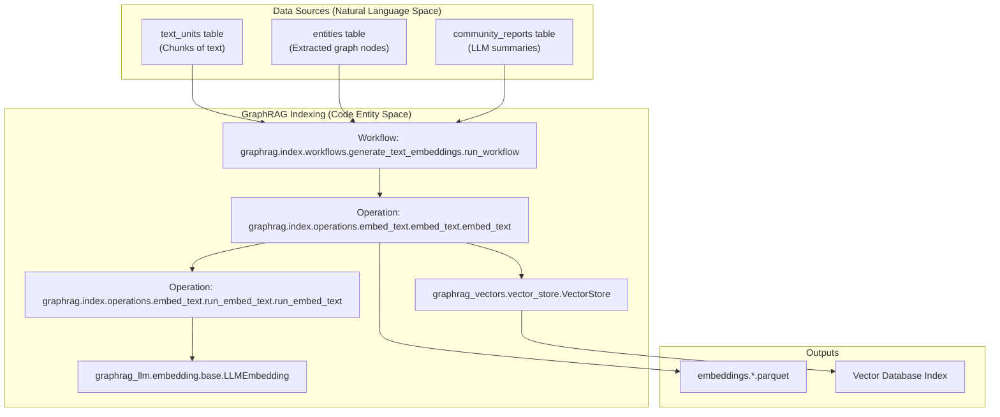
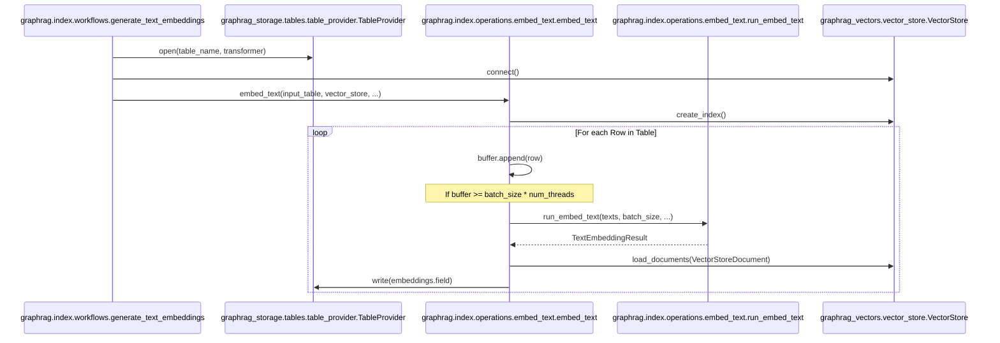

<!-- source: DeepWiki mcp.deepwiki.com · repo microsoft/graphrag · page 4.6 Text Embeddings Generation · fetched 2026-10-26 -->

# Text Embeddings Generation

<details>
<summary>Relevant source files</summary>

The following files were used as context for generating this wiki page:

- [packages/graphrag-storage/graphrag_storage/tables/__init__.py](packages/graphrag-storage/graphrag_storage/tables/__init__.py)
- [packages/graphrag/graphrag/index/operations/embed_text/embed_text.py](packages/graphrag/graphrag/index/operations/embed_text/embed_text.py)
- [packages/graphrag/graphrag/index/operations/extract_graph/extract_graph.py](packages/graphrag/graphrag/index/operations/extract_graph/extract_graph.py)
- [packages/graphrag/graphrag/index/operations/extract_graph/utils.py](packages/graphrag/graphrag/index/operations/extract_graph/utils.py)
- [packages/graphrag/graphrag/index/workflows/create_base_text_units.py](packages/graphrag/graphrag/index/workflows/create_base_text_units.py)
- [packages/graphrag/graphrag/index/workflows/generate_text_embeddings.py](packages/graphrag/graphrag/index/workflows/generate_text_embeddings.py)
- [packages/graphrag/graphrag/index/workflows/update_entities_relationships.py](packages/graphrag/graphrag/index/workflows/update_entities_relationships.py)
- [tests/unit/indexing/operations/embed_text/test_embed_text.py](tests/unit/indexing/operations/embed_text/test_embed_text.py)
- [tests/unit/indexing/operations/test_extract_graph.py](tests/unit/indexing/operations/test_extract_graph.py)
- [tests/unit/indexing/update/__init__.py](tests/unit/indexing/update/__init__.py)
- [tests/unit/indexing/update/test_update_relationships.py](tests/unit/indexing/update/test_update_relationships.py)

</details>


This document describes the text embeddings generation workflow in the GraphRAG indexing pipeline. This workflow creates vector embeddings for various text artifacts produced by earlier pipeline stages, enabling semantic search during query execution.

For configuration of embedding models, see **9.4 Embedding Models**. For configuration of vector stores, see **3.5 Vector Store Configuration**.

## Purpose and Scope

The text embeddings generation workflow (`generate_text_embeddings`) converts textual content from multiple artifact types into dense vector representations. This workflow:

- Generates embeddings for core text fields across 3 primary artifact types (Text Units, Entities, Community Reports).
- Supports both in-memory embedding storage and vector store persistence.
- Processes embeddings in configurable batches for efficiency.
- Produces parquet files containing ID-to-embedding mappings.
- Optionally uploads embeddings to vector stores for semantic search.

Sources: [packages/graphrag/graphrag/index/workflows/generate_text_embeddings.py:72-163](), [packages/graphrag/graphrag/index/operations/embed_text/embed_text.py:23-90]()

## Workflow Architecture

The embedding generation is orchestrated as a pipeline workflow that interacts with the `TableProvider` for source data and the `VectorStore` for persistence.

### System Flow: Natural Language to Code Entity Space



Sources: [packages/graphrag/graphrag/index/workflows/generate_text_embeddings.py:72-108](), [packages/graphrag/graphrag/index/operations/embed_text/embed_text.py:23-43]()

## Embedding Types

The workflow supports 3 core embedding types defined in the `EMBEDDING_FIELDS` dictionary. Each configuration specifies the source table and the column to be embedded.

| Embedding Name | Source Table | Embed Column | Row Transform | Use Case |
|----------------|--------------|--------------|---------------|----------|
| `text_unit_text` | `text_units` | `text` | None | Text chunk semantic search (Basic Search) |
| `entity_description` | `entities` | `title_description` | `transform_entity_row_for_embedding` | Entity search using title and description |
| `community_full_content` | `community_reports` | `full_content` | None | Community report search (Local/DRIFT Search) |

Sources: [packages/graphrag/graphrag/index/workflows/generate_text_embeddings.py:52-69]()

### Row Transformers
For entities, a specific transformer `transform_entity_row_for_embedding` is used to prepare the source data. This transformer is applied via the `TableProvider.open` method to ensure the data is correctly formatted before the embedding operation begins.

Sources: [packages/graphrag/graphrag/index/workflows/generate_text_embeddings.py:58-63](), [packages/graphrag/graphrag/index/workflows/generate_text_embeddings.py:131-137]()

## Embedding Generation Process

### Batching Strategy
The embedding workflow uses a two-level batching approach to saturate the concurrency limit of the LLM provider:

1.  **Flush Buffer Size**: Calculated as `batch_size * num_threads`. Rows are accumulated in a `buffer` list until this size is reached.
2.  **API Batch Size**: Controlled by `batch_size` and `batch_max_tokens`. The `run_embed_text` function dispatches these batches concurrently up to `num_threads`.

Sources: [packages/graphrag/graphrag/index/operations/embed_text/embed_text.py:45-47](), [packages/graphrag/graphrag/index/operations/embed_text/embed_text.py:110-118](), [tests/unit/indexing/operations/embed_text/test_embed_text.py:152-160]()

### Execution Logic



Sources: [packages/graphrag/graphrag/index/operations/embed_text/embed_text.py:43-90](), [packages/graphrag/graphrag/index/workflows/generate_text_embeddings.py:124-156]()

## Vector Store Integration

The `embed_text` operation converts results into `VectorStoreDocument` objects before loading them into the configured `VectorStore`.

### Data Normalization
The system ensures that embedding vectors are compatible with various backends by converting `numpy.ndarray` types to standard Python lists before storage.

```python
if type(doc_vector) is np.ndarray:
    doc_vector = doc_vector.tolist()
documents.append(
    VectorStoreDocument(
        id=doc_id,
        vector=doc_vector,
    )
)
```

Sources: [packages/graphrag/graphrag/index/operations/embed_text/embed_text.py:127-134]()

## Incremental Updates and Graph Integrity

During an incremental index run, the `update_entities_relationships` workflow handles merging new extractions with previous data. 

### Relationship Filtering
A critical step in maintaining graph integrity during updates is `filter_orphan_relationships`. This function ensures that any relationships (including those newly extracted) that reference non-existent entities are removed. This prevents the embedding workflow or search systems from attempting to process broken graph edges.

```python
def filter_orphan_relationships(
    relationships: pd.DataFrame,
    entities: pd.DataFrame,
) -> pd.DataFrame:
    # ... logic to drop relationships where source or target is missing from entities
```

Sources: [packages/graphrag/graphrag/index/operations/extract_graph/utils.py:13-53](), [packages/graphrag/graphrag/index/workflows/update_entities_relationships.py:85-87]()

### Entity Resolution
The `_update_entities_and_relationships` function merges `old_entities` and `delta_entities` using `_group_and_resolve_entities`, then summarizes descriptions using an LLM via `get_summarized_entities_relationships` before the final tables are saved and subsequently embedded.

Sources: [packages/graphrag/graphrag/index/workflows/update_entities_relationships.py:61-119](), [packages/graphrag/graphrag/index/update/entities.py:23-23]()

## Output Artifacts

If `config.snapshots.embeddings` is enabled, the pipeline writes Parquet files for each embedding field using the `TableProvider`.

**Parquet Schema:**
- `id`: The unique identifier of the source record (e.g., `text_unit_id` or `entity_id`).
- `embedding`: The generated vector as a list of floats.

Sources: [packages/graphrag/graphrag/index/workflows/generate_text_embeddings.py:140-143](), [packages/graphrag/graphrag/index/operations/embed_text/embed_text.py:145-151]()

---

