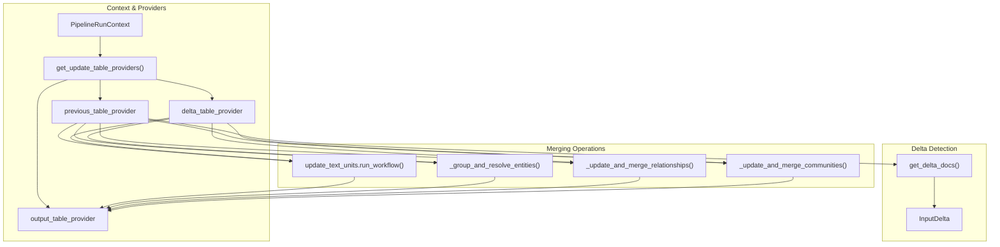
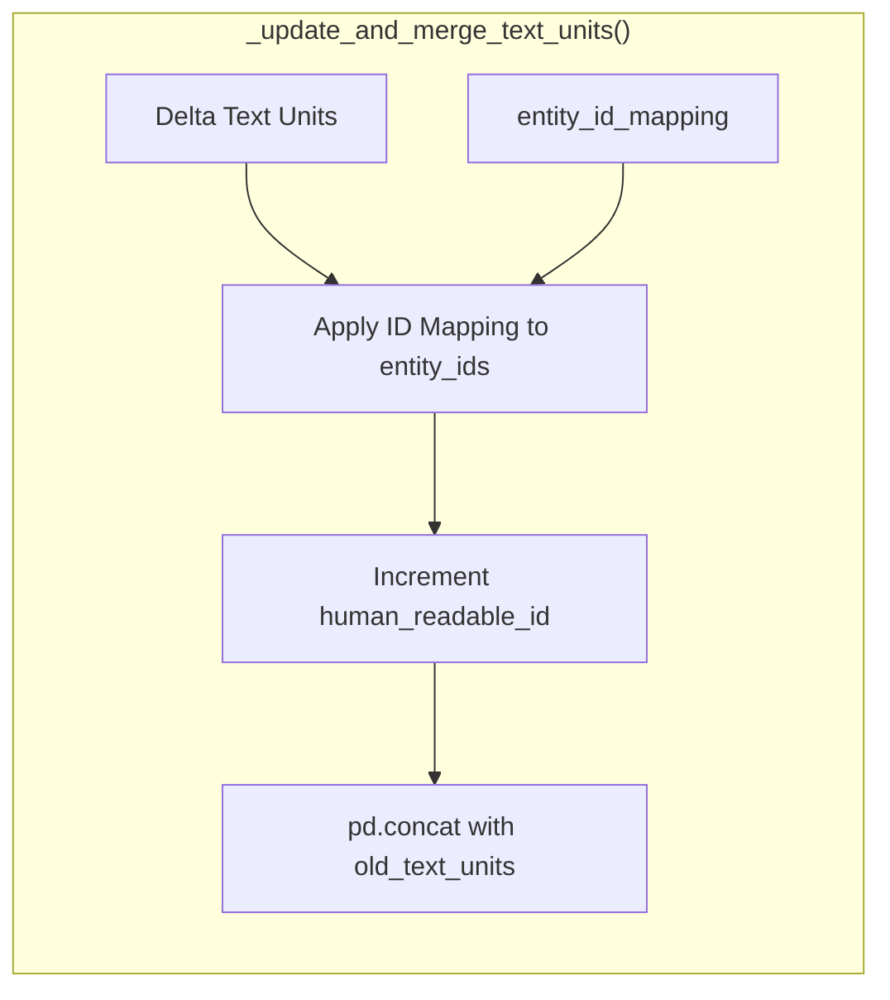

<!-- source: DeepWiki mcp.deepwiki.com · repo microsoft/graphrag · page 4.7 Incremental Indexing and Updates · fetched 2026-10-26 -->

# Incremental Indexing and Updates

Relevant source files

The following files were used as context for generating this wiki page:

- [packages/graphrag/graphrag/index/update/communities.py](packages/graphrag/graphrag/index/update/communities.py)
- [packages/graphrag/graphrag/index/update/entities.py](packages/graphrag/graphrag/index/update/entities.py)
- [packages/graphrag/graphrag/index/update/incremental_index.py](packages/graphrag/graphrag/index/update/incremental_index.py)
- [packages/graphrag/graphrag/index/update/relationships.py](packages/graphrag/graphrag/index/update/relationships.py)
- [packages/graphrag/graphrag/index/workflows/update_text_units.py](packages/graphrag/graphrag/index/workflows/update_text_units.py)

## Purpose and Scope

This page documents GraphRAG's incremental indexing system, which enables updating an existing knowledge graph index with new or modified documents without reprocessing the entire corpus. Incremental updates detect changes in the input data, merge new entities and relationships with existing ones, and update community structures while preserving existing work.

The system uses a delta-based approach, comparing current input states against previously indexed artifacts to minimize LLM calls and computation.

Sources: [packages/graphrag/graphrag/index/workflows/update_text_units.py:21-42](), [packages/graphrag/graphrag/index/update/incremental_index.py:29-58]()

## Overview

Incremental indexing addresses the need to maintain up-to-date knowledge graphs as source documents evolve. Instead of rebuilding the entire index, the update workflow:

- **Delta Detection**: Identifies new or modified documents by comparing titles between the current input dataset and the previously indexed "documents" table.
- **Entity Resolution**: Groups and resolves entities by comparing existing finalized data with new extractions, merging descriptions and text unit references.
- **Relationship Merging**: Combines existing edges with new ones, aggregating weights and recalculating node degrees.
- **Community Mapping**: Increments community IDs and maps parents to maintain hierarchical consistency between old and new clusters.
- **Text Unit Updates**: Merges text units while updating entity ID references to point to the resolved global entities.

The process utilizes `TableProvider` abstractions to read from previous index states and write to new output locations.

Sources: [packages/graphrag/graphrag/index/update/incremental_index.py:29-58](), [packages/graphrag/graphrag/index/update/entities.py:14-32](), [packages/graphrag/graphrag/index/update/communities.py:14-17](), [packages/graphrag/graphrag/index/workflows/update_text_units.py:27-30]()

## Update Workflow Architecture

The following diagram bridges the logical update process with the specific code entities responsible for execution.

### Code Entity Space: Update Workflow Data Flow

Sources: [packages/graphrag/graphrag/index/workflows/update_text_units.py:21-42](), [packages/graphrag/graphrag/index/update/incremental_index.py:29-58](), [packages/graphrag/graphrag/index/update/entities.py:14-74](), [packages/graphrag/graphrag/index/update/communities.py:14-86]()

## Delta Detection

The `get_delta_docs` function identifies changes in the document set. It uses the `title` column as the primary key for comparison.

- **New Documents**: Documents present in the current input but missing from the `previous_table_provider`'s "documents" table.
- **Deleted Documents**: Documents present in the previous index but missing from the current input dataset.

Sources: [packages/graphrag/graphrag/index/update/incremental_index.py:29-58]()

## Entity and Relationship Merging

### Entity Merging Strategy

The function `_group_and_resolve_entities` reconciles entities across indexing runs. It compares entities from the `old_entities_df` with those in the `delta_entities_df`.

**Merge Behavior:**
- **Matching**: Entities are matched based on `title`. If a title exists in both dataframes, an ID mapping `{delta_id: old_id}` is created.
- **Resolution**: Attributes like `description` are converted to lists of strings. `text_unit_ids` are concatenated using `itertools.chain`.
- **Frequency**: The `frequency` attribute is recomputed based on the length of the merged `text_unit_ids` list.
- **ID Consistency**: `human_readable_id` for new entities is incremented starting from the previous maximum.

Sources: [packages/graphrag/graphrag/index/update/entities.py:33-45](), [packages/graphrag/graphrag/index/update/entities.py:50-66]()

### Relationship Merging

Relationships are merged via `_update_and_merge_relationships`, combining existing edges with new extractions.

| Operation | Logic |
|-----------|-------|
| **Weight Aggregation** | Overlapping pairs (same source/target) have their `weight` averaged (`mean`). |
| **ID Incrementing** | `human_readable_id` values for delta relationships are offset by the previous maximum. |
| **Degree Recalculation** | `source_degree` and `target_degree` are recalculated for the entire merged set. `combined_degree` is recomputed as the sum of source and target degrees. |
| **Conflict Resolution** | Descriptions are aggregated into lists of strings. |

Sources: [packages/graphrag/graphrag/index/update/relationships.py:14-65](), [packages/graphrag/graphrag/index/update/relationships.py:70-82]()

## Community and Text Unit Updates

### Community Merging

The `_update_and_merge_communities` and `_update_and_merge_community_reports` functions ensure community hierarchies remain valid.

1. **ID Shifting**: All non-NaN community IDs in the delta set are incremented by the maximum ID of the old set plus one.
2. **Mapping**: A `community_id_mapping` is created to update both `community` and `parent` columns.
3. **Naming**: Community titles are regenerated as "Community " + ID.
4. **Consistency**: The `human_readable_id` is re-assigned to match the new `community` ID.

Sources: [packages/graphrag/graphrag/index/update/communities.py:46-66](), [packages/graphrag/graphrag/index/update/communities.py:75-81](), [packages/graphrag/graphrag/index/update/communities.py:123-149]()

### Text Unit Updates

The `update_text_units` workflow merges text units while ensuring they point to the correct resolved entities.

Sources: [packages/graphrag/graphrag/index/workflows/update_text_units.py:63-95]()

## Implementation Summary

### Key Classes and Functions

| Component | File Path | Role |
|-----------|-----------|------|
| `get_delta_docs` | [packages/graphrag/graphrag/index/update/incremental_index.py:29-58]() | Detects new and deleted documents based on title comparison. |
| `_group_and_resolve_entities` | [packages/graphrag/graphrag/index/update/entities.py:14-74]() | Merges entity attributes and creates ID mappings for deduplication. |
| `_update_and_merge_relationships` | [packages/graphrag/graphrag/index/update/relationships.py:14-86]() | Merges relationships, averages weights, and recalculates graph degrees. |
| `_update_and_merge_communities` | [packages/graphrag/graphrag/index/update/communities.py:14-86]() | Shifts community IDs and updates parent references to avoid collisions. |
| `run_workflow` (Text Units) | [packages/graphrag/graphrag/index/workflows/update_text_units.py:21-42]() | Orchestrates the merging of text units and updates their entity references. |

Sources: [packages/graphrag/graphrag/index/update/incremental_index.py:29-58](), [packages/graphrag/graphrag/index/update/entities.py:14-74](), [packages/graphrag/graphrag/index/update/relationships.py:14-86](), [packages/graphrag/graphrag/index/update/communities.py:14-86](), [packages/graphrag/graphrag/index/workflows/update_text_units.py:21-42]()

---

