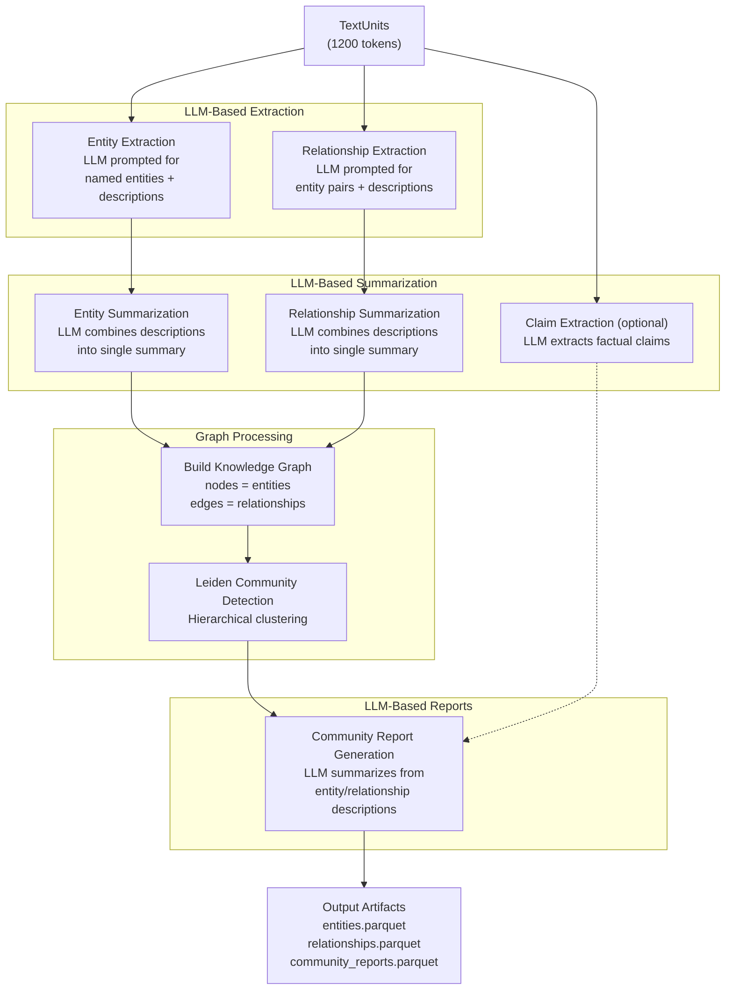
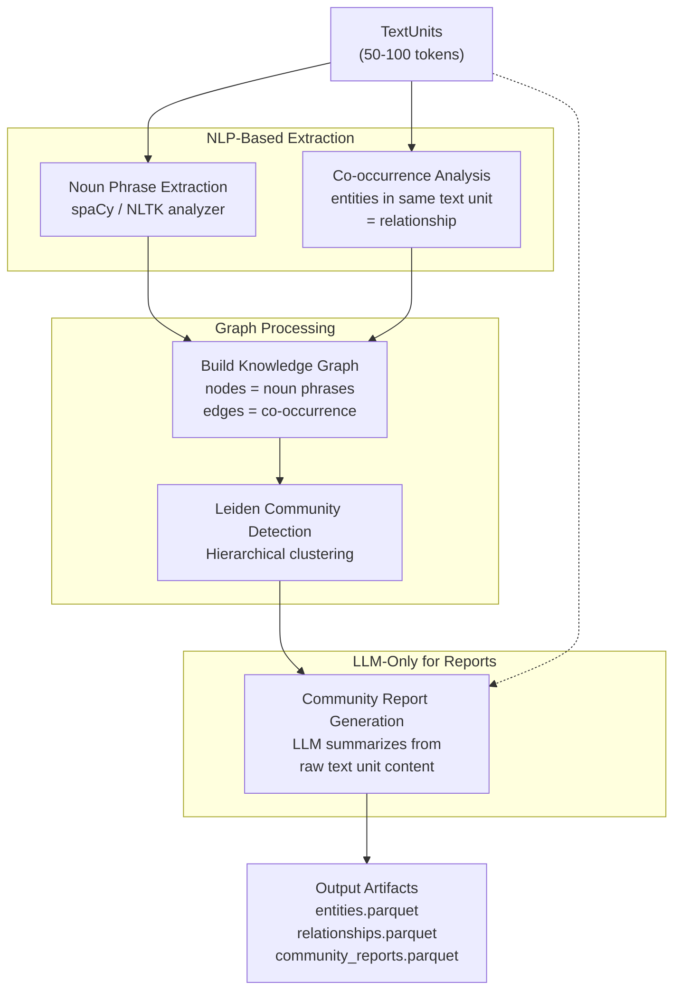
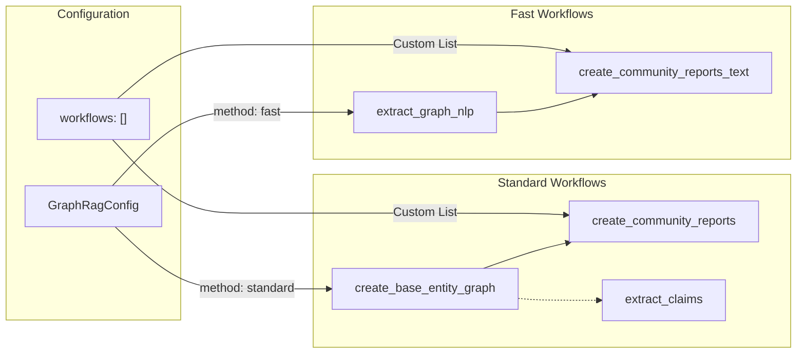

<!-- source: DeepWiki mcp.deepwiki.com · repo microsoft/graphrag · page 4.8 Indexing Methods Comparison · fetched 2026-10-26 -->

# Indexing Methods Comparison

Relevant source files

The following files were used as context for generating this wiki page:

- [README.md](README.md)
- [breaking-changes.md](breaking-changes.md)
- [docs/examples_notebooks/drift_search.ipynb](docs/examples_notebooks/drift_search.ipynb)
- [docs/examples_notebooks/global_search.ipynb](docs/examples_notebooks/global_search.ipynb)
- [docs/examples_notebooks/global_search_with_dynamic_community_selection.ipynb](docs/examples_notebooks/global_search_with_dynamic_community_selection.ipynb)
- [docs/examples_notebooks/local_search.ipynb](docs/examples_notebooks/local_search.ipynb)
- [docs/index.md](docs/index.md)
- [docs/index/byog.md](docs/index/byog.md)
- [docs/index/default_dataflow.md](docs/index/default_dataflow.md)
- [docs/index/methods.md](docs/index/methods.md)
- [docs/index/outputs.md](docs/index/outputs.md)

This document provides a comprehensive comparison between the two primary indexing methods available in GraphRAG: **Standard GraphRAG** and **FastGraphRAG**. It analyzes their architectural differences, workflow sequences, and technical trade-offs to help users select the optimal method for their knowledge graph construction.

For information about the overall indexing pipeline architecture, see [4.1](). For specific output table schemas, see [4.10]().

## Overview of Indexing Methods

GraphRAG supports two distinct approaches to knowledge graph construction. Both methods produce the same core artifacts (entities, relationships, communities, and community reports) but differ in their extraction mechanisms and computational requirements.

**Standard GraphRAG** uses large language models (LLMs) for all reasoning and extraction tasks, providing high-fidelity graph structures with rich semantic descriptions. This is the default method described in the original research.

**FastGraphRAG** substitutes traditional natural language processing (NLP) techniques for LLM-based graph extraction, dramatically reducing cost and indexing time while maintaining high quality for holistic summarization tasks.

Sources: [docs/index/methods.md:5-30](), [docs/index.md:36-42]()

## Method Workflow Comparison

### Standard GraphRAG Workflow

Standard GraphRAG relies on LLM-based extraction logic. It typically uses larger chunk sizes (default 1200 tokens) and generates detailed semantic descriptions for every node and edge.

Title: Standard GraphRAG Dataflow

**Execution Path:**
- Command: `graphrag index --method standard` (or omit as it is the default) [docs/index/methods.md:16-16]().
- Extraction: Performed by `extract_graph` workflow using LLM prompts [docs/index/methods.md:9-12]().
- Reporting: Uses `create_community_reports` which leverages LLM-summarized entity/relationship descriptions [docs/index/methods.md:14-14]().

Sources: [docs/index/methods.md:5-17](), [docs/index/default_dataflow.md:54-123]()

---

### FastGraphRAG Workflow

FastGraphRAG replaces LLM extraction with NLP-based noun phrase extraction and co-occurrence analysis. This method is significantly faster and cheaper but produces a noisier graph structure.

Title: FastGraphRAG Dataflow

**Execution Path:**
- Command: `graphrag index --method fast` [docs/index/methods.md:29-29]().
- Extraction: Entity extraction uses NLP libraries like NLTK or spaCy to identify noun phrases [docs/index/methods.md:22-22]().
- Reporting: Uses `create_community_reports_text` which generates reports directly from the text unit content containing the entities, bypassing the need for entity/relationship descriptions [docs/index/methods.md:27-27](), [docs/index/byog.md:53-57]().

Sources: [docs/index/methods.md:18-34](), [docs/index/byog.md:51-59]()

## Detailed Feature Comparison

| Feature | Standard GraphRAG | FastGraphRAG |
|---------|------------------|--------------|
| **Entity Extraction** | LLM extracts named entities + descriptions [docs/index/methods.md:9-9]() | NLP extracts noun phrases (no description) [docs/index/methods.md:22-22]() |
| **Relationship Extraction** | LLM describes pairs in each text unit [docs/index/methods.md:10-10]() | Defined by text unit co-occurrence [docs/index/methods.md:23-23]() |
| **Summarization Phase** | LLM combines descriptions per entity/relationship [docs/index/methods.md:11-12]() | Not necessary [docs/index/methods.md:24-25]() |
| **Community Reports** | Summarized from entity/relationship descriptions [docs/index/methods.md:14-14]() | Summarized from direct text unit content [docs/index/methods.md:27-27]() |
| **Claim Extraction** | Optional [docs/index/methods.md:13-13]() | Unused [docs/index/methods.md:26-26]() |
| **Typical Chunk Size** | ~1200 tokens [docs/index/default_dataflow.md:58-58]() | 50-100 tokens [docs/index/methods.md:33-33]() |
| **Workflow Entrypoint** | `extract_graph` | `extract_graph_nlp` |

Sources: [docs/index/methods.md:5-44](), [docs/index/default_dataflow.md:105-107]()

## Code Entity Association

The following diagram bridges high-level indexing methods to the specific system concepts and configuration points used within the pipeline.

Title: Indexing Method Code Associations

Sources: [docs/index/methods.md:16-29](), [docs/index/byog.md:25-57](), [docs/index/default_dataflow.md:92-95]()

## Trade-offs and Recommendations

### Cost and Performance
- **Standard**: Extraction constitutes roughly 75% of indexing cost due to heavy LLM usage for entity/relationship descriptions [docs/index/methods.md:44-44]().
- **Fast**: Significantly cheaper and faster as it substitutes LLM reasoning for NLP methods in the extraction phase [docs/index/methods.md:20-20]().

### Quality and Use Cases
- **High Fidelity**: Standard GraphRAG is recommended if high-fidelity entities and direct graph exploration (e.g., Local Search) are important to your use case [docs/index/methods.md:44-44]().
- **Holistic Summarization**: FastGraphRAG is ideal for summary questions using Global Search, as it provides high-quality summarization with much lower LLM costs [docs/index/methods.md:44-44]().
- **Noisy Graphs**: FastGraphRAG produces a noisier graph that is less directly relevant for use outside of the RAG context [docs/index/methods.md:44-44]().

### NLP Options for FastGraphRAG
FastGraphRAG supports multiple noun phrase extraction strategies:
- **NLTK + Regex**: Default, very fast, optimized for English [docs/index/methods.md:31-31]().
- **spaCy Semantic Parsing**: Uses models like `en_core_web_md` [docs/index/methods.md:31-31]().
- **spaCy CFG**: Context-Free Grammar based extraction [docs/index/methods.md:31-31]().

Sources: [docs/index/methods.md:31-45]()

---

