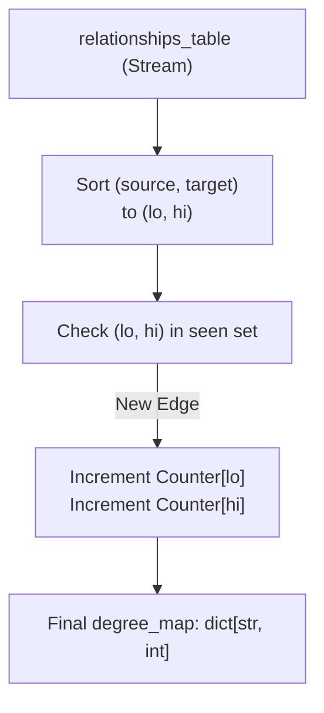
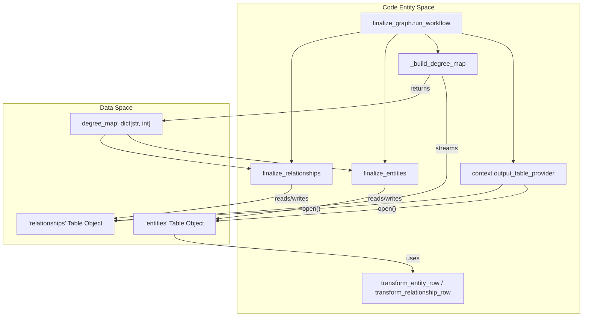

<!-- source: DeepWiki mcp.deepwiki.com · repo microsoft/graphrag · page 4.9 Graph Pruning and Finalization · fetched 2026-10-26 -->

# Graph Pruning and Finalization

Relevant source files

The following files were used as context for generating this wiki page:

- [packages/graphrag/graphrag/index/operations/finalize_entities.py](packages/graphrag/graphrag/index/operations/finalize_entities.py)
- [packages/graphrag/graphrag/index/operations/finalize_relationships.py](packages/graphrag/graphrag/index/operations/finalize_relationships.py)
- [packages/graphrag/graphrag/index/workflows/finalize_graph.py](packages/graphrag/graphrag/index/workflows/finalize_graph.py)
- [packages/graphrag/graphrag/index/workflows/prune_graph.py](packages/graphrag/graphrag/index/workflows/prune_graph.py)
- [tests/unit/indexing/test_finalize_graph.py](tests/unit/indexing/test_finalize_graph.py)
- [tests/verbs/test_finalize_graph.py](tests/verbs/test_finalize_graph.py)
- [tests/verbs/test_prune_graph.py](tests/verbs/test_prune_graph.py)

## Purpose and Scope

This document describes the graph pruning and finalization workflows that occur near the end of the indexing pipeline. These workflows filter low-quality graph elements and compute final graph statistics, ensuring the knowledge graph is clean and properly structured for downstream querying and community detection.

**Graph Pruning** removes entities and relationships that do not meet quality thresholds based on frequency and connectivity metrics [packages/graphrag/graphrag/index/workflows/prune_graph.py:50-54]().

**Graph Finalization** computes final graph-theoretic properties such as node degrees and combined degrees, enforces the final schema for output artifacts, and optionally exports the graph to GraphML format [packages/graphrag/graphrag/index/workflows/finalize_graph.py:62-95]().

---

## Pipeline Position

The pruning and finalization workflows are executed sequentially in the indexing pipeline:

```mermaid
graph LR
    ExtractGraph["extract_graph or<br/>extract_graph_nlp"]
    PruneGraph["graphrag.index.workflows.prune_graph.run_workflow"]
    FinalizeGraph["graphrag.index.workflows.finalize_graph.run_workflow"]
    CreateCommunities["create_communities"]
    
    ExtractGraph -->|"entities table<br/>relationships table"| PruneGraph
    PruneGraph -->|"filtered entities<br/>filtered relationships"| FinalizeGraph
    FinalizeGraph -->|"entities (final schema)<br/>relationships (final schema)"| CreateCommunities
```

**Diagram: Graph Pruning and Finalization in the Indexing Pipeline**

**Sources:** [packages/graphrag/graphrag/index/workflows/prune_graph.py:20-47](), [packages/graphrag/graphrag/index/workflows/finalize_graph.py:28-59]()

---

## Graph Pruning Workflow

The `prune_graph` workflow filters entities and relationships based on configurable quality thresholds. This step removes noise from the extracted graph by eliminating low-frequency entities and weakly connected edges.

### Configuration

Pruning behavior is controlled by the `PruneGraphConfig` class [packages/graphrag/graphrag/index/workflows/prune_graph.py:11-11]().

| Parameter | Type | Purpose |
|-----------|------|---------|
| `min_node_freq` | `int` | Minimum entity frequency threshold |
| `min_node_degree` | `int` | Minimum node degree (number of edges) |
| `min_edge_weight_pct` | `float` | Minimum edge weight percentile (0-100) |
| `lcc_only` | `bool` | If true, keep only the Largest Connected Component |
| `remove_ego_nodes` | `bool` | If true, remove high-degree "ego" nodes |

**Sources:** [packages/graphrag/graphrag/index/workflows/prune_graph.py:50-66](), [tests/verbs/test_prune_graph.py:20-22]()

### Pruning Logic

The workflow uses `prune_graph_operation` to perform the actual filtering [packages/graphrag/graphrag/index/workflows/prune_graph.py:56-66](). If the pruning process results in zero entities or relationships, a `ValueError` is raised to prevent downstream failures [packages/graphrag/graphrag/index/workflows/prune_graph.py:68-76]().

---

## Graph Finalization Workflow

The `finalize_graph` workflow computes final graph-theoretic properties and enforces the complete schema for entities and relationships.

### Implementation Detail: Streaming vs. DataFrames

Unlike pruning, which operates on DataFrames [packages/graphrag/graphrag/index/workflows/prune_graph.py:26-39](), the finalization workflow is designed to be memory-efficient by using streaming operations [packages/graphrag/graphrag/index/workflows/finalize_graph.py:66-71](). It processes rows one by one to avoid materializing large tables in memory.

### Workflow Steps

1.  **Build Degree Map**: Streams through the `relationships` table to count the number of unique undirected edges for each entity [packages/graphrag/graphrag/index/workflows/finalize_graph.py:98-125]().
2.  **Finalize Entities**: Streams the `entities` table, deduplicates by title, assigns the computed `degree`, and generates a `human_readable_id` and a unique `id` (UUID) [packages/graphrag/graphrag/index/operations/finalize_entities.py:14-56]().
3.  **Finalize Relationships**: Streams the `relationships` table, deduplicates by (source, target) pairs, computes `combined_degree` (sum of source and target degrees), and assigns IDs [packages/graphrag/graphrag/index/operations/finalize_relationships.py:14-55]().
4.  **GraphML Snapshot**: If `config.snapshots.graphml` is enabled, the workflow exports the finalized graph to a GraphML file using `snapshot_graphml` [packages/graphrag/graphrag/index/workflows/finalize_graph.py:50-56]().

### Degree Calculation Logic

The `_build_degree_map` function ensures undirected consistency by sorting source and target titles before counting [packages/graphrag/graphrag/index/workflows/finalize_graph.py:117-124]().

**Diagram: Streaming Degree Map Construction**

**Sources:** [packages/graphrag/graphrag/index/workflows/finalize_graph.py:117-125](), [tests/unit/indexing/test_finalize_graph.py:103-167]()

### Schema Enforcement

The workflow enforces the final schema defined by `ENTITIES_FINAL_COLUMNS` and `RELATIONSHIPS_FINAL_COLUMNS` [packages/graphrag/graphrag/index/operations/finalize_entities.py:51-52](), [packages/graphrag/graphrag/index/operations/finalize_relationships.py:50-51]().

**`ENTITIES_FINAL_COLUMNS`** includes:
- `id`, `human_readable_id`, `title`, `type`, `description`, `degree`, `text_unit_ids` [tests/verbs/test_finalize_graph.py:4-7](), [packages/graphrag/graphrag/index/operations/finalize_entities.py:47-52]().

**`RELATIONSHIPS_FINAL_COLUMNS`** includes:
- `id`, `human_readable_id`, `source`, `target`, `description`, `weight`, `combined_degree`, `text_unit_ids` [tests/verbs/test_finalize_graph.py:4-7](), [packages/graphrag/graphrag/index/operations/finalize_relationships.py:46-51]().

---

## Code Entity Bridge

### Workflow Execution Flow

The following diagram maps the high-level workflow to the specific code entities and data structures used during execution.

**Diagram: Finalization Code Execution Bridge**

**Sources:** [packages/graphrag/graphrag/index/workflows/finalize_graph.py:28-95](), [packages/graphrag/graphrag/index/operations/finalize_entities.py:14-17](), [packages/graphrag/graphrag/index/operations/finalize_relationships.py:14-17]()

### Key Classes and Operations

| Code Entity | File Path | Role |
|-------------|-----------|------|
| `run_workflow` (Pruning) | [packages/graphrag/graphrag/index/workflows/prune_graph.py:20]() | Orchestrates graph pruning using DataFrames. |
| `run_workflow` (Finalize) | [packages/graphrag/graphrag/index/workflows/finalize_graph.py:28]() | Orchestrates streaming finalization. |
| `finalize_graph` | [packages/graphrag/graphrag/index/workflows/finalize_graph.py:62]() | Logic for building degree maps and delegating to sub-operations. |
| `finalize_entities` | [packages/graphrag/graphrag/index/operations/finalize_entities.py:14]() | Streams entity rows, enriches with degree and IDs. |
| `finalize_relationships` | [packages/graphrag/graphrag/index/operations/finalize_relationships.py:14]() | Streams relationship rows, enriches with combined degree and IDs. |
| `_build_degree_map` | [packages/graphrag/graphrag/index/workflows/finalize_graph.py:98]() | Computes undirected node degrees from a relationship stream. |
| `FakeTable` | [tests/unit/indexing/test_finalize_graph.py:28]() | Mock implementation of `Table` for unit testing streaming logic. |

**Sources:** [packages/graphrag/graphrag/index/workflows/finalize_graph.py:28-125](), [packages/graphrag/graphrag/index/workflows/prune_graph.py:20-47](), [tests/unit/indexing/test_finalize_graph.py:28-70]()

---

