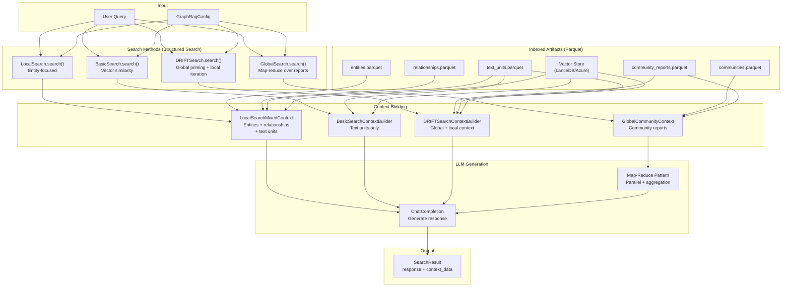
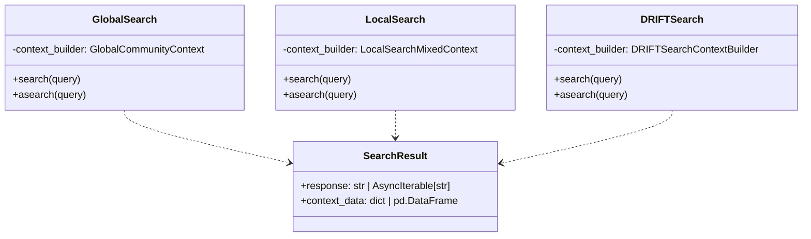

<!-- source: DeepWiki mcp.deepwiki.com · repo microsoft/graphrag · page 5 Query System · fetched 2026-10-26 -->

# Query System

Relevant source files

The following files were used as context for generating this wiki page:

- [docs/blog_posts.md](docs/blog_posts.md)
- [docs/examples_notebooks/drift_search.ipynb](docs/examples_notebooks/drift_search.ipynb)
- [docs/examples_notebooks/global_search.ipynb](docs/examples_notebooks/global_search.ipynb)
- [docs/examples_notebooks/global_search_with_dynamic_community_selection.ipynb](docs/examples_notebooks/global_search_with_dynamic_community_selection.ipynb)
- [docs/examples_notebooks/local_search.ipynb](docs/examples_notebooks/local_search.ipynb)
- [docs/index/default_dataflow.md](docs/index/default_dataflow.md)
- [docs/index/outputs.md](docs/index/outputs.md)
- [docs/index/overview.md](docs/index/overview.md)
- [docs/prompt_tuning/manual_prompt_tuning.md](docs/prompt_tuning/manual_prompt_tuning.md)
- [docs/query/drift_search.md](docs/query/drift_search.md)
- [docs/query/global_search.md](docs/query/global_search.md)
- [docs/query/local_search.md](docs/query/local_search.md)
- [docs/query/question_generation.md](docs/query/question_generation.md)

The Query System is the retrieval and response generation module of GraphRAG. It operates over completed indexes to answer user questions by leveraging the knowledge graph, community reports, text units, and embeddings created during the indexing phase [docs/query/local_search.md:1-5](). This document covers the query architecture, search methods, context builders, and configuration.

For information about creating the indexes that the query system operates on, see [Indexing Pipeline](#4). For details on prompt customization for query operations, see [Query Prompts](#6.3).

## Query System Architecture

The Query System provides four distinct search strategies, each optimized for different question types and retrieval patterns. All search methods follow a common pattern: context building → LLM-based synthesis → response formatting [docs/query/local_search.md:43-46]().

### Query Flow Overview

**Sources:** [docs/query/local_search.md:9-43](), [docs/query/global_search.md:11-46](), [docs/query/drift_search.md:11-15](), [docs/examples_notebooks/local_search.ipynb:31-34](), [docs/examples_notebooks/drift_search.ipynb:29-32](), [docs/examples_notebooks/global_search.ipynb:27-30]()

### Search Method Comparison

| Search Method | Question Type | Artifacts Used | LLM Pattern | Cost | Best For |
|---------------|--------------|----------------|-------------|------|----------|
| **Global Search** | Dataset-wide, holistic questions | `community_reports`, `communities` | Map-reduce over community hierarchy | High (multiple LLM calls) | "What are the main themes?" "What are the top entities?" |
| **Local Search** | Specific entity questions | `entities`, `relationships`, `text_units`, embeddings | Single LLM call with vector retrieval | Medium | "Who is Scrooge?" "What are the properties of X?" |
| **DRIFT Search** | Exploratory, iterative questions | All artifacts (reports + entities + text units) | Global priming + iterative local refinement | Very High (multiple rounds) | Complex multi-hop questions requiring broad context |
| **Basic Search** | Simple fact retrieval | `text_units`, embeddings | Single LLM call with vector retrieval | Low | Standard RAG baseline comparison |

**Sources:** [docs/query/global_search.md:3-8](), [docs/query/local_search.md:3-5](), [docs/query/drift_search.md:6-8]()

## Query API

The primary entry point for querying is through the API functions in `graphrag.api`. Each search method has a corresponding function that accepts configuration and dataframes.

### Core Search Classes

**Sources:** [docs/query/global_search.md:55-58](), [docs/query/local_search.md:49-52](), [docs/query/drift_search.md:22-25](), [docs/examples_notebooks/drift_search.ipynb:130-132]()

## Global Search

Global Search uses a **map-reduce pattern** over community reports to answer holistic questions about the entire dataset [docs/query/global_search.md:48-50](). It segments community reports into text chunks and generates intermediate responses (map) before aggregating them into a final answer (reduce) [docs/query/global_search.md:48-50]().

### Key Features
- **Dynamic Community Selection**: An optional mode where an agent dynamically traverses the community hierarchy to filter relevant reports before the map-reduce operation [docs/examples_notebooks/global_search_with_dynamic_community_selection.ipynb:133-141]().
- **Community Hierarchy**: Quality is influenced by the `COMMUNITY_LEVEL` chosen for reports [docs/query/global_search.md:50]().

For details, see [Global Search](#5.2).

## Local Search

Local Search performs entity-focused retrieval by identifying entities semantically related to the query and extracting their neighbors (relationships, other entities, and community reports) [docs/query/local_search.md:45-46]().

### Key Features
- **Hybrid Context**: Combines structured graph data (entities, relationships) with unstructured raw text chunks (`text_units`) [docs/query/local_search.md:45]().
- **Prioritization**: Filters and ranks candidate text units, reports, and relationships to fit within a single context window [docs/query/local_search.md:45]().

For details, see [Local Search](#5.3).

## DRIFT Search

DRIFT (Dynamic Reasoning and Inference with Flexible Traversal) Search is a hybrid approach that combines global community context with iterative local refinement [docs/query/drift_search.md:6-8]().

### Methodology Phases
1. **Primer**: Compares the query with top-K community reports for a broad initial answer [docs/query/drift_search.md:15]().
2. **Follow-Up**: Uses local search to refine queries and generate intermediate answers [docs/query/drift_search.md:15]().
3. **Output Hierarchy**: Produces a final structure of ranked questions and answers [docs/query/drift_search.md:15]().

For details, see [DRIFT Search](#5.4).

## Basic Search

Basic Search provides a simple vector similarity baseline. It performs vector search over text unit embeddings and passes the top-k chunks to the LLM without graph-based traversal.

For details, see [Basic Search](#5.5).

## Context Builders and Entity Extraction

Context builders are the core abstraction for assembling relevant data into LLM prompts. Each search method uses a specialized context builder (e.g., `LocalSearchMixedContext`, `GlobalCommunityContext`) that understands which artifacts to load and how to format them [docs/query/drift_search.md:25]().

### Question Generation
The system supports generating candidate follow-up questions using `LocalQuestionGen`, which leverages the knowledge graph to suggest relevant areas for further exploration [docs/examples_notebooks/local_search.ipynb:30]().

For details, see [Context Builders and Entity Extraction](#5.6).

## Multi-Index Search

GraphRAG supports querying across multiple independent indexes. This is facilitated by loading dataframes from multiple output directories and merging them into the search context.

For details, see [Multi-Index Search](#5.7).

**Sources:** [docs/query/global_search.md:48-73](), [docs/query/local_search.md:45-61](), [docs/query/drift_search.md:11-28](), [docs/examples_notebooks/global_search_with_dynamic_community_selection.ipynb:148-158](), [docs/examples_notebooks/local_search.ipynb:30-34]()

---

