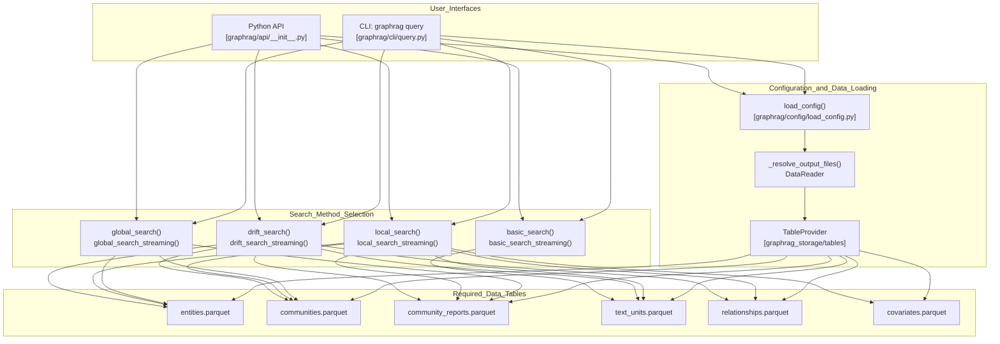
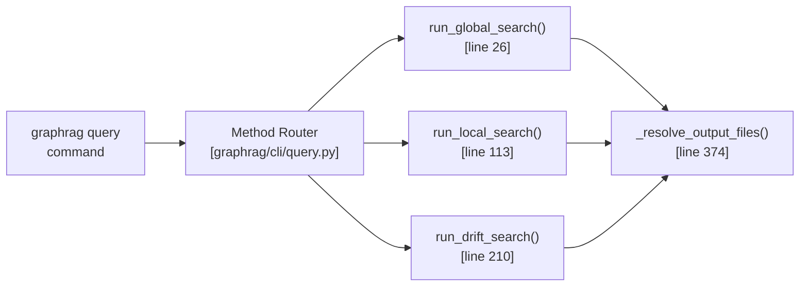
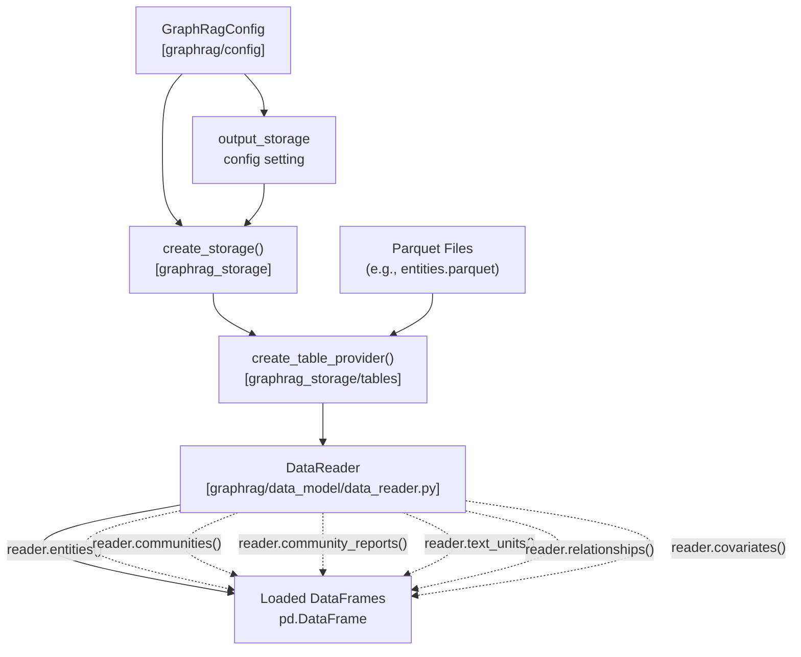

<!-- source: DeepWiki mcp.deepwiki.com · repo microsoft/graphrag · page 5.1 Query API · fetched 2026-10-26 -->

# Query API

Relevant source files

The following files were used as context for generating this wiki page:

- [docs/config/init.md](docs/config/init.md)
- [docs/config/overview.md](docs/config/overview.md)
- [docs/query/overview.md](docs/query/overview.md)
- [packages/graphrag-storage/graphrag_storage/memory_storage.py](packages/graphrag-storage/graphrag_storage/memory_storage.py)
- [packages/graphrag/graphrag/cli/query.py](packages/graphrag/graphrag/cli/query.py)
- [packages/graphrag/graphrag/index/workflows/create_community_reports.py](packages/graphrag/graphrag/index/workflows/create_community_reports.py)
- [packages/graphrag/graphrag/index/workflows/create_final_text_units.py](packages/graphrag/graphrag/index/workflows/create_final_text_units.py)
- [packages/graphrag/graphrag/index/workflows/update_covariates.py](packages/graphrag/graphrag/index/workflows/update_covariates.py)
- [tests/unit/storage/test_parquet_table_provider.py](tests/unit/storage/test_parquet_table_provider.py)

This page documents the Query API entrypoints for executing searches against indexed GraphRAG data. The Query API provides both command-line and programmatic interfaces to access the search strategies supported by GraphRAG.

For detailed information about how each search strategy works internally, see [Global Search](5.2), [Local Search](5.3), [DRIFT Search](5.4), and [Basic Search](5.5). For information about building context and extracting entities from queries, see [Context Builders and Entity Extraction](5.6).

## Query API Architecture

The Query API consists of two primary interfaces that provide access to the search functionality:

Title: Query API Data Flow and Entrypoints

Sources: [packages/graphrag/graphrag/cli/query.py:26-218](), [packages/graphrag/graphrag/data_model/data_reader.py:13-50]()

## Query Methods

GraphRAG supports four distinct query strategies, each optimized for different types of questions:

| Method | Best For | Required Data Tables | Documentation |
|--------|----------|---------------------|---------------|
| **Global Search** | Holistic questions about the entire dataset | `entities`, `communities`, `community_reports` | [Global Search](5.2) |
| **Local Search** | Specific entity-focused questions | `entities`, `communities`, `community_reports`, `text_units`, `relationships`, `covariates` (optional) | [Local Search](5.3) |
| **DRIFT Search** | Entity-focused questions with community context | `entities`, `communities`, `community_reports`, `text_units`, `relationships` | [DRIFT Search](5.4) |
| **Basic Search** | Simple vector similarity baseline | `text_units` | [Basic Search](5.5) |

Sources: [packages/graphrag/graphrag/cli/query.py:26-218](), [docs/query/overview.md:12-34]()

## CLI Interface

The CLI provides a simple command-line interface for executing queries via the `graphrag query` subcommand.

### CLI Options
- `--method`: Search method: `global`, `local`, `drift`, or `basic`. [packages/graphrag/graphrag/cli/query.py:26-218]()
- `--data`: Path to indexed data directory (defaults to `./output`). [packages/graphrag/graphrag/cli/query.py:41-42]()
- `--root`: Project root directory. [packages/graphrag/graphrag/cli/query.py:28-28]()
- `--community-level`: Community hierarchy level to use. [packages/graphrag/graphrag/cli/query.py:29-29]()
- `--response-type`: Response format (e.g., "Multiple Paragraphs"). [packages/graphrag/graphrag/cli/query.py:31-31]()
- `--streaming`: Enable streaming response output. [packages/graphrag/graphrag/cli/query.py:32-32]()

### CLI Implementation Routing

Title: CLI Query Method Routing

Each CLI function follows a standard pattern:
1. Apply CLI overrides to `GraphRagConfig`. [packages/graphrag/graphrag/cli/query.py:40-46]()
2. Load required parquet tables using `_resolve_output_files()`. [packages/graphrag/graphrag/cli/query.py:48-56]()
3. Execute streaming or non-streaming search via the `api` module. [packages/graphrag/graphrag/cli/query.py:75-107]()

Sources: [packages/graphrag/graphrag/cli/query.py:1-218]()

## Python API Interface

The Python API provides programmatic access to all query methods through the `graphrag.api` module.

### API Functions
The API provides both standard (blocking) and streaming (async iterator) versions of each search:
- `api.global_search` / `api.global_search_streaming` [packages/graphrag/graphrag/cli/query.py:75-107]()
- `api.local_search` / `api.local_search_streaming` [packages/graphrag/graphrag/cli/query.py:168-204]()
- `api.drift_search` / `api.drift_search_streaming` [packages/graphrag/graphrag/cli/query.py:210-218]()

### API Parameters
Common parameters across API methods include:
- `config`: `GraphRagConfig` object loaded via `load_config()`. [packages/graphrag/graphrag/cli/query.py:43-46]()
- `query`: The user's query string. [packages/graphrag/graphrag/cli/query.py:33-33]()
- `response_type`: Desired response format. [packages/graphrag/graphrag/cli/query.py:31-31]()
- `callbacks`: List of `QueryCallbacks` (e.g., `NoopQueryCallbacks`) to handle context events. [packages/graphrag/graphrag/cli/query.py:72-73]()

Sources: [packages/graphrag/graphrag/cli/query.py:14-15]()

## Data Loading Process

The Query API requires loading indexed data from storage (typically Parquet files) before executing searches. This is managed by the `TableProvider` and `DataReader` abstractions.

Title: Query Data Loading Architecture

### Table Resolution
The `_resolve_output_files()` helper function handles the initialization of storage and loading of DataFrames:
1. It creates a storage instance using `create_storage()`. [packages/graphrag/graphrag/cli/query.py:11-11]()
2. It creates a `TableProvider` (e.g., `ParquetTableProvider`) via `create_table_provider()`. [packages/graphrag/graphrag/cli/query.py:12-12]()
3. It uses `DataReader` to fetch specific tables like `entities`, `communities`, and `community_reports`. [packages/graphrag/graphrag/data_model/data_reader.py:13-50]()

Sources: [packages/graphrag/graphrag/cli/query.py:48-60](), [packages/graphrag/graphrag/data_model/data_reader.py:13-50](), [tests/unit/storage/test_parquet_table_provider.py:14-24]()

## Streaming and Callbacks

GraphRAG supports streaming responses for real-time interaction, allowing users to consume the LLM output as it is generated.

### Streaming Implementation
Streaming is handled via async generators. For example, `api.global_search_streaming` yields chunks of strings as they are generated by the LLM. [packages/graphrag/graphrag/cli/query.py:75-86]().

### Context Callbacks
To capture the context data used during a streaming search, users can provide a callback object. The `NoopQueryCallbacks` class is the default, which can be extended to capture context via the `on_context` method. [packages/graphrag/graphrag/cli/query.py:68-73]().

Sources: [packages/graphrag/graphrag/cli/query.py:62-93](), [packages/graphrag/graphrag/callbacks/noop_query_callbacks.py:15-15]()

---

