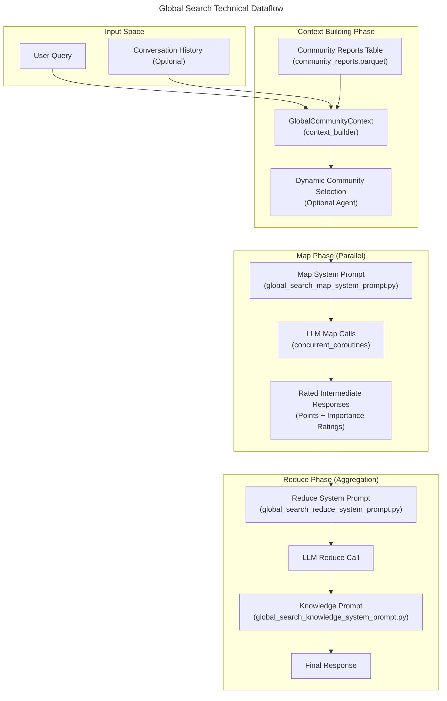
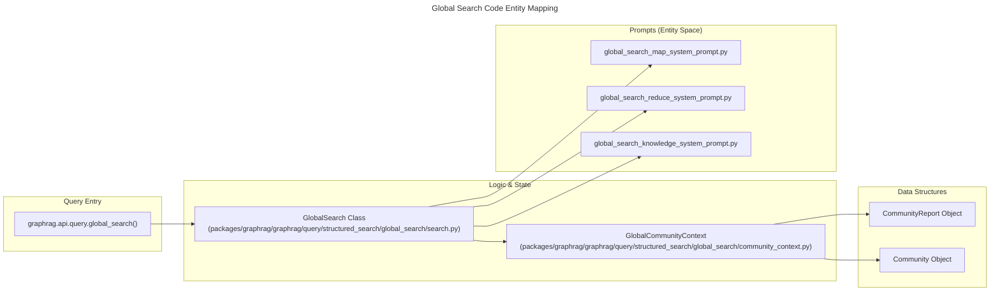

<!-- source: DeepWiki mcp.deepwiki.com · repo microsoft/graphrag · page 5.2 Global Search · fetched 2026-10-26 -->

# Global Search

Relevant source files

The following files were used as context for generating this wiki page:

- [docs/blog_posts.md](docs/blog_posts.md)
- [docs/examples_notebooks/drift_search.ipynb](docs/examples_notebooks/drift_search.ipynb)
- [docs/examples_notebooks/global_search.ipynb](docs/examples_notebooks/global_search.ipynb)
- [docs/examples_notebooks/global_search_with_dynamic_community_selection.ipynb](docs/examples_notebooks/global_search_with_dynamic_community_selection.ipynb)
- [docs/examples_notebooks/local_search.ipynb](docs/examples_notebooks/local_search.ipynb)
- [docs/index/default_dataflow.md](docs/index/default_dataflow.md)
- [docs/index/outputs.md](docs/index/outputs.md)
- [docs/index/overview.md](docs/index/overview.md)
- [docs/prompt_tuning/manual_prompt_tuning.md](docs/prompt_tuning/manual_prompt_tuning.md)
- [docs/query/drift_search.md](docs/query/drift_search.md)
- [docs/query/global_search.md](docs/query/global_search.md)
- [docs/query/local_search.md](docs/query/local_search.md)
- [docs/query/question_generation.md](docs/query/question_generation.md)
- [packages/graphrag/graphrag/query/structured_search/global_search/community_context.py](packages/graphrag/graphrag/query/structured_search/global_search/community_context.py)

## Purpose and Scope

Global Search is a query strategy in GraphRAG designed for "whole-dataset" reasoning. While traditional RAG (and GraphRAG's Local Search) excels at retrieving specific facts about entities, it often struggles with aggregate queries like "What are the major themes in this data?". Global Search solves this by using a map-reduce approach over the hierarchical community reports generated during the indexing pipeline. This method allows the system to summarize information across the entire dataset by leveraging pre-summarized semantic clusters.

**Sources:** [docs/query/global_search.md:1-8](), [docs/query/local_search.md:1-5]()

## Methodology: Map-Reduce over Communities

The Global Search algorithm processes the dataset by leveraging the semantic clusters (communities) created during indexing. It operates in two primary phases: **Map** and **Reduce**.

### Data Flow Overview

### 1. Context Building
The `GlobalCommunityContext` class prepares the data [packages/graphrag/graphrag/query/structured_search/global_search/community_context.py](). It loads community reports from a specified `COMMUNITY_LEVEL` [docs/examples_notebooks/global_search.ipynb:94-96](). Higher levels provide broad overviews, while lower levels (e.g., Level 2) provide more granular detail but increase computational cost due to the volume of reports [docs/query/global_search.md:50-51]().
*   **Dynamic Community Selection**: Instead of a fixed level, the system can use an LLM to dynamically search through community reports [docs/examples_notebooks/global_search_with_dynamic_community_selection.ipynb:135-139](). It first asks the LLM to rate the relevance of level 0 communities and traverses down to child nodes only if the parent is deemed relevant [docs/examples_notebooks/global_search_with_dynamic_community_selection.ipynb:135-139]().

### 2. Map Phase
The `GlobalSearch` engine segments community reports into text chunks of a pre-defined size [docs/query/global_search.md:48-49](). Each text chunk is processed by the LLM using the `map_system_prompt` [docs/query/global_search.md:59-60]().
*   **Output**: The LLM produces an intermediate response containing a list of points, each accompanied by a numerical rating indicating the point's importance [docs/query/global_search.md:48-49]().
*   **Parallelism**: The degree of parallelism is controlled by the `concurrent_coroutines` parameter to manage rate limits and execution speed [docs/query/global_search.md:68]().

### 3. Reduce Phase
The engine filters and ranks the most important points from the aggregated intermediate responses [docs/query/global_search.md:48-49]().
*   **Aggregation**: A filtered set of the most important points is used as context in the `reduce_system_prompt` [docs/query/global_search.md:60-61]().
*   **General Knowledge**: If `allow_general_knowledge` is enabled, the `general_knowledge_inclusion_prompt` is used to instruct the LLM to incorporate relevant real-world knowledge outside of the dataset [docs/query/global_search.md:62-63]().

**Sources:** [docs/query/global_search.md:48-52](), [docs/query/global_search.md:55-70](), [docs/examples_notebooks/global_search.ipynb:100-103](), [docs/examples_notebooks/global_search_with_dynamic_community_selection.ipynb:139-146]()

## Implementation Details

The implementation relies on several key classes and prompt templates to manage the lifecycle of a global query.

### Key Classes and Functions

| Component | Code Entity | Role |
| :--- | :--- | :--- |
| **Search Engine** | `GlobalSearch` | Orchestrates the map-reduce workflow and LLM interactions [packages/graphrag/graphrag/query/structured_search/global_search/search.py](). |
| **Context Builder** | `GlobalCommunityContext` | Filters and formats community reports into LLM-readable tables [packages/graphrag/graphrag/query/structured_search/global_search/community_context.py](). |
| **Data Adapters** | `read_indexer_reports` | Converts Parquet data into internal Knowledge Model objects [docs/examples_notebooks/global_search.ipynb:25-26](). |
| **Community Loader** | `read_indexer_communities` | Reconstructs the community graph hierarchy for dynamic selection [docs/examples_notebooks/global_search_with_dynamic_community_selection.ipynb:23-24](). |
| **Tokenization** | `get_tokenizer` | Tracks token budgets for both Map and Reduce stages [docs/examples_notebooks/global_search.ipynb:31-32](). |

**Sources:** [docs/query/global_search.md:55-60](), [docs/examples_notebooks/global_search.ipynb:25-34](), [docs/examples_notebooks/global_search_with_dynamic_community_selection.ipynb:115-122]()

### Bridge: Natural Language to Code Entity Space

The following diagram maps the logical steps of a Global Search to the specific code structures and files that handle them.

**Sources:** [docs/query/global_search.md:55-60](), [docs/examples_notebooks/global_search.ipynb:25-34](), [docs/prompt_tuning/manual_prompt_tuning.md:68-72]()

## Configuration Parameters

Global Search behavior is highly configurable through the `GlobalSearch` class and its associated context builder.

| Parameter | Description | Source |
| :--- | :--- | :--- |
| `max_data_tokens` | The total token budget for the context data across all map/reduce steps. | [docs/query/global_search.md:64]() |
| `map_llm_params` | Dictionary (e.g., `temperature`, `max_tokens`) for the Map phase LLM calls. | [docs/query/global_search.md:65]() |
| `reduce_llm_params` | Dictionary for the final Reduce phase LLM call. | [docs/query/global_search.md:66]() |
| `allow_general_knowledge` | Boolean to toggle inclusion of the LLM's internal knowledge. | [docs/query/global_search.md:62]() |
| `dynamic_community_selection` | Enables an agentic approach to find relevant communities across levels. | [docs/examples_notebooks/global_search_with_dynamic_community_selection.ipynb:153-158]() |
| `use_community_summary` | If `True`, uses community short summaries instead of full reports to save tokens. | [docs/examples_notebooks/global_search_with_dynamic_community_selection.ipynb:175]() |
| `concurrent_coroutines` | Controls the degree of parallelism in the `map` stage. | [docs/query/global_search.md:68]() |

**Sources:** [docs/query/global_search.md:55-70](), [docs/examples_notebooks/global_search_with_dynamic_community_selection.ipynb:174-185]()

## Comparison: Global vs. Local Search

| Feature | Global Search | Local Search |
| :--- | :--- | :--- |
| **Retrieval Unit** | Community Reports | Entities, Relationships, Text Units |
| **Architecture** | Map-Reduce over Clusters | Semantic Search + Graph Traversal |
| **Best For** | "What are the top 5 themes?" | "What are the healing properties of chamomile?" |
| **Cost** | High (Many parallel LLM calls) | Low to Medium |

**Sources:** [docs/query/global_search.md:5-7](), [docs/query/local_search.md:3-5](), [docs/examples_notebooks/global_search.ipynb:41-43]()

## Prompt Templates
Global search uses three specific system prompts defined in the `graphrag.prompts.query` module:
1.  **Map Phase**: `global_search_map_system_prompt.py` — Used to generate intermediate rated points from community reports [docs/prompt_tuning/manual_prompt_tuning.md:68]().
2.  **Reduce Phase**: `global_search_reduce_system_prompt.py` — Used to synthesize the aggregated points into a final formatted response [docs/prompt_tuning/manual_prompt_tuning.md:70]().
3.  **Knowledge Phase**: `global_search_knowledge_system_prompt.py` — Optional instructions for incorporating general world knowledge when `allow_general_knowledge` is True [docs/prompt_tuning/manual_prompt_tuning.md:72]().

**Sources:** [docs/prompt_tuning/manual_prompt_tuning.md:68-74](), [docs/query/global_search.md:59-63]()

---

