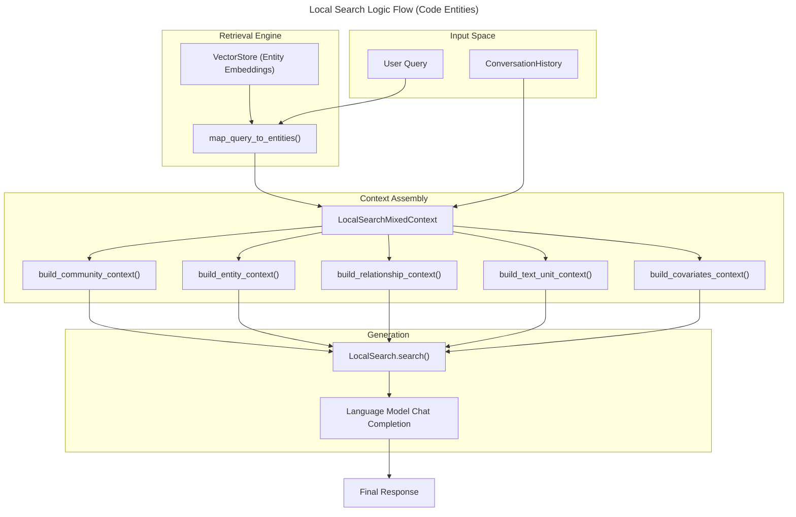
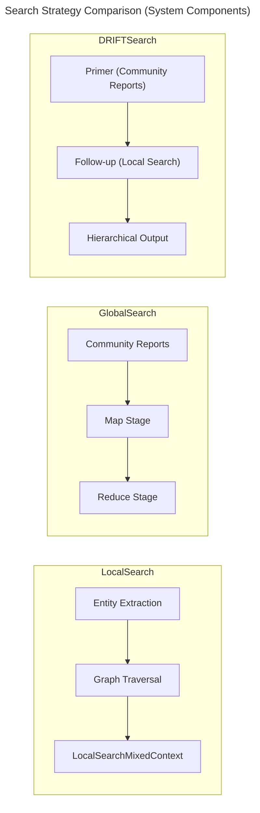

<!-- source: DeepWiki mcp.deepwiki.com · repo microsoft/graphrag · page 5.3 Local Search · fetched 2026-10-26 -->

# Local Search

Relevant source files

The following files were used as context for generating this wiki page:

- [docs/blog_posts.md](docs/blog_posts.md)
- [docs/index/overview.md](docs/index/overview.md)
- [docs/prompt_tuning/manual_prompt_tuning.md](docs/prompt_tuning/manual_prompt_tuning.md)
- [docs/query/drift_search.md](docs/query/drift_search.md)
- [docs/query/global_search.md](docs/query/global_search.md)
- [docs/query/local_search.md](docs/query/local_search.md)
- [docs/query/question_generation.md](docs/query/question_generation.md)
- [packages/graphrag/graphrag/query/structured_search/local_search/mixed_context.py](packages/graphrag/graphrag/query/structured_search/local_search/mixed_context.py)

Local Search is an entity-centric query method that retrieves information by identifying relevant entities in a user's query, then traversing the knowledge graph to gather related entities, relationships, text units, and community information to construct a comprehensive context for answer generation. It is specifically optimized for "bottom-up" reasoning where the query focuses on specific nodes and their immediate neighborhood in the graph [docs/query/local_search.md:1-5]().

## Purpose and Use Cases

Local Search is designed for questions that require detailed understanding of specific entities and their direct relationships. It excels at:

- Questions about particular people, organizations, or locations mentioned in the documents [docs/query/local_search.md:1-5]().
- Queries requiring detailed attribute information about specific entities [docs/query/local_search.md:43-45]().
- Questions that need context from immediate relationships and connected concepts [docs/query/local_search.md:43-45]().
- Scenarios where the answer involves a small subgraph of the overall knowledge graph [docs/query/local_search.md:43-45]().

Unlike Global Search, which operates on community summaries to answer dataset-wide thematic questions [docs/query/global_search.md:3-7](), Local Search performs graph traversal starting from query-relevant entities to build localized context windows [docs/query/local_search.md:43-45]().

Sources: [docs/query/local_search.md:1-5](), [docs/query/global_search.md:3-7](), [docs/query/local_search.md:43-45]()

## Architecture and Data Flow

The Local Search method combines structured data (entities, relationships, covariates) with unstructured data (text chunks) to augment the LLM context.

**Figure 1: Local Search Code Entity Dataflow**

Sources: [docs/query/local_search.md:9-43](), [packages/graphrag/graphrag/query/structured_search/local_search/mixed_context.py:54-115](), [packages/graphrag/graphrag/query/structured_search/local_search/mixed_context.py:28-45](), [docs/query/local_search.md:49-57]()

## Implementation Details

### Entity Extraction and Mapping
The system identifies entities semantically related to the user input. This is performed by `map_query_to_entities`, which uses a `text_embedder` to embed the query and searches the `entity_text_embeddings` vector store [packages/graphrag/graphrag/query/structured_search/local_search/mixed_context.py:139-149](). These extracted entities serve as "anchors" for the rest of the retrieval process [docs/query/local_search.md:43-45]().

### Context Building
The `LocalSearchMixedContext` class (the default `context_builder`) is responsible for preparing the context data [packages/graphrag/graphrag/query/structured_search/local_search/mixed_context.py:54-55](). It performs the following operations:
- **Conversation History**: If provided, previous user turns are appended to the query to maintain context [packages/graphrag/graphrag/query/structured_search/local_search/mixed_context.py:133-137]().
- **Entity-to-Text Unit Mapping**: Retrieves raw text chunks associated with identified entities via `get_candidate_text_units` [packages/graphrag/graphrag/query/structured_search/local_search/mixed_context.py:45]().
- **Entity-to-Report Mapping**: Retrieves community reports for the communities the entities belong to via `get_candidate_communities` [packages/graphrag/graphrag/query/structured_search/local_search/mixed_context.py:42-44]().
- **Entity-to-Entity Relationships**: Extracts direct connections using `build_relationship_context` [packages/graphrag/graphrag/query/structured_search/local_search/mixed_context.py:35]().
- **Entity-to-Covariate Mapping**: Retrieves associated claims or facts using `build_covariates_context` [packages/graphrag/graphrag/query/structured_search/local_search/mixed_context.py:33]().

### Ranking and Filtering
Since retrieved context might exceed the LLM's token limit, `LocalSearchMixedContext` uses proportional parameters like `text_unit_prop` (default 0.5) and `community_prop` (default 0.25) to allocate the `max_context_tokens` budget across different data types [packages/graphrag/graphrag/query/structured_search/local_search/mixed_context.py:99-101]().

Sources: [docs/query/local_search.md:43-45](), [packages/graphrag/graphrag/query/structured_search/local_search/mixed_context.py:54-173]()

## Configuration

Local search behavior is governed by the `LocalSearch` class parameters and the underlying context builder configuration.

| Parameter | Description | Source |
|-----------|-------------|--------|
| `model` | Language model chat completion object for response generation. | [docs/query/local_search.md:51]() |
| `context_builder` | `LocalSearchMixedContext` object for preparing data from graph objects. | [docs/query/local_search.md:52]() |
| `system_prompt` | Prompt template used to generate the final search response. | [docs/query/local_search.md:53]() |
| `response_type` | Free-form text describing desired format (e.g., "Multiple Paragraphs"). | [docs/query/local_search.md:54]() |
| `llm_params` | Dictionary of parameters like `temperature` or `max_tokens` for the LLM. | [docs/query/local_search.md:55]() |
| `context_builder_params` | Parameters passed to the `context_builder` during context assembly. | [docs/query/local_search.md:56]() |

### Prompt Tokens
The local search system prompt uses specific tokens for dynamic replacement during the query phase:
- **`{response_type}`**: Describes the expected structure of the output [docs/prompt_tuning/manual_prompt_tuning.md:63]().
- **`{context_data}`**: The container for the data tables (entities, relationships, etc.) from the index [docs/prompt_tuning/manual_prompt_tuning.md:64]().

Sources: [docs/query/local_search.md:49-57](), [docs/prompt_tuning/manual_prompt_tuning.md:57-65]()

## Comparison: Local vs. Global vs. DRIFT

| Feature | Local Search | Global Search | DRIFT Search |
|-----------|-------------|---------------|--------------|
| **Focus** | Specific entities/relationships [docs/query/local_search.md:1-5]() | Dataset-wide themes [docs/query/global_search.md:3-7]() | Hybrid/Iterative traversal [docs/query/drift_search.md:7-8]() |
| **Context** | Text units + Graph nodes [docs/query/local_search.md:43-45]() | Community Reports only [docs/query/global_search.md:48-51]() | Reports + Local Graph [docs/query/drift_search.md:18-19]() |
| **Method** | Single-shot retrieval [docs/query/local_search.md:43-45]() | Map-Reduce aggregation [docs/query/global_search.md:48-51]() | Dynamic Reasoning/Inference [docs/query/drift_search.md:7-8]() |

Sources: [docs/query/local_search.md:1-7](), [docs/query/global_search.md:1-7](), [docs/query/drift_search.md:1-19]()

## Technical Workflow in Code

To instantiate a local search in Python, the following components are typically initialized:

1. **Data Loading**: Entities, Relationships, Community Reports, Covariates, and Text Units are loaded from Parquet artifacts [packages/graphrag/graphrag/query/structured_search/local_search/mixed_context.py:59-65]().
2. **Vector Store**: A `VectorStore` is connected to the entity description embeddings to facilitate the initial entity lookup via `map_query_to_entities` [packages/graphrag/graphrag/query/structured_search/local_search/mixed_context.py:60,139]().
3. **Context Builder**: `LocalSearchMixedContext` is initialized with the loaded graph data and the vector store [packages/graphrag/graphrag/query/structured_search/local_search/mixed_context.py:57-68]().
4. **Search Execution**: The `LocalSearch` object is called with the user query, which triggers the retrieval, context assembly, and LLM generation steps [docs/query/local_search.md:49-57]().

Sources: [packages/graphrag/graphrag/query/structured_search/local_search/mixed_context.py:54-150](), [docs/query/local_search.md:49-57]()

---

