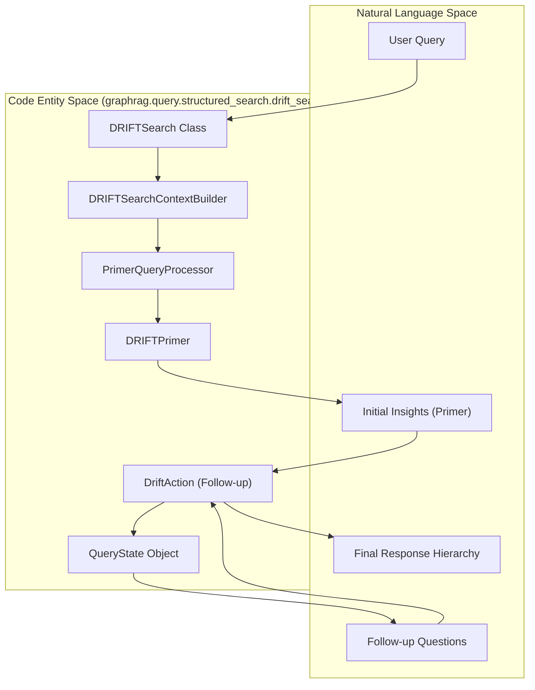
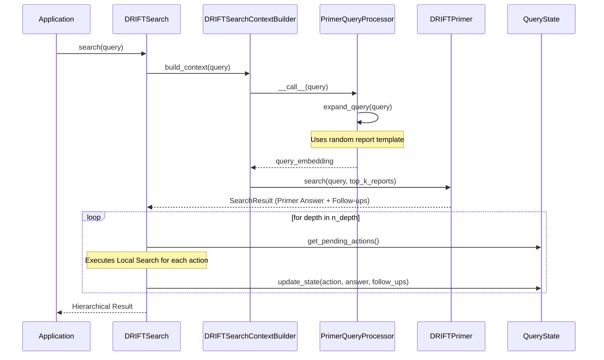

<!-- source: DeepWiki mcp.deepwiki.com · repo microsoft/graphrag · page 5.4 DRIFT Search · fetched 2026-10-26 -->

# DRIFT Search

Relevant source files

The following files were used as context for generating this wiki page:

- [docs/blog_posts.md](docs/blog_posts.md)
- [docs/index/overview.md](docs/index/overview.md)
- [docs/prompt_tuning/manual_prompt_tuning.md](docs/prompt_tuning/manual_prompt_tuning.md)
- [docs/query/drift_search.md](docs/query/drift_search.md)
- [docs/query/global_search.md](docs/query/global_search.md)
- [docs/query/local_search.md](docs/query/local_search.md)
- [docs/query/question_generation.md](docs/query/question_generation.md)
- [packages/graphrag/graphrag/query/structured_search/drift_search/drift_context.py](packages/graphrag/graphrag/query/structured_search/drift_search/drift_context.py)
- [packages/graphrag/graphrag/query/structured_search/drift_search/primer.py](packages/graphrag/graphrag/query/structured_search/drift_search/primer.py)

DRIFT Search (Dynamic Reasoning and Inference with Flexible Traversal) is an advanced query strategy in GraphRAG that combines the strengths of global and local search. It uses an iterative refinement process to navigate the knowledge graph, starting from broad community insights and drilling down into specific entity neighborhoods to generate comprehensive, detail-rich responses.

For information about other search strategies, see [Global Search](5.2), [Local Search](5.3), and [Basic Search](5.5).

## Overview

DRIFT Search implements a multi-phase algorithm designed to balance computational cost with high-quality outcomes [docs/query/drift_search.md:7-15](). It expands upon the GraphRAG query engine by using community information to provide a broad starting point for local search queries, which are then refined into detailed follow-up questions [docs/query/drift_search.md:18-19]().

The process is divided into three core phases:
1.  **Primer (Phase A)**: Compares the user's query with the top $K$ semantically relevant community reports to generate a broad initial answer and steering questions [docs/query/drift_search.md:15-15]().
2.  **Follow-Up (Phase B)**: Uses local search to refine queries, producing intermediate answers and new follow-up questions that guide the engine toward context-rich information [docs/query/drift_search.md:15-15]().
3.  **Output Hierarchy (Phase C)**: Synthesizes a final hierarchical structure of questions and answers ranked by relevance [docs/query/drift_search.md:15-15]().

### DRIFT Search Data Flow

The following diagram associates the natural language phases with the internal code entities and data structures used during execution.

Sources: [docs/query/drift_search.md:7-15](), [docs/query/drift_search.md:22-28](), [packages/graphrag/graphrag/query/structured_search/drift_search/drift_context.py:195-202](), [packages/graphrag/graphrag/query/structured_search/drift_search/primer.py:123-124]()

## Implementation Details

### Core Classes and Functions

| Class/Function | File Path | Role |
| :--- | :--- | :--- |
| `DRIFTSearch` | [docs/query/drift_search.md:22-22]() | Main orchestrator for the DRIFT algorithm. |
| `DRIFTSearchContextBuilder` | [packages/graphrag/graphrag/query/structured_search/drift_search/drift_context.py:39-40]() | Prepares context data from community reports and query information. |
| `PrimerQueryProcessor` | [packages/graphrag/graphrag/query/structured_search/drift_search/primer.py:46-47]() | Expands query using community report templates (HyDE-like) and generates embeddings. |
| `DRIFTPrimer` | [packages/graphrag/graphrag/query/structured_search/drift_search/primer.py:123-124]() | Performs initial query decomposition using global guidance from community reports. |
| `QueryState` | [docs/query/drift_search.md:28-28]() | Tracks execution of a DRIFT Search instance, alongside follow ups and actions. |

### Primer and Traversal Logic

The `DRIFTSearchContextBuilder` initializes a `PrimerQueryProcessor` to handle the initial query expansion [packages/graphrag/graphrag/query/structured_search/drift_search/drift_context.py:195-200](). The expansion logic uses a random community report as a template to create a hypothetical answer, which is then embedded to find relevant context [packages/graphrag/graphrag/query/structured_search/drift_search/primer.py:81-103]().

Sources: [packages/graphrag/graphrag/query/structured_search/drift_search/drift_context.py:168-202](), [packages/graphrag/graphrag/query/structured_search/drift_search/primer.py:70-120](), [docs/query/drift_search.md:15-15]()

## Configuration Parameters

DRIFT Search is configured via the `DRIFTSearchConfig` model [docs/query/drift_search.md:26-26]().

*   **`model`**: Language model chat completion object used for response generation [docs/query/drift_search.md:24-24]().
*   **`tokenizer`**: Token encoder for tracking the algorithm's budget [docs/query/drift_search.md:27-27]().
*   **`context_builder`**: Object responsible for preparing context from reports and query info [docs/query/drift_search.md:25-25]().
*   **`query_state`**: State object for tracking follow-ups and actions [docs/query/drift_search.md:28-28]().

Sources: [docs/query/drift_search.md:22-28]()

## Context Building

The `DRIFTSearchContextBuilder` combines multiple data sources and internal components:
1.  **Local Context Integration**: It internally initializes a `LocalSearchMixedContext` to handle the local refinement steps [packages/graphrag/graphrag/query/structured_search/drift_search/drift_context.py:78-82]().
2.  **Community Reports**: Converts community reports to a DataFrame for processing, ensuring they contain the required `full_content` and `full_content_embedding` [packages/graphrag/graphrag/query/structured_search/drift_search/drift_context.py:103-142]().
3.  **Prompts**: Utilizes specific system prompts for the local and reduce phases: `DRIFT_LOCAL_SYSTEM_PROMPT` and `DRIFT_REDUCE_PROMPT` [packages/graphrag/graphrag/query/structured_search/drift_search/drift_context.py:21-24]().

Sources: [packages/graphrag/graphrag/query/structured_search/drift_search/drift_context.py:42-80](), [docs/prompt_tuning/manual_prompt_tuning.md:81-90]()

## Comparison with Other Search Methods

| Feature | Global Search | Local Search | DRIFT Search |
| :--- | :--- | :--- | :--- |
| **Primary Data** | Community Reports [docs/query/global_search.md:48-48]() | Entity Neighborhoods [docs/query/local_search.md:45-45]() | Both + Iterative Refinement [docs/query/drift_search.md:7-7]() |
| **Strategy** | Map-Reduce [docs/query/global_search.md:48-48]() | Single-pass Retrieval [docs/query/local_search.md:45-45]() | Dynamic Traversal [docs/query/drift_search.md:7-7]() |
| **Use Case** | Whole dataset themes [docs/query/global_search.md:5-7]() | Specific entity facts [docs/query/local_search.md:5-5]() | Complex discovery balancing quality/cost [docs/query/drift_search.md:7-7]() |
| **Context Builder** | `CommunityContextBuilder` [docs/query/global_search.md:58-58]() | `LocalSearchMixedContext` [docs/query/local_search.md:52-52]() | `DRIFTSearchContextBuilder` [packages/graphrag/graphrag/query/structured_search/drift_search/drift_context.py:39-40]() |

Sources: [docs/query/drift_search.md:7-18](), [docs/query/global_search.md:48-50](), [docs/query/local_search.md:45-47]()

---

