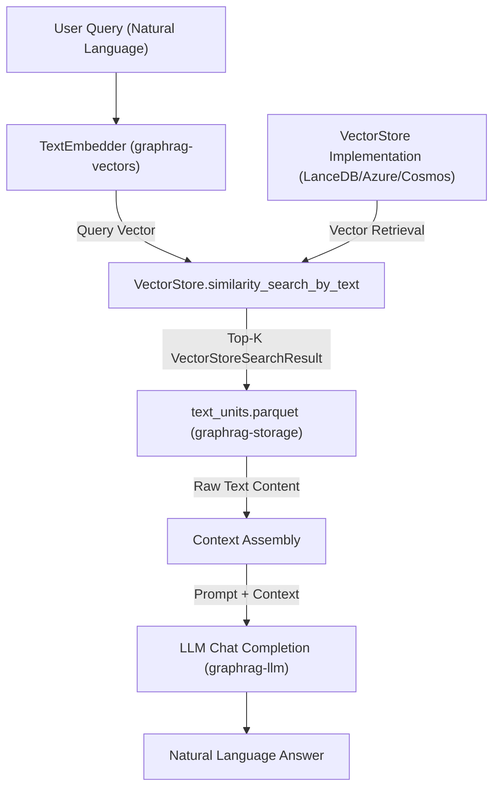
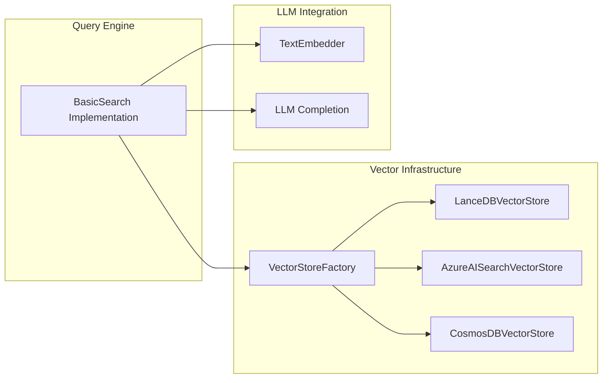

<!-- source: DeepWiki mcp.deepwiki.com · repo microsoft/graphrag · page 5.5 Basic Search · fetched 2026-10-26 -->

# Basic Search

<details>
<summary>Relevant source files</summary>

The following files were used as context for generating this wiki page:

- [docs/blog_posts.md](docs/blog_posts.md)
- [docs/index/overview.md](docs/index/overview.md)
- [docs/prompt_tuning/manual_prompt_tuning.md](docs/prompt_tuning/manual_prompt_tuning.md)
- [docs/query/drift_search.md](docs/query/drift_search.md)
- [docs/query/global_search.md](docs/query/global_search.md)
- [docs/query/local_search.md](docs/query/local_search.md)
- [docs/query/question_generation.md](docs/query/question_generation.md)
- [tests/integration/vector_stores/test_azure_ai_search.py](tests/integration/vector_stores/test_azure_ai_search.py)
- [tests/integration/vector_stores/test_cosmosdb.py](tests/integration/vector_stores/test_cosmosdb.py)
- [tests/integration/vector_stores/test_factory.py](tests/integration/vector_stores/test_factory.py)
- [tests/integration/vector_stores/test_lancedb.py](tests/integration/vector_stores/test_lancedb.py)
- [tests/unit/query/context_builder/test_entity_extraction.py](tests/unit/query/context_builder/test_entity_extraction.py)

</details>


## Purpose and Scope

This document describes the Basic Search method in GraphRAG, which provides a baseline vector-based Retrieval-Augmented Generation (RAG) implementation. Basic Search serves as a comparison point for evaluating the more sophisticated search methods and is useful for queries that are best answered through traditional semantic similarity matching.

For information about other search methods, see:
- **Global Search (5.2)**: for holistic questions about the corpus using community reports. [docs/query/global_search.md:1-7]()
- **Local Search (5.3)**: for entity-centric retrieval with graph traversal. [docs/query/local_search.md:1-5]()
- **DRIFT Search (5.4)**: for hybrid approach with iterative refinement. [docs/query/drift_search.md:1-7]()

## Overview

Basic Search implements a standard vector RAG approach that retrieves the top-k most semantically similar text units to a user's query and uses them as context for LLM-based answer generation. Unlike GraphRAG's other search methods, Basic Search does not leverage the knowledge graph structure, community reports, or entity relationships. Instead, it performs direct vector similarity search over text chunks.

**When to Use Basic Search:**
- Questions that can be answered from a small number of relevant passages.
- Queries where semantic similarity is sufficient for retrieval.
- As a baseline for comparing results with graph-based search methods.
- When you want fast responses without graph traversal overhead.

Sources: [docs/query/global_search.md:5-7](), [docs/query/local_search.md:1-5]()

## Architecture

### Search Flow

The basic search process follows a linear data flow from natural language query to vector space and back to a natural language response. It utilizes the `VectorStore` abstraction to perform similarity lookups.

Title: "Basic Search Dataflow"


Sources: [docs/query/local_search.md:9-43](), [tests/unit/query/context_builder/test_entity_extraction.py:60-68](), [docs/index/overview.md:5-12]()

### Component Interaction (Code Entity Space)

Basic Search bridges the high-level query requirements with specific storage and model entities. It relies on the `VectorStoreFactory` to instantiate the correct backend.

Title: "Basic Search Component Architecture"


Sources: [tests/integration/vector_stores/test_factory.py:9-21](), [tests/unit/query/context_builder/test_entity_extraction.py:13-18](), [docs/index/overview.md:3-12]()

### Text Units and Vector Storage

Basic Search operates exclusively on text units. During indexing, the pipeline embeds text into a vector space [docs/index/overview.md:10](). These embeddings are stored in a configured `VectorStore`.

| Component | Role | Code Reference |
|----------|--------------|------------------|
| `VectorStoreDocument` | Data envelope for vector storage | [tests/unit/query/context_builder/test_entity_extraction.py:16]() |
| `VectorStoreSearchResult` | Container for search results and scores | [tests/unit/query/context_builder/test_entity_extraction.py:17]() |
| `LanceDBVectorStore` | Local file-based vector storage | [tests/integration/vector_stores/test_lancedb.py:15]() |
| `AzureAISearchVectorStore` | Cloud-based vector search | [tests/integration/vector_stores/test_azure_ai_search.py:13]() |
| `CosmosDBVectorStore` | NoSQL-based vector search | [tests/integration/vector_stores/test_cosmosdb.py:13]() |

Sources: [tests/unit/query/context_builder/test_entity_extraction.py:11-18](), [docs/index/overview.md:5-12]()

## Usage

### CLI Usage

Basic Search can be invoked through the `graphrag query` command. You can specify basic search using the `--method` parameter:

```bash
graphrag query "Who is Jordan Hayes?" --method basic
```

Sources: [docs/index/overview.md:25-29]()

### API Usage

Basic Search is typically executed using a search class that mirrors the pattern of `LocalSearch` or `GlobalSearch`, requiring a `model` (LLM) and a `context_builder`.

Sources: [docs/query/local_search.md:49-57](), [docs/query/global_search.md:55-70]()

## Configuration

Basic Search uses configuration from several sections of the indexing and query settings.

### Vector Store Configuration

The vector store must be initialized and documents loaded before Basic Search can function.

```python
# Example initialization from integration tests
vector_store = LanceDBVectorStore(
    db_uri=temp_dir, 
    index_name="test_collection", 
    vector_size=1536
)
vector_store.connect()
vector_store.create_index()
```

Sources: [tests/integration/vector_stores/test_lancedb.py:79-83](), [tests/integration/vector_stores/test_factory.py:24-31]()

### Prompting

Basic Search uses a system prompt to instruct the LLM on how to process the retrieved context. This follows the pattern of `local_search_system_prompt.py` but without graph-specific tokens like `{context_data}` (tables).

Sources: [docs/prompt_tuning/manual_prompt_tuning.md:57-65]()

## Comparison with Other Search Methods

| Feature | Basic Search | Local Search | Global Search | DRIFT Search |
|---------|--------------|--------------|---------------|--------------|
| **Primary Data Source** | Text units only | Entities + Relationships | Community reports | Hybrid (Reports + Local) |
| **Retrieval Mechanism** | Vector Search | Graph Traversal | Map-Reduce | Iterative Traversal |
| **Best For** | Fact retrieval | Specific entity details | High-level themes | Complex exploration |
| **Method Name** | `basic` | `local` | `global` | `drift` |

Sources: [docs/query/drift_search.md:1-18](), [docs/query/local_search.md:1-7](), [docs/query/global_search.md:1-9]()

## Implementation Details

### Similarity Search

The core of Basic Search is the `similarity_search_by_text` method provided by the `VectorStore` interface. This method:
1. Takes the user query string.
2. Uses a `TextEmbedder` to generate a vector.
3. Performs a nearest-neighbor search in the vector database.

Sources: [tests/unit/query/context_builder/test_entity_extraction.py:60-68](), [tests/integration/vector_stores/test_lancedb.py:112-116]()

### Limitations

Basic Search is a baseline and lacks several advanced features of the GraphRAG system:
- **No Community Awareness**: Unlike Global Search, it does not use `community_reports`. [docs/query/global_search.md:48-50]()
- **No Relationship Traversal**: It does not follow graph edges like Local Search. [docs/query/local_search.md:45]()
- **No Dynamic Reasoning**: It lacks the iterative refinement found in DRIFT Search. [docs/query/drift_search.md:18]()

Sources: [docs/query/global_search.md:7-9](), [docs/query/local_search.md:5-7](), [docs/query/drift_search.md:7-8]()

---

