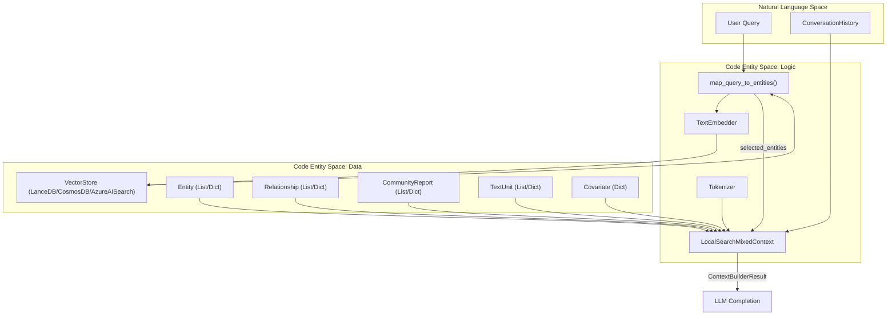
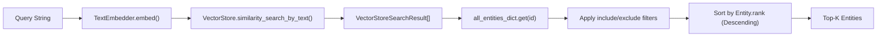

<!-- source: DeepWiki mcp.deepwiki.com · repo microsoft/graphrag · page 5.6 Context Builders and Entity Extraction · fetched 2026-10-26 -->

# Context Builders and Entity Extraction

<details>
<summary>Relevant source files</summary>

The following files were used as context for generating this wiki page:

- [packages/graphrag/graphrag/query/structured_search/local_search/mixed_context.py](packages/graphrag/graphrag/query/structured_search/local_search/mixed_context.py)
- [tests/integration/vector_stores/test_azure_ai_search.py](tests/integration/vector_stores/test_azure_ai_search.py)
- [tests/integration/vector_stores/test_cosmosdb.py](tests/integration/vector_stores/test_cosmosdb.py)
- [tests/integration/vector_stores/test_factory.py](tests/integration/vector_stores/test_factory.py)
- [tests/integration/vector_stores/test_lancedb.py](tests/integration/vector_stores/test_lancedb.py)
- [tests/unit/query/context_builder/test_entity_extraction.py](tests/unit/query/context_builder/test_entity_extraction.py)

</details>


This page documents the context building mechanisms used during query time and the entity extraction process that maps user queries to relevant entities in the knowledge graph. Context builders are responsible for assembling relevant data from the knowledge graph—including entities, relationships, community reports, and text units—before passing it to the LLM for answer generation.

## Overview of Context Building

Context builders serve as the bridge between a user's natural language query and the structured knowledge graph data. They perform two primary functions:

1.  **Entity Extraction**: Identify which entities in the knowledge graph are most relevant to the query using vector similarity.
2.  **Context Assembly**: Gather and format the relevant graph data into a structured context window for the LLM, respecting token limits.

Different search methods (Local, Global, DRIFT) utilize specialized context builders optimized for their specific retrieval strategies.

### Context Building Dataflow

The following diagram illustrates how the system bridges "Natural Language Space" (User Query) to "Code Entity Space" (Parquet tables and Vector Stores).



**Sources**: [packages/graphrag/graphrag/query/structured_search/local_search/mixed_context.py:54-90](), [tests/unit/query/context_builder/test_entity_extraction.py:97-166]()

## Entity Extraction Architecture

The entity extraction process maps a natural language query to a ranked list of relevant entities using vector similarity search. This is primarily implemented in the `map_query_to_entities()` function.

### map_query_to_entities Implementation

The `map_query_to_entities()` function identifies entry points into the graph. It performs a similarity search against the vector store and then maps the resulting document IDs back to `Entity` objects.

**Function Signature**:
[packages/graphrag/graphrag/query/context_builder/entity_extraction.py:7-9]()
```python
def map_query_to_entities(
    query: str,
    text_embedding_vectorstore: VectorStore,
    text_embedder: TextEmbedder,
    all_entities_dict: dict[str, Entity],
    embedding_vectorstore_key: str = EntityVectorStoreKey.ID,
    include_entity_names: list[str] | None = None,
    exclude_entity_names: list[str] | None = None,
    k: int = 10,
    oversample_scaler: int = 2,
) -> list[Entity]:
```

### Entity Extraction Logic Flow



**Key Components**:
*   **`EntityVectorStoreKey`**: An enum determining if the search matches against entity `TITLE` or `ID`. [packages/graphrag/graphrag/query/context_builder/entity_extraction.py:8-9](), [packages/graphrag/graphrag/query/structured_search/local_search/mixed_context.py:67-67]()
*   **`oversample_scaler`**: A multiplier used to retrieve more candidates from the vector store than requested (`k * oversample_scaler`). These candidates are then re-ranked by their graph-based `rank` attribute (calculated during indexing) to ensure globally important entities are prioritized. [packages/graphrag/graphrag/query/structured_search/local_search/mixed_context.py:148-148]()
*   **`Entity` Data Model**: Represents a node in the graph with attributes like `id`, `short_id`, `title`, and `rank`. [tests/unit/query/context_builder/test_entity_extraction.py:99-123]()
*   **Conversation Integration**: If a `ConversationHistory` is provided, previous user questions are appended to the query to improve context-aware entity retrieval. [packages/graphrag/graphrag/query/structured_search/local_search/mixed_context.py:133-138]()

**Sources**: [packages/graphrag/graphrag/query/structured_search/local_search/mixed_context.py:131-150](), [tests/unit/query/context_builder/test_entity_extraction.py:7-166]()

## Vector Store Integration

Context builders and entity extraction rely on the `VectorStore` abstraction to perform similarity searches. The `VectorStoreFactory` is used to instantiate specific providers.

| Implementation | Description | Source |
| :--- | :--- | :--- |
| `LanceDBVectorStore` | File-based vector store using LanceDB. Supports metadata filtering and vector size validation. | [tests/integration/vector_stores/test_lancedb.py:15-18](), [tests/integration/vector_stores/test_lancedb.py:166-190]() |
| `AzureAISearchVectorStore` | Integration with Azure AI Search, supporting custom ID and vector fields via `SearchClient` and `SearchIndexClient`. | [tests/integration/vector_stores/test_azure_ai_search.py:13-14](), [tests/integration/vector_stores/test_azure_ai_search.py:39-44]() |
| `CosmosDBVectorStore` | Integration with Azure Cosmos DB (vCore-based Vector Search) with DiskANN indexing and custom field mapping. | [tests/integration/vector_stores/test_cosmosdb.py:13-14](), [tests/integration/vector_stores/test_cosmosdb.py:98-105]() |

### Vector Store Operations
Vector stores implement a standard interface for retrieval:
*   **`similarity_search_by_text`**: High-level method that uses a `TextEmbedder` to convert a string to a vector before searching. [tests/unit/query/context_builder/test_entity_extraction.py:60-68](), [tests/integration/vector_stores/test_lancedb.py:112-116]()
*   **`similarity_search_by_vector`**: Low-level method for searching with pre-computed embeddings. [tests/unit/query/context_builder/test_entity_extraction.py:47-58](), [tests/integration/vector_stores/test_lancedb.py:96-98]()
*   **`search_by_id`**: Retrieves a specific `VectorStoreDocument` by its unique identifier. [tests/unit/query/context_builder/test_entity_extraction.py:80-85](), [tests/integration/vector_stores/test_lancedb.py:91-94]()

### Vector Store Factory Registration
The `VectorStoreFactory` allows for lazy registration of built-in and custom vector store types.

```python
VectorStoreFactory().register(VectorStoreType.LanceDB, LanceDBVectorStore)
VectorStoreFactory().register(VectorStoreType.AzureAISearch, AzureAISearchVectorStore)
VectorStoreFactory().register(VectorStoreType.CosmosDB, CosmosDBVectorStore)
```
**Sources**: [tests/integration/vector_stores/test_factory.py:19-21](), [tests/unit/query/context_builder/test_entity_extraction.py:30-95](), [tests/integration/vector_stores/test_lancedb.py:75-121]()

## Search Context Building Logic

GraphRAG provides different context builders depending on the search method. The `LocalSearchMixedContext` is a primary implementation for local search.

### 1. Local Search Context (`LocalSearchMixedContext`)
The local search strategy identifies entities semantically related to the query, then traverses the graph to find connected neighbors, associated relationships, and relevant text segments.

*   **Proportional Allocation**: It allocates the context window based on configurable proportions for community reports (`community_prop`) and text units (`text_unit_prop`). [packages/graphrag/graphrag/query/structured_search/local_search/mixed_context.py:100-101](), [packages/graphrag/graphrag/query/structured_search/local_search/mixed_context.py:125-130]()
*   **Conversation History**: It prioritizes conversation history, subtracting those tokens from the available budget before building other contexts. [packages/graphrag/graphrag/query/structured_search/local_search/mixed_context.py:155-173]()
*   **Multi-Faceted Context**: Combines community context, entity context, relationship context, covariate context, and text unit context into a single `ContextBuilderResult`. [packages/graphrag/graphrag/query/structured_search/local_search/mixed_context.py:175-220]()

### 2. Global Search Context
The global search strategy prepares context from community reports. It segments community reports into text chunks to facilitate map-reduce operations, focusing on high-level themes rather than specific entity neighbors.

### 3. DRIFT Search Context
The DRIFT search utilizes a specialized context builder that prepares data from community reports and query information to generate follow-up questions and refined answers, combining global insights with local refinements iteratively.

**Sources**: [packages/graphrag/graphrag/query/structured_search/local_search/mixed_context.py:54-220](), [tests/unit/query/context_builder/test_entity_extraction.py:7-166]()

---

