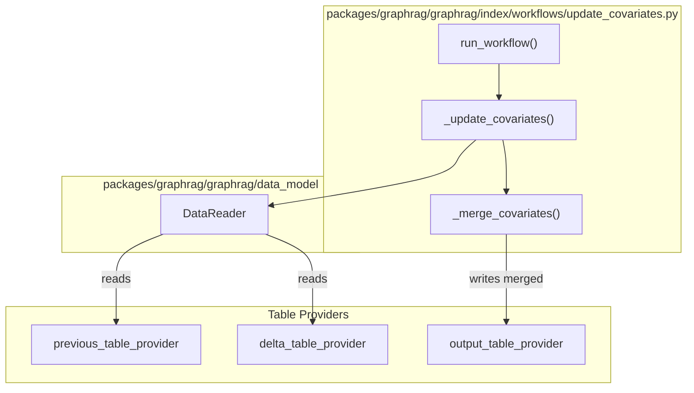
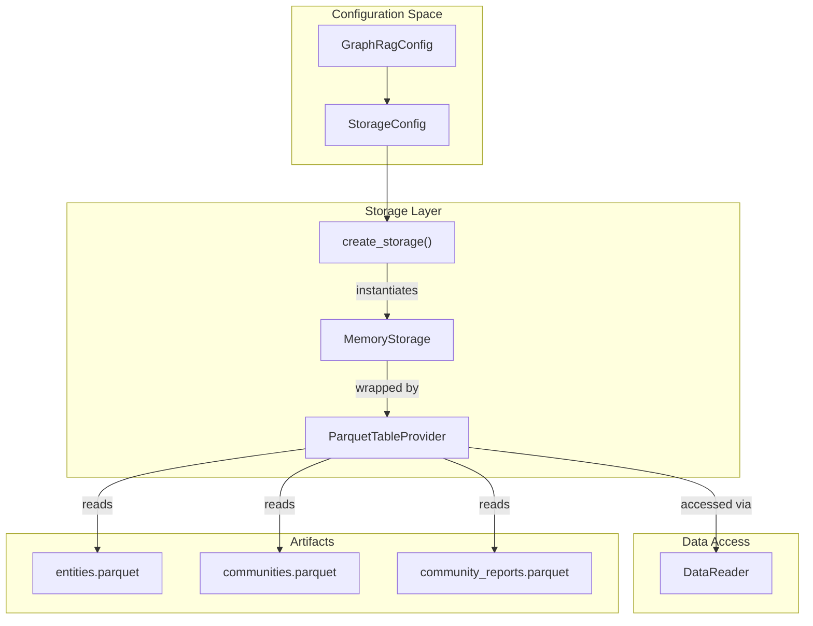

<!-- source: DeepWiki mcp.deepwiki.com · repo microsoft/graphrag · page 5.7 Multi-Index Search · fetched 2026-10-26 -->

# Multi-Index Search

<details>
<summary>Relevant source files</summary>

The following files were used as context for generating this wiki page:

- [docs/blog_posts.md](docs/blog_posts.md)
- [docs/index/overview.md](docs/index/overview.md)
- [docs/prompt_tuning/manual_prompt_tuning.md](docs/prompt_tuning/manual_prompt_tuning.md)
- [docs/query/drift_search.md](docs/query/drift_search.md)
- [docs/query/global_search.md](docs/query/global_search.md)
- [docs/query/local_search.md](docs/query/local_search.md)
- [docs/query/question_generation.md](docs/query/question_generation.md)
- [packages/graphrag-storage/graphrag_storage/memory_storage.py](packages/graphrag-storage/graphrag_storage/memory_storage.py)
- [packages/graphrag/graphrag/cli/query.py](packages/graphrag/graphrag/cli/query.py)
- [packages/graphrag/graphrag/index/workflows/create_community_reports.py](packages/graphrag/graphrag/index/workflows/create_community_reports.py)
- [packages/graphrag/graphrag/index/workflows/create_final_text_units.py](packages/graphrag/graphrag/index/workflows/create_final_text_units.py)
- [packages/graphrag/graphrag/index/workflows/update_covariates.py](packages/graphrag/graphrag/index/workflows/update_covariates.py)
- [tests/unit/storage/test_parquet_table_provider.py](tests/unit/storage/test_parquet_table_provider.py)

</details>


## Purpose and Scope

This page documents the multi-index search capability in GraphRAG, which enables querying across multiple independent GraphRAG indexes simultaneously. This feature allows users to maintain separate indexes for different data sources, time periods, or domains, and search across all of them in a single query operation. The system leverages the `TableProvider` abstraction and `Storage` interfaces to load artifacts from various locations, including incremental update directories.

For information about individual search methods (Global, Local, DRIFT, Basic), see pages [5.2](), [5.3](), [5.4](), and [5.5](). For the overall query API, see [5.1]().

**Sources**: [packages/graphrag/graphrag/cli/query.py:40-46](), [docs/query/drift_search.md:3-8]()

---

## Concept and Use Cases

Multi-index search allows query operations to span multiple GraphRAG indexes that were created independently. Each index maintains its own complete set of artifacts (entities, relationships, communities, text units, embeddings) but shares a common schema. A common scenario for multi-index interaction is during **Incremental Indexing**, where a "previous" index is merged or queried alongside a "delta" index.

### Common Use Cases

| Use Case | Description | Implementation Detail |
|----------|-------------|---------|
| **Incremental Updates** | New data in separate index before merge | Uses `previous_table_provider` and `delta_table_provider` in `update_covariates` [packages/graphrag/graphrag/index/workflows/update_covariates.py:27-29]() |
| **Temporal Segmentation** | Separate indexes for different time periods | Loading multiple parquet sets via `TableProvider` [packages/graphrag-storage/graphrag_storage/tables/parquet_table_provider.py:14-24]() |
| **Domain Separation** | Different indexes per topic or domain | Independent `root_dir` configurations in CLI [packages/graphrag/graphrag/cli/query.py:43-46]() |
| **Source Separation** | One index per data source | Distinct `output_storage` base directories [packages/graphrag/graphrag/cli/query.py:41-42]() |

**Sources**: [packages/graphrag/graphrag/index/workflows/update_covariates.py:21-37](), [packages/graphrag/graphrag/cli/query.py:40-56]()

---

## Architecture Overview

Multi-index search operates by loading artifacts from multiple storage locations and executing queries against the combined data structures. The system uses the `DataReader` to abstract the loading of tables like `entities`, `relationships`, and `covariates` from different providers.

### Multi-Index Data Flow (Code Entity Space)

This diagram shows how the system manages different table providers to support multi-index operations, specifically during incremental runs where covariates are merged.



**Sources**: [packages/graphrag/graphrag/index/workflows/update_covariates.py:21-53](), [packages/graphrag/graphrag/data_model/data_reader.py:13-18]()

---

## Index Loading and Data Merging

The system handles multiple indexes through coordinated loading of parquet artifacts from multiple storage backends using the `TableProvider` and `DataReader` classes.

### Loading Sequence (Natural Language to Code Entity)



**Sources**: [tests/unit/storage/test_parquet_table_provider.py:18-24](), [packages/graphrag-storage/graphrag_storage/memory_storage.py:16-29](), [packages/graphrag/graphrag/cli/query.py:48-60]()

### Data Structure Handling
When querying across indexes, the CLI resolves specific files required for each search method:
- **Global Search**: Requires `entities`, `communities`, and `community_reports` [packages/graphrag/graphrag/cli/query.py:58-60]().
- **Local Search**: Requires `communities`, `community_reports`, `text_units`, `relationships`, and `entities` [packages/graphrag/graphrag/cli/query.py:148-152]().
- **DRIFT Search**: Combines community information with local search mechanics [docs/query/drift_search.md:18-19]().

---

## Query Execution Across Indexes

### Global Search Across Indexes
Global search uses a map-reduce approach. When multiple indexes are involved, community reports from all indexes are pooled. The `map` stage produces intermediate responses from these reports, and the `reduce` stage aggregates them into a final response [docs/query/global_search.md:48-50]().

### Local Search Across Indexes
Local search identifies entities semantically related to the query across the provided indexes. It extracts connected relationships and text units from the combined knowledge graph to fit into the LLM context window [docs/query/local_search.md:45-46]().

### DRIFT Search Across Indexes
DRIFT (Dynamic Reasoning and Inference with Flexible Traversal) specifically leverages community information to expand the breadth of local search [docs/query/drift_search.md:18-19](). It uses a `QueryState` to track execution across follow-up actions and multiple context sources [docs/query/drift_search.md:28]().

---

## Configuration and API

### Incremental Merging Example
The `update_covariates` workflow demonstrates the programmatic merging of data from two different index locations (previous and delta).

```python
# From packages/graphrag/graphrag/index/workflows/update_covariates.py
async def _update_covariates(
    previous_table_provider: TableProvider,
    delta_table_provider: TableProvider,
    output_table_provider: TableProvider,
) -> None:
    old_covariates = await DataReader(previous_table_provider).covariates()
    delta_covariates = await DataReader(delta_table_provider).covariates()
    merged_covariates = _merge_covariates(old_covariates, delta_covariates)
    await output_table_provider.write_dataframe("covariates", merged_covariates)
```
**Sources**: [packages/graphrag/graphrag/index/workflows/update_covariates.py:43-53]()

### CLI Usage
The CLI allows specifying a `data_dir` which overrides the default output storage, facilitating the targeting of specific indexes for a query operation.

```bash
# Querying a specific index directory
graphrag query --root <root_dir> --data <data_dir> --method global "What are the themes?"
```
**Sources**: [packages/graphrag/graphrag/cli/query.py:40-42]()

---

## Storage and Table Providers

Multi-index search relies on the ability to combine data from different `TableProvider` implementations.

| Component | Role | File Reference |
|-----------|------|----------------|
| `TableProvider` | Interface for reading/writing tables | [packages/graphrag-storage/graphrag_storage/tables/table_provider.py]() |
| `ParquetTableProvider` | Implementation for Parquet files | [packages/graphrag-storage/graphrag_storage/tables/parquet_table_provider.py:14]() |
| `MemoryStorage` | In-memory key-value store for artifacts | [packages/graphrag-storage/graphrag_storage/memory_storage.py:16-29]() |
| `DataReader` | Helper to read specific data models (entities, etc) | [packages/graphrag/graphrag/data_model/data_reader.py:13]() |

**Sources**: [packages/graphrag-storage/graphrag_storage/memory_storage.py:1-10](), [packages/graphrag/graphrag/data_model/data_reader.py:13-18]()

---

## Performance and Optimization

1. **Parallelism**: Global search map stages can be parallelized via `concurrent_coroutines` [docs/query/global_search.md:68]().
2. **Context Budgeting**: Search methods use tokenizers to track and limit the budget for query expansion and context building [docs/query/drift_search.md:27](), [docs/query/global_search.md:64]().
3. **Table Streaming**: Final text unit creation streams data to avoid memory overhead when enriching large indexes [packages/graphrag/graphrag/index/workflows/create_final_text_units.py:82-86]().

**Sources**: [docs/query/global_search.md:64-68](), [packages/graphrag/graphrag/index/workflows/create_final_text_units.py:97-112]()

---

