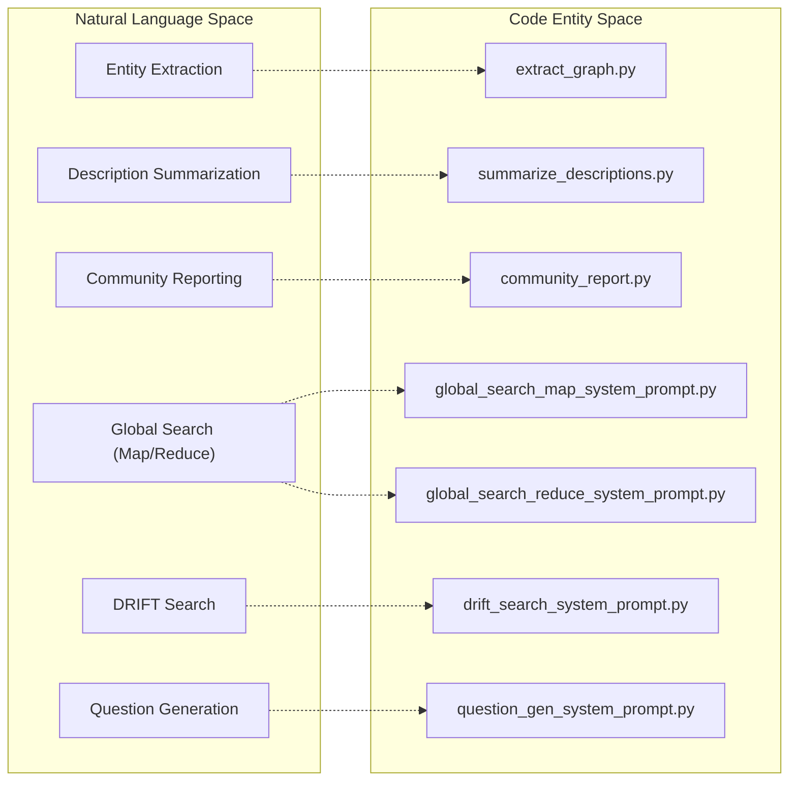

<!-- source: DeepWiki mcp.deepwiki.com · repo microsoft/graphrag · page 6 Prompt Management · fetched 2026-10-26 -->

# Prompt Management

<details>
<summary>Relevant source files</summary>

The following files were used as context for generating this wiki page:

- [docs/blog_posts.md](docs/blog_posts.md)
- [docs/index/overview.md](docs/index/overview.md)
- [docs/prompt_tuning/auto_prompt_tuning.md](docs/prompt_tuning/auto_prompt_tuning.md)
- [docs/prompt_tuning/manual_prompt_tuning.md](docs/prompt_tuning/manual_prompt_tuning.md)
- [docs/query/drift_search.md](docs/query/drift_search.md)
- [docs/query/global_search.md](docs/query/global_search.md)
- [docs/query/local_search.md](docs/query/local_search.md)
- [docs/query/question_generation.md](docs/query/question_generation.md)

</details>


**Purpose**: This page documents the prompt management system in GraphRAG, including how prompts are configured, stored, and customized for both indexing and query operations. Prompts are text templates that instruct language models to perform specific extraction and summarization tasks.

**Scope**: This page covers prompt configuration, file organization, and customization mechanisms. For detailed information about automatic prompt optimization, see [Auto Prompt Tuning](#6.4). For configuration of language models themselves, see [Language Model Configuration](#3.3).

---

## Overview

GraphRAG uses **prompt templates** to guide language models through knowledge extraction, summarization, and query answering tasks. These prompts are critical to the quality of results and should be tuned for your specific domain and data characteristics.

Prompts are:
- **Text files** or Python-defined templates stored in specific directories [docs/prompt_tuning/manual_prompt_tuning.md:5-7]().
- **Referenced by path** in the `settings.yaml` configuration for indexing tasks [docs/prompt_tuning/auto_prompt_tuning.md:82-91]().
- **Template-based** with support for variable substitution using `{token_name}` syntax [docs/prompt_tuning/manual_prompt_tuning.md:7-8]().
- **Workflow-specific** with different prompts for extraction, community reporting, and various search modes [docs/prompt_tuning/manual_prompt_tuning.md:9-90]().

The system provides default prompts that work well for general use cases, but the GraphRAG team strongly recommends customizing prompts for your specific data domain to achieve optimal results [docs/prompt_tuning/auto_prompt_tuning.md:3-5]().

**Sources**: [docs/prompt_tuning/manual_prompt_tuning.md:1-8](), [docs/prompt_tuning/auto_prompt_tuning.md:1-6](), [docs/index/overview.md:1-13]()

---

## Prompt Architecture

### System Integration

The following diagram illustrates how prompts integrate with the GraphRAG indexing workflows and query classes.

**Prompt Flow and Integration**

```mermaid
graph TB
    subgraph "Configuration"
        SettingsYAML["settings.yaml"]
        PromptsDir["prompts/ Directory"]
    end
    
    subgraph "Indexing Workflows"
        ExtractGraph["extract_graph Workflow"]
        Summarize["summarize_descriptions Workflow"]
        ExtractClaims["extract_claims Workflow"]
        CommunityReports["community_reports Workflow"]
    end
    
    subgraph "Query Operations"
        LocalSearch["LocalSearch class"]
        GlobalSearch["GlobalSearch class"]
        DRIFTSearch["DRIFTSearch class"]
        QuestionGen["QuestionGeneration class"]
    end
    
    subgraph "Prompt Files/Templates"
        ExtractGraphPrompt["extract_graph.txt / .py"]
        SummarizePrompt["summarize_descriptions.txt / .py"]
        ClaimsPrompt["extract_claims.py"]
        GraphReportPrompt["community_report.txt / .py"]
        
        LocalPrompt["local_search_system_prompt.py"]
        MapPrompt["global_search_map_system_prompt.py"]
        ReducePrompt["global_search_reduce_system_prompt.py"]
        DRIFTPrompt["drift_search_system_prompt.py"]
    end
    
    SettingsYAML --> ExtractGraph
    SettingsYAML --> LocalSearch
    
    PromptsDir --> ExtractGraphPrompt
    PromptsDir --> LocalPrompt
    
    ExtractGraphPrompt --> ExtractGraph
    SummarizePrompt --> Summarize
    ClaimsPrompt --> ExtractClaims
    GraphReportPrompt --> CommunityReports
    
    LocalPrompt --> LocalSearch
    MapPrompt --> GlobalSearch
    ReducePrompt --> GlobalSearch
    DRIFTPrompt --> DRIFTSearch
```


**Sources**: [docs/prompt_tuning/manual_prompt_tuning.md:9-90](), [docs/query/local_search.md:49-57](), [docs/query/global_search.md:55-63](), [docs/query/drift_search.md:22-28](), [docs/prompt_tuning/auto_prompt_tuning.md:82-91]()

### Natural Language to Code Entity Mapping

This diagram maps the conceptual prompt types to their specific implementation classes and source files within the codebase.

**Prompt Entity Mapping**


**Sources**: [docs/prompt_tuning/manual_prompt_tuning.md:13-83](), [docs/query/global_search.md:59-60](), [docs/query/question_generation.md:16-16]()

---

## Prompt Types and Configuration

### Indexing Prompts

Indexing prompts guide the LLM through knowledge extraction and summarization during the indexing pipeline [docs/index/overview.md:5-10]().

*   **Entity and Relationship Extraction**: Extracts entities and relationships from text chunks using tokens like `{input_text}` and `{entity_types}` [docs/prompt_tuning/manual_prompt_tuning.md:11-21]().
    *   **Source**: `packages/graphrag/graphrag/prompts/index/extract_graph.py` [docs/prompt_tuning/manual_prompt_tuning.md:13]()
*   **Summarize Descriptions**: Summarizes entity and relationship descriptions extracted from multiple chunks using `{entity_name}` and `{description_list}` [docs/prompt_tuning/manual_prompt_tuning.md:23-30]().
    *   **Source**: `packages/graphrag/graphrag/prompts/index/summarize_descriptions.py` [docs/prompt_tuning/manual_prompt_tuning.md:25]()
*   **Community Reports**: Generates summaries for detected communities using `{input_text}` containing tables of entities and relationships [docs/prompt_tuning/manual_prompt_tuning.md:47-54]().
    *   **Source**: `packages/graphrag/graphrag/prompts/index/community_report.py` [docs/prompt_tuning/manual_prompt_tuning.md:49]()

### Query Prompts

Query prompts guide the LLM in answering user questions using the indexed knowledge graph [docs/query/local_search.md:5-7]().

*   **Local Search**: Performs entity-focused search. The prompt uses `{context_data}` and `{response_type}` [docs/prompt_tuning/manual_prompt_tuning.md:57-65]().
    *   **Class**: `LocalSearch` [docs/query/local_search.md:49]()
    *   **Source**: `packages/graphrag/graphrag/prompts/query/local_search_system_prompt.py` [docs/prompt_tuning/manual_prompt_tuning.md:59]()
*   **Global Search**: Uses a map-reduce approach. It involves a `map_system_prompt` and a `reduce_system_prompt` [docs/query/global_search.md:48-60]().
    *   **Class**: `GlobalSearch` [docs/query/global_search.md:55]()
    *   **Sources**: `global_search_map_system_prompt.py` and `global_search_reduce_system_prompt.py` [docs/prompt_tuning/manual_prompt_tuning.md:68-70]()
*   **DRIFT Search**: Combines global insights with local refinements. Uses `{community_reports}`, `{context_data}`, and `{query}` [docs/prompt_tuning/manual_prompt_tuning.md:81-90]().
    *   **Class**: `DRIFTSearch` [docs/query/drift_search.md:22]()
    *   **Source**: `packages/graphrag/graphrag/prompts/query/drift_search_system_prompt.py` [docs/prompt_tuning/manual_prompt_tuning.md:83]()
*   **Question Generation**: Generates candidate follow-up questions using structured and unstructured data [docs/query/question_generation.md:5-9]().
    *   **Source**: `packages/graphrag/graphrag/prompts/query/question_gen_system_prompt.py` [docs/query/question_generation.md:16]()

---

## Prompt Customization

### Manual Tuning
Users can override any default prompt by writing a custom plaintext file using supported tokens like `{tuple_delimiter}` or `{record_delimiter}` [docs/prompt_tuning/manual_prompt_tuning.md:5-42](). These paths are then updated in the `settings.yaml` configuration [docs/prompt_tuning/auto_prompt_tuning.md:82-91]().

### Auto Prompt Tuning
GraphRAG provides a CLI tool to create domain-adapted prompts automatically by sampling input data and using LLM-based template substitution [docs/prompt_tuning/auto_prompt_tuning.md:1-5]().

**Command**:
```bash
graphrag prompt-tune --root <project_root> --domain <domain_name>
```
[docs/prompt_tuning/auto_prompt_tuning.md:22-25]()

**Selection Methods**:
*   `random`: (Default) Selects text units randomly [docs/prompt_tuning/auto_prompt_tuning.md:73]().
*   `auto`: Embeds text units and selects nearest neighbors to the centroid for a representative sample [docs/prompt_tuning/auto_prompt_tuning.md:76]().

**Sources**: [docs/prompt_tuning/auto_prompt_tuning.md:20-77](), [docs/prompt_tuning/manual_prompt_tuning.md:1-8]()

---

## Child Pages

- **[Prompt Files and Customization](#6.1)**: Detailed structure of prompt files and token replacement rules.
- **[Indexing Prompts](#6.2)**: Specifics for extraction, summarization, and claim prompts used in the pipeline.
- **[Query Prompts](#6.3)**: Detailed documentation for Local, Global, and DRIFT search prompts.

**Sources**: [docs/prompt_tuning/auto_prompt_tuning.md:1-80](), [docs/prompt_tuning/manual_prompt_tuning.md:1-90]()

---

