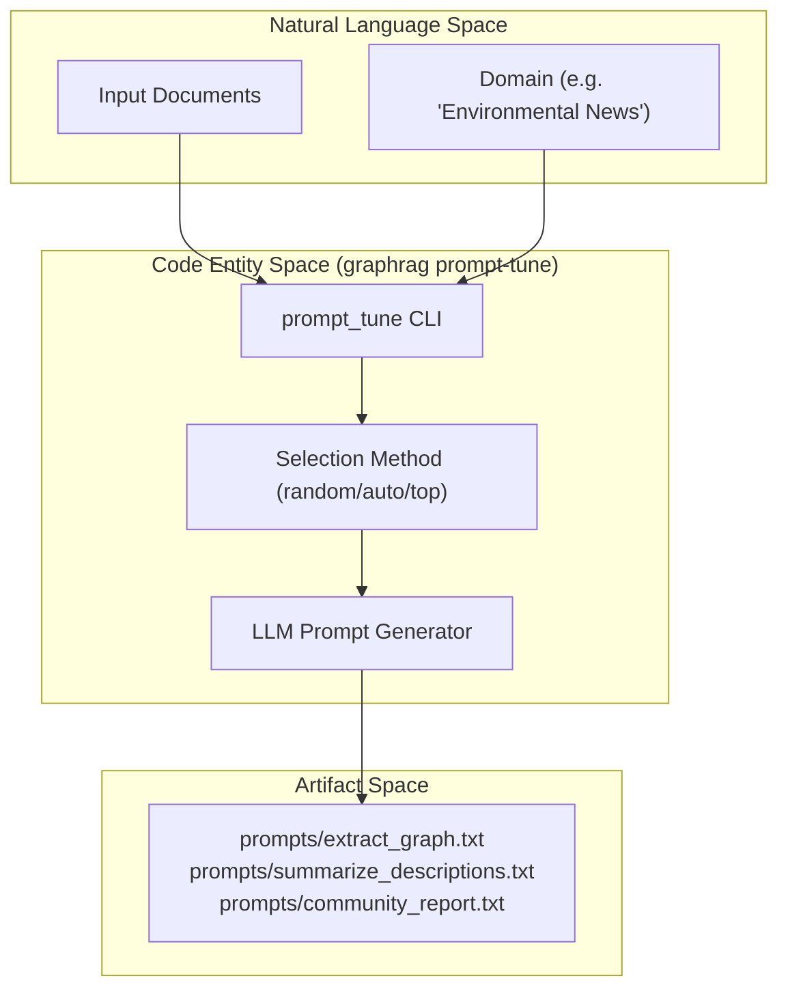
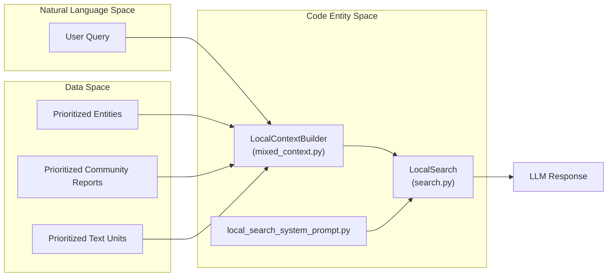

<!-- source: DeepWiki mcp.deepwiki.com · repo microsoft/graphrag · page 6.1 Prompt Files and Customization · fetched 2026-10-26 -->

# Prompt Files and Customization

<details>
<summary>Relevant source files</summary>

The following files were used as context for generating this wiki page:

- [docs/blog_posts.md](docs/blog_posts.md)
- [docs/index/overview.md](docs/index/overview.md)
- [docs/prompt_tuning/auto_prompt_tuning.md](docs/prompt_tuning/auto_prompt_tuning.md)
- [docs/prompt_tuning/manual_prompt_tuning.md](docs/prompt_tuning/manual_prompt_tuning.md)
- [docs/query/drift_search.md](docs/query/drift_search.md)
- [docs/query/global_search.md](docs/query/global_search.md)
- [docs/query/local_search.md](docs/query/local_search.md)
- [docs/query/question_generation.md](docs/query/question_generation.md)

</details>


This document explains the prompt file system in GraphRAG, including where prompt files are stored, how they are referenced in configuration, and how to customize them for your specific use case. It details the structure of prompt templates and the automated tuning mechanism used to adapt prompts to specific domains.

---

## Prompt Directory Structure

GraphRAG stores all LLM prompt templates in a dedicated `prompts/` directory within your project root. This directory is created automatically when you run the `graphrag init` command [docs/prompt_tuning/auto_prompt_tuning.md:14-16]().

```
project_root/
├── .env
├── settings.yaml
├── input/
└── prompts/              # Prompt template directory
    ├── extract_graph.txt
    ├── summarize_descriptions.txt
    ├── extract_claims.txt
    ├── community_report.txt
    ├── global_search_map_system_prompt.txt
    ├── global_search_reduce_system_prompt.txt
    ├── global_search_knowledge_system_prompt.txt
    ├── local_search_system_prompt.txt
    ├── drift_search_system_prompt.txt
    └── question_gen_system_prompt.txt
```

### Initialization Behavior

When you run `graphrag init`, the system:
1. Creates a `prompts/` directory.
2. Populates it with default prompt templates designed for broad knowledge discovery [docs/prompt_tuning/manual_prompt_tuning.md:1-4]().
3. References these prompts in the generated `settings.yaml` file [docs/prompt_tuning/auto_prompt_tuning.md:78-91]().

**Sources:** [docs/prompt_tuning/auto_prompt_tuning.md:14-16](), [docs/prompt_tuning/manual_prompt_tuning.md:1-4](), [docs/prompt_tuning/auto_prompt_tuning.md:78-91]()

---

## Prompt Configuration Architecture

Prompts are referenced in the configuration through specific workflow blocks. Each search method or indexing step that requires LLM interaction specifies which prompt file to use.

### Natural Language to Code Entity Mapping (Indexing)

The following table maps logical indexing tasks to the specific prompt source files and the tokens they consume.

| Task | Code Prompt Source Reference | Key Tokens |
|------|------------------------------|------------|
| Entity Extraction | [packages/graphrag/graphrag/prompts/index/extract_graph.py]() | `{input_text}`, `{entity_types}`, `{tuple_delimiter}` |
| Description Summarization | [packages/graphrag/graphrag/prompts/index/summarize_descriptions.py]() | `{entity_name}`, `{description_list}` |
| Claim Extraction | [packages/graphrag/graphrag/prompts/index/extract_claims.py]() | `{input_text}`, `{entity_specs}`, `{claim_description}` |
| Community Reporting | [packages/graphrag/graphrag/prompts/index/community_report.py]() | `{input_text}` (tables of entities/relationships) |

**Sources:** [docs/prompt_tuning/manual_prompt_tuning.md:11-54]()

### Search Method Prompt Mapping

Search methods utilize distinct system prompts to guide the LLM's reasoning over the graph data.

| Search Method | Code Class | System Prompt Source |
|---------------|------------|----------------------|
| **Local Search** | `LocalSearch` [docs/query/local_search.md:49]() | [packages/graphrag/graphrag/prompts/query/local_search_system_prompt.py]() |
| **Global Search (Map)** | `GlobalSearch` [docs/query/global_search.md:55]() | [packages/graphrag/graphrag/prompts/query/global_search_map_system_prompt.py]() |
| **Global Search (Reduce)** | `GlobalSearch` [docs/query/global_search.md:55]() | [packages/graphrag/graphrag/prompts/query/global_search_reduce_system_prompt.py]() |
| **DRIFT Search** | `DRIFTSearch` [docs/query/drift_search.md:22]() | [packages/graphrag/graphrag/prompts/query/drift_search_system_prompt.py]() |
| **Question Gen** | `Question Generation` [docs/query/question_generation.md:12]() | [packages/graphrag/graphrag/prompts/query/question_gen_system_prompt.py]() |

**Sources:** [docs/query/local_search.md:49-53](), [docs/query/global_search.md:55-60](), [docs/query/drift_search.md:22-28](), [docs/query/question_generation.md:12-16](), [docs/prompt_tuning/manual_prompt_tuning.md:56-90]()

---

## Variable Substitution (Tokens)

GraphRAG uses a token-replacement system in the form of `{token_name}` within plaintext `.txt` files [docs/prompt_tuning/manual_prompt_tuning.md:5-7]().

### Common Tokens

*   **`{input_text}`**: The raw text or data tables to be processed [docs/prompt_tuning/manual_prompt_tuning.md:17-53]().
*   **`{context_data}`**: Structured data tables (entities, relationships, reports) extracted from the index [docs/prompt_tuning/manual_prompt_tuning.md:64-88]().
*   **`{response_type}`**: Describes the desired output format (e.g., "multiple paragraphs") [docs/prompt_tuning/manual_prompt_tuning.md:63-87]().
*   **`{tuple_delimiter}` / `{record_delimiter}`**: Used to structure LLM outputs for reliable parsing into the knowledge graph [docs/prompt_tuning/manual_prompt_tuning.md:19-20]().
*   **`{community_reports}`**: Specifically used in DRIFT search to provide relevant community summaries [docs/prompt_tuning/manual_prompt_tuning.md:89]().

**Sources:** [docs/prompt_tuning/manual_prompt_tuning.md:5-90]()

---

## Customizing Prompts

### Manual Customization
Users can override any default prompt by creating a custom plaintext file and updating the `settings.yaml` configuration [docs/prompt_tuning/manual_prompt_tuning.md:5-7]().

```yaml
# Example settings.yaml update
extract_graph:
  prompt: "prompts/custom_extract_graph.txt"

summarize_descriptions:
  prompt: "prompts/custom_summarize_descriptions.txt"

community_reports:
  prompt: "prompts/community_report.txt"
```

**Sources:** [docs/prompt_tuning/auto_prompt_tuning.md:82-91]()

### Auto Prompt Tuning
GraphRAG provides an automated mechanism to generate domain-adapted prompts by running a series of LLM invocations and template substitutions [docs/prompt_tuning/auto_prompt_tuning.md:3-5](). This adapts the extraction and summarization logic to the specific vocabulary and entity types of your dataset.

#### Document Selection Methods
The auto-tuning process divides input data into text units and selects a representative sample using one of several methods [docs/prompt_tuning/auto_prompt_tuning.md:70-72]():

*   **`random`**: Selects text units randomly. This is the default [docs/prompt_tuning/auto_prompt_tuning.md:73]().
*   **`top`**: Selects the first *n* text units [docs/prompt_tuning/auto_prompt_tuning.md:74]().
*   **`all`**: Uses all text units (recommended only for small datasets) [docs/prompt_tuning/auto_prompt_tuning.md:75]().
*   **`auto`**: Embeds text units and selects the *k* nearest neighbors to the centroid [docs/prompt_tuning/auto_prompt_tuning.md:76]().

**Auto-Tuning Logic Flow:**



**Sources:** [docs/prompt_tuning/auto_prompt_tuning.md:20-77]()

---

## Search Execution Dataflow

Prompts are injected into the search context at runtime based on the selected search strategy.

### Local Search Dataflow
Local search uses the `local_search_system_prompt.py` to combine prioritized entities, relationships, and text units into a single context window [docs/query/local_search.md:45-53]().



**Sources:** [docs/query/local_search.md:9-45](), [docs/query/local_search.md:49-56](), [docs/prompt_tuning/manual_prompt_tuning.md:57-65]()

### Global Search Dataflow (Map-Reduce)
Global search utilizes a two-stage prompt system to handle whole-dataset reasoning [docs/query/global_search.md:48-50]():
1.  **Map Stage**: Uses `global_search_map_system_prompt.txt` to generate intermediate rated responses from shuffled community report batches.
2.  **Reduce Stage**: Uses `global_search_reduce_system_prompt.txt` to aggregate the most important points into a final answer.

**Sources:** [docs/query/global_search.md:11-50](), [docs/prompt_tuning/manual_prompt_tuning.md:67-80]()

---

## Summary of Prompt Parameters

| Parameter | Type | Description | Source |
|-----------|------|-------------|--------|
| `max_tokens` | CLI Option | Max token count for prompt generation during tuning | [docs/prompt_tuning/auto_prompt_tuning.md:40-41]() |
| `domain` | CLI Option | Domain context for tuning (inferred if empty) | [docs/prompt_tuning/auto_prompt_tuning.md:32-33]() |
| `chunk_size` | CLI Option | Size in tokens for text units used in tuning | [docs/prompt_tuning/auto_prompt_tuning.md:42-43]() |
| `selection_method` | CLI Option | Method to select documents (random, top, auto, all) | [docs/prompt_tuning/auto_prompt_tuning.md:34-34]() |
| `allow_general_knowledge` | Config | Whether to include real-world knowledge in Global Search | [docs/query/global_search.md:62-63]() |
| `response_type` | Config | Desired format (e.g., 'Multiple Paragraphs') | [docs/query/global_search.md:61-61]() |

**Sources:** [docs/prompt_tuning/auto_prompt_tuning.md:28-53](), [docs/query/global_search.md:55-70]()

---

