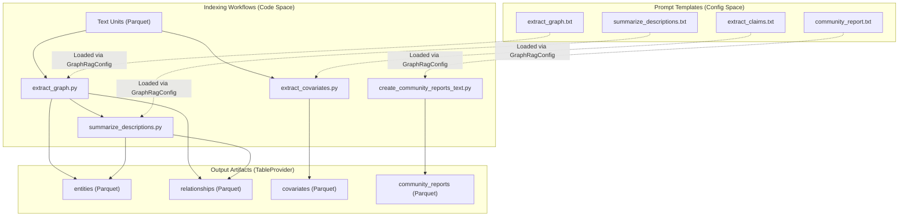
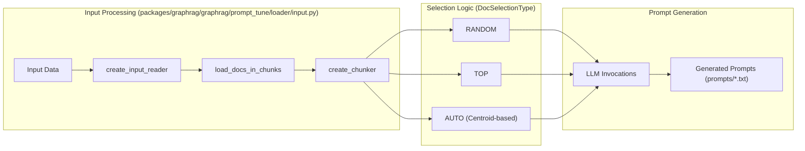
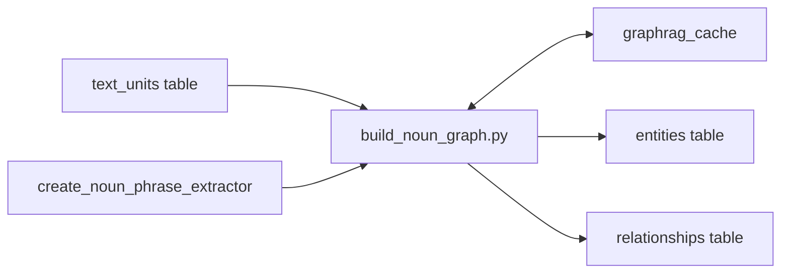

<!-- source: DeepWiki mcp.deepwiki.com · repo microsoft/graphrag · page 6.2 Indexing Prompts · fetched 2026-10-26 -->

# Indexing Prompts

<details>
<summary>Relevant source files</summary>

The following files were used as context for generating this wiki page:

- [docs/prompt_tuning/auto_prompt_tuning.md](docs/prompt_tuning/auto_prompt_tuning.md)
- [packages/graphrag/graphrag/prompt_tune/loader/input.py](packages/graphrag/graphrag/prompt_tune/loader/input.py)

</details>


This page documents the prompts used during the GraphRAG indexing pipeline. These prompts instruct the language model on how to extract entities, relationships, claims, and generate community reports from input text. For information about prompts used during query operations, see [Query Prompts](#6.3). For general information about customizing prompts, see [Prompt Files and Customization](#6.1).

## Overview

The indexing pipeline uses several primary prompt types to transform raw text into structured knowledge graph artifacts. Each prompt is defined as a text template with token placeholders replaced at runtime with workflow-specific data.

### Prompt-Driven Indexing Flow

The following diagram bridges the natural language prompts to the code entities and workflows that consume them.



**Indexing Workflow Prompt Usage**

Sources: [packages/graphrag/graphrag/index/workflows/extract_graph.py:32-94](), [packages/graphrag/graphrag/index/workflows/extract_covariates.py:32-71](), [packages/graphrag/graphrag/index/workflows/create_community_reports_text.py:40-81]()

## Entity and Relationship Extraction Prompt

The extraction prompt instructs the LLM to identify entities and their relationships from text units. This is invoked during the `extract_graph` workflow [packages/graphrag/graphrag/index/workflows/extract_graph.py:114-125]().

### Token Replacements

| Token | Description |
|-------|-------------|
| `{input_text}` | The text unit to process. |
| `{entity_types}` | List of entity types to extract (e.g., person, organization). |
| `{tuple_delimiter}` | Separator for values within an extracted tuple. |
| `{record_delimiter}` | Separator between different tuple instances. |
| `{completion_delimiter}` | Indicator for generation completion. |

### Configuration

The extraction prompt is configured in the `extract_graph` section of the `GraphRagConfig` [packages/graphrag/graphrag/config/models/graph_rag_config.py:13]().

```yaml
extract_graph:
  prompt: "prompts/extract_graph.txt"
  entity_types: [organization, person, geo, event]
  max_gleanings: 1
```

Sources: [packages/graphrag/graphrag/index/workflows/extract_graph.py:44-49](), [docs/prompt_tuning/auto_prompt_tuning.md:83-84]()

## Entity and Relationship Description Summarization Prompt

After extraction, multiple descriptions for the same entity or relationship may exist. The summarization prompt merges these into a single comprehensive description within the `summarize_descriptions` operation [packages/graphrag/graphrag/index/workflows/extract_graph.py:168-177]().

### Token Replacements

| Token | Description |
|-------|-------------|
| `{entity_name}` | Name of the entity or relationship being summarized. |
| `{description_list}` | List of all raw descriptions extracted from various text units. |

### Configuration

```yaml
summarize_descriptions:
  prompt: "prompts/summarize_descriptions.txt"
  max_length: 500
```

Sources: [packages/graphrag/graphrag/index/workflows/extract_graph.py:51-59](), [docs/prompt_tuning/auto_prompt_tuning.md:86-87]()

## Claim Extraction Prompt

Claim extraction (covariates) identifies factual claims within text units. This workflow is optional and controlled by `config.extract_claims.enabled` [packages/graphrag/graphrag/index/workflows/extract_covariates.py:39]().

### Token Replacements

| Token | Description |
|-------|-------------|
| `{input_text}` | The text unit to process. |
| `{claim_description}` | Semantic guidance on what constitutes a relevant claim. |
| `{entity_specs}` | List of entity types relevant to the claims. |

### Configuration

```yaml
extract_claims:
  enabled: true
  prompt: "prompts/extract_claims.txt"
  description: "Any claims or facts that could be relevant to information discovery."
```

Sources: [packages/graphrag/graphrag/index/workflows/extract_covariates.py:53-66]()

## Community Report Generation Prompt

Community reports synthesize entity and relationship information into a comprehensive summary for a detected community. This occurs in the `create_community_reports_text` workflow [packages/graphrag/graphrag/index/workflows/create_community_reports_text.py:40-45]().

### Standard vs. FastGraphRAG Variants

GraphRAG supports two methods for community report generation:
1. **Standard**: Uses entity and relationship descriptions as context.
2. **FastGraphRAG**: Uses raw text units associated with the community as context.

### Configuration

```yaml
community_reports:
  prompt: "prompts/community_report.txt"
  max_length: 500
  max_input_length: 65536
```

Sources: [packages/graphrag/graphrag/index/workflows/create_community_reports_text.py:62-76](), [docs/prompt_tuning/auto_prompt_tuning.md:89-91]()

## Auto Prompt Tuning

GraphRAG provides a `prompt-tune` command to generate domain-adapted prompts automatically [docs/prompt_tuning/auto_prompt_tuning.md:1-5](). This tool uses input documents to tailor the extraction and summarization templates to specific data domains.

### Auto-Tuning Architecture

This diagram maps the CLI and logical selection methods to the underlying code functions used for data preparation.



**Auto-Tuning Logic Flow**

The tuning process involves:
1. **Document Selection**: Choosing representative samples using methods like `random`, `top`, or `auto` [docs/prompt_tuning/auto_prompt_tuning.md:71-77](). The `auto` method embeds text units and uses `_sample_chunks_from_embeddings` to select the $k$ nearest neighbors to the centroid [packages/graphrag/graphrag/prompt_tune/loader/input.py:31-41]().
2. **Chunk Loading**: The `load_docs_in_chunks` function handles reading files via `create_input_reader` and splitting them into text units using `chunk_document` [packages/graphrag/graphrag/prompt_tune/loader/input.py:44-68](). It ensures special characters like curly braces are escaped (`{{` and `}}`) to prevent `str.format()` errors during template substitution [packages/graphrag/graphrag/prompt_tune/loader/input.py:103-107]().
3. **Entity Discovery**: Optionally allowing the LLM to discover entity types automatically with `--discover-entity-types` [docs/prompt_tuning/auto_prompt_tuning.md:50-51]().
4. **Template Substitution**: Generating final prompt files based on the sampled data [docs/prompt_tuning/auto_prompt_tuning.md:5]().

Sources: [docs/prompt_tuning/auto_prompt_tuning.md:20-53](), [docs/prompt_tuning/auto_prompt_tuning.md:68-77](), [packages/graphrag/graphrag/prompt_tune/loader/input.py:31-108]()

## NLP-Based Extraction (Non-LLM)

For high-performance or cost-sensitive scenarios, GraphRAG supports an NLP-based extraction workflow (`extract_graph_nlp`) that does not use LLM prompts. Instead, it uses a `BaseNounPhraseExtractor` [packages/graphrag/graphrag/index/workflows/extract_graph_nlp.py:17-22]().



**NLP Extraction Architecture**

In this mode:
- Entities are identified as **NOUN PHRASES** [packages/graphrag/graphrag/index/workflows/extract_graph_nlp.py:116]().
- Relationships are built based on **co-occurrence** within the same text unit [packages/graphrag/graphrag/index/operations/build_noun_graph/build_noun_graph.py:104-108]().
- Edge weights can be normalized using Pointwise Mutual Information (PMI) [packages/graphrag/graphrag/index/operations/build_noun_graph/build_noun_graph.py:141]().

Sources: [packages/graphrag/graphrag/index/workflows/extract_graph_nlp.py:48-55](), [packages/graphrag/graphrag/index/operations/build_noun_graph/build_noun_graph.py:23-53](), [packages/graphrag/graphrag/index/operations/build_noun_graph/build_noun_graph.py:104-143]()

---

