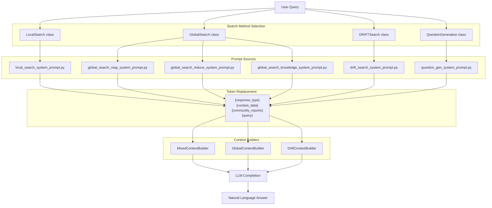
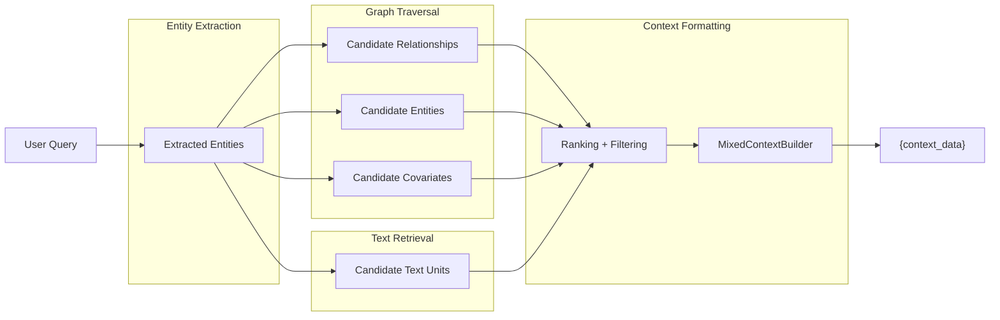
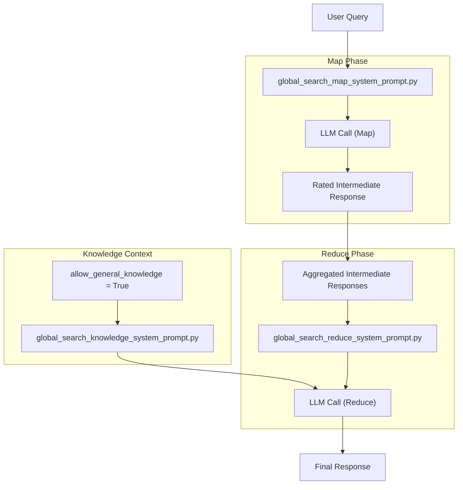
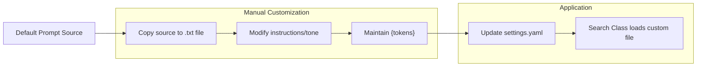

<!-- source: DeepWiki mcp.deepwiki.com · repo microsoft/graphrag · page 6.3 Query Prompts · fetched 2026-10-26 -->

# Query Prompts

Relevant source files

The following files were used as context for generating this wiki page:

- [docs/blog_posts.md](docs/blog_posts.md)
- [docs/index/overview.md](docs/index/overview.md)
- [docs/prompt_tuning/manual_prompt_tuning.md](docs/prompt_tuning/manual_prompt_tuning.md)
- [docs/query/drift_search.md](docs/query/drift_search.md)
- [docs/query/global_search.md](docs/query/global_search.md)
- [docs/query/local_search.md](docs/query/local_search.md)
- [docs/query/question_generation.md](docs/query/question_generation.md)
- [packages/graphrag/graphrag/query/llm/text_utils.py](packages/graphrag/graphrag/query/llm/text_utils.py)

This page documents the prompt templates used during the query phase of GraphRAG. Query prompts control how the system generates natural language answers from the indexed knowledge graph and text units. For information about prompts used during indexing, see [6.2 Indexing Prompts](). For general information about prompt customization and file structure, see [6.1 Prompt Files and Customization]().

## Overview

Query prompts are template files that define how the LLM should process retrieved context and generate answers for user queries. Each search method (Local, Global, DRIFT, and Basic) uses different prompt strategies tailored to its retrieval approach. Prompts use a token-replacement system where placeholders like `{context_data}` and `{response_type}` are dynamically filled with relevant information at query time [docs/prompt_tuning/manual_prompt_tuning.md:5-8]().

The query system supports several distinct search and utility modes, each with its own prompt configuration:

| Search Method | Prompt Files | Purpose |
|---------------|-------------|---------|
| **Local Search** | 1 system prompt | Entity-centric retrieval with graph traversal [docs/query/local_search.md:5-6]() |
| **Global Search** | 3 prompts (map, reduce, knowledge) | Community-level summarization with map-reduce [docs/query/global_search.md:48]() |
| **DRIFT Search** | 1 system prompt | Hybrid approach combining global insights and local refinements [docs/query/drift_search.md:15]() |
| **Question Gen** | 1 system prompt | Generates candidate follow-up questions from entities [docs/query/question_generation.md:5]() |

Sources: [docs/prompt_tuning/manual_prompt_tuning.md:55-90](), [docs/query/question_generation.md:12-16]()

## Query Prompt Architecture

**Query Prompt Flow Diagram** - This diagram shows how user queries route through different search method classes, each loading specific prompt templates. Prompts use token replacement to inject context assembled from indexed data before calling the LLM.

Sources: [docs/query/local_search.md:49-57](), [docs/query/global_search.md:55-63](), [docs/query/drift_search.md:22-28](), [docs/query/question_generation.md:12-19]()

## Token Replacement System

Query prompts use a template system with placeholder tokens enclosed in curly braces. These tokens are replaced with dynamic content at runtime [docs/prompt_tuning/manual_prompt_tuning.md:7]().

### Common Tokens

| Token | Description | Used In |
|-------|-------------|---------|
| `{response_type}` | Describes expected response format (default: "multiple paragraphs") | Local, Global (reduce), DRIFT |
| `{context_data}` | Data tables from GraphRAG index formatted as context | Local, Global, DRIFT |
| `{query}` | The user's query text | DRIFT |
| `{community_reports}` | Most relevant community reports for the query | DRIFT |

Sources: [docs/prompt_tuning/manual_prompt_tuning.md:61-90]()

## Local Search Prompts

Local search uses a single system prompt that instructs the LLM to answer queries based on entity-centric context retrieved through graph traversal [docs/query/local_search.md:5]().

### Configuration

The `LocalSearch` class uses a `system_prompt` parameter to define the template [docs/query/local_search.md:53]().

### Prompt Source Location

The default local search prompt template is defined at [packages/graphrag/graphrag/prompts/query/local_search_system_prompt.py:59-65]().

### Context Assembly Process

**Local Search Context Assembly** - Shows how `LocalSearch` builds context by extracting entities from the query, traversing the knowledge graph, and formatting everything into the `{context_data}` token using `MixedContextBuilder` [docs/query/local_search.md:9-45]().

Sources: [docs/query/local_search.md:49-57](), [docs/prompt_tuning/manual_prompt_tuning.md:57-65]()

## Global Search Prompts

Global search employs a map-reduce architecture with three distinct prompts. This approach allows the system to process community reports in parallel (map phase) and then synthesize a final answer (reduce phase) [docs/query/global_search.md:48]().

### Prompt Configuration

The `GlobalSearch` class takes `map_system_prompt`, `reduce_system_prompt`, and `general_knowledge_inclusion_prompt` as parameters [docs/query/global_search.md:59-63]().

### Map-Reduce Flow

**Global Search Map-Reduce Architecture** - Illustrates how global search processes community reports using the map prompt, then combines intermediate answers with the reduce prompt [docs/query/global_search.md:11-48]().

### Prompt Source Locations

- **Map Prompt**: [packages/graphrag/graphrag/prompts/query/global_search_map_system_prompt.py:68-70]()
- **Reduce Prompt**: [packages/graphrag/graphrag/prompts/query/global_search_reduce_system_prompt.py:70-72]()
- **Knowledge Prompt**: [packages/graphrag/graphrag/prompts/query/global_search_knowledge_system_prompt.py:72-74]()

Sources: [docs/query/global_search.md:55-70](), [docs/prompt_tuning/manual_prompt_tuning.md:67-80]()

## DRIFT Search Prompts

DRIFT Search (Dynamic Reasoning and Inference with Flexible Traversal) builds upon the standard GraphRAG technique by combining global and local search characteristics [docs/query/drift_search.md:7](). It compares the user's query with relevant community reports to generate an initial answer and follow-up questions for further exploration [docs/query/drift_search.md:15]().

### Configuration

The `DRIFTSearch` class utilizes a `DriftContextBuilder` to prepare context data from community reports and query information [docs/query/drift_search.md:25](). It also uses a `query_state` object to track the execution of actions and follow-ups [docs/query/drift_search.md:28]().

### Prompt Source Location

- **System Prompt**: [packages/graphrag/graphrag/prompts/query/drift_search_system_prompt.py:83-85]()

Sources: [docs/prompt_tuning/manual_prompt_tuning.md:82-90](), [docs/query/drift_search.md:22-28]()

## Question Generation Prompts

The question generation method uses a context-building approach similar to local search to generate candidate follow-up questions based on specific entities [docs/query/question_generation.md:5-8]().

### Configuration

The `QuestionGeneration` class uses a `system_prompt` parameter for its template [docs/query/question_generation.md:16](). It leverages the same `MixedContextBuilder` used in local search to prepare context data [docs/query/question_generation.md:15]().

### Prompt Source Location

- **System Prompt**: [packages/graphrag/graphrag/prompts/query/question_gen_system_prompt.py:16-18]()

Sources: [docs/query/question_generation.md:12-19]()

## Prompt Customization

All query prompts can be customized. While the indexing package provides auto-tuning for graph extraction prompts, query prompts are typically tuned manually to adjust the style and depth of the generated answers [docs/prompt_tuning/manual_prompt_tuning.md:3-5]().

### Customization Process

**Prompt Customization Workflow** - Demonstrates the process of overriding default query prompts by providing custom text files in the configuration [docs/prompt_tuning/manual_prompt_tuning.md:1-8]().

### Best Practices

- **Maintain Tokens**: Ensure all required tokens like `{context_data}` are present in custom templates [docs/prompt_tuning/manual_prompt_tuning.md:7]().
- **Response Type**: Use the `{response_type}` token to allow dynamic control of output format (e.g., "Multiple Paragraphs", "Multi-Page Report") [docs/query/local_search.md:54]().
- **Token Budget**: Be aware of the `max_data_tokens` or `max_context_tokens` settings, as the context builder will truncate data to fit the LLM's window [docs/query/global_search.md:64]().
- **JSON Handling**: When prompts require JSON output, the system uses `try_parse_json_object` to clean and repair potentially malformed LLM responses [packages/graphrag/graphrag/query/llm/text_utils.py:49-53]().

Sources: [docs/prompt_tuning/manual_prompt_tuning.md:1-8](), [docs/query/global_search.md:55-70](), [packages/graphrag/graphrag/query/llm/text_utils.py:49-109]()

---

