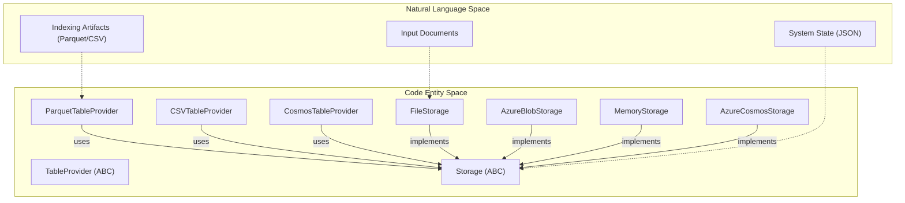
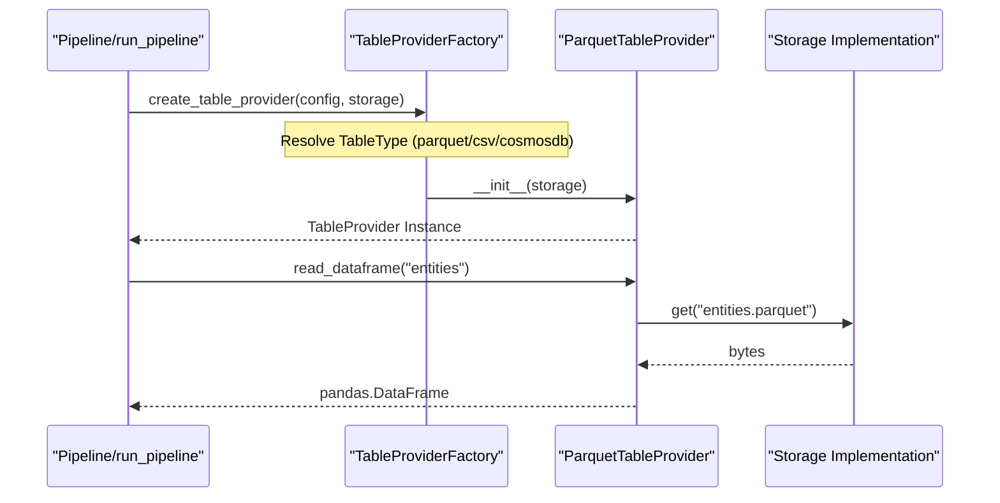
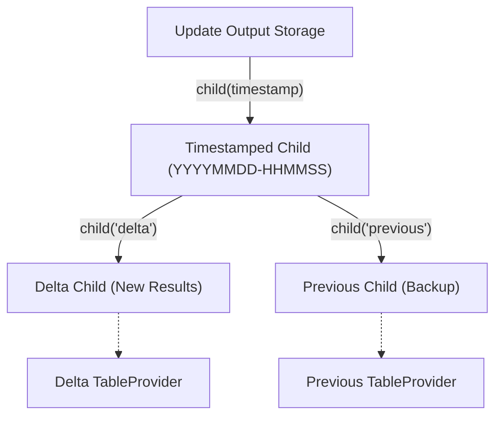

<!-- source: DeepWiki mcp.deepwiki.com · repo microsoft/graphrag · page 7.1 Storage Architecture and Factory Pattern · fetched 2026-10-26 -->

# Storage Architecture and Factory Pattern

Relevant source files

The following files were used as context for generating this wiki page:

- [packages/graphrag-storage/graphrag_storage/tables/csv_table_provider.py](packages/graphrag-storage/graphrag_storage/tables/csv_table_provider.py)
- [packages/graphrag-storage/graphrag_storage/tables/parquet_table_provider.py](packages/graphrag-storage/graphrag_storage/tables/parquet_table_provider.py)
- [packages/graphrag-storage/graphrag_storage/tables/table_provider.py](packages/graphrag-storage/graphrag_storage/tables/table_provider.py)
- [tests/integration/storage/test_factory.py](tests/integration/storage/test_factory.py)

## Purpose and Scope

This page documents the storage abstraction layer and factory patterns used in GraphRAG to manage data persistence. The system utilizes a decoupled architecture where high-level workflows interact with abstract interfaces (`Storage`, `TableProvider`), while concrete implementations (File, Azure Blob, Cosmos DB) are instantiated at runtime via specialized factories. This allows GraphRAG to switch between local development and cloud-scale production environments through configuration changes alone.

## Storage Abstraction Layer

The core of GraphRAG's persistence logic resides in the `graphrag-storage` package. It provides two primary levels of abstraction:
1.  **Blob/File Storage**: Low-level byte or string persistence (e.g., `get`, `set`, `has`) defined by the `Storage` interface. [packages/graphrag-storage/graphrag_storage/storage.py:1-50]()
2.  **Table Storage**: High-level structured data operations using `pandas.DataFrame` or row-based streaming via the `TableProvider` interface. [packages/graphrag-storage/graphrag_storage/tables/table_provider.py:14-103]()

### Natural Language to Code Entity Mapping: Storage Flow

The following diagram maps high-level storage concepts to the specific code entities that implement them.

Sources: [packages/graphrag-storage/graphrag_storage/storage.py:1-50](), [packages/graphrag-storage/graphrag_storage/tables/table_provider.py:14-103](), [packages/graphrag-storage/graphrag_storage/tables/parquet_table_provider.py:20-139](), [packages/graphrag-storage/graphrag_storage/tables/csv_table_provider.py:21-140](), [tests/integration/storage/test_factory.py:18-21]()

## Table Provider Factory Pattern

GraphRAG uses a `TableProviderFactory` to manage different table formats and backends. This factory allows the system to remain agnostic of the underlying storage implementation during indexing and querying.

### Table Provider Architecture

The `create_table_provider` function serves as the entry point, resolving the requested `TableType` and injecting the required `Storage` backend. For Cosmos DB, it automatically extracts connection details from the provided `Storage` instance to simplify configuration. [packages/graphrag-storage/graphrag_storage/tables/table_provider_factory.py:41-109]()

Sources: [packages/graphrag-storage/graphrag_storage/tables/table_provider_factory.py:41-109](), [packages/graphrag-storage/graphrag_storage/tables/parquet_table_provider.py:39-67](), [packages/graphrag-storage/graphrag_storage/tables/csv_table_provider.py:43-77]()

### Supported Table Providers

| Provider Type | Class | Extension/Backend | Requirements |
| :--- | :--- | :--- | :--- |
| **Parquet** | `ParquetTableProvider` | `.parquet` | Supports any `Storage` backend. [packages/graphrag-storage/graphrag_storage/tables/parquet_table_provider.py:20-26]() |
| **CSV** | `CSVTableProvider` | `.csv` | Restricted to `FileStorage` backends. [packages/graphrag-storage/graphrag_storage/tables/csv_table_provider.py:38-40]() |
| **CosmosDB** | `CosmosTableProvider` | Azure Cosmos DB | Requires `AzureCosmosStorage` for credential sharing. [packages/graphrag-storage/graphrag_storage/tables/table_provider_factory.py:92-108]() |

## Storage in the Indexing Pipeline

During a pipeline run, multiple storage and provider instances are created to handle input, output, and incremental updates.

### Storage Initialization in `run_pipeline`

The `run_pipeline` function initializes the environment by creating storage instances for different purposes based on the `GraphRagConfig`.

1.  **Input Storage**: Where raw source documents reside. [packages/graphrag/graphrag/index/run/run_pipeline.py:39-39]()
2.  **Output Storage**: Where final artifacts (entities, relationships) are stored. [packages/graphrag/graphrag/index/run/run_pipeline.py:41-41]()
3.  **Table Provider**: Wraps the output storage to provide DataFrame access. [packages/graphrag/graphrag/index/run/run_pipeline.py:43-43]()
4.  **State Management**: The pipeline persists `context.json` and `stats.json` directly to the output storage. [packages/graphrag/graphrag/index/run/run_pipeline.py:160-179]()

### Incremental Indexing Storage Flow

When `is_update_run` is True, the pipeline creates a namespaced storage hierarchy using the `child()` method to isolate delta results and backups of previous runs. [packages/graphrag/graphrag/index/run/run_pipeline.py:57-73]()

Sources: [packages/graphrag/graphrag/index/run/run_pipeline.py:57-73](), [packages/graphrag-storage/graphrag_storage/storage.py:35-37](), [packages/graphrag-storage/graphrag_storage/tables/table_provider.py:104-121]()

## Registration and Customization

The factory pattern allows for easy extension of the storage system. Custom implementations can be registered at runtime.

- **Storage Registration**: Use `register_storage(type_name, initializer)` to add new backends to the `StorageFactory`. [tests/integration/storage/test_factory.py:11-17](), [tests/integration/storage/test_factory.py:74-94]()
- **Table Provider Registration**: Use `register_table_provider(table_type, table_initializer)` to add new table formats or database integrations. [packages/graphrag-storage/graphrag_storage/tables/table_provider_factory.py:24-38]()

The `TableProviderConfig` uses Pydantic's `extra="allow"` to permit passing custom parameters through the configuration system to these registered initializers. [packages/graphrag-storage/graphrag_storage/tables/table_provider_config.py:11-15]()

Sources: [packages/graphrag-storage/graphrag_storage/storage.py:1-50](), [packages/graphrag-storage/graphrag_storage/tables/table_provider.py:1-122](), [packages/graphrag-storage/graphrag_storage/tables/table_provider_factory.py:1-110](), [packages/graphrag-storage/graphrag_storage/tables/parquet_table_provider.py:1-145](), [packages/graphrag-storage/graphrag_storage/tables/csv_table_provider.py:1-151](), [packages/graphrag/graphrag/index/run/run_pipeline.py:1-189](), [packages/graphrag-storage/graphrag_storage/tables/table_provider_config.py:1-36](), [tests/integration/storage/test_factory.py:1-151]()

---

