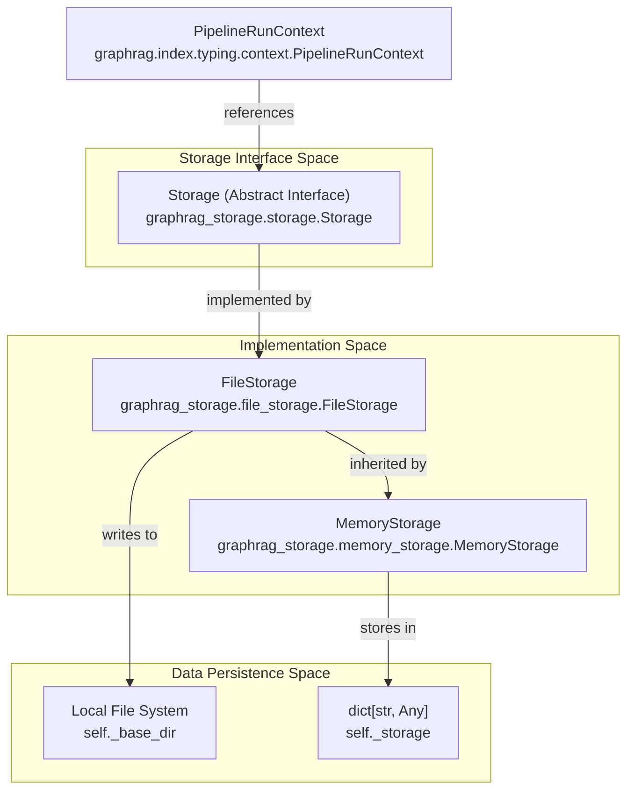
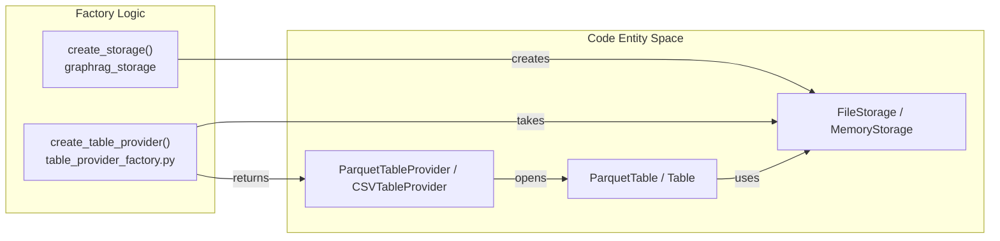

<!-- source: DeepWiki mcp.deepwiki.com · repo microsoft/graphrag · page 7.2 File and Memory Storage · fetched 2026-10-26 -->

# File and Memory Storage

Relevant source files

The following files were used as context for generating this wiki page:

- [packages/graphrag-input/graphrag_input/csv.py](packages/graphrag-input/graphrag_input/csv.py)
- [packages/graphrag-storage/graphrag_storage/file_storage.py](packages/graphrag-storage/graphrag_storage/file_storage.py)
- [packages/graphrag-storage/graphrag_storage/memory_storage.py](packages/graphrag-storage/graphrag_storage/memory_storage.py)
- [packages/graphrag-storage/graphrag_storage/tables/parquet_table.py](packages/graphrag-storage/graphrag_storage/tables/parquet_table.py)
- [packages/graphrag-storage/graphrag_storage/tables/table.py](packages/graphrag-storage/graphrag_storage/tables/table.py)
- [packages/graphrag/graphrag/cli/query.py](packages/graphrag/graphrag/cli/query.py)
- [packages/graphrag/graphrag/index/workflows/create_community_reports.py](packages/graphrag/graphrag/index/workflows/create_community_reports.py)
- [packages/graphrag/graphrag/index/workflows/create_final_text_units.py](packages/graphrag/graphrag/index/workflows/create_final_text_units.py)
- [packages/graphrag/graphrag/index/workflows/update_covariates.py](packages/graphrag/graphrag/index/workflows/update_covariates.py)
- [tests/unit/indexing/input/test_csv_loader.py](tests/unit/indexing/input/test_csv_loader.py)
- [tests/unit/storage/test_parquet_table_provider.py](tests/unit/storage/test_parquet_table_provider.py)

## Purpose and Scope

This document covers the local filesystem storage (`FileStorage`) and in-memory storage (`MemoryStorage`) implementations provided by the `graphrag-storage` package. These are the two non-cloud storage backends that GraphRAG supports for storing indexing artifacts, intermediate data, and query results.

For the overall storage architecture and factory pattern, see [7.1 Storage Architecture and Factory Pattern](). For cloud-based storage options, see [7.3 Azure Storage Integration]().

---

## Storage Backend Overview

GraphRAG provides two local storage backends that implement the `Storage` interface:

| Storage Type | Implementation Class | Primary Use Case | Persistence |
|-------------|---------------------|------------------|-------------|
| `file` | `FileStorage` | Production indexing and query operations | Persistent on disk |
| `memory` | `MemoryStorage` | Testing and development | Transient in RAM |

Both storage backends support the same operations defined by the `Storage` interface, making them interchangeable in the GraphRAG pipeline.

Title: "Storage Implementation Hierarchy and Usage"

**Sources:** [packages/graphrag-storage/graphrag_storage/file_storage.py:27-28](), [packages/graphrag-storage/graphrag_storage/memory_storage.py:16-16](), [packages/graphrag/graphrag/index/typing/context.py:1-50]()

---

## FileStorage Implementation

### Overview

`FileStorage` is the default storage backend for GraphRAG operations. It stores all artifacts as files in a local directory structure, organizing outputs by workflow and data type.

**Class Location:** [packages/graphrag-storage/graphrag_storage/file_storage.py:27-155]()

### Initialization and Operations

The `FileStorage` class is initialized with a base directory path and optional encoding [packages/graphrag-storage/graphrag_storage/file_storage.py:33-38](). It uses `aiofiles` for asynchronous file I/O to prevent blocking the event loop during indexing or query operations.

Key methods include:
- `get()`: Reads file contents as either text or bytes [packages/graphrag-storage/graphrag_storage/file_storage.py:70-79]().
- `set()`: Writes data to a file, automatically handling directory creation [packages/graphrag-storage/graphrag_storage/file_storage.py:98-108]().
- `find()`: Recursively searches for files matching a regex pattern [packages/graphrag-storage/graphrag_storage/file_storage.py:40-69]().
- `child()`: Creates a new `FileStorage` instance pointing to a subdirectory [packages/graphrag-storage/graphrag_storage/file_storage.py:127-132]().
- `get_path()`: Returns the full `Path` for a given key, facilitating streaming access [packages/graphrag-storage/graphrag_storage/file_storage.py:147-150]().

### Use in Workflows

During indexing workflows, `FileStorage` is utilized via the `PipelineRunContext`. For example, in the `create_final_text_units` workflow, the `output_table_provider` (which wraps a `Storage` instance) is used to open multiple tables for reading and writing [packages/graphrag/graphrag/index/workflows/create_final_text_units.py:47-62]().

---

## MemoryStorage Implementation

### Overview

`MemoryStorage` is an in-memory storage backend designed for testing and development. It extends `FileStorage` but overrides the persistence logic to use a Python dictionary [packages/graphrag-storage/graphrag_storage/memory_storage.py:16-29]().

**Class Location:** [packages/graphrag-storage/graphrag_storage/memory_storage.py:16-103]()

### Implementation Details

- **Storage Dictionary**: Data is stored in `self._storage = {}` [packages/graphrag-storage/graphrag_storage/memory_storage.py:29-29]().
- **Non-persistent Operations**: `get`, `set`, `has`, and `delete` are implemented as standard dictionary lookups and assignments [packages/graphrag-storage/graphrag_storage/memory_storage.py:31-73]().
- **Pattern Matching**: The `find()` method iterates over dictionary keys to match regex patterns [packages/graphrag-storage/graphrag_storage/memory_storage.py:87-103]().
- **Clear**: The `clear()` method resets the internal dictionary [packages/graphrag-storage/graphrag_storage/memory_storage.py:75-77]().

---

## Table and Provider Integration

The storage layer is accessed via the `Table` abstraction, which provides row-by-row streaming access to structured data [packages/graphrag-storage/graphrag_storage/tables/table.py:16-47]().

### Parquet Streaming Implementation

The `ParquetTable` class simulates streaming for Parquet files, which are inherently block-based.

| Feature | Implementation Detail | Source |
|---------|-----------------------|--------|
| **Read Strategy** | Loads entire DataFrame into memory, yields rows via `iterrows()` | [packages/graphrag-storage/graphrag_storage/tables/parquet_table.py:89-100]() |
| **Write Strategy** | Accumulates rows in a list, writes as a single Parquet file on `close()` | [packages/graphrag-storage/graphrag_storage/tables/parquet_table.py:122-149]() |
| **Transformation** | Supports a `RowTransformer` to convert dicts to Pydantic models or other types | [packages/graphrag-storage/graphrag_storage/tables/parquet_table.py:27-35]() |
| **Truncation** | Supports overwriting (`truncate=True`) or appending (`truncate=False`) to existing files | [packages/graphrag-storage/graphrag_storage/tables/parquet_table.py:134-147]() |

### Table Provider Factory

The `create_table_provider` function initializes the appropriate provider (Parquet or CSV) and injects the configured `Storage` instance into it.

Title: "Storage and Table Provider Association"

**Sources:** [packages/graphrag-storage/graphrag_storage/tables/parquet_table.py:68-74](), [packages/graphrag-storage/graphrag_storage/tables/table_provider_factory.py:12-12]()

---

## Use in Indexing and Querying

### Query Execution
The query CLI resolves output files by creating a storage instance from the configuration and reading the required DataFrames [packages/graphrag/graphrag/cli/query.py:11-12](). For instance, `run_global_search` and `run_local_search` load tables like `entities`, `communities`, and `community_reports` from the storage backend [packages/graphrag/graphrag/cli/query.py:50-60](), [packages/graphrag/graphrag/cli/query.py:134-153]().

### Structured Input Reading
The `CSVFileReader` uses the `Storage` instance to retrieve raw CSV data before parsing it into `TextDocument` objects [packages/graphrag-input/graphrag_input/csv.py:41-45]().

### Incremental Updates
During incremental updates, the `update_covariates` workflow utilizes multiple table providers (previous, delta, and output) to merge data and write the result back to storage [packages/graphrag/graphrag/index/workflows/update_covariates.py:27-53]().

**Sources:** [packages/graphrag/graphrag/cli/query.py:40-60](), [packages/graphrag-input/graphrag_input/csv.py:31-45](), [packages/graphrag/graphrag/index/workflows/update_covariates.py:21-53]()

---

