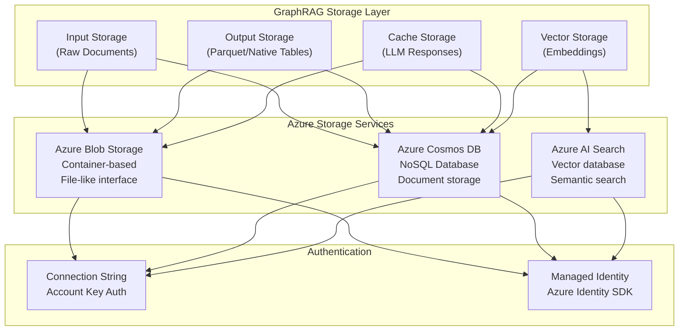
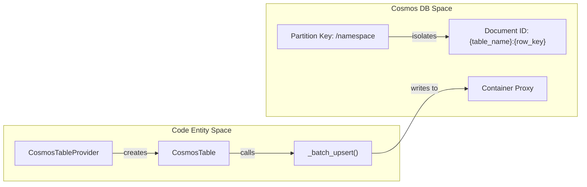

<!-- source: DeepWiki mcp.deepwiki.com · repo microsoft/graphrag · page 7.3 Azure Storage Integration · fetched 2026-10-26 -->

# Azure Storage Integration

<details>
<summary>Relevant source files</summary>

The following files were used as context for generating this wiki page:

- [dictionary.txt](dictionary.txt)
- [docs/config/models.md](docs/config/models.md)
- [docs/get_started.md](docs/get_started.md)
- [docs/visualization_guide.md](docs/visualization_guide.md)
- [mkdocs.yaml](mkdocs.yaml)
- [packages/graphrag-storage/COSMOS_TABLE_PROVIDER_DESIGN.md](packages/graphrag-storage/COSMOS_TABLE_PROVIDER_DESIGN.md)
- [packages/graphrag-storage/graphrag_storage/azure_cosmos_storage.py](packages/graphrag-storage/graphrag_storage/azure_cosmos_storage.py)
- [packages/graphrag-storage/graphrag_storage/tables/cosmos_table.py](packages/graphrag-storage/graphrag_storage/tables/cosmos_table.py)
- [packages/graphrag-storage/graphrag_storage/tables/cosmos_table_provider.py](packages/graphrag-storage/graphrag_storage/tables/cosmos_table_provider.py)
- [tests/integration/storage/test_cosmosdb_storage.py](tests/integration/storage/test_cosmosdb_storage.py)

</details>


## Purpose and Scope

This document describes GraphRAG's integration with Microsoft Azure storage services for persisting indexing artifacts, caching LLM responses, and storing vector embeddings. GraphRAG supports three primary Azure storage backends: Azure Blob Storage, Azure Cosmos DB, and Azure AI Search. 

The system provides two distinct layers for Azure interaction: a general-purpose key-value `Storage` interface and a specialized `TableProvider` interface for high-performance tabular data handling.

---

## Azure Storage Services Overview

GraphRAG integrates with Azure services to handle different data types in the indexing and query pipeline:



**Storage Backend Mapping:**
| GraphRAG Storage Type | Azure Service | Primary Use Cases |
|----------------------|---------------|-------------------|
| `StorageType.Blob` | Azure Blob Storage | Parquet artifacts, cache files, input documents |
| `StorageType.Cosmos` | Azure Cosmos DB | Key-value metadata, pipeline state, LLM cache |
| `TableType.CosmosDB` | Azure Cosmos DB | Native tabular data storage (NoSQL documents) |
| `VectorStoreType.AzureAISearch` | Azure AI Search | Vector embeddings for entities and text units |

**Sources:** [packages/graphrag-storage/graphrag_storage/azure_cosmos_storage.py:4-11](), [packages/graphrag-storage/graphrag_storage/tables/cosmos_table_provider.py:1-19](), [packages/graphrag-storage/COSMOS_TABLE_PROVIDER_DESIGN.md:30-42]()

---

## Azure Blob Storage Integration

Azure Blob Storage integration provides a cloud-based file storage backend through the `AzureBlobStorage` class. This implementation uses the `azure-storage-blob` SDK to store parquet files, cache data, and input documents in blob containers.

### Local Development with Azurite

For local development and smoke testing, GraphRAG supports the Azurite storage emulator. A well-known connection string is often used for local testing environments [tests/integration/storage/test_cosmosdb_storage.py:14]().

---

## Azure Cosmos DB Integration

GraphRAG provides two distinct ways to interact with Cosmos DB: a Key-Value storage implementation and a Native Table implementation.

### 1. Key-Value Storage (`AzureCosmosStorage`)

The `AzureCosmosStorage` class provides a simple key-value store for non-tabular data such as pipeline state (`context.json`), GraphML snapshots, and LLM cache entries [packages/graphrag-storage/graphrag_storage/azure_cosmos_storage.py:4-10]().

*   **Partitioning**: Uses a partition key of `/id` [packages/graphrag-storage/graphrag_storage/azure_cosmos_storage.py:106]().
*   **Data Model**: Each item is stored as `{"id": key, "body": <parsed JSON or string>}` [packages/graphrag-storage/graphrag_storage/azure_cosmos_storage.py:37]().
*   **Search**: Supports `RegexMatch` for finding documents by pattern within the container [packages/graphrag-storage/graphrag_storage/azure_cosmos_storage.py:132]().
*   **Namespace Isolation**: The `child()` method creates a new instance that prefixes all keys with `{namespace}:` to avoid collision in shared containers [packages/graphrag-storage/graphrag_storage/azure_cosmos_storage.py:41-43](), [packages/graphrag-storage/graphrag_storage/azure_cosmos_storage.py:115-121]().

### 2. Native Table Provider (`CosmosTableProvider`)

The `CosmosTableProvider` implements the `TableProvider` interface directly, bypassing the `Storage` layer to avoid Parquet serialization overhead [packages/graphrag-storage/COSMOS_TABLE_PROVIDER_DESIGN.md:24-26]().



**Key Features:**
*   **Namespace Isolation**: Uses the `/namespace` partition key to isolate different pipeline runs (e.g., `delta` vs `previous`) [packages/graphrag-storage/graphrag_storage/tables/cosmos_table_provider.py:11-19]().
*   **Single-Partition Queries**: All queries (read, count, clear) target a single namespace partition to minimize Request Units (RU) [packages/graphrag-storage/COSMOS_TABLE_PROVIDER_DESIGN.md:79-89]().
*   **Batching**: Uses `_batch_upsert` to flush accumulated rows to Cosmos DB efficiently using the async SDK [packages/graphrag-storage/graphrag_storage/tables/cosmos_table.py:167-173]().
*   **Metadata Stripping**: Automatically removes Cosmos-specific fields like `_rid`, `_self`, and `_etag` when reading data back into DataFrames [packages/graphrag-storage/graphrag_storage/tables/cosmos_table.py:40-58]().

**Sources:** [packages/graphrag-storage/graphrag_storage/azure_cosmos_storage.py:34-43](), [packages/graphrag-storage/graphrag_storage/tables/cosmos_table_provider.py:48-55](), [packages/graphrag-storage/graphrag_storage/tables/cosmos_table.py:60-66](), [packages/graphrag-storage/COSMOS_TABLE_PROVIDER_DESIGN.md:44-60]()

---

## Azure AI Search Integration

Azure AI Search is used primarily as a vector store. It is configured in the `vector_store` section of the settings. Users can provide the service URL and API key to enable semantic retrieval during query workflows.

**Configuration Example:**
```yaml
vector_store:
  type: "azure_ai_search"
  url: https://<instance>.search.windows.net
  api_key: <API_KEY>
  container_name: "graphrag-index"
```
**Sources:** [docs/get_started.md:74-85](), [docs/config/models.md:42-68]()

---

## Authentication and Security

GraphRAG supports two primary authentication modes for Azure services:

1.  **Connection String**: Explicit credentials passed via environment variables or settings [packages/graphrag-storage/graphrag_storage/azure_cosmos_storage.py:73-74]().
2.  **Managed Identity**: Uses `DefaultAzureCredential` for passwordless authentication in Azure environments. This is enabled when an `account_url` is provided without a connection string [packages/graphrag-storage/graphrag_storage/azure_cosmos_storage.py:75-79](), [packages/graphrag-storage/graphrag_storage/tables/cosmos_table_provider.py:104-108]().

**Managed Identity Configuration:**
```yaml
# Example for Azure OpenAI, similar logic applies to Storage
auth_method: azure_managed_identity 
```
**Sources:** [docs/get_started.md:87-95](), [packages/graphrag-storage/graphrag_storage/tables/cosmos_table_provider.py:107-108]()

---

## Summary of Key Classes

| Class | Package | Responsibility |
|-------|---------|----------------|
| `AzureCosmosStorage` | `graphrag-storage` | Implements `Storage` (Key-Value) for Cosmos DB [packages/graphrag-storage/graphrag_storage/azure_cosmos_storage.py:34](). |
| `CosmosTableProvider` | `graphrag-storage` | Implements `TableProvider` for high-perf tabular Cosmos DB access [packages/graphrag-storage/graphrag_storage/tables/cosmos_table_provider.py:48](). |
| `CosmosTable` | `graphrag-storage` | Handles streaming row-level operations for a specific Cosmos table [packages/graphrag-storage/graphrag_storage/tables/cosmos_table.py:60](). |

**Sources:** [packages/graphrag-storage/graphrag_storage/azure_cosmos_storage.py:34](), [packages/graphrag-storage/graphrag_storage/tables/cosmos_table_provider.py:48](), [packages/graphrag-storage/graphrag_storage/tables/cosmos_table.py:60]()

---

