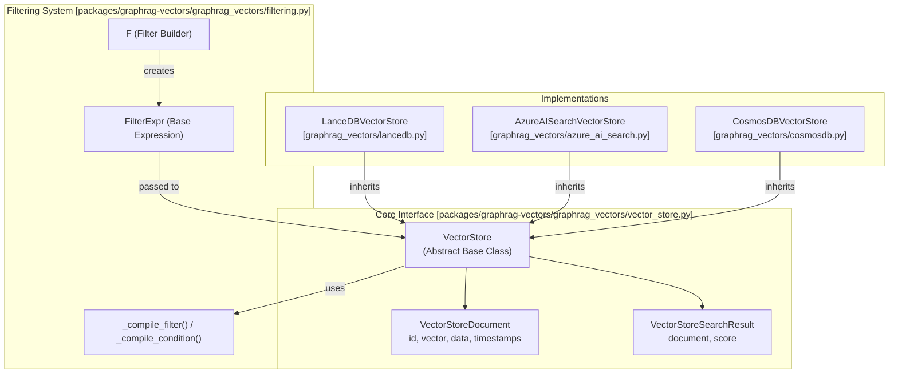
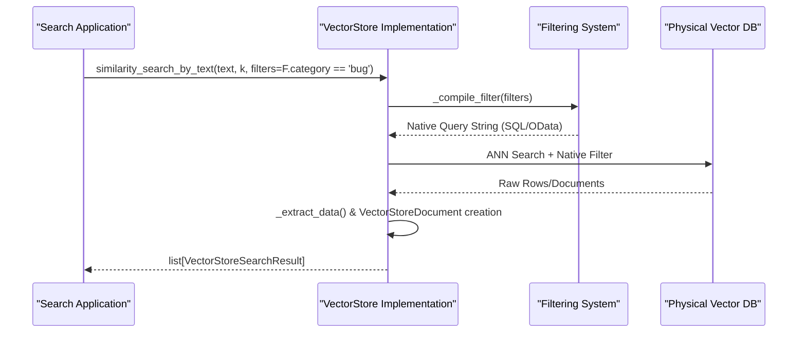
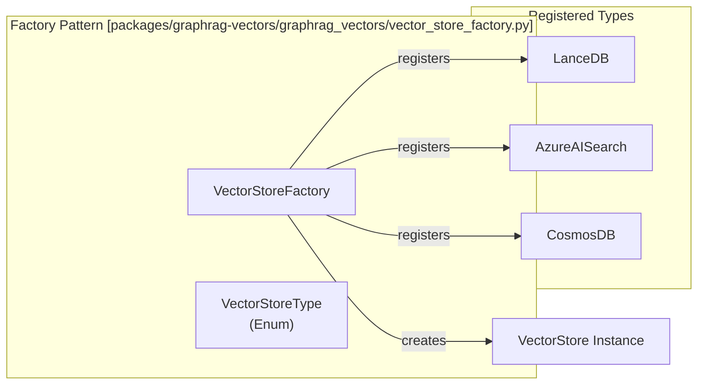

<!-- source: DeepWiki mcp.deepwiki.com · repo microsoft/graphrag · page 7.4 Vector Store Architecture · fetched 2026-10-26 -->

# Vector Store Architecture

<details>
<summary>Relevant source files</summary>

The following files were used as context for generating this wiki page:

- [packages/graphrag-vectors/graphrag_vectors/azure_ai_search.py](packages/graphrag-vectors/graphrag_vectors/azure_ai_search.py)
- [packages/graphrag-vectors/graphrag_vectors/cosmosdb.py](packages/graphrag-vectors/graphrag_vectors/cosmosdb.py)
- [packages/graphrag-vectors/graphrag_vectors/lancedb.py](packages/graphrag-vectors/graphrag_vectors/lancedb.py)
- [packages/graphrag-vectors/graphrag_vectors/vector_store.py](packages/graphrag-vectors/graphrag_vectors/vector_store.py)
- [tests/integration/vector_stores/test_azure_ai_search.py](tests/integration/vector_stores/test_azure_ai_search.py)
- [tests/integration/vector_stores/test_cosmosdb.py](tests/integration/vector_stores/test_cosmosdb.py)
- [tests/integration/vector_stores/test_factory.py](tests/integration/vector_stores/test_factory.py)
- [tests/integration/vector_stores/test_lancedb.py](tests/integration/vector_stores/test_lancedb.py)
- [tests/unit/query/context_builder/test_entity_extraction.py](tests/unit/query/context_builder/test_entity_extraction.py)

</details>


## Purpose and Scope

This document describes the vector store architecture in GraphRAG, which provides persistent storage and retrieval of vector embeddings used for semantic search operations. The vector store subsystem enables efficient similarity search across entities, text units, and community content during both indexing and querying. It features a unified filtering system and automatic timestamp handling to support complex retrieval patterns.

**Sources:** [packages/graphrag-vectors/graphrag_vectors/vector_store.py:4-10]()

---

## Architecture Overview

The vector store subsystem implements an abstract base class (`VectorStore`) that supports multiple backend implementations. Each implementation provides specialized logic for connecting to storage, creating indices, and compiling generic filter expressions into native query languages.

### Code Entity Space to Natural Language Space

The following diagram associates code entities with their roles in the retrieval process.

**Vector Store Component Relationships**



**Data Flow: Search Request to Result**



**Sources:** [packages/graphrag-vectors/graphrag_vectors/vector_store.py:56-78](), [packages/graphrag-vectors/graphrag_vectors/filtering.py:6-14](), [packages/graphrag-vectors/graphrag_vectors/lancedb.py:27-33]()

---

## Vector Store Interface

The `VectorStore` abstract class defines the protocol for all implementations. It manages metadata fields, index names, and automatic timestamp "explosion" for filtering.

### Core Data Models

#### VectorStoreDocument
Represents the unit of storage. It uses a `data` dictionary for arbitrary metadata and includes optional timestamp fields.

| Field | Type | Description |
|-------|------|-------------|
| `id` | `str \| int` | Unique identifier. [packages/graphrag-vectors/graphrag_vectors/vector_store.py:29]() |
| `vector` | `list[float] \| None` | Embedding vector. [packages/graphrag-vectors/graphrag_vectors/vector_store.py:32]() |
| `data` | `dict[str, Any]` | Metadata dictionary for associated document data. [packages/graphrag-vectors/graphrag_vectors/vector_store.py:35]() |
| `create_date` | `str \| None` | ISO 8601 creation timestamp. [packages/graphrag-vectors/graphrag_vectors/vector_store.py:38]() |
| `update_date` | `str \| None` | ISO 8601 last update timestamp. [packages/graphrag-vectors/graphrag_vectors/vector_store.py:41]() |

### Timestamp Handling
The base class automatically "explodes" ISO 8601 timestamps into filterable components (year, month, day, etc.) using a `TimestampExploder`. This allows users to filter by specific date parts even if the underlying database doesn't support complex date logic.

- `_prepare_document`: Enriches the document data with exploded fields before insertion. [packages/graphrag-vectors/graphrag_vectors/vector_store.py:97-121]()
- `_prepare_update`: Updates the `update_date` and its exploded components. [packages/graphrag-vectors/graphrag_vectors/vector_store.py:122-133]()

**Sources:** [packages/graphrag-vectors/graphrag_vectors/vector_store.py:97-133](), [packages/graphrag-vectors/graphrag_vectors/timestamp.py:13-17]()

---

## Filtering System

GraphRAG uses an expression language for filtering that can be built programmatically using the `F` builder.

### Filter Expressions
The system supports `Condition`, `AndExpr`, `OrExpr`, and `NotExpr`. The `F` builder provides a pythonic syntax for creating these:

```python
# Programmatic usage example from notebooks
filters = (F.os == "windows") & (F.category == "bug")
```

### Supported Operators
The `Operator` enum defines standard comparisons used in `Condition` objects: `eq`, `ne`, `gt`, `gte`, `lt`, `lte`, `contains`, `startswith`, `endswith`, `in_`, `not_in`, and `exists`.

**Sources:** [packages/graphrag-vectors/graphrag_vectors/filtering.py:15-32](), [packages/graphrag-vectors/graphrag_vectors/lancedb.py:156-182]()

---

## Implementations

### LanceDB Vector Store
`LanceDBVectorStore` provides local, disk-based storage using the Lance format.

- **Index Type:** Uses `IVF_FLAT` for vector indexing. [packages/graphrag-vectors/graphrag_vectors/lancedb.py:74-76]()
- **Filter Compilation:** Converts `FilterExpr` into LanceDB SQL-compatible `WHERE` clauses. [packages/graphrag-vectors/graphrag_vectors/lancedb.py:139-185]()
- **Batch Loading:** Implements efficient batch writes using PyArrow tables. [packages/graphrag-vectors/graphrag_vectors/lancedb.py:81-126]()

### Azure AI Search Vector Store
`AzureAISearchVectorStore` integrates with cloud-based Azure AI Search.

- **Index Type:** Configures `HnswAlgorithmConfiguration` with `COSINE` metric. [packages/graphrag-vectors/graphrag_vectors/azure_ai_search.py:104-112]()
- **Filter Compilation:** Compiles filters into OData filter strings. [packages/graphrag-vectors/graphrag_vectors/azure_ai_search.py:190-206]()
- **Field Mapping:** Maps internal types (`str`, `int`, `float`, `bool`) to `SearchFieldDataType`. [packages/graphrag-vectors/graphrag_vectors/azure_ai_search.py:40-45]()

### CosmosDB Vector Store
`CosmosDBVectorStore` uses Azure Cosmos DB for NoSQL with vector search capabilities.

- **Constraint:** Requires the `id_field` to be exactly `"id"`. [packages/graphrag-vectors/graphrag_vectors/cosmosdb.py:43-45]()
- **Index Type:** Attempts to use `diskANN` vector indexing, falling back to standard indexing if unavailable (e.g., in the emulator). [packages/graphrag-vectors/graphrag_vectors/cosmosdb.py:114-138]()
- **Filter Compilation:** Compiles filters into Cosmos DB SQL WHERE clauses, prefixing fields with `c.`. [packages/graphrag-vectors/graphrag_vectors/cosmosdb.py:188-198]()

---

## Factory and Configuration

Vector stores are instantiated via the `VectorStoreFactory`.

### Factory Pattern
The `VectorStoreFactory` allows registration and creation of different vector store implementations.

- **Registration:** Natively supports `LanceDB`, `AzureAISearch`, and `CosmosDB`. [tests/integration/vector_stores/test_factory.py:18-21]()
- **Customization:** Users can register custom implementations by providing a class or factory function. [tests/integration/vector_stores/test_factory.py:63-88]()

**Vector Store Factory Registration**



**Sources:** [tests/integration/vector_stores/test_factory.py:18-21](), [tests/integration/vector_stores/test_factory.py:63-88](), [packages/graphrag-vectors/graphrag_vectors/vector_store.py:56-78]()

---

