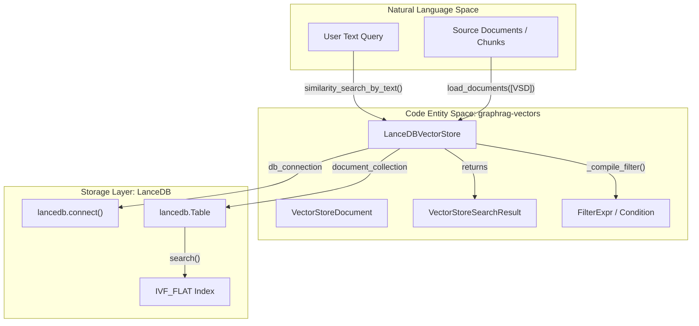
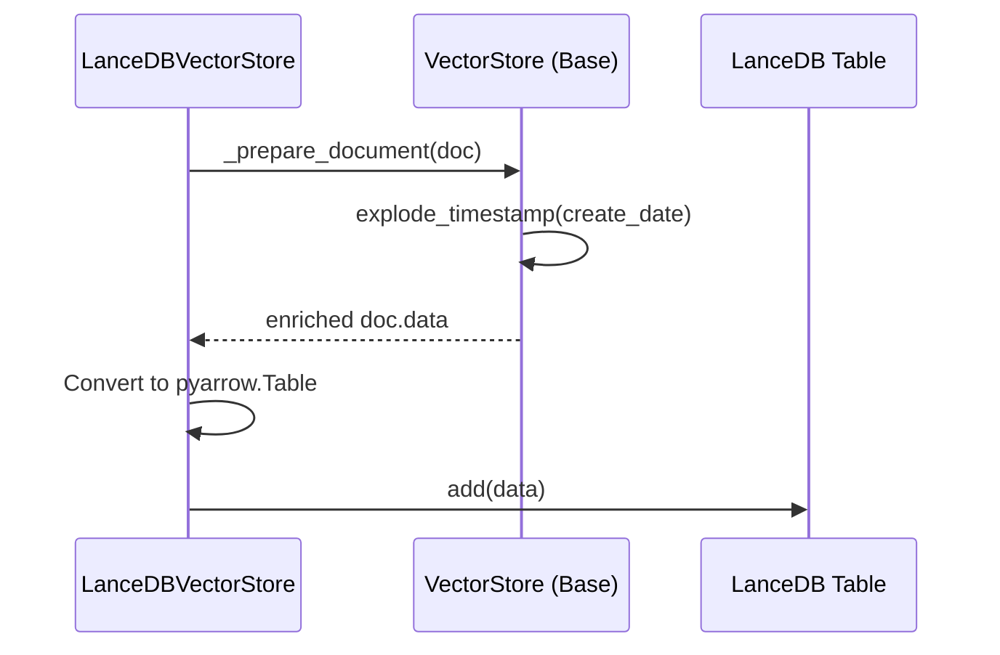
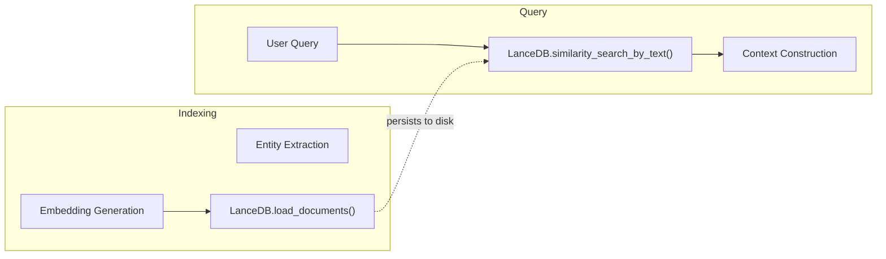

<!-- source: DeepWiki mcp.deepwiki.com · repo microsoft/graphrag · page 7.5 LanceDB Vector Store · fetched 2026-10-26 -->

# LanceDB Vector Store

<details>
<summary>Relevant source files</summary>

The following files were used as context for generating this wiki page:

- [packages/graphrag-vectors/graphrag_vectors/azure_ai_search.py](packages/graphrag-vectors/graphrag_vectors/azure_ai_search.py)
- [packages/graphrag-vectors/graphrag_vectors/cosmosdb.py](packages/graphrag-vectors/graphrag_vectors/cosmosdb.py)
- [packages/graphrag-vectors/graphrag_vectors/lancedb.py](packages/graphrag-vectors/graphrag_vectors/lancedb.py)
- [packages/graphrag-vectors/graphrag_vectors/vector_store.py](packages/graphrag-vectors/graphrag_vectors/vector_store.py)
- [tests/integration/vector_stores/test_azure_ai_search.py](tests/integration/vector_stores/test_azure_ai_search.py)
- [tests/integration/vector_stores/test_cosmosdb.py](tests/integration/vector_stores/test_cosmosdb.py)
- [tests/integration/vector_stores/test_factory.py](tests/integration/vector_stores/test_factory.py)
- [tests/integration/vector_stores/test_lancedb.py](tests/integration/vector_stores/test_lancedb.py)
- [tests/unit/query/context_builder/test_entity_extraction.py](tests/unit/query/context_builder/test_entity_extraction.py)

</details>


## Purpose and Scope

This page documents the `LanceDBVectorStore` implementation in GraphRAG, which provides local, file-based vector storage for embeddings using [LanceDB](https://lancedb.com/). LanceDB is the default vector store backend in GraphRAG, offering high-performance similarity search and persistence using the Apache Arrow format without requiring external database infrastructure.

For information about the general vector store architecture and factory pattern, see [Vector Store Architecture](7.4). For cloud-based alternatives, see [Azure AI Search Vector Store](7.6) and [Cosmos DB Vector Store](7.7).

**Sources:** [packages/graphrag-vectors/graphrag_vectors/lancedb.py:1-28](), [tests/integration/vector_stores/test_lancedb.py:1-18]()

---

## Overview

`LanceDBVectorStore` is an implementation of the `VectorStore` abstract base class [packages/graphrag-vectors/graphrag_vectors/vector_store.py:56-57](). It leverages an embedded database that stores data in `.lance` format (based on Apache Arrow/Parquet) on the local filesystem.

Key characteristics include:
- **Embedded Operation**: Runs in-process via the `lancedb` Python library [packages/graphrag-vectors/graphrag_vectors/lancedb.py:8]().
- **Schema Management**: Automatically handles schema creation using dummy records and `pyarrow.table` to initialize Arrow tables with correct types [packages/graphrag-vectors/graphrag_vectors/lancedb.py:41-80]().
- **Batch Processing**: Supports efficient batch loading of `VectorStoreDocument` objects using Arrow tables [packages/graphrag-vectors/graphrag_vectors/lancedb.py:81-117]().
- **SQL Filtering**: Compiles GraphRAG `FilterExpr` objects into LanceDB-compatible SQL WHERE clauses [packages/graphrag-vectors/graphrag_vectors/lancedb.py:139-155]().

**Sources:** [packages/graphrag-vectors/graphrag_vectors/lancedb.py:27-30](), [packages/graphrag-vectors/graphrag_vectors/vector_store.py:56-57]()

---

## Class Architecture and Data Flow

The following diagrams illustrate how the `LanceDBVectorStore` bridges the "Natural Language Space" (Queries and Documents) to the "Code Entity Space" (Classes and Methods).

### System Entity Mapping



**Sources:** [packages/graphrag-vectors/graphrag_vectors/lancedb.py:27-40](), [packages/graphrag-vectors/graphrag_vectors/vector_store.py:26-55]()

---

## Core Implementation Details

### 1. Connection and Index Creation
The `connect()` method establishes a session with the local database URI via `lancedb.connect(self.db_uri)` [packages/graphrag-vectors/graphrag_vectors/lancedb.py:36](). If the `index_name` exists, it opens the corresponding table using `open_table` [packages/graphrag-vectors/graphrag_vectors/lancedb.py:39]().

The `create_index()` method defines the table schema. It creates a `pyarrow.table` with dummy records to force LanceDB to infer types (string, int64, float32, bool) [packages/graphrag-vectors/graphrag_vectors/lancedb.py:47-64](). It explicitly creates an `IVF_FLAT` index for the vector column [packages/graphrag-vectors/graphrag_vectors/lancedb.py:74-76]().

**Sources:** [packages/graphrag-vectors/graphrag_vectors/lancedb.py:34-40](), [packages/graphrag-vectors/graphrag_vectors/lancedb.py:41-80]()

### 2. Data Loading and Preparation
When documents are loaded via `load_documents()`, the store calls `_prepare_document()` [packages/graphrag-vectors/graphrag_vectors/lancedb.py:90](). This base class method enriches the document's metadata with "exploded" timestamp fields (e.g., year, month, day) via the `timestamp_exploder` [packages/graphrag-vectors/graphrag_vectors/vector_store.py:108-114]().



**Sources:** [packages/graphrag-vectors/graphrag_vectors/lancedb.py:81-117](), [packages/graphrag-vectors/graphrag_vectors/vector_store.py:97-121]()

### 3. Filtering and Query Compilation
LanceDB uses a SQL-like syntax for metadata filtering. `LanceDBVectorStore` implements `_compile_filter` to transform `FilterExpr` into SQL strings [packages/graphrag-vectors/graphrag_vectors/lancedb.py:139-155]().

| Operator | SQL Mapping | Code Reference |
|----------|-------------|----------------|
| `eq` | `=` | [packages/graphrag-vectors/graphrag_vectors/lancedb.py:167]() |
| `ne` | `!=` | [packages/graphrag-vectors/graphrag_vectors/lancedb.py:169]() |
| `in_` | `IN (...)` | [packages/graphrag-vectors/graphrag_vectors/lancedb.py:178-180]() |
| `contains` | `LIKE '%val%'` | [packages/graphrag-vectors/graphrag_vectors/lancedb.py:184-185]() |

**Sources:** [packages/graphrag-vectors/graphrag_vectors/lancedb.py:139-188]()

---

## Search Operations

### Similarity Search by Vector
This method uses the LanceDB `search()` API. It applies pre-filters by calling `where()` with the compiled SQL string [packages/graphrag-vectors/graphrag_vectors/lancedb.py:207-210]().

```python
def similarity_search_by_vector(
    self,
    query_embedding: list[float] | np.ndarray,
    k: int = 10,
    select: list[str] | None = None,
    filters: FilterExpr | None = None,
    include_vectors: bool = True,
) -> list[VectorStoreSearchResult]:
    query = self.document_collection.search(query_embedding, vector_column_name=self.vector_field)
    if filters:
        query.where(self._compile_filter(filters))
    # ... mapping to VectorStoreSearchResult
```

**Sources:** [packages/graphrag-vectors/graphrag_vectors/lancedb.py:195-218]()

### Similarity Search by Text
A base class method that uses a `TextEmbedder` to generate a vector before delegating to `similarity_search_by_vector` [packages/graphrag-vectors/graphrag_vectors/vector_store.py:176-195]().

---

## Configuration

LanceDB is initialized via the `VectorStoreFactory` [tests/integration/vector_stores/test_factory.py:19]().

### Configuration Parameters

| Parameter | Type | Default | Description |
|-----------|------|---------|-------------|
| `db_uri` | `str` | `"lancedb"` | Local directory path for storage [packages/graphrag-vectors/graphrag_vectors/lancedb.py:30](). |
| `index_name` | `str` | `"vector_index"` | The name of the table [packages/graphrag-vectors/graphrag_vectors/vector_store.py:61](). |
| `vector_size` | `int` | `3072` | Embedding dimensions [packages/graphrag-vectors/graphrag_vectors/vector_store.py:66](). |
| `fields` | `dict` | `{}` | Metadata field mapping [packages/graphrag-vectors/graphrag_vectors/vector_store.py:67](). |

**Sources:** [packages/graphrag-vectors/graphrag_vectors/vector_store.py:59-91](), [packages/graphrag-vectors/graphrag_vectors/lancedb.py:30-33]()

---

## Integration in GraphRAG

LanceDB is integrated into query workflows such as `map_query_to_entities`, where it retrieves entity candidates based on query embeddings [tests/unit/query/context_builder/test_entity_extraction.py:7-10]().



**Sources:** [tests/unit/query/context_builder/test_entity_extraction.py:125-135](), [packages/graphrag-vectors/graphrag_vectors/lancedb.py:81-82]()

---

