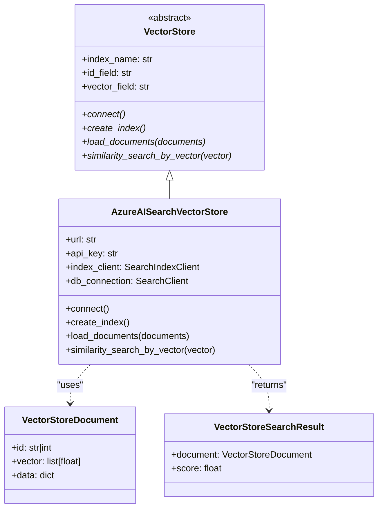
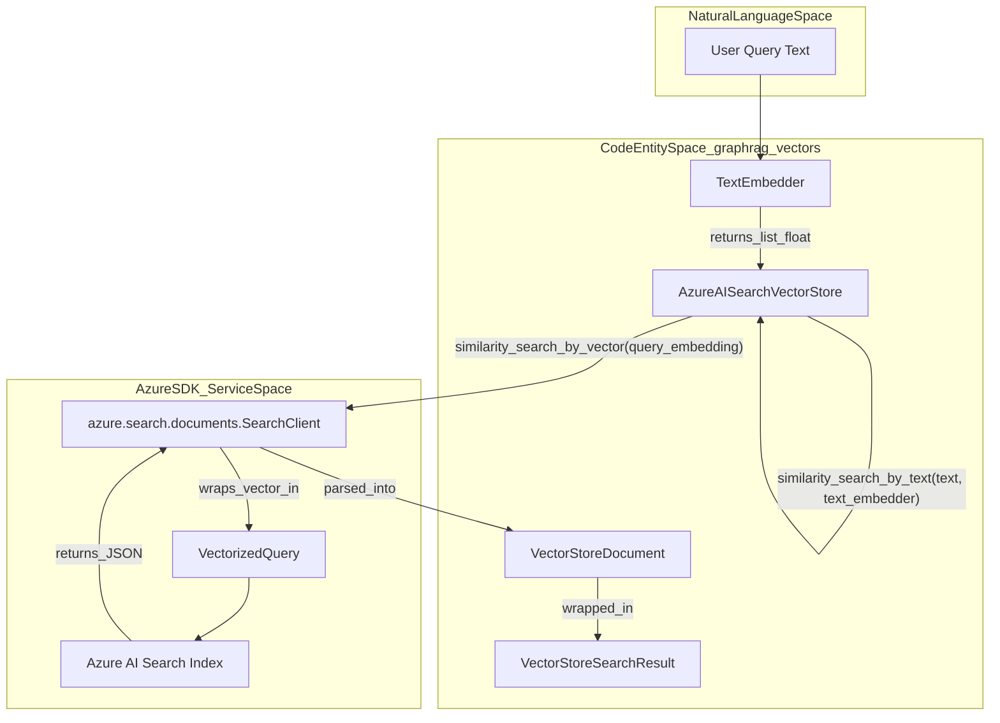

<!-- source: DeepWiki mcp.deepwiki.com · repo microsoft/graphrag · page 7.6 Azure AI Search Vector Store · fetched 2026-10-26 -->

# Azure AI Search Vector Store

<details>
<summary>Relevant source files</summary>

The following files were used as context for generating this wiki page:

- [packages/graphrag-vectors/graphrag_vectors/azure_ai_search.py](packages/graphrag-vectors/graphrag_vectors/azure_ai_search.py)
- [packages/graphrag-vectors/graphrag_vectors/cosmosdb.py](packages/graphrag-vectors/graphrag_vectors/cosmosdb.py)
- [packages/graphrag-vectors/graphrag_vectors/lancedb.py](packages/graphrag-vectors/graphrag_vectors/lancedb.py)
- [packages/graphrag-vectors/graphrag_vectors/vector_store.py](packages/graphrag-vectors/graphrag_vectors/vector_store.py)
- [tests/integration/vector_stores/test_azure_ai_search.py](tests/integration/vector_stores/test_azure_ai_search.py)
- [tests/integration/vector_stores/test_cosmosdb.py](tests/integration/vector_stores/test_cosmosdb.py)
- [tests/integration/vector_stores/test_factory.py](tests/integration/vector_stores/test_factory.py)
- [tests/integration/vector_stores/test_lancedb.py](tests/integration/vector_stores/test_lancedb.py)
- [tests/unit/query/context_builder/test_entity_extraction.py](tests/unit/query/context_builder/test_entity_extraction.py)

</details>


This document describes the Azure AI Search vector store implementation in GraphRAG, which provides cloud-based vector storage and similarity search capabilities using Microsoft Azure's AI Search service. This implementation allows GraphRAG to scale to large datasets while leveraging managed infrastructure.

For general vector store architecture and the factory pattern, see [Vector Store Architecture](7.4). For local vector storage, see [LanceDB Vector Store](7.5). For alternative cloud storage using Cosmos DB, see [Cosmos DB Vector Store](7.7).

---

## Overview

The Azure AI Search vector store (`AzureAISearchVectorStore`) enables GraphRAG to store and query vector embeddings using Azure's managed search service. It implements the base `VectorStore` interface, providing a consistent API for indexing and retrieval.

**Key Characteristics:**
- **Cloud-native**: Fully managed service requiring no local infrastructure [packages/graphrag-vectors/graphrag_vectors/azure_ai_search.py:49-69]().
- **Scalable**: Handles large-scale vector search workloads using HNSW indexing [packages/graphrag-vectors/graphrag_vectors/azure_ai_search.py:104-119]().
- **Secure**: Supports both API key and Azure AD (`DefaultAzureCredential`) authentication [packages/graphrag-vectors/graphrag_vectors/azure_ai_search.py:70-93]().
- **Flexible Schema**: Supports mapping internal document fields to custom Azure Search index fields [packages/graphrag-vectors/graphrag_vectors/azure_ai_search.py:122-157]().

Sources: [packages/graphrag-vectors/graphrag_vectors/azure_ai_search.py:48-69](), [packages/graphrag-vectors/graphrag_vectors/vector_store.py:56-79]()

---

## Architecture and Class Hierarchy

The `AzureAISearchVectorStore` extends the abstract `VectorStore` class. It utilizes the `azure-search-documents` SDK to interact with the service.

### Code Entity Relationship



Sources: [packages/graphrag-vectors/graphrag_vectors/vector_store.py:26-55](), [packages/graphrag-vectors/graphrag_vectors/azure_ai_search.py:48-51]()

---

## Implementation Details

### Data Flow: Natural Language to Azure AI Search

This diagram illustrates how a natural language query is transformed into code entities and eventually executed against the Azure service.



Sources: [packages/graphrag-vectors/graphrag_vectors/vector_store.py:176-195](), [packages/graphrag-vectors/graphrag_vectors/azure_ai_search.py:220-255]()

### Index Schema and Configuration

When `create_index()` is called, the store configures a `SearchIndex` with a vector search profile using the HNSW algorithm and Cosine metric [packages/graphrag-vectors/graphrag_vectors/azure_ai_search.py:104-119]().

The field mapping is determined by:
1. **Core Fields**: `id`, `vector`, `create_date`, and `update_date` [packages/graphrag-vectors/graphrag_vectors/azure_ai_search.py:122-146]().
2. **Additional Fields**: Custom fields provided in the `fields` dictionary during initialization [packages/graphrag-vectors/graphrag_vectors/azure_ai_search.py:149-157]().

| Internal Field | Azure Search Type | Configuration |
|----------------|-------------------|---------------|
| `id_field` | `String` | `key=True` [packages/graphrag-vectors/graphrag_vectors/azure_ai_search.py:123-127]() |
| `vector_field` | `Collection(Single)` | `searchable=True`, `hidden=False`, `vector_search_dimensions=vector_size` [packages/graphrag-vectors/graphrag_vectors/azure_ai_search.py:128-135]() |
| `str` | `String` | `filterable=True` [packages/graphrag-vectors/graphrag_vectors/azure_ai_search.py:41](), [packages/graphrag-vectors/graphrag_vectors/azure_ai_search.py:154]() |
| `int` | `Int64` | `filterable=True` [packages/graphrag-vectors/graphrag_vectors/azure_ai_search.py:42](), [packages/graphrag-vectors/graphrag_vectors/azure_ai_search.py:154]() |
| `float` | `Double` | `filterable=True` [packages/graphrag-vectors/graphrag_vectors/azure_ai_search.py:43](), [packages/graphrag-vectors/graphrag_vectors/azure_ai_search.py:154]() |
| `bool` | `Boolean` | `filterable=True` [packages/graphrag-vectors/graphrag_vectors/azure_ai_search.py:44](), [packages/graphrag-vectors/graphrag_vectors/azure_ai_search.py:154]() |

Sources: [packages/graphrag-vectors/graphrag_vectors/azure_ai_search.py:40-45](), [packages/graphrag-vectors/graphrag_vectors/azure_ai_search.py:122-166]()

---

## Key Functions

### `connect()`
Initializes the `SearchClient` (as `self.db_connection`) and `SearchIndexClient` (as `self.index_client`). It checks for an `api_key`; if missing, it falls back to `DefaultAzureCredential` [packages/graphrag-vectors/graphrag_vectors/azure_ai_search.py:70-93]().

### `load_documents()`
Batch uploads documents to the search index using `self.db_connection.upload_documents`. It first calls `_prepare_document()` to handle timestamp explosion and metadata preparation [packages/graphrag-vectors/graphrag_vectors/azure_ai_search.py:168-188]().
- **Timestamp Explosion**: Automatically expands ISO 8601 timestamps into filterable component fields (e.g., year, month, day) to support granular OData filtering [packages/graphrag-vectors/graphrag_vectors/vector_store.py:97-121]().

### `similarity_search_by_vector()`
Executes a `VectorizedQuery` against the Azure endpoint [packages/graphrag-vectors/graphrag_vectors/azure_ai_search.py:241-247]().
- **Filtering**: Compiles GraphRAG `FilterExpr` objects into OData filter strings [packages/graphrag-vectors/graphrag_vectors/azure_ai_search.py:190-218]().
- **Score Mapping**: Maps the Azure `@search.score` to the `score` field in `VectorStoreSearchResult` [packages/graphrag-vectors/graphrag_vectors/azure_ai_search.py:265]().

Sources: [packages/graphrag-vectors/graphrag_vectors/azure_ai_search.py:220-277](), [packages/graphrag-vectors/graphrag_vectors/vector_store.py:97-121]()

---

## OData Filter Compilation

The `AzureAISearchVectorStore` includes a private `_compile_filter` method that translates complex nested logical expressions (`AndExpr`, `OrExpr`, `NotExpr`) and conditions into OData syntax [packages/graphrag-vectors/graphrag_vectors/azure_ai_search.py:190-218]().

Supported operators include:
- `eq`, `ne`, `gt`, `ge`, `lt`, `le` [packages/graphrag-vectors/graphrag_vectors/azure_ai_search.py:284-295]().
- `in` (translated to `search.in`) [packages/graphrag-vectors/graphrag_vectors/azure_ai_search.py:297-300]().
- `contains`, `startswith` [packages/graphrag-vectors/graphrag_vectors/azure_ai_search.py:304-307]().

Sources: [packages/graphrag-vectors/graphrag_vectors/azure_ai_search.py:279-315]()

---

## Integration with Factory Pattern

The `AzureAISearchVectorStore` is typically instantiated via the `VectorStoreFactory`. In the query system, this allows the context builders to remain agnostic of the underlying storage implementation.

```python
# Example of registration in the factory
from graphrag_vectors import VectorStoreFactory, VectorStoreType
from graphrag_vectors.azure_ai_search import AzureAISearchVectorStore

VectorStoreFactory().register(VectorStoreType.AzureAISearch, AzureAISearchVectorStore)
```

Sources: [tests/integration/vector_stores/test_factory.py:19-21](), [tests/integration/vector_stores/test_azure_ai_search.py:37-51]()

---

