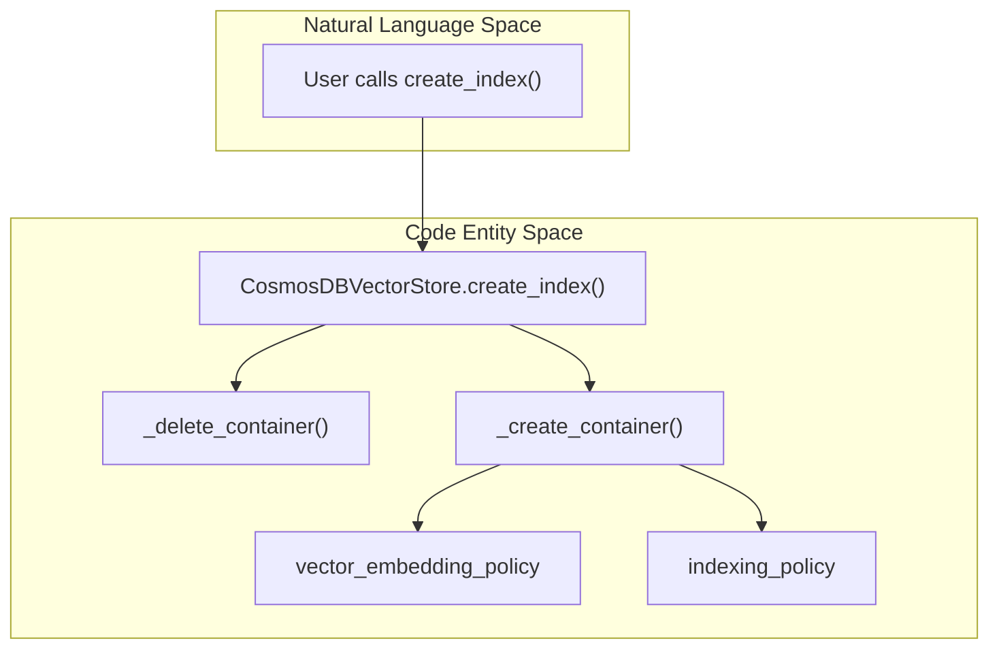
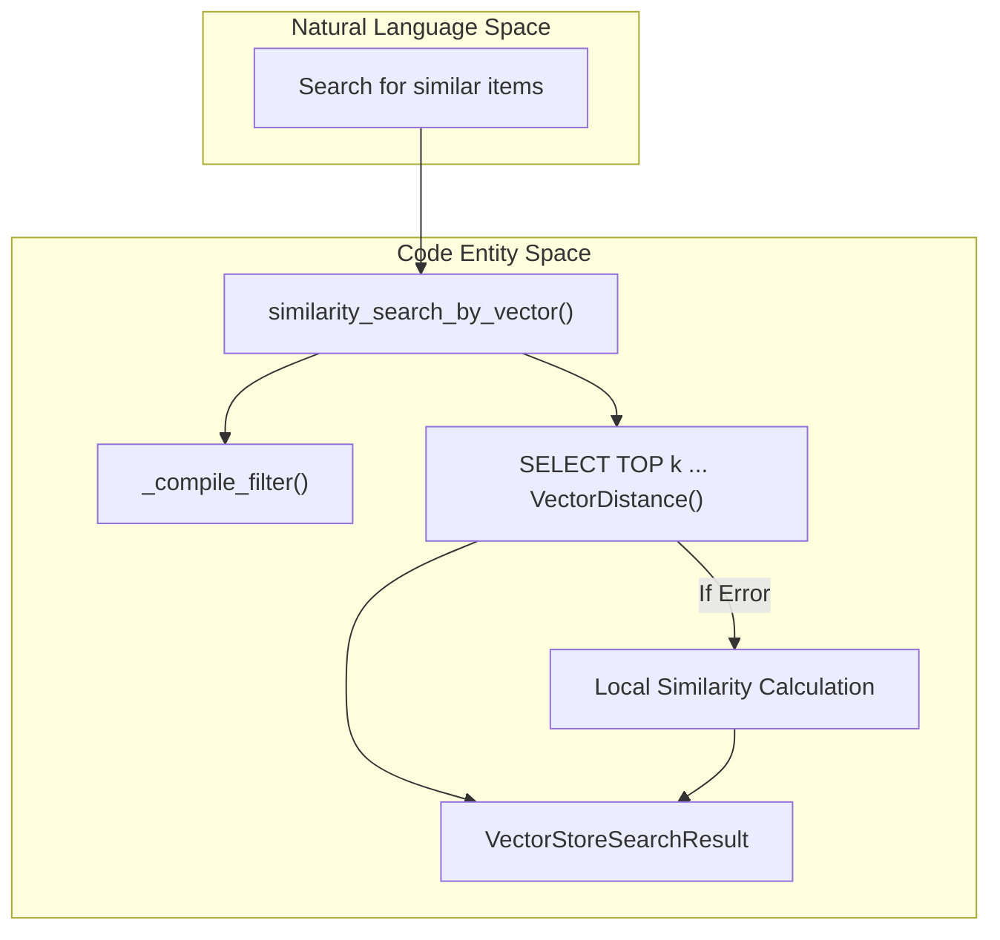
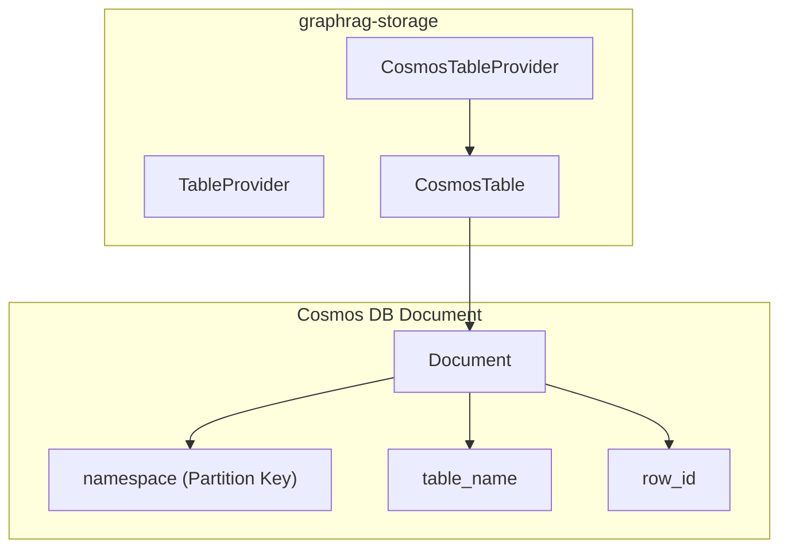

<!-- source: DeepWiki mcp.deepwiki.com · repo microsoft/graphrag · page 7.7 Cosmos DB Vector Store · fetched 2026-10-26 -->

# Cosmos DB Vector Store

<details>
<summary>Relevant source files</summary>

The following files were used as context for generating this wiki page:

- [packages/graphrag-storage/COSMOS_TABLE_PROVIDER_DESIGN.md](packages/graphrag-storage/COSMOS_TABLE_PROVIDER_DESIGN.md)
- [packages/graphrag-storage/graphrag_storage/azure_cosmos_storage.py](packages/graphrag-storage/graphrag_storage/azure_cosmos_storage.py)
- [packages/graphrag-storage/graphrag_storage/tables/cosmos_table.py](packages/graphrag-storage/graphrag_storage/tables/cosmos_table.py)
- [packages/graphrag-storage/graphrag_storage/tables/cosmos_table_provider.py](packages/graphrag-storage/graphrag_storage/tables/cosmos_table_provider.py)
- [packages/graphrag-vectors/graphrag_vectors/azure_ai_search.py](packages/graphrag-vectors/graphrag_vectors/azure_ai_search.py)
- [packages/graphrag-vectors/graphrag_vectors/cosmosdb.py](packages/graphrag-vectors/graphrag_vectors/cosmosdb.py)
- [packages/graphrag-vectors/graphrag_vectors/lancedb.py](packages/graphrag-vectors/graphrag_vectors/lancedb.py)
- [packages/graphrag-vectors/graphrag_vectors/vector_store.py](packages/graphrag-vectors/graphrag_vectors/vector_store.py)

</details>


This page documents the Cosmos DB vector store implementation in GraphRAG, which provides cloud-based vector storage capabilities using Azure Cosmos DB. This implementation is part of the `graphrag-vectors` package and enables persistent, scalable vector storage for embeddings generated during the indexing pipeline.

For information about Cosmos DB as a general storage backend (for parquet files and other artifacts), see [Azure Storage Integration](7.3). For the vector store architecture and interface, see [Vector Store Architecture](7.4). For alternative vector storage options, see [LanceDB Vector Store](7.5) and [Azure AI Search Vector Store](7.6).

## CosmosDBVectorStore Class

The `CosmosDBVectorStore` class implements the `VectorStore` interface for Azure Cosmos DB. It provides vector similarity search capabilities using Cosmos DB's native vector search features, allowing GraphRAG to store and query embeddings in a fully managed, globally distributed database.

```mermaid
graph TB
    subgraph "graphrag-vectors Package"
        VectorStoreInterface["VectorStore"]
        CosmosDBVectorStore["CosmosDBVectorStore"]
        VectorStoreDocument["VectorStoreDocument"]
        VectorStoreSearchResult["VectorStoreSearchResult"]
    end
    
    subgraph "Azure Cosmos DB SDK"
        CosmosClient["azure.cosmos.CosmosClient"]
        DatabaseProxy["azure.cosmos.DatabaseProxy"]
        ContainerProxy["azure.cosmos.ContainerProxy"]
    end
    
    VectorStoreInterface <|-- CosmosDBVectorStore
    CosmosDBVectorStore o-- CosmosClient
    CosmosDBVectorStore o-- DatabaseProxy
    CosmosDBVectorStore o-- ContainerProxy
    
    CosmosDBVectorStore -->|"uses"| VectorStoreDocument
    CosmosDBVectorStore -->|"returns"| VectorStoreSearchResult
```

**Sources:** [packages/graphrag-vectors/graphrag_vectors/cosmosdb.py:28-33](), [packages/graphrag-vectors/graphrag_vectors/vector_store.py:56-58]()

## Configuration and Connection

The `CosmosDBVectorStore` supports two authentication methods: connection string with account key, or account URL with Azure identity-based authentication using `DefaultAzureCredential`.

### Authentication Methods

**Connection String (with account key):**
```
AccountEndpoint=https://<account-name>.documents.azure.com:443/;AccountKey=<account-key>
```

**Account URL (with managed identity):**
```
https://<account-name>.documents.azure.com:443/
```

### Initialization Parameters

| Parameter | Type | Required | Default | Description |
|-----------|------|----------|---------|-------------|
| `database_name` | `str` | Yes | - | Name of the Cosmos database |
| `connection_string` | `str` | No* | `None` | Azure Cosmos DB connection string with account key |
| `url` | `str` | No* | `None` | Azure Cosmos DB account URL for identity-based auth |
| `index_name` | `str` | No | `"vector_index"` | Name of the container (collection) for vectors |
| `id_field` | `str` | No | `"id"` | Field name for document identifier (must be `"id"`) |
| `vector_field` | `str` | No | `"vector"` | Field name for vector embeddings |
| `vector_size` | `int` | No | `3072` | Dimensionality of vectors |
| `fields` | `dict[str, str]` | No | `{}` | Additional fields with type specifications |

\* Either `connection_string` or `url` must be provided [packages/graphrag-vectors/graphrag_vectors/cosmosdb.py:46-48]().

**Important Constraint:** The `id_field` must be `"id"` for Cosmos DB. This is enforced by the implementation and will raise a `ValueError` if a different value is provided [packages/graphrag-vectors/graphrag_vectors/cosmosdb.py:43-45]().

**Sources:** [packages/graphrag-vectors/graphrag_vectors/cosmosdb.py:35-52](), [packages/graphrag-vectors/graphrag_vectors/vector_store.py:59-78]()

## Index Management

The Cosmos DB vector store manages database and container creation with vector indexing support. The `create_index()` method sets up the container with a `diskANN` vector index for efficient similarity search.

### Index Lifecycle



**Index Configuration with diskANN**

The container is configured with:

1. **Vector Embedding Policy:** Defines the vector field path, data type (`float32`), distance function (`cosine`), and dimensionality [packages/graphrag-vectors/graphrag_vectors/cosmosdb.py:92-101]().
2. **Indexing Policy:** Specifies `diskANN` indexing for efficient approximate nearest neighbor search [packages/graphrag-vectors/graphrag_vectors/cosmosdb.py:117-119]().
3. **Partition Key:** Set to the `id_field` (hash partitioning) [packages/graphrag-vectors/graphrag_vectors/cosmosdb.py:89-89]().

The implementation includes a fallback mechanism for environments that don't support diskANN (e.g., Cosmos DB Emulator) [packages/graphrag-vectors/graphrag_vectors/cosmosdb.py:115-138]().

**Sources:** [packages/graphrag-vectors/graphrag_vectors/cosmosdb.py:87-142](), [packages/graphrag-vectors/graphrag_vectors/cosmosdb.py:156-165]()

## Document Operations

Documents in the Cosmos DB vector store are represented by the `VectorStoreDocument` class, which contains an ID, vector embedding, additional data fields, and timestamps.

### Loading Documents

The `load_documents()` method inserts documents individually. Since Cosmos DB does not support native batch upsert in the standard SDK client used here, each document is upserted individually after preparation [packages/graphrag-vectors/graphrag_vectors/cosmosdb.py:172-186]().

**Document Preparation:**
The `_prepare_document()` method (inherited from `VectorStore`) enriches documents before insertion [packages/graphrag-vectors/graphrag_vectors/vector_store.py:97-121]():
- Sets `create_date` to current UTC time if not provided.
- Explodes timestamps into component fields for filtering (year, month, day, etc.) via `timestamp_exploder`.
- Merges additional fields from the `data` dictionary.

**Sources:** [packages/graphrag-vectors/graphrag_vectors/cosmosdb.py:166-186](), [packages/graphrag-vectors/graphrag_vectors/vector_store.py:26-43](), [packages/graphrag-vectors/graphrag_vectors/vector_store.py:97-121]()

## Search Operations

The Cosmos DB vector store provides multiple search operations with filtering support and automatic fallback for environments without native vector search.

### Search Flow



### Similarity Search by Vector

The `similarity_search_by_vector()` method performs vector similarity search with optional filtering. It uses Cosmos DB's `VectorDistance()` function with automatic fallback.

**Native Vector Search (production):**
It constructs a SQL query using `VectorDistance(c.{vector_field}, @embedding)` [packages/graphrag-vectors/graphrag_vectors/cosmosdb.py:280-292]().

**Fallback (emulator/error):**
If the native query fails (e.g., `CosmosHttpResponseError`), it retrieves all documents matching the filters and calculates cosine similarity locally using `numpy` [packages/graphrag-vectors/graphrag_vectors/cosmosdb.py:318-341]().

### Similarity Search by Text

The `similarity_search_by_text()` method embeds the query text using the provided `TextEmbedder` and delegates to vector search [packages/graphrag-vectors/graphrag_vectors/vector_store.py:176-195]().

**Sources:** [packages/graphrag-vectors/graphrag_vectors/cosmosdb.py:259-355](), [packages/graphrag-vectors/graphrag_vectors/vector_store.py:176-195]()

## Namespace Partitioning and Table Provider

For tabular data (DataFrames), GraphRAG uses the `CosmosTableProvider` which implements the `TableProvider` interface. This provides efficient namespace isolation and eliminates Parquet serialization overhead.

### Architecture



**Key Features:**
- **Partition Key:** Uses `/namespace` as the partition key to isolate data between different pipeline runs or delta/previous states [packages/graphrag-storage/graphrag_storage/tables/cosmos_table_provider.py:11-16]().
- **Composite ID:** Document IDs are formatted as `{table_name}:{row_key}` [packages/graphrag-storage/graphrag_storage/tables/cosmos_table_provider.py:12-12]().
- **Single-Partition Queries:** All queries target a single namespace partition to avoid expensive cross-partition fan-outs [packages/graphrag-storage/graphrag_storage/tables/cosmos_table_provider.py:18-18]().
- **Streaming Access:** `CosmosTable` implements asynchronous iteration with server-side pagination via `by_page()` [packages/graphrag-storage/graphrag_storage/tables/cosmos_table.py:102-107]().

**Sources:** [packages/graphrag-storage/graphrag_storage/tables/cosmos_table_provider.py:48-55](), [packages/graphrag-storage/graphrag_storage/tables/cosmos_table.py:60-66](), [packages/graphrag-storage/COSMOS_TABLE_PROVIDER_DESIGN.md:44-60]()

## Filtering Support

The Cosmos DB vector store supports complex filtering using the `FilterExpr` system, which compiles to Cosmos DB SQL `WHERE` clauses [packages/graphrag-vectors/graphrag_vectors/cosmosdb.py:188-208]().

### Supported Operators

| Operator | Cosmos DB SQL |
|----------|---------------|
| `Operator.eq` | `c.field = value` |
| `Operator.ne` | `c.field != value` |
| `Operator.gt` | `c.field > value` |
| `Operator.gte` | `c.field >= value` |
| `Operator.lt` | `c.field < value` |
| `Operator.lte` | `c.field <= value` |
| `Operator.in_` | `c.field IN (...)` |
| `Operator.contains` | `CONTAINS(c.field, 'value')` |
| `Operator.startswith` | `STARTSWITH(c.field, 'value')` |
| `Operator.exists` | `IS_DEFINED(c.field)` |

**Note:** All field references are prefixed with `c.` for Cosmos SQL syntax [packages/graphrag-vectors/graphrag_vectors/cosmosdb.py:191-191]().

**Sources:** [packages/graphrag-vectors/graphrag_vectors/cosmosdb.py:188-246](), [packages/graphrag-vectors/graphrag_vectors/filtering.py:1-40]()

## Additional Operations

### Update Operation
The `update()` method modifies an existing document. It first prepares the update by setting the `update_date`, then retrieves the existing document, merges the data, and performs an `upsert_item` [packages/graphrag-vectors/graphrag_vectors/cosmosdb.py:377-402]().

### Remove Operation
The `remove()` method deletes documents by their IDs using `delete_item` [packages/graphrag-vectors/graphrag_vectors/cosmosdb.py:411-416]().

### Count Operation
The `count()` method returns the total number of documents in the container using a `SELECT VALUE COUNT(1)` query [packages/graphrag-vectors/graphrag_vectors/cosmosdb.py:404-409]().

**Sources:** [packages/graphrag-vectors/graphrag_vectors/cosmosdb.py:377-416](), [packages/graphrag-vectors/graphrag_vectors/vector_store.py:122-134]()

---

