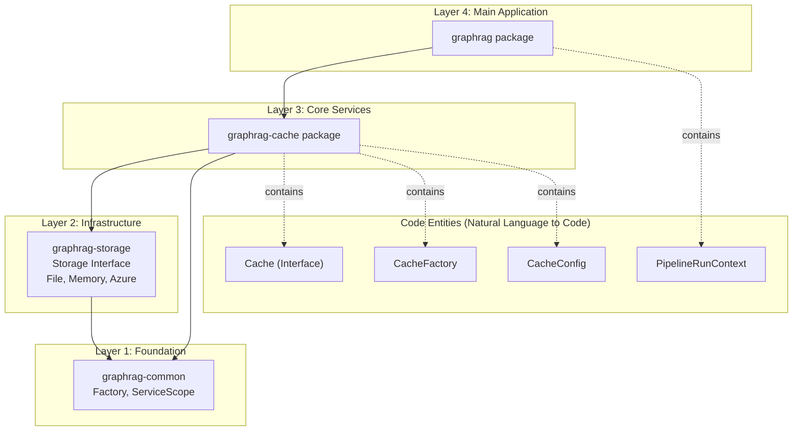
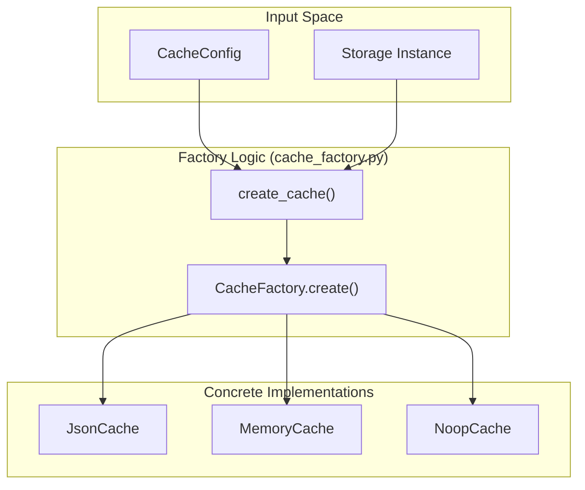
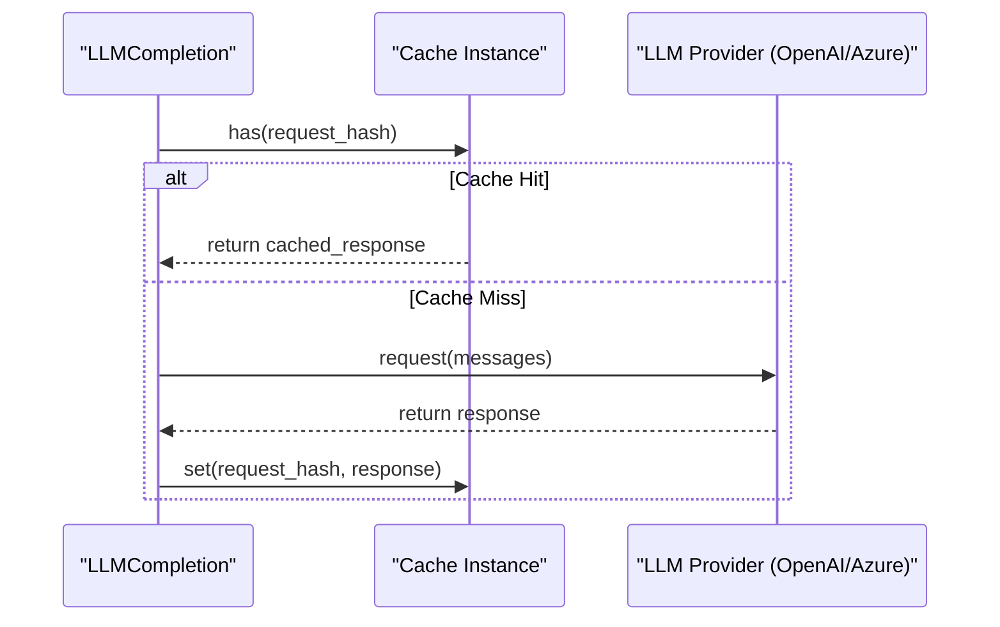

<!-- source: DeepWiki mcp.deepwiki.com · repo microsoft/graphrag · page 7.8 Cache System · fetched 2026-10-26 -->

# Cache System

Relevant source files

The following files were used as context for generating this wiki page:

- [packages/graphrag-cache/graphrag_cache/cache_factory.py](packages/graphrag-cache/graphrag_cache/cache_factory.py)
- [packages/graphrag-llm/notebooks/05_caching.ipynb](packages/graphrag-llm/notebooks/05_caching.ipynb)
- [packages/graphrag/graphrag/config/models/graph_rag_config.py](packages/graphrag/graphrag/config/models/graph_rag_config.py)
- [packages/graphrag/graphrag/index/typing/context.py](packages/graphrag/graphrag/index/typing/context.py)

## Purpose and Scope

The Cache System provides LLM response caching functionality for GraphRAG, enabling idempotent operations and reducing costs by storing and reusing LLM API responses and embedding results. This system ensures that expensive LLM calls are not repeated for identical inputs across different pipeline runs or query sessions.

The system is implemented primarily in the `graphrag-cache` package and is integrated into the core indexing pipeline and query systems via the `graphrag-llm` and `graphrag` packages.

**Sources:** [packages/graphrag/graphrag/config/models/graph_rag_config.py:147-151](), [packages/graphrag-llm/notebooks/05_caching.ipynb:8-10]()

## System Architecture

The cache system abstracts persistence by utilizing the `graphrag-storage` layer. This allows LLM results to be stored in various backends (local files, memory, or cloud storage) without modifying the LLM interaction logic.

### Natural Language to Code Entity Mapping

The following diagram bridges the high-level system concepts to the specific code entities implemented in the monorepo.

**Key Components:**

| Entity | Location | Purpose |
|--------|----------|---------|
| `Cache` | `graphrag_cache.cache` | The interface defining methods for getting, setting, and checking cache entries [packages/graphrag-cache/graphrag_cache/cache_factory.py:12-12](). |
| `CacheFactory` | `graphrag_cache.cache_factory` | A factory class for instantiating cache implementations based on `CacheType` [packages/graphrag-cache/graphrag_cache/cache_factory.py:17-21](). |
| `PipelineRunContext` | `graphrag.index.typing.context` | Orchestrates the indexing execution state, including the shared `cache` instance [packages/graphrag/graphrag/index/typing/context.py:17-35](). |
| `CacheConfig` | `graphrag_cache.cache_config` | Pydantic model defining cache settings like type and storage backend [packages/graphrag-cache/graphrag_cache/cache_config.py:13-13](). |

**Sources:** [packages/graphrag-cache/graphrag_cache/cache_factory.py:12-21](), [packages/graphrag/graphrag/index/typing/context.py:17-35]()

## Cache Factory Pattern

The cache system uses a registration-based factory pattern. The `create_cache` function is the primary entry point for creating cache instances.

### Cache Providers

The system includes built-in cache types defined in `CacheType` [packages/graphrag-cache/graphrag_cache/cache_type.py:14-14]().

| Cache Type | Class Name | Description |
|------------|------------|-------------|
| `json` | `JsonCache` | Persists cache entries as JSON files using a `Storage` backend [packages/graphrag-cache/graphrag_cache/cache_factory.py:67-70]() |
| `memory` | `MemoryCache` | Volatile in-memory storage, useful for testing or single-run sessions [packages/graphrag-cache/graphrag_cache/cache_factory.py:72-75]() |
| `none` | `noop` | Disables caching entirely by providing a no-op implementation [packages/graphrag-cache/graphrag_cache/cache_factory.py:77-80]() |

### Custom Cache Registration
Users can extend the system by calling `register_cache(cache_type, cache_initializer)`, which adds a new provider to the `cache_factory` [packages/graphrag-cache/graphrag_cache/cache_factory.py:24-38]().

**Sources:** [packages/graphrag-cache/graphrag_cache/cache_factory.py:24-90]()

## Integration with LLM and Indexing

### LLM Completion Caching
To enable caching for LLM requests, a `Cache` instance is passed to `create_completion` or `create_embedding`. When a request is made, the system checks the cache before hitting the LLM provider [packages/graphrag-llm/notebooks/05_caching.ipynb:10-10]().

Even when a cache hit occurs, GraphRAG's `metrics_store` tracks "simulated" tokens and costs. This provides an estimate of what the job would have cost without the cache [packages/graphrag-llm/notebooks/05_caching.ipynb:108-109]().

### Pipeline Context
During indexing, the cache instance is stored in the `PipelineRunContext`. This shared instance is used by various indexing verbs (e.g., entity extraction, summarization) to persist intermediate LLM results [packages/graphrag/graphrag/index/typing/context.py:29-30]().

**Sources:** [packages/graphrag/graphrag/index/typing/context.py:29-30](), [packages/graphrag-llm/notebooks/05_caching.ipynb:84-96](), [packages/graphrag-llm/notebooks/05_caching.ipynb:108-109]()

## Configuration

The cache is configured within the `GraphRagConfig` via the `cache` field [packages/graphrag/graphrag/config/models/graph_rag_config.py:147-151]().

| Field | Type | Default | Description |
|-------|------|---------|-------------|
| `type` | `CacheType` | `CacheType.Json` | The strategy for caching (json, memory, none) |
| `storage` | `StorageConfig` | `StorageType.File` | The storage backend configuration for the cache [packages/graphrag-llm/notebooks/05_caching.ipynb:68-72](). |

### Default Configuration
By default, GraphRAG initializes a `JsonCache` pointing to a local directory named `cache` [packages/graphrag-llm/notebooks/05_caching.ipynb:67-72]().

**Sources:** [packages/graphrag/graphrag/config/models/graph_rag_config.py:147-151](), [packages/graphrag-llm/notebooks/05_caching.ipynb:67-72]()

---

