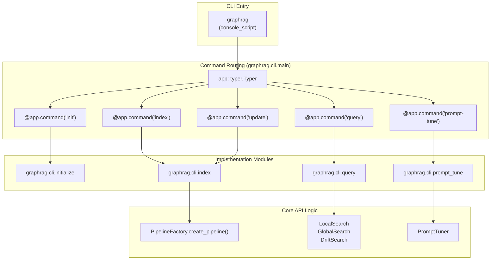
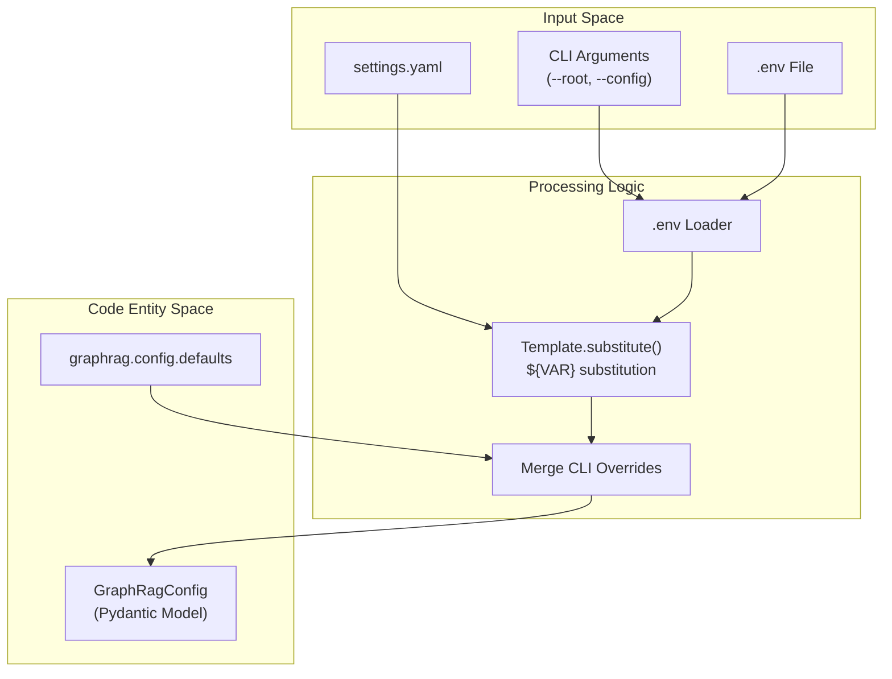

<!-- source: DeepWiki mcp.deepwiki.com · repo microsoft/graphrag · page 8 CLI Interface · fetched 2026-10-26 -->

# CLI Interface

Relevant source files

The following files were used as context for generating this wiki page:

- [CHANGELOG.md](CHANGELOG.md)
- [dictionary.txt](dictionary.txt)
- [docs/config/models.md](docs/config/models.md)
- [docs/get_started.md](docs/get_started.md)
- [docs/visualization_guide.md](docs/visualization_guide.md)
- [mkdocs.yaml](mkdocs.yaml)
- [packages/graphrag-cache/pyproject.toml](packages/graphrag-cache/pyproject.toml)
- [packages/graphrag-chunking/pyproject.toml](packages/graphrag-chunking/pyproject.toml)
- [pyproject.toml](pyproject.toml)
- [tests/integration/storage/test_cosmosdb_storage.py](tests/integration/storage/test_cosmosdb_storage.py)

The GraphRAG command-line interface (CLI) provides the primary entry point for users to interact with the knowledge graph construction and query systems. Built using the [Typer](https://typer.tiangolo.com/) framework, it orchestrates configuration loading, environment variable substitution, and calls to core pipeline functions.

## Overview

The CLI is registered as a console script entry point in the package configuration and can be invoked via the `graphrag` command. It supports five primary operations: project initialization, indexing, incremental updates, querying, and prompt tuning.

**Available Commands:**
- `graphrag init` — Initialize project structure with default configuration.
- `graphrag index` — Build a knowledge graph from input documents.
- `graphrag update` — Incrementally update an existing knowledge graph with new data.
- `graphrag query` — Execute searches (Global, Local, DRIFT, Basic) against indexed data.
- `graphrag prompt-tune` — Generate domain-adapted prompts from sample data.

**Sources:** [packages/graphrag/pyproject.toml:97-101](), [docs/cli.md:5-9](), [docs/get_started.md:45-49]()

## CLI Architecture and Entry Points

### Console Script Registration
The `graphrag` command is mapped to the `app` instance in `graphrag.cli.main`. This instance routes subcommands to implementation modules within the `graphrag.cli` package.

**Title:** CLI Command Routing from Entry Point to Implementation

**Sources:** [packages/graphrag/pyproject.toml:97-101](), [docs/cli.md:1-10](), [CHANGELOG.md:159-165]()

### Poethepoet Task Aliases
For development and monorepo management, several `poe` tasks are defined in the root `pyproject.toml` to wrap CLI calls:

| Task | Command | File Reference |
|------|---------|----------------|
| `poe init` | `python -m graphrag init` | [pyproject.toml:99]() |
| `poe index` | `python -m graphrag index` | [pyproject.toml:97]() |
| `poe update` | `python -m graphrag update` | [pyproject.toml:98]() |
| `poe query` | `python -m graphrag query` | [pyproject.toml:100]() |
| `poe prompt_tune` | `python -m graphrag prompt-tune` | [pyproject.toml:101]() |

**Sources:** [pyproject.toml:97-101]()

## Configuration and Environment

The CLI utilizes a hierarchical configuration resolution process. It looks for a `settings.yaml` (or `.yml`/`.json`) file in the project root.

**Title: Configuration Loading and Validation Pipeline**

The configuration supports environment variable substitution using `${VARIABLE_NAME}` syntax. This is particularly useful for sensitive keys like `GRAPHRAG_API_KEY`.

**Sources:** [docs/get_started.md:55-58](), [CHANGELOG.md:184-184](), [docs/config/models.md:13-27]()

## Command Summaries

Detailed documentation for each command can be found on their respective child pages.

### [Initialization Command](#8.1)
The `init` command sets up the required project structure. It creates a default `settings.yaml`, an `.env` file template, and an `input/` directory for raw text files. For details, see [Initialization Command](#8.1).
**Sources:** [docs/get_started.md:45-55]()

### [Indexing Commands](#8.2)
The `index` command executes the full pipeline to transform raw text into a knowledge graph. It supports multiple methods, including the LLM-heavy "standard" approach and the NLP-based "fast" approach. For details, see [Indexing Commands](#8.2).
**Sources:** [docs/get_started.md:101-103](), [docs/config/models.md:70-71]()

### [Update Command](#8.5)
The `update` command performs incremental indexing. It identifies new or changed documents and merges them into the existing graph structure, avoiding a full re-index of unchanged data. For details, see [Update Command](#8.5).
**Sources:** [CHANGELOG.md:182-182](), [CHANGELOG.md:191-192]()

### [Query Commands](#8.3)
The `query` command provides access to the retrieval system. It supports multiple search modes including `global` (community-report based), `local` (entity-centric), and `drift` (iterative expansion). For details, see [Query Commands](#8.3).
**Sources:** [docs/get_started.md:113-127](), [CHANGELOG.md:186-186]()

### [Prompt Tuning Command](#8.4)
The `prompt-tune` command automates the creation of domain-specific prompts. It samples the input corpus to discover relevant entity types and generates tailored extraction templates. For details, see [Prompt Tuning Command](#8.4).
**Sources:** [CHANGELOG.md:152-152](), [CHANGELOG.md:168-169]()

## Standard CLI Options

Most commands support a set of common global flags:

| Option | Short | Description |
|--------|-------|-------------|
| `--root` | `-r` | The project root directory (default: current directory). |
| `--config` | `-c` | Path to the configuration file relative to the root. |
| `--verbose` | `-v` | Enable detailed logging output for debugging. |

**Sources:** [docs/config/init.md:11-15](), [docs/cli.md:1-10](), [CHANGELOG.md:190-190]()

---

