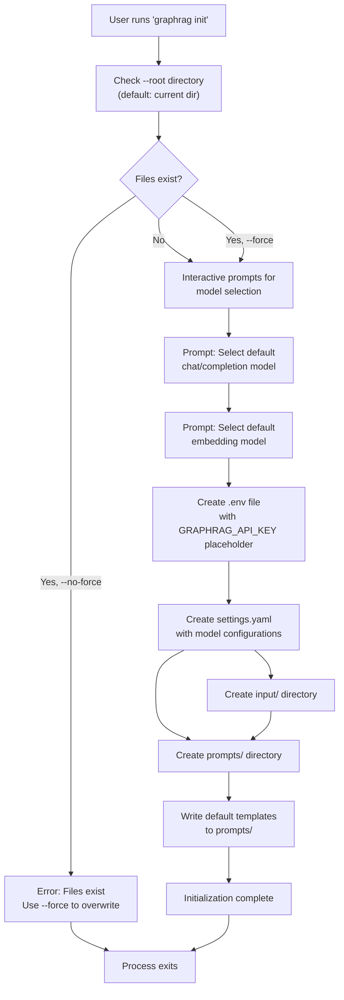
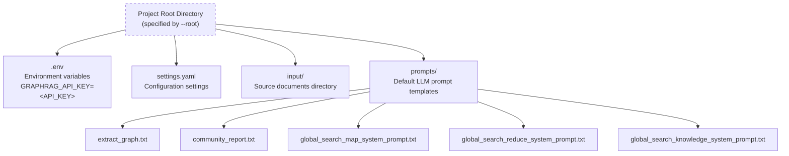
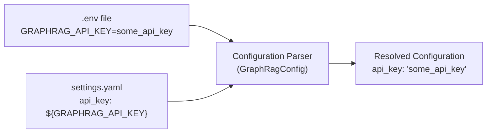

<!-- source: DeepWiki mcp.deepwiki.com · repo microsoft/graphrag · page 8.1 Initialization Command · fetched 2026-10-26 -->

# Initialization Command

<details>
<summary>Relevant source files</summary>

The following files were used as context for generating this wiki page:

- [dictionary.txt](dictionary.txt)
- [docs/config/init.md](docs/config/init.md)
- [docs/config/models.md](docs/config/models.md)
- [docs/config/overview.md](docs/config/overview.md)
- [docs/get_started.md](docs/get_started.md)
- [docs/query/overview.md](docs/query/overview.md)
- [docs/visualization_guide.md](docs/visualization_guide.md)
- [mkdocs.yaml](mkdocs.yaml)
- [tests/integration/storage/test_cosmosdb_storage.py](tests/integration/storage/test_cosmosdb_storage.py)

</details>


The `graphrag init` command generates the default configuration files and directory structure required to run GraphRAG. It creates a `settings.yaml` configuration file, a `.env` file for sensitive credentials, an `input/` directory for source documents, and a `prompts/` directory containing default LLM prompt templates. This command is the recommended first step when setting up a new GraphRAG project.

**Sources:** [docs/config/init.md:1-3](), [docs/get_started.md:43-53](), [docs/config/overview.md:5-11]()

## Command Syntax

```bash
graphrag init [--root PATH] [--force | --no-force]
```

### Options

| Option | Type | Default | Description |
|--------|------|---------|-------------|
| `--root` | Path | Current directory | The project root directory where GraphRAG will be initialized |
| `--force` | Flag | `false` | Overwrite existing configuration and prompt files if they exist |
| `--no-force` | Flag | `true` | Do not overwrite existing files (default behavior) |

**Sources:** [docs/config/init.md:7-14]()

## Initialization Workflow



**Diagram: Initialization Command Execution Flow**

The initialization command performs file existence checks, prompts for model selection, and generates the required project structure.

**Sources:** [docs/config/init.md:5-29](), [docs/get_started.md:43-58]()

## Interactive Model Selection

When `graphrag init` runs, it prompts users to specify their preferred language models. These selections are written into the generated `settings.yaml` file under the `completion_models` and `embedding_models` sections. 

GraphRAG supports asymmetric model usage, allowing different models for different workflow steps. While `init` sets defaults, users can manually define multiple models in the `models` block of `settings.yaml` to optimize for cost or quality (e.g., using `gpt-4o` for indexing and `o1` for query).

The prompts request:
1. **Default chat/completion model** - Used for entity extraction, summarization, and query operations.
2. **Default embedding model** - Used for generating vector embeddings of text units and entities.

**Sources:** [docs/get_started.md:50-51](), [docs/config/models.md:39-43](), [docs/config/models.md:13-27]()

## Generated Directory Structure



**Diagram: File Structure Created by graphrag init**

The initialization command creates a standardized project structure with configuration files, an input directory for documents, and a prompts directory containing default templates for all indexing and query operations.

**Sources:** [docs/config/init.md:22-29](), [docs/get_started.md:52-57](), [docs/config/models.md:57-68]()

### File Descriptions

| File/Directory | Purpose |
|----------------|---------|
| `.env` | Contains environment variables, primarily API keys. The default placeholder is `GRAPHRAG_API_KEY=<API_KEY>`. |
| `settings.yaml` | Master configuration file containing all pipeline settings including model configurations, storage settings, and workflow parameters. |
| `input/` | Directory where users place source documents (e.g., `.txt`, `.csv`, `.json`) to be processed by the indexing pipeline. |
| `prompts/` | Directory containing default LLM prompt templates. These can be modified or updated via the `prompt-tune` command. |

**Sources:** [docs/config/init.md:24-29](), [docs/get_started.md:52-57](), [docs/get_started.md:64-65]()

## Environment Variable Token Replacement

GraphRAG supports token replacement in `settings.yaml` using environment variables defined in `.env`. This allows sensitive credentials to be separated from configuration files.



**Diagram: Environment Variable Token Replacement Mechanism**

When GraphRAG loads `settings.yaml`, it first loads the `.env` file and makes all defined variables available for substitution using `${ENV_VAR}` syntax.

**Sources:** [docs/get_started.md:55-57]()

## Model Configuration Examples

### OpenAI Configuration (Default)
After `init`, users typically only need to update the `GRAPHRAG_API_KEY` in the `.env` file.

**Sources:** [docs/get_started.md:69-71]()

### Azure OpenAI Configuration
Azure users should update the `settings.yaml` file generated by `init` to include specific Azure parameters like deployment names and API versions.

```yaml
completion_models:
  default_completion_model:
    type: chat
    model_provider: azure
    model: gpt-4.1
    azure_deployment_name: <AZURE_DEPLOYMENT_NAME>
    api_base: https://<instance>.openai.azure.com
    api_version: 2024-02-15-preview
    auth_method: azure_managed_identity # Optional for managed auth
```

**Sources:** [docs/get_started.md:73-92]()

### LiteLLM and Custom Models
GraphRAG uses LiteLLM as the default provider manager, supporting 100+ models. Users can configure non-OpenAI providers (e.g., Gemini) by updating the `model_provider` and `model` fields in the generated `settings.yaml`.

```yaml
completion_models:
  default_completion_model:
    model_provider: gemini
    model: gemini-2.5-flash-lite
    api_key: ${GEMINI_API_KEY}
```

**Sources:** [docs/config/models.md:9-27]()

## When to Re-Initialize

Re-running `graphrag init` is recommended in the following scenarios:

1.  **Project Setup**: When starting a new indexing project in a fresh directory.
2.  **Resetting Defaults**: To restore default prompts and settings if local modifications lead to errors.
3.  **Schema Updates**: When upgrading GraphRAG versions that introduce new configuration requirements. Use `--force` to overwrite existing files.

⚠️ **Warning:** The `--force` flag overwrites existing `settings.yaml` and `prompts/` files. Backup any custom configurations or prompts before re-initializing.

**Sources:** [docs/config/init.md:11-15](), [docs/config/init.md:3-5]()

## Next Steps

After successful initialization:

1.  **Set API Key**: Replace the placeholder in `.env` with a valid key.
2.  **Add Data**: Place text files in the `./input` directory.
3.  **Optional - Tune Prompts**: Run `graphrag prompt-tune` to adapt templates to your specific dataset.
4.  **Index**: Run `graphrag index` to build the knowledge graph.
5.  **Query**: Use `graphrag query` to perform Global, Local, or DRIFT searches.

**Sources:** [docs/config/init.md:30-33](), [docs/get_started.md:97-127]()

---

