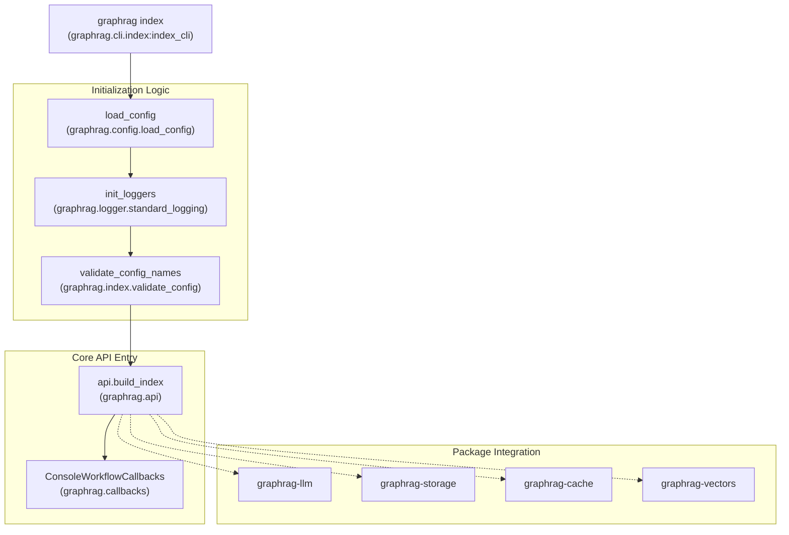
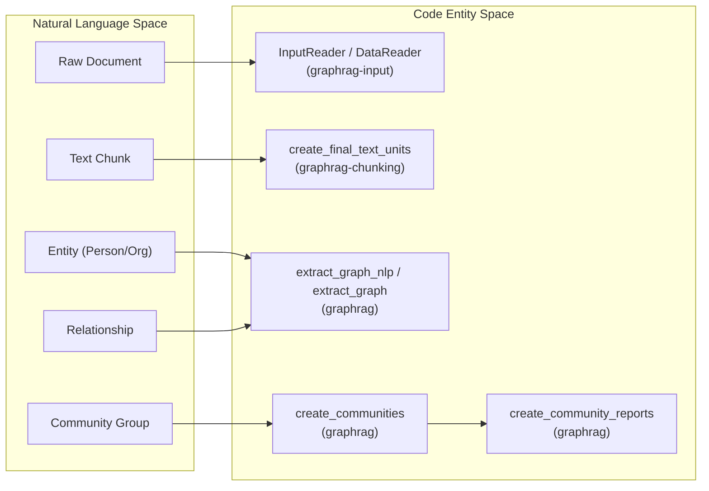

<!-- source: DeepWiki mcp.deepwiki.com · repo microsoft/graphrag · page 8.2 Indexing Commands · fetched 2026-10-26 -->

# Indexing Commands

<details>
<summary>Relevant source files</summary>

The following files were used as context for generating this wiki page:

- [CHANGELOG.md](CHANGELOG.md)
- [packages/graphrag-cache/pyproject.toml](packages/graphrag-cache/pyproject.toml)
- [packages/graphrag-chunking/pyproject.toml](packages/graphrag-chunking/pyproject.toml)
- [packages/graphrag/graphrag/cli/index.py](packages/graphrag/graphrag/cli/index.py)
- [pyproject.toml](pyproject.toml)

</details>


## Purpose and Scope

This page documents the command-line interface (CLI) for running the GraphRAG indexing process. The indexing commands transform raw input documents into a structured knowledge graph consisting of communities, entities, relationships, and embeddings.

The primary entry point for these operations is the `graphrag index` command, which orchestrates a series of workflows to process data from input storage to final parquet tables.

## Overview

The GraphRAG CLI is accessible via `python -m graphrag`. The indexing functionality is primarily handled by two commands defined in the project tasks:

| Command | Task Alias | Purpose |
|---------|------------|---------|
| `graphrag index` | `poe index` | Perform a full indexing run from raw documents |
| `graphrag update` | `poe update` | Perform incremental indexing on new or modified documents |

**Sources:** [pyproject.toml:97-98](), [packages/graphrag/graphrag/cli/index.py:44-86]()

## The `graphrag index` Command

### Basic Usage

```bash
graphrag index [OPTIONS]
```

The `graphrag index` command executes the complete indexing pipeline. It reads configuration from a `settings.yaml` file and environment variables from a `.env` file located in the project root.

**Sources:** [pyproject.toml:97](), [packages/graphrag/graphrag/cli/index.py:44-53]()

### Command Options

The CLI implementation in `index_cli` supports several parameters to control the execution environment:

| Option | Description |
|--------|-------------|
| `root_dir` | Project root directory containing configuration and inputs |
| `method` | Indexing method to use: `Standard` or `Fast` |
| `verbose` | Enable detailed logging for debugging |
| `cache` | Enable or disable the caching system |
| `dry_run` | Validate configuration and exit without executing workflows |
| `skip_validation` | Skip validation of configuration names |

**Sources:** [packages/graphrag/graphrag/cli/index.py:44-51](), [packages/graphrag/graphrag/cli/index.py:106-110]()

### Indexing Command Execution Flow

The following diagram bridges the CLI command to the underlying code entities and execution logic.

**CLI to Code Entity Mapping**


**Execution Steps:**
1. **Entry Point:** The CLI is invoked via `index_cli` which calls `_run_index`. [packages/graphrag/graphrag/cli/index.py:44-62]()
2. **Configuration:** The system loads `GraphRagConfig` via `load_config`. [packages/graphrag/graphrag/cli/index.py:53]()
3. **Logging & Validation:** `init_loggers` sets up the reporting environment, and `validate_config_names` ensures configuration integrity. [packages/graphrag/graphrag/cli/index.py:101-110]()
4. **Caching:** If `cache` is disabled, the system overrides the config to use `CacheType.Noop`. [packages/graphrag/graphrag/cli/index.py:106-107]()
5. **API Call:** The actual indexing is orchestrated by `asyncio.run(api.build_index(...))`, passing in `ConsoleWorkflowCallbacks` for real-time progress. [packages/graphrag/graphrag/cli/index.py:124-132]()

**Sources:** [packages/graphrag/graphrag/cli/index.py:44-136](), [CHANGELOG.md:84-93]()

## Pipeline Workflows

The indexing process is divided into discrete workflows. Recent updates introduced streaming support for several core workflows to improve performance and memory usage.

### Default Workflow Sequence

| Workflow | Purpose |
|----------|---------|
| `load_input_documents` | Loads raw data from storage (CSV, Text, JSON, JSONL, Parquet) |
| `create_base_text_units` | Chunks documents into manageable pieces |
| `extract_graph` | Extracts entities/relationships using LLM or NLP methods |
| `create_communities` | Runs community detection using the Leiden algorithm |
| `create_community_reports` | Generates LLM summaries for each community |
| `generate_text_embeddings` | Creates vectors for entities, text units, and reports |
| `create_final_documents` | Finalizes the document table with graph links |

**Sources:** [CHANGELOG.md:37-38](), [CHANGELOG.md:55-62](), [CHANGELOG.md:174-175]()

### Natural Language to Code Entity Space

This diagram shows how natural language concepts in the indexing process map to specific data structures and packages.

**Concept Mapping Diagram**


**Sources:** [CHANGELOG.md:55-62](), [CHANGELOG.md:84-93](), [packages/graphrag-chunking/pyproject.toml:2-4](), [packages/graphrag-input/pyproject.toml:2-4]()

## Output Artifacts

The indexing command produces several parquet files in the output directory. Version 3.0.3 added the feature of writing a `stats.json` file per workflow to track execution metrics.

### Final Tables and Metadata
- **Parquet Tables**: The primary outputs including `entities`, `relationships`, `communities`, and `community_reports`.
- **`stats.json`**: Contains execution metrics and performance data for each workflow step. [CHANGELOG.md:62]()
- **Vector Store**: Embeddings are stored in the configured vector store (e.g., LanceDB). [CHANGELOG.md:52]()

**Sources:** [CHANGELOG.md:52](), [CHANGELOG.md:62](), [CHANGELOG.md:155-156]()

## Caching System

GraphRAG implements a robust caching system to prevent redundant LLM calls. The `graphrag-cache` package provides the underlying logic, which is integrated into the CLI via the `--cache` flag.

- **Cache Providers**: Supports file-based and blob-based caching. [CHANGELOG.md:11-12](), [CHANGELOG.md:87]()
- **CLI Control**: The `index_cli` function explicitly handles cache enabling/disabling by modifying the `config.cache.type`. [packages/graphrag/graphrag/cli/index.py:106-107]()

**Sources:** [packages/graphrag/graphrag/cli/index.py:106-107](), [packages/graphrag-cache/pyproject.toml:2-4]()

## Advanced Usage: Incremental Indexing

The `graphrag update` command is used for incremental indexing via the `update_cli` function.

**Key Features:**
- **Update Workflow**: It sets `is_update_run=True` when calling the internal index runner. [packages/graphrag/graphrag/cli/index.py:80]()
- **Input Loading**: Uses `load_update_documents` to identify and load only new or changed data. [CHANGELOG.md:69-72]()
- **ID Persistence**: Ensures `human_readable_id` and `document_id` are maintained consistently across runs. [CHANGELOG.md:72-73](), [CHANGELOG.md:116-117]()

**Sources:** [packages/graphrag/graphrag/cli/index.py:65-86](), [CHANGELOG.md:69-73]()

---

