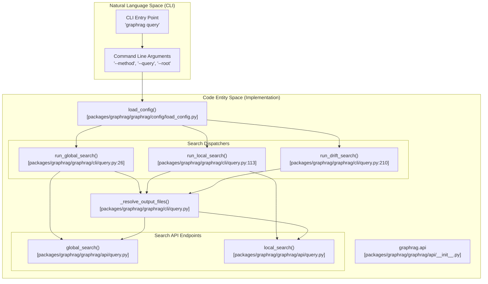
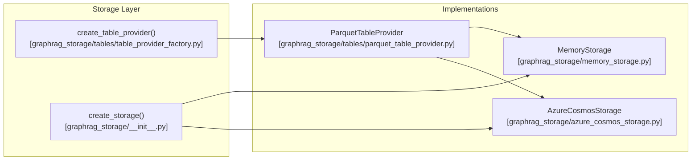

<!-- source: DeepWiki mcp.deepwiki.com · repo microsoft/graphrag · page 8.3 Query Commands · fetched 2026-10-26 -->

# Query Commands

<details>
<summary>Relevant source files</summary>

The following files were used as context for generating this wiki page:

- [dictionary.txt](dictionary.txt)
- [docs/config/models.md](docs/config/models.md)
- [docs/get_started.md](docs/get_started.md)
- [docs/visualization_guide.md](docs/visualization_guide.md)
- [mkdocs.yaml](mkdocs.yaml)
- [packages/graphrag-storage/graphrag_storage/memory_storage.py](packages/graphrag-storage/graphrag_storage/memory_storage.py)
- [packages/graphrag/graphrag/cli/query.py](packages/graphrag/graphrag/cli/query.py)
- [packages/graphrag/graphrag/index/workflows/create_community_reports.py](packages/graphrag/graphrag/index/workflows/create_community_reports.py)
- [packages/graphrag/graphrag/index/workflows/create_final_text_units.py](packages/graphrag/graphrag/index/workflows/create_final_text_units.py)
- [packages/graphrag/graphrag/index/workflows/update_covariates.py](packages/graphrag/graphrag/index/workflows/update_covariates.py)
- [tests/integration/storage/test_cosmosdb_storage.py](tests/integration/storage/test_cosmosdb_storage.py)
- [tests/unit/storage/test_parquet_table_provider.py](tests/unit/storage/test_parquet_table_provider.py)

</details>


This page documents the `graphrag query` command, which provides a CLI interface to execute search queries against indexed GraphRAG data. The query command supports four distinct search strategies (global, local, DRIFT, and basic), streaming responses, and multi-index querying capabilities.

For information about the query API methods called by these commands, see [Query API](). For details on the underlying search algorithms, see [Global Search](), [Local Search](), [DRIFT Search](), and [Basic Search]().

## Command Syntax

The `graphrag query` command follows this basic syntax:

```bash
graphrag query --root PATH --method METHOD --query "QUERY_TEXT" [OPTIONS]
```

### Required Arguments

| Argument | Description |
|----------|-------------|
| `--root PATH` | Root directory of the GraphRAG project containing configuration and output data [docs/get_started.md:115-125]() |
| `--method METHOD` | Search method to use: `global`, `local`, `drift`, or `basic` [docs/get_started.md:124]() |
| `--query "TEXT"` | Query string to search for [docs/get_started.md:116]() |

### Optional Arguments

| Argument | Type | Default | Description |
|----------|------|---------|-------------|
| `--config PATH` | Path | None | Path to custom configuration file (defaults to `settings.yaml` in root) |
| `--data PATH` | Path | None | Custom data directory (overrides `output_storage.base_dir` in config) [packages/graphrag/graphrag/cli/query.py:42]() |
| `--community-level INT` | Integer | Varies by method | Community hierarchy level to query [packages/graphrag/graphrag/cli/query.py:29]() |
| `--dynamic-community-selection` | Flag | False | Enable dynamic community selection (global search only) [packages/graphrag/graphrag/cli/query.py:30]() |
| `--response-type STR` | String | Method default | Response format (e.g., `Multiple Paragraphs`) [packages/graphrag/graphrag/cli/query.py:31]() |
| `--streaming` | Flag | False | Enable streaming output mode [packages/graphrag/graphrag/cli/query.py:32]() |
| `--verbose` | Flag | False | Enable verbose logging [packages/graphrag/graphrag/cli/query.py:34]() |

**Sources:** [docs/get_started.md:109-128](), [packages/graphrag/graphrag/cli/query.py:26-35]()

## Query Command Architecture

The CLI query command acts as a bridge between user input and the underlying search implementations. It is responsible for loading the configuration using `load_config`, resolving output files into DataFrames, and calling the appropriate API functions.

### CLI to API Data Flow


**Sources:** [packages/graphrag/graphrag/cli/query.py:26-207](), [packages/graphrag/graphrag/config/load_config.py:1-46]()

## Search Methods

Each search method requires different indexed data files. The CLI implementation loads these files into pandas DataFrames before passing them to the search API.

### Method Comparison

| Method | Use Case | Required Data Files |
|--------|----------|---------------------|
| `global` | Dataset-wide understanding, holistic questions [docs/get_started.md:113-117]() | `entities`, `communities`, `community_reports` [packages/graphrag/graphrag/cli/query.py:50-55]() |
| `local` | Entity-specific queries, neighborhood exploration [docs/get_started.md:119-125]() | `entities`, `relationships`, `communities`, `community_reports`, `text_units`, `covariates` [packages/graphrag/graphrag/cli/query.py:136-146]() |
| `drift` | Iterative refinement with community context | `entities`, `relationships`, `communities`, `community_reports`, `text_units` [packages/graphrag/graphrag/cli/query.py:232-240]() |
| `basic` | Simple vector similarity baseline | `text_units` |

### Implementation Detail: Global Search
The `run_global_search` function loads `entities`, `communities`, and `community_reports` [packages/graphrag/graphrag/cli/query.py:50-55](). It supports a `streaming` flag which uses `api.global_search_streaming` to yield chunks as they are generated [packages/graphrag/graphrag/cli/query.py:75-91]().

### Implementation Detail: Local Search
The `run_local_search` function requires a more extensive set of data, including `text_units` and `relationships` [packages/graphrag/graphrag/cli/query.py:136-142](). It optionally loads `covariates` if they exist in the output directory [packages/graphrag/graphrag/cli/query.py:144-145]().

## Data Loading and Storage

The CLI accesses indexed data stored as Parquet tables in the `output` folder [docs/get_started.md:107-108](). These tables are managed via a `TableProvider` abstraction.

### Table Provider System
The query system uses `create_table_provider` to instantiate a provider (typically `ParquetTableProvider`) that interacts with the underlying `Storage` [packages/graphrag/graphrag/cli/query.py:11-12]().



**Sources:** [packages/graphrag/graphrag/cli/query.py:11-12](), [packages/graphrag-storage/graphrag_storage/memory_storage.py:16](), [tests/unit/storage/test_parquet_table_provider.py:14]()

## Streaming and Callbacks

The query system supports streaming responses through callback functions. In the CLI, if `--streaming` is enabled, a `NoopQueryCallbacks` object is instantiated and its `on_context` method is overridden to capture context data [packages/graphrag/graphrag/cli/query.py:68-73]().

**Callback Execution Flow:**
1. The CLI starts an async loop [packages/graphrag/graphrag/cli/query.py:93]().
2. It calls `api.global_search_streaming` or `api.local_search_streaming` [packages/graphrag/graphrag/cli/query.py:75, 168]().
3. As chunks arrive, they are printed to `stdout` and flushed immediately [packages/graphrag/graphrag/cli/query.py:88-89]().

## Multi-Model Support

Query commands can be configured to use different models than the indexing pipeline (asymmetric model usage). Users can define multiple models in `settings.yaml` and reference them by ID in the search configuration [docs/config/models.md:39-42]().

```yaml
# Example settings.yaml for asymmetric query
global_search:
  completion_model_id: query_completion_model
  map_prompt: "prompts/global_search_map_system_prompt.txt"
  reduce_prompt: "prompts/global_search_reduce_system_prompt.txt"
```

**Sources:** [docs/config/models.md:42-68](), [packages/graphrag/graphrag/index/workflows/create_community_reports.py:58-61]()

---

