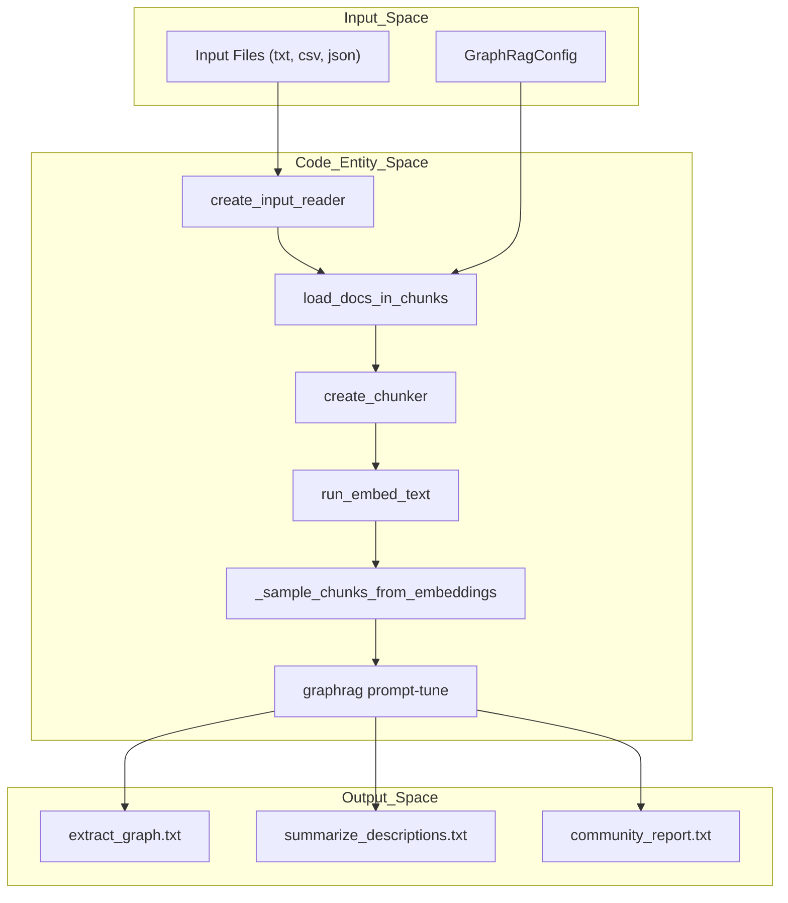
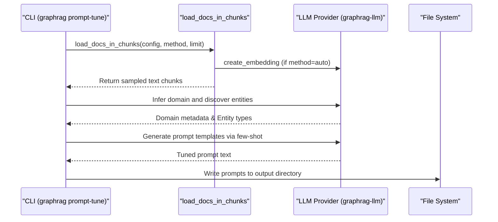

<!-- source: DeepWiki mcp.deepwiki.com · repo microsoft/graphrag · page 8.4 Prompt Tuning Command · fetched 2026-10-26 -->

# Prompt Tuning Command

<details>
<summary>Relevant source files</summary>

The following files were used as context for generating this wiki page:

- [docs/prompt_tuning/auto_prompt_tuning.md](docs/prompt_tuning/auto_prompt_tuning.md)
- [packages/graphrag/graphrag/prompt_tune/loader/input.py](packages/graphrag/graphrag/prompt_tune/loader/input.py)

</details>


This page documents the `graphrag prompt-tune` CLI command used to automatically optimize LLM prompts for domain-specific data. This command analyzes a sample of your input data and generates customized prompt templates tailored to the entities, relationships, and concepts present in your corpus.

For information about the underlying auto-tuning algorithms, see [Auto Prompt Tuning](docs/prompt_tuning/auto_prompt_tuning.md:1-92)(). For broader prompt customization strategies, see [Prompt Management](#6).

## Purpose and Scope

The `graphrag prompt-tune` command addresses a common challenge: default LLM prompts are generic and may not effectively extract domain-specific knowledge from specialized corpora (e.g., medical research, legal documents, technical specifications). The command performs the following:

1.  **Document Sampling**: Loads inputs and splits them into text units [docs/prompt_tuning/auto_prompt_tuning.md:3-5]().
2.  **Domain Analysis**: Runs a series of LLM invocations to infer the domain and identify relevant entity types [docs/prompt_tuning/auto_prompt_tuning.md:32-50]().
3.  **Prompt Generation**: Uses template substitutions to generate final prompts for extraction, summarization, and community reporting [docs/prompt_tuning/auto_prompt_tuning.md:5-12]().
4.  **Persistence**: Saves tuned prompts to a specified output folder (default is `prompts/`) [docs/prompt_tuning/auto_prompt_tuning.md:52-53]().

This command is highly encouraged as it yields better results when executing an Index Run [docs/prompt_tuning/auto_prompt_tuning.md:3-4]().

Sources: [docs/prompt_tuning/auto_prompt_tuning.md:1-53]()

## Command Syntax

The command is registered as a task in the monorepo and can be executed via `python -m graphrag prompt-tune` [docs/prompt_tuning/auto_prompt_tuning.md:20-27]().

```bash
graphrag prompt-tune [--root ROOT] [--domain DOMAIN] [--selection-method METHOD] [--limit LIMIT] [--language LANGUAGE] \
[--max-tokens MAX_TOKENS] [--chunk-size CHUNK_SIZE] [--n-subset-max N_SUBSET_MAX] [--k K] \
[--min-examples-required MIN_EXAMPLES_REQUIRED] [--discover-entity-types] [--output OUTPUT]
```

### Command-Line Options

| Option | Description | Default |
|--------|-------------|---------|
| `--root` | Path to the project directory containing `settings.yaml`. | Current directory |
| `--domain` | The domain of your data (e.g., 'microbiology'). Inferred if empty. | `""` |
| `--selection-method` | Method to select documents: `all`, `random`, `auto`, or `top`. | `random` |
| `--limit` | Number of text units to load for `random` or `top` selection. | `15` |
| `--language` | Language for input processing. Auto-detected if empty. | `""` |
| `--max-tokens` | Maximum token count for prompt generation. | `2000` |
| `--chunk-size` | Token size for generating text units from input documents. | `200` |
| `--n-subset-max` | Number of text chunks to embed when using `auto` selection. | `300` |
| `--k` | Number of documents to select when using `auto` selection. | `15` |
| `--min-examples-required` | Minimum examples for entity extraction prompts. | `2` |
| `--discover-entity-types` | Allow the LLM to discover and extract entities automatically. | Recommended for diverse data |
| `--output` | The folder to save the generated prompts. | `prompts` |

Sources: [docs/prompt_tuning/auto_prompt_tuning.md:20-53]()

## Workflow Architecture

The prompt tuning process bridges the gap between raw input data and the specialized prompts required by the indexing pipeline.

### Document Selection Methods

The command ingests data and divides it into text units based on `--chunk-size`. The `load_docs_in_chunks` function handles the selection logic [packages/graphrag/graphrag/prompt_tune/loader/input.py:44-51]():

*   **`random`**: Selects text units randomly using `pandas.sample` [packages/graphrag/graphrag/prompt_tune/loader/input.py:78-79](). Recommended for most cases [docs/prompt_tuning/auto_prompt_tuning.md:73-73]().
*   **`top`**: Selects the first *n* text units [packages/graphrag/graphrag/prompt_tune/loader/input.py:76-77]().
*   **`all`**: Uses all text units. Recommended only for small datasets [docs/prompt_tuning/auto_prompt_tuning.md:75-75]().
*   **`auto`**: Performs semantic selection. It embeds a subset of chunks, calculates the centroid, and selects the `k` nearest neighbors to that centroid [packages/graphrag/graphrag/prompt_tune/loader/input.py:80-101]().

### Prompt Tuning Data Flow

The following diagram illustrates how the CLI interacts with the internal loader and LLM components to produce prompt artifacts.



Sources: [packages/graphrag/graphrag/prompt_tune/loader/input.py:44-108](), [docs/prompt_tuning/auto_prompt_tuning.md:70-77]()

## Implementation Details

The prompt tuning command utilizes the LLM infrastructure provided by the `graphrag-llm` and `graphrag-chunking` packages. 

### Semantic Sampling (`auto` method)
When using the `auto` selection method, the system uses `run_embed_text` to generate embeddings for a subset of the data [packages/graphrag/graphrag/prompt_tune/loader/input.py:90-98](). It then uses `np.linalg.norm` to find chunks closest to the mean embedding (the centroid) [packages/graphrag/graphrag/prompt_tune/loader/input.py:31-41]().

### Generated Prompt Files

| File | Workflow Association | Purpose |
|------|----------------------|---------|
| `extract_graph.txt` | `extract_graph` | Defines how entities and relationships are extracted [docs/prompt_tuning/auto_prompt_tuning.md:83-84](). |
| `summarize_descriptions.txt` | `summarize_descriptions` | Defines how entity/relationship descriptions are summarized [docs/prompt_tuning/auto_prompt_tuning.md:86-87](). |
| `community_report.txt` | `community_reports` | Defines the structure and content of community summaries [docs/prompt_tuning/auto_prompt_tuning.md:89-90](). |

### Configuration Integration

After running the command, the `settings.yaml` file must be updated to point to the new prompt files [docs/prompt_tuning/auto_prompt_tuning.md:78-81]():

```yaml
extract_graph:
  prompt: "prompts/extract_graph.txt"

summarize_descriptions:
  prompt: "prompts/summarize_descriptions.txt"

community_reports:
  prompt: "prompts/community_report.txt"
```

Sources: [docs/prompt_tuning/auto_prompt_tuning.md:78-92](), [packages/graphrag/graphrag/prompt_tune/loader/input.py:31-108]()

## CLI Execution Logic

The command is orchestrated by the `graphrag` CLI. It interacts with storage abstractions via `create_storage` and `create_input_reader` to read inputs [packages/graphrag/graphrag/prompt_tune/loader/input.py:59-61]().



Sources: [docs/prompt_tuning/auto_prompt_tuning.md:3-12](), [packages/graphrag/graphrag/prompt_tune/loader/input.py:44-108]()

## Usage Examples

### Minimal Configuration (Recommended)
This uses the current directory as root and automatically discovers entity types based on the input data [docs/prompt_tuning/auto_prompt_tuning.md:64-66]().
```bash
python -m graphrag prompt-tune --no-discover-entity-types
```

### Full Domain Customization
Specifying a domain and selection limits for a specialized corpus [docs/prompt_tuning/auto_prompt_tuning.md:56-60]().
```bash
python -m graphrag prompt-tune --root /path/to/project --domain "environmental news" \
--selection-method random --limit 10 --language English --max-tokens 2048 --chunk-size 256 \
--min-examples-required 3 --no-discover-entity-types --output /path/to/output
```

Sources: [docs/prompt_tuning/auto_prompt_tuning.md:54-67]()

---

