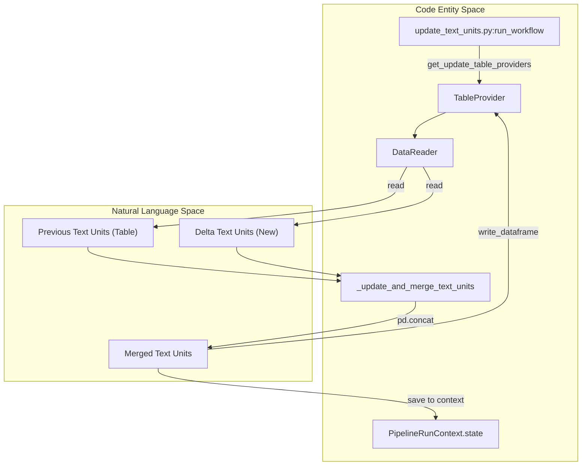
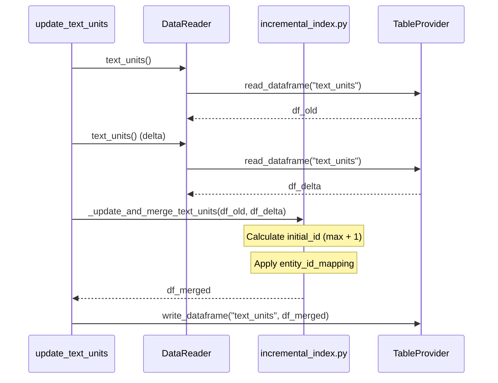

<!-- source: DeepWiki mcp.deepwiki.com · repo microsoft/graphrag · page 8.5 Update Command · fetched 2026-10-26 -->

# Update Command

<details>
<summary>Relevant source files</summary>

The following files were used as context for generating this wiki page:

- [CHANGELOG.md](CHANGELOG.md)
- [packages/graphrag-cache/pyproject.toml](packages/graphrag-cache/pyproject.toml)
- [packages/graphrag-chunking/pyproject.toml](packages/graphrag-chunking/pyproject.toml)
- [packages/graphrag/graphrag/index/update/incremental_index.py](packages/graphrag/graphrag/index/update/incremental_index.py)
- [packages/graphrag/graphrag/index/workflows/update_text_units.py](packages/graphrag/graphrag/index/workflows/update_text_units.py)
- [pyproject.toml](pyproject.toml)

</details>


The `graphrag update` command performs incremental indexing by processing new documents and merging them into an existing GraphRAG index. This command allows you to add documents to a previously indexed dataset without re-processing all existing content, saving significant time and LLM API costs [pyproject.toml:98]().

For information about the full indexing process, see [Indexing Commands](#8.2). For detailed information about the incremental indexing architecture and merge strategies, see [Incremental Indexing and Updates](#4.7).

## Purpose and Scope

The update command:
- Identifies and processes only new documents from the input directory by comparing titles against the existing index [packages/graphrag/graphrag/index/update/incremental_index.py:29-58]().
- Merges extracted entities, relationships, and text units with existing data while maintaining sequential `human_readable_id` values [packages/graphrag/graphrag/index/update/incremental_index.py:61-78]().
- Preserves the original index by performing operations in a timestamped delta directory and then merging [packages/graphrag/graphrag/index/workflows/update_text_units.py:27-29]().
- Re-runs community detection and report generation to incorporate new data into the global graph structure [CHANGELOG.md:57-58]().

This command does **not** support:
- Removing documents from an index (deleted documents are identified but currently the pipeline focuses on additions) [packages/graphrag/graphrag/index/update/incremental_index.py:56-58]().
- Modifying existing documents (requires a full re-index).
- Updating individual artifacts in isolation.

Sources: [packages/graphrag/graphrag/index/update/incremental_index.py:29-78](), [packages/graphrag/graphrag/index/workflows/update_text_units.py:21-42](), [CHANGELOG.md:190-192]()

---

## Command Syntax

The update command is invoked via the `graphrag` module [pyproject.toml:98]().

```bash
python -m graphrag update [--root PATH] [--config PATH] [--resume TIMESTAMP] 
                          [--reporter {rich,print,none}] [--emit {parquet,csv}]
```

### Options

| Option | Description | Default |
|--------|-------------|---------|
| `--root PATH` | The project root directory containing `settings.yaml` | Current directory |
| `--config PATH` | Path to a custom configuration file | `{root}/settings.yaml` |
| `--resume TIMESTAMP` | Resume from a specific timestamp of a previous run | None |
| `--reporter` | Output format for progress reporting: `rich`, `print`, or `none` | `rich` |
| `--emit` | Output file format: `parquet` or `csv` | `parquet` |

Sources: [pyproject.toml:98](), [CHANGELOG.md:96-97]()

---

## Configuration Requirements

The update command utilizes the `update_output_storage` configuration. The system uses a `TableProvider` abstraction to manage data across different backends like Parquet, CSV, or Cosmos DB [packages/graphrag/graphrag/index/workflows/update_text_units.py:10-13]().

### Update Storage Layout
When an update run starts, the system creates a timestamped folder structure within the configured update storage via `get_update_table_providers` [packages/graphrag/graphrag/index/workflows/update_text_units.py:27-29]():
1. **Previous**: A backup copy or reference to the existing index tables.
2. **Delta**: The working directory for new data extracted from the update documents.
3. **Output**: The destination for the merged dataframes.

Sources: [packages/graphrag/graphrag/index/workflows/update_text_units.py:21-42](), [packages/graphrag/graphrag/index/run/utils.py:14-14]()

---

## Internal Data Flow and Implementation

The update process bridges the gap between raw input and the merged knowledge graph through specialized workflows and the `PipelineRunContext` [packages/graphrag/graphrag/index/typing/context.py:15-15]().

### Incremental Indexing Architecture

This diagram illustrates how the `run_workflow` for text units interacts with `TableProvider` instances and the `DataReader` to merge incremental data.



Sources: [packages/graphrag/graphrag/index/workflows/update_text_units.py:21-60](), [packages/graphrag/graphrag/index/update/incremental_index.py:61-78](), [packages/graphrag/graphrag/data_model/data_reader.py:13-13]()

---

## Table Provider System

The `update` command relies heavily on the `TableProvider` abstraction to handle incremental data merging across different storage types [packages/graphrag/graphrag/index/workflows/update_text_units.py:10-10]().

| Provider Type | Code Entity | Description |
|---------------|-------------|-------------|
| **Parquet** | `ParquetTableProvider` | Default provider for local file-based Parquet tables [CHANGELOG.md:24](). |
| **CSV** | `CSVTableProvider` | Handles table operations using CSV files [CHANGELOG.md:66](). |
| **Cosmos DB** | `CosmosTableProvider` | Supports transactional batch writes and namespace partitioning for cloud-native indexing [CHANGELOG.md:17](). |

The system uses `DataReader` as a high-level wrapper around these providers to ensure typed dataframe loading across indexing workflows [CHANGELOG.md:67-70]().

Sources: [packages/graphrag/graphrag/data_model/data_reader.py:13-13](), [CHANGELOG.md:17-70]()

---

## Merge Logic and Artifact Handling

The `incremental_index.py` module provides the core logic for merging dataframes while maintaining metadata integrity [packages/graphrag/graphrag/index/update/incremental_index.py:4-9]().

### Merge Workflow Execution



| Artifact | Update Strategy |
|----------|-----------------|
| **Documents** | `get_delta_docs` identifies new vs deleted documents by title [packages/graphrag/graphrag/index/update/incremental_index.py:29-58](). |
| **Text Units** | Merged via `_update_and_merge_text_units`; `human_readable_id` is incremented based on the previous max [packages/graphrag/graphrag/index/workflows/update_text_units.py:63-95](). |
| **Entities/Relationships** | Merged using similar concatenation logic; entity ID mappings are applied to ensure consistency with new text units [packages/graphrag/graphrag/index/workflows/update_text_units.py:85-88](). |
| **Community Reports** | Regenerated to incorporate the new topology of the graph [CHANGELOG.md:57-58](). |
| **Embeddings** | Generated for new text units and updated entities [CHANGELOG.md:61](). |

Sources: [packages/graphrag/graphrag/index/update/incremental_index.py:29-78](), [packages/graphrag/graphrag/index/workflows/update_text_units.py:63-95](), [CHANGELOG.md:57-61]()

---

