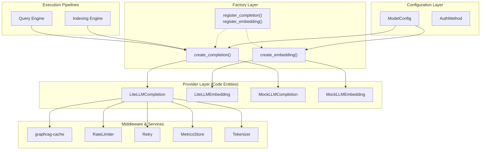
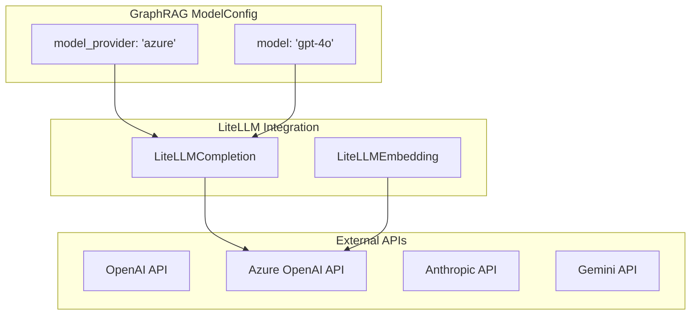

<!-- source: DeepWiki mcp.deepwiki.com · repo microsoft/graphrag · page 9 Language Model Integration · fetched 2026-10-26 -->

# Language Model Integration

Relevant source files

The following files were used as context for generating this wiki page:

- [.github/dependabot.yml](.github/dependabot.yml)
- [packages/graphrag-llm/graphrag_llm/completion/completion.py](packages/graphrag-llm/graphrag_llm/completion/completion.py)
- [packages/graphrag-llm/graphrag_llm/completion/lite_llm_completion.py](packages/graphrag-llm/graphrag_llm/completion/lite_llm_completion.py)
- [packages/graphrag-llm/graphrag_llm/completion/mock_llm_completion.py](packages/graphrag-llm/graphrag_llm/completion/mock_llm_completion.py)
- [packages/graphrag-llm/graphrag_llm/embedding/lite_llm_embedding.py](packages/graphrag-llm/graphrag_llm/embedding/lite_llm_embedding.py)
- [packages/graphrag-llm/graphrag_llm/embedding/mock_llm_embedding.py](packages/graphrag-llm/graphrag_llm/embedding/mock_llm_embedding.py)
- [packages/graphrag-llm/graphrag_llm/metrics/memory_metrics_store.py](packages/graphrag-llm/graphrag_llm/metrics/memory_metrics_store.py)
- [packages/graphrag-llm/graphrag_llm/metrics/metrics_store.py](packages/graphrag-llm/graphrag_llm/metrics/metrics_store.py)
- [packages/graphrag-llm/graphrag_llm/metrics/noop_metrics_store.py](packages/graphrag-llm/graphrag_llm/metrics/noop_metrics_store.py)
- [packages/graphrag-llm/notebooks/03_structured_responses.ipynb](packages/graphrag-llm/notebooks/03_structured_responses.ipynb)
- [tests/integration/language_model/test_factory.py](tests/integration/language_model/test_factory.py)

This document covers GraphRAG's language model integration system, including model provider architecture, configuration, and runtime behavior. It describes how GraphRAG interfaces with large language models (LLMs) for both completion (text generation) and embedding tasks.

For information about selecting specific models and providers, see [Supported Providers](#9.2). For configuration details, see [Language Model Configuration](#3.3). For prompt management, see [Prompt Management](#6).

## Overview

GraphRAG's LLM integration is primarily implemented in the `graphrag-llm` package and provides a unified interface for:

- **Completion models**: Text generation for entity extraction, summarization, and query answering.
- **Embedding models**: Vector generation for similarity search and retrieval.
- **Provider abstraction**: Support for multiple LLM providers through LiteLLM.
- **Operational features**: Rate limiting, retry logic, caching, and metrics collection.

The system uses a factory pattern to instantiate models based on configuration, allowing users to define multiple models and reference them throughout the indexing and query pipelines.

Sources: [packages/graphrag-llm/graphrag_llm/completion/completion.py:34-161](), [packages/graphrag-llm/graphrag_llm/embedding/embedding.py:17-88]()

## Architecture

### Component Structure

The following diagram illustrates how the `graphrag-llm` package bridges the gap between high-level configuration and concrete model execution.

The architecture separates concerns into distinct layers:

1.  **Configuration Layer**: Uses `ModelConfig` to define provider, auth, and tuning parameters [packages/graphrag-llm/graphrag_llm/config/types.py:1-40]().
2.  **Factory Layer**: Provides `create_completion` and `create_embedding` functions to instantiate implementations based on the `type` field in the configuration [tests/integration/language_model/test_factory.py:11-17]().
3.  **Provider Layer**: Implements abstract base classes `LLMCompletion` and `LLMEmbedding`. `LiteLLMCompletion` is the primary implementation using the `litellm` library [packages/graphrag-llm/graphrag_llm/completion/lite_llm_completion.py:45-131]().
4.  **Middleware & Services**: Injects cross-cutting concerns like caching, rate limiting, and retries into the model function via `with_middleware_pipeline` [packages/graphrag-llm/graphrag_llm/completion/lite_llm_completion.py:119-130]().

Sources: [packages/graphrag-llm/graphrag_llm/completion/completion.py:34-51](), [packages/graphrag-llm/graphrag_llm/completion/lite_llm_completion.py:45-131](), [tests/integration/language_model/test_factory.py:11-102]()

## LiteLLM Integration

### Provider Support

GraphRAG uses [LiteLLM](https://docs.litellm.ai/) as its primary model provider abstraction. LiteLLM supports 100+ model providers through a unified interface. The `model_provider` field in `ModelConfig` is passed to LiteLLM to resolve the appropriate API.

The `LiteLLMCompletion` class handles the mapping of parameters and manages the underlying LiteLLM calls, including support for streaming and structured JSON responses [packages/graphrag-llm/graphrag_llm/completion/lite_llm_completion.py:132-170]().

Sources: [packages/graphrag-llm/graphrag_llm/completion/lite_llm_completion.py:1-131](), [packages/graphrag-llm/graphrag_llm/embedding/lite_llm_embedding.py:34-119]()

### Authentication Methods

GraphRAG supports multiple authentication methods defined in `AuthMethod`:

-   **API Key**: Standard authentication using a secret key [packages/graphrag-llm/graphrag_llm/completion/lite_llm_completion.py:63-70]().
-   **Azure Managed Identity**: Uses `DefaultAzureCredential` and `get_bearer_token_provider` from `azure-identity` for secure, keyless authentication in Azure environments [packages/graphrag-llm/graphrag_llm/completion/lite_llm_completion.py:10-11]().

Sources: [packages/graphrag-llm/graphrag_llm/completion/lite_llm_completion.py:10-11](), [packages/graphrag-llm/graphrag_llm/config/types.py:14]()

## Rate Limiting and Retry Logic

GraphRAG implements robust error handling to manage the high-volume requests generated during indexing.

-   **Rate Limiting**: Controlled by `RateLimiter`. It tracks token and request usage to stay within provider limits [packages/graphrag-llm/graphrag_llm/completion/lite_llm_completion.py:56]().
-   **Retry Strategy**: Controlled by `Retry`. It implements strategies like exponential backoff to handle transient errors (e.g., HTTP 429 or 503) [packages/graphrag-llm/graphrag_llm/completion/lite_llm_completion.py:57]().

These are applied as middleware to the base completion and embedding functions [packages/graphrag-llm/graphrag_llm/completion/lite_llm_completion.py:119-130]().

For details, see [Rate Limiting and Retry Strategies](#9.3).

Sources: [packages/graphrag-llm/graphrag_llm/completion/lite_llm_completion.py:119-130]()

## Metrics and Observability

The LLM system tracks operational metrics through `MetricsStore` implementations.

- **MemoryMetricsStore**: Aggregates metrics like `total_tokens`, `total_cost`, and `failure_rate` in memory [packages/graphrag-llm/graphrag_llm/metrics/memory_metrics_store.py:44-51]().
- **NoopMetricsStore**: A null implementation used when metrics tracking is disabled [packages/graphrag-llm/graphrag_llm/metrics/noop_metrics_store.py:12-28]().

Metrics are updated automatically after each completion or embedding call [packages/graphrag-llm/graphrag_llm/completion/lite_llm_completion.py:168-169]().

Sources: [packages/graphrag-llm/graphrag_llm/metrics/metrics_store.py:14-38](), [packages/graphrag-llm/graphrag_llm/metrics/memory_metrics_store.py:17-41]()

## Structured Responses

The `LLMCompletion` interface supports structured outputs using [Pydantic](https://docs.pydantic.dev/) models. This is used extensively during entity extraction to ensure the LLM returns valid data schemas.

-   **`response_format`**: A Pydantic `BaseModel` passed to the `completion` method [packages/graphrag-llm/graphrag_llm/completion/completion.py:93-95]().
-   **Validation**: The `structure_completion_response` utility parses the raw string response into the requested Pydantic model [packages/graphrag-llm/graphrag_llm/completion/lite_llm_completion.py:161-165]().

Note: Streaming is not supported when a `response_format` is specified [packages/graphrag-llm/notebooks/03_structured_responses.ipynb:92-94]().

Sources: [packages/graphrag-llm/graphrag_llm/completion/completion.py:93-95](), [packages/graphrag-llm/notebooks/03_structured_responses.ipynb:10-11]()

## Child Pages

For more detailed information on specific components of the LLM integration, please refer to the following child pages:

-   **[LLM Provider System](#9.1)**: Deep dive into the `LiteLLM` integration, middleware pipeline, and the factory registration pattern (`register_completion`, `register_embedding`).
-   **[Supported Providers](#9.2)**: Specific configuration examples and requirements for OpenAI, Azure OpenAI, Anthropic, Gemini, and local models (Ollama).
-   **[Rate Limiting and Retry Strategies](#9.3)**: Details on the `RateLimiter` and `Retry` implementations, including exponential backoff and jitter.
-   **[Embedding Models](#9.4)**: Documentation on `LLMEmbedding`, vectorization workflows, and configuration for specific embedding providers.

---

