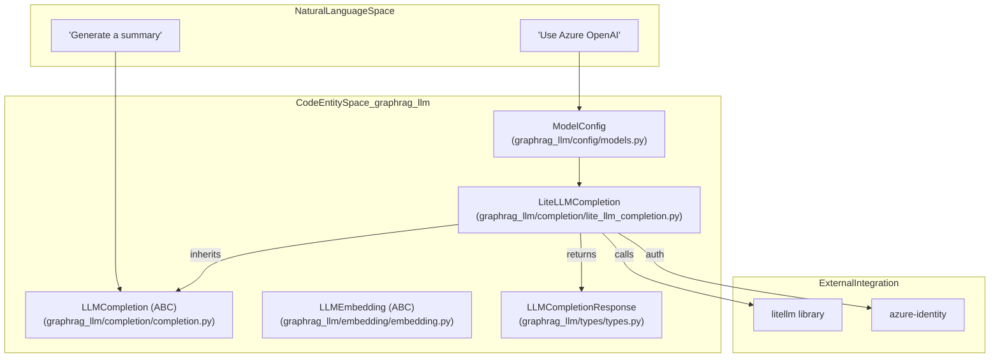
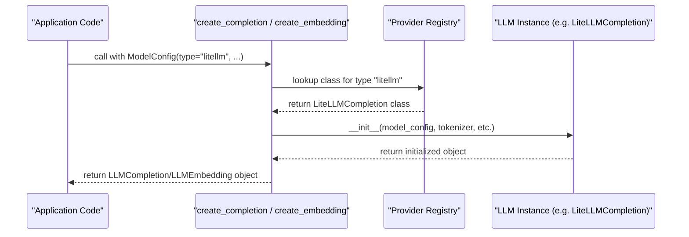
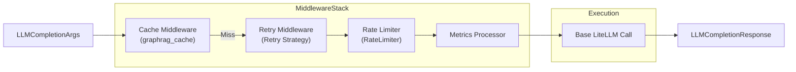

<!-- source: DeepWiki mcp.deepwiki.com · repo microsoft/graphrag · page 9.1 LLM Provider System · fetched 2026-10-26 -->

# LLM Provider System

Relevant source files

The following files were used as context for generating this wiki page:

- [packages/graphrag-llm/graphrag_llm/completion/completion.py](packages/graphrag-llm/graphrag_llm/completion/completion.py)
- [packages/graphrag-llm/graphrag_llm/completion/lite_llm_completion.py](packages/graphrag-llm/graphrag_llm/completion/lite_llm_completion.py)
- [packages/graphrag-llm/graphrag_llm/completion/mock_llm_completion.py](packages/graphrag-llm/graphrag_llm/completion/mock_llm_completion.py)
- [packages/graphrag-llm/graphrag_llm/types/types.py](packages/graphrag-llm/graphrag_llm/types/types.py)
- [packages/graphrag-llm/notebooks/03_structured_responses.ipynb](packages/graphrag-llm/notebooks/03_structured_responses.ipynb)
- [tests/integration/language_model/test_factory.py](tests/integration/language_model/test_factory.py)

## Purpose and Scope

The LLM Provider System manages all interactions with language models in GraphRAG. It provides a unified abstraction layer for both completion (text generation) and embedding models, supporting 100+ model providers through LiteLLM integration [packages/graphrag-llm/graphrag_llm/completion/lite_llm_completion.py:9-11](). This system handles model instantiation, configuration, caching, rate limiting, retry logic, and authentication.

This page documents the provider architecture, factory pattern, and integration with the middleware and caching layers.

**Sources:** [packages/graphrag-llm/graphrag_llm/completion/lite_llm_completion.py:1-45](), [packages/graphrag-llm/graphrag_llm/types/types.py:1-114]()

---

## Architecture Overview

The LLM provider system is implemented in the `graphrag-llm` package and provides a clean separation between the application layer and various LLM service providers. The architecture uses a factory pattern with provider registration, enabling both built-in providers and custom implementations [tests/integration/language_model/test_factory.py:34-102]().

### Natural Language to Code Entity Mapping

The following diagram bridges high-level concepts to specific code entities within the `graphrag-llm` package.

**Sources:** [packages/graphrag-llm/graphrag_llm/completion/completion.py:34-161](), [packages/graphrag-llm/graphrag_llm/completion/lite_llm_completion.py:45-131](), [packages/graphrag-llm/graphrag_llm/types/types.py:86-106](), [tests/integration/language_model/test_factory.py:63-70]()

---

## Provider Factory Pattern

The system uses a registration-based factory pattern to instantiate LLM providers. Developers can register custom completion or embedding classes which the factory then uses based on the `type` field in the `ModelConfig` [tests/integration/language_model/test_factory.py:61-102]().

### Factory Data Flow

**Key Factory Functions:**
- `register_completion(type, class)`: Registers a new completion provider [tests/integration/language_model/test_factory.py:61]().
- `create_completion(config)`: Instantiates a completion provider based on `ModelConfig.type` [tests/integration/language_model/test_factory.py:63-70]().
- `register_embedding(type, class)`: Registers a new embedding provider [tests/integration/language_model/test_factory.py:91]().
- `create_embedding(config)`: Instantiates an embedding provider [tests/integration/language_model/test_factory.py:93-99]().

**Sources:** [tests/integration/language_model/test_factory.py:1-102]()

---

## LiteLLM Provider

`LiteLLMCompletion` is the primary implementation for text generation. It wraps the `litellm` library to provide a unified interface across different backends (OpenAI, Azure, Anthropic, etc.) [packages/graphrag-llm/graphrag_llm/completion/lite_llm_completion.py:45-131]().

### Implementation Details
- **Middleware Pipeline**: The provider wraps the base LLM call in a middleware pipeline using `with_middleware_pipeline` that handles caching, rate limiting, and retries [packages/graphrag-llm/graphrag_llm/completion/lite_llm_completion.py:119-130]().
- **Structured Responses**: It supports `response_format` using Pydantic models to ensure structured output via `structure_completion_response` [packages/graphrag-llm/graphrag_llm/completion/lite_llm_completion.py:161-166]().
- **Streaming Constraints**: Structured responses are explicitly incompatible with streaming; attempting both raises a `ValueError` [packages/graphrag-llm/graphrag_llm/completion/lite_llm_completion.py:143-145](), [packages/graphrag-llm/notebooks/03_structured_responses.ipynb:92-121]().
- **Tokenization**: Requires a `Tokenizer` instance to track usage and manage context window limits [packages/graphrag-llm/graphrag_llm/completion/lite_llm_completion.py:64]().

**Sources:** [packages/graphrag-llm/graphrag_llm/completion/lite_llm_completion.py:59-131](), [packages/graphrag-llm/notebooks/03_structured_responses.ipynb:75-84](), [packages/graphrag-llm/graphrag_llm/types/types.py:107-150]()

---

## Completion Interface

The `LLMCompletion` abstract base class defines the contract for all completion providers [packages/graphrag-llm/graphrag_llm/completion/completion.py:34-161]().

| Method | Description | Implementation Detail |
|-----------|-------------|----------|
| `completion` | Synchronous text generation | Returns `LLMCompletionResponse` or `Iterator[LLMCompletionChunk]` [packages/graphrag-llm/graphrag_llm/completion/completion.py:81-121](). |
| `completion_async` | Asynchronous text generation | Returns `LLMCompletionResponse` or `AsyncIterator[LLMCompletionChunk]` [packages/graphrag-llm/graphrag_llm/completion/completion.py:123-161](). |
| `completion_thread_pool` | Context manager for parallel execution | Uses `completion_thread_runner` to manage concurrency [packages/graphrag-llm/graphrag_llm/completion/completion.py:164-180](). |

**Sources:** [packages/graphrag-llm/graphrag_llm/completion/completion.py:34-180](), [packages/graphrag-llm/graphrag_llm/types/types.py:86-106]()

---

## Middleware and Supporting Systems

The provider system utilizes a middleware pattern via `with_middleware_pipeline` to inject cross-cutting concerns into the LLM request lifecycle [packages/graphrag-llm/graphrag_llm/completion/lite_llm_completion.py:119-130]().

### Middleware Pipeline Flow

**Supporting Components:**
- **Cache**: Integrates with `graphrag-cache` to store responses based on a hash generated by `CacheKeyCreator` [packages/graphrag-llm/graphrag_llm/completion/lite_llm_completion.py:69-70]().
- **Rate Limiter**: Implements limits on Requests Per Minute (RPM) and Tokens Per Minute (TPM) via the `RateLimiter` interface [packages/graphrag-llm/graphrag_llm/completion/lite_llm_completion.py:67]().
- **Retrier**: Handles transient errors with configurable retry strategies via the `Retry` class [packages/graphrag-llm/graphrag_llm/completion/lite_llm_completion.py:68]().
- **Metrics Store**: Collects token usage and latency data via `MetricsStore` and `MetricsProcessor` [packages/graphrag-llm/graphrag_llm/completion/lite_llm_completion.py:65-66]().

**Sources:** [packages/graphrag-llm/graphrag_llm/completion/lite_llm_completion.py:119-130](), [packages/graphrag-llm/graphrag_llm/types/types.py:66-78]()

---

## Mock Provider

For testing purposes, the system includes a `MockLLMCompletion` provider. It returns pre-defined strings from a list in the `ModelConfig` instead of making network calls [packages/graphrag-llm/graphrag_llm/completion/mock_llm_completion.py:33-112]().

- **Input**: `model_config.mock_responses` (list of strings) [packages/graphrag-llm/graphrag_llm/completion/mock_llm_completion.py:79-88]().
- **Behavior**: Cycles through the provided responses for each call using an internal `_mock_index` [packages/graphrag-llm/graphrag_llm/completion/mock_llm_completion.py:103-106]().
- **Streaming**: Unlike `LiteLLMCompletion`, the mock provider does not support streaming and will raise a `ValueError` if `stream=True` [packages/graphrag-llm/graphrag_llm/completion/mock_llm_completion.py:99-101]().

**Sources:** [packages/graphrag-llm/graphrag_llm/completion/mock_llm_completion.py:33-121]()

---

