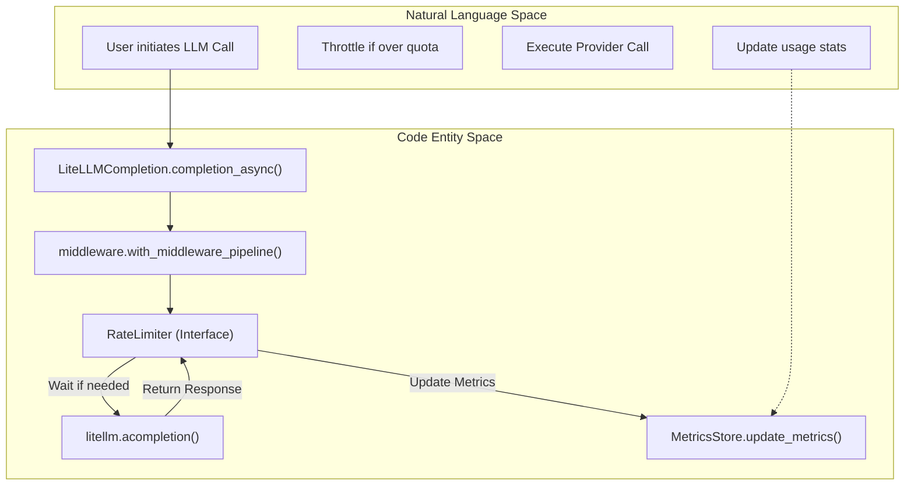
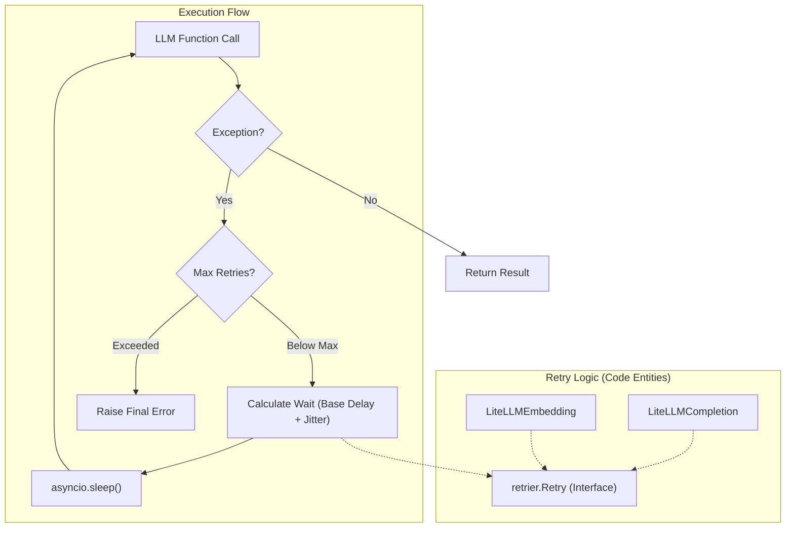

<!-- source: DeepWiki mcp.deepwiki.com · repo microsoft/graphrag · page 9.3 Rate Limiting and Retry Strategies · fetched 2026-10-26 -->

# Rate Limiting and Retry Strategies

<details>
<summary>Relevant source files</summary>

The following files were used as context for generating this wiki page:

- [.github/dependabot.yml](.github/dependabot.yml)
- [packages/graphrag-llm/graphrag_llm/completion/completion.py](packages/graphrag-llm/graphrag_llm/completion/completion.py)
- [packages/graphrag-llm/graphrag_llm/completion/lite_llm_completion.py](packages/graphrag-llm/graphrag_llm/completion/lite_llm_completion.py)
- [packages/graphrag-llm/graphrag_llm/completion/mock_llm_completion.py](packages/graphrag-llm/graphrag_llm/completion/mock_llm_completion.py)
- [packages/graphrag-llm/graphrag_llm/embedding/lite_llm_embedding.py](packages/graphrag-llm/graphrag_llm/embedding/lite_llm_embedding.py)
- [packages/graphrag-llm/graphrag_llm/embedding/mock_llm_embedding.py](packages/graphrag-llm/graphrag_llm/embedding/mock_llm_embedding.py)
- [packages/graphrag-llm/graphrag_llm/metrics/memory_metrics_store.py](packages/graphrag-llm/graphrag_llm/metrics/memory_metrics_store.py)
- [packages/graphrag-llm/graphrag_llm/metrics/metrics_store.py](packages/graphrag-llm/graphrag_llm/metrics/metrics_store.py)
- [packages/graphrag-llm/graphrag_llm/metrics/noop_metrics_store.py](packages/graphrag-llm/graphrag_llm/metrics/noop_metrics_store.py)
- [packages/graphrag-llm/notebooks/03_structured_responses.ipynb](packages/graphrag-llm/notebooks/03_structured_responses.ipynb)
- [tests/integration/language_model/test_factory.py](tests/integration/language_model/test_factory.py)

</details>


This page documents GraphRAG's rate limiting and retry mechanisms for Language Model API calls. These features control how the system manages API request throughput and handles transient failures when communicating with external LLM providers like OpenAI, Azure OpenAI, or others via LiteLLM.

## Overview

GraphRAG performs high-volume LLM operations during indexing (e.g., entity extraction, community reporting) and querying. To ensure reliability and stay within provider quotas, the system implements:

- **Rate Limiting**: Throttles requests based on Tokens Per Period and Requests Per Period.
- **Retry Logic**: Automatically retries failed requests (e.g., 429 Too Many Requests) using backoff strategies.
- **Middleware Pipeline**: Injects these behaviors into the LLM call chain dynamically.

The implementation is primarily housed within the `graphrag-llm` package, utilizing a middleware-based approach to wrap base completion and embedding functions.

**Sources:** [packages/graphrag-llm/graphrag_llm/completion/lite_llm_completion.py:119-130](), [packages/graphrag-llm/graphrag_llm/completion/completion.py:34-78]()

## Rate Limiting Architecture

GraphRAG uses a `RateLimiter` interface to manage capacity. The system typically tracks consumption to prevent hitting hard provider limits, which is critical for large-scale indexing workflows.

### Natural Language to Code Entity Space: Rate Limiting

The following diagram maps the logical flow of a request through the rate limiting middleware to the specific code entities in the `graphrag-llm` package.



**Sources:** [packages/graphrag-llm/graphrag_llm/completion/lite_llm_completion.py:119-130](), [packages/graphrag-llm/graphrag_llm/completion/lite_llm_completion.py:168-169](), [packages/graphrag-llm/graphrag_llm/completion/completion.py:123-161]()

### Rate Limiter Configuration
Rate limits are defined in the configuration models. The `RateLimiter` is initialized during the creation of `LiteLLMCompletion` or `LiteLLMEmbedding` objects.

| Setting | Description |
|---------|-------------|
| `rate_limiter` | The `RateLimiter` instance injected into the completion class. |
| `tokens_per_period` | Max tokens allowed in a defined window. |
| `requests_per_period` | Max requests allowed in a defined window. |

**Sources:** [packages/graphrag-llm/graphrag_llm/completion/lite_llm_completion.py:67-67](), [packages/graphrag-llm/graphrag_llm/embedding/lite_llm_embedding.py:56-56]()

## Retry Strategies

When an LLM call fails due to transient issues, GraphRAG applies a `Retry` strategy. The system supports multiple strategies to handle network errors or provider-side throttling.

### Retry Execution Flow

The `LiteLLMCompletion` and `LiteLLMEmbedding` classes wrap the base LiteLLM call with a retry middleware via `with_middleware_pipeline`. If the underlying `litellm` call raises an exception, the retrier determines the wait time before the next attempt.



**Sources:** [packages/graphrag-llm/graphrag_llm/completion/lite_llm_completion.py:119-130](), [packages/graphrag-llm/graphrag_llm/embedding/lite_llm_embedding.py:108-119]()

### Retry Configuration Parameters
The `Retry` strategy is typically configured during the initialization of the LLM provider. Key parameters include:
* `max_retries`: Total number of attempts.
* `base_delay`: The initial delay before retrying.
* `max_delay`: The maximum cap for delay between retries.

**Sources:** [packages/graphrag-llm/graphrag_llm/completion/completion.py:68-69](), [packages/graphrag-llm/graphrag_llm/embedding/embedding.py:53-54]()

## Concurrency and Threading

GraphRAG manages high-concurrency workloads using a dedicated `completion_thread_runner`. This allows the system to process many documents or queries in parallel while still respecting the overall rate limits and retry logic.

### Thread Pool Management
The `LLMCompletion.completion_thread_pool` context manager is used to spin up a pool of workers that execute completions.

```python
# packages/graphrag-llm/graphrag_llm/completion/completion.py:164-180
def completion_thread_pool(
    self,
    *,
    response_handler: "ThreadedLLMCompletionResponseHandler",
    concurrency: int,
    queue_limit: int = 0,
) -> "Iterator[ThreadedLLMCompletionFunction]":
    # Context manager for threaded execution
```

**Sources:** [packages/graphrag-llm/graphrag_llm/completion/completion.py:164-180](), [packages/graphrag-llm/graphrag_llm/threading/completion_thread_runner.py:10-10]()

## Implementation Details

### LiteLLM Integration
The `LiteLLMCompletion` and `LiteLLMEmbedding` classes are the primary implementations for LLM calls. They use `with_middleware_pipeline` to inject rate limiting and retry logic into the execution path.

```python
# packages/graphrag-llm/graphrag_llm/completion/lite_llm_completion.py:119-130
self._completion, self._completion_async = with_middleware_pipeline(
    model_config=self._model_config,
    model_fn=self._completion,
    async_model_fn=self._completion_async,
    request_type="chat",
    cache=self._cache,
    cache_key_creator=self._cache_key_creator,
    tokenizer=self._tokenizer,
    metrics_processor=self._metrics_processor,
    rate_limiter=self._rate_limiter,
    retrier=self._retrier,
)
```

**Sources:** [packages/graphrag-llm/graphrag_llm/completion/lite_llm_completion.py:119-130](), [packages/graphrag-llm/graphrag_llm/embedding/lite_llm_embedding.py:108-119]()

### Error Handling in Streaming
Streaming completions (where `stream=True`) have specific constraints. For example, `response_format` (structured output) is not supported during streaming because the full content is required for parsing.

```python
# packages/graphrag-llm/graphrag_llm/completion/lite_llm_completion.py:143-145
if response_format is not None and is_streaming:
    msg = "response_format is not supported for streaming completions."
    raise ValueError(msg)
```

**Sources:** [packages/graphrag-llm/graphrag_llm/completion/lite_llm_completion.py:143-145](), [packages/graphrag-llm/notebooks/03_structured_responses.ipynb:112-119]()

### Metrics and Monitoring
The rate limiting and retry systems interact with the `MetricsStore`. Every request updates the metrics to track performance, failures, and retries. The `MemoryMetricsStore` aggregates these values and can write them out via a `MetricsWriter` upon system exit.

**Sources:** [packages/graphrag-llm/graphrag_llm/metrics/memory_metrics_store.py:17-41](), [packages/graphrag-llm/graphrag_llm/metrics/memory_metrics_store.py:71-73](), [packages/graphrag-llm/graphrag_llm/completion/lite_llm_completion.py:168-169]()

---

