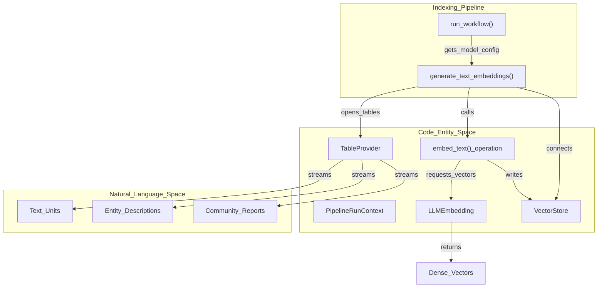
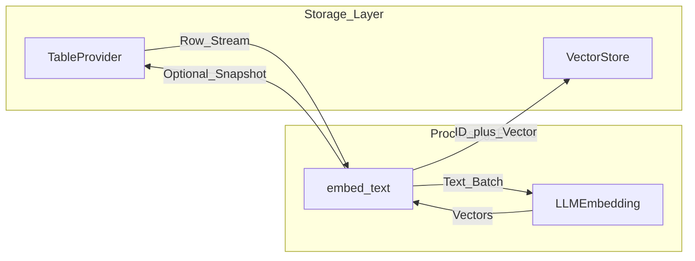

<!-- source: DeepWiki mcp.deepwiki.com · repo microsoft/graphrag · page 9.4 Embedding Models · fetched 2026-10-26 -->

# Embedding Models

Relevant source files

The following files were used as context for generating this wiki page:

- [.github/dependabot.yml](.github/dependabot.yml)
- [packages/graphrag-llm/graphrag_llm/embedding/lite_llm_embedding.py](packages/graphrag-llm/graphrag_llm/embedding/lite_llm_embedding.py)
- [packages/graphrag-llm/graphrag_llm/embedding/mock_llm_embedding.py](packages/graphrag-llm/graphrag_llm/embedding/mock_llm_embedding.py)
- [packages/graphrag-llm/graphrag_llm/metrics/memory_metrics_store.py](packages/graphrag-llm/graphrag_llm/metrics/memory_metrics_store.py)
- [packages/graphrag-llm/graphrag_llm/metrics/metrics_store.py](packages/graphrag-llm/graphrag_llm/metrics/metrics_store.py)
- [packages/graphrag-llm/graphrag_llm/metrics/noop_metrics_store.py](packages/graphrag-llm/graphrag_llm/metrics/noop_metrics_store.py)
- [packages/graphrag-storage/graphrag_storage/tables/__init__.py](packages/graphrag-storage/graphrag_storage/tables/__init__.py)
- [packages/graphrag/graphrag/index/workflows/create_base_text_units.py](packages/graphrag/graphrag/index/workflows/create_base_text_units.py)
- [packages/graphrag/graphrag/index/workflows/generate_text_embeddings.py](packages/graphrag/graphrag/index/workflows/generate_text_embeddings.py)

## Purpose and Scope

Embedding models convert text into dense vector representations that enable semantic search and similarity-based retrieval in GraphRAG. This document covers:
- Configuration of embedding models and their integration with LLM providers.
- Types of embeddings generated during the indexing pipeline.
- The embedding generation workflow, data flow, and storage format.
- Integration with vector stores for efficient retrieval.

For information about LLM providers and general model configuration, see [LLM Provider System](#9.1). For rate limiting and API management, see [Rate Limiting and Retry Strategies](#9.3).

## Embedding Types in GraphRAG

### Available Embedding Fields

GraphRAG generates embeddings for multiple artifact types produced during indexing. Each embedding type serves a specific retrieval purpose. The system defines these via `EmbeddingFieldConfig` objects [packages/graphrag/graphrag/index/workflows/generate_text_embeddings.py:39-50]().

| Embedding Type | Source Table | Source Column | Usage |
|----------------|--------------|---------------|-------|
| `text_unit_text_embedding` | `text_units` | `text` | Content-based retrieval in Local and Basic search [packages/graphrag/graphrag/index/workflows/generate_text_embeddings.py:53-57]() |
| `entity_description_embedding` | `entities` | `title_description` | Entity-centric semantic search [packages/graphrag/graphrag/index/workflows/generate_text_embeddings.py:58-63]() |
| `community_full_content_embedding` | `community_reports` | `full_content` | Community-level search in Global modes [packages/graphrag/graphrag/index/workflows/generate_text_embeddings.py:64-68]() |

Sources: [packages/graphrag/graphrag/index/workflows/generate_text_embeddings.py:52-69]()

### Selective Embedding Generation

The `embed_text.names` configuration field in `GraphRagConfig` controls which embedding types are generated. This allows optimization by generating only the embeddings required for your specific search strategy [packages/graphrag/graphrag/index/workflows/generate_text_embeddings.py:109-112]().

## Embedding Model Configuration

### Model Definition and Instantiation

Embedding models are instantiated using the `create_embedding` factory function [packages/graphrag/graphrag/index/workflows/generate_text_embeddings.py:82](). This function takes a `model_config` and returns an instance of `LLMEmbedding` [packages/graphrag/graphrag/index/workflows/generate_text_embeddings.py:82-86]().

### LiteLLM Integration

GraphRAG utilizes `LiteLLMEmbedding` to provide a unified interface to numerous providers. The `LiteLLMEmbedding` class handles the mapping of parameters and execution of requests using the `litellm` library [packages/graphrag-llm/graphrag_llm/embedding/lite_llm_embedding.py:34-158]().

Key components of `LiteLLMEmbedding` include:
- **Middleware Pipeline**: Requests are wrapped with middleware for caching, metrics, rate limiting, and retries [packages/graphrag-llm/graphrag_llm/embedding/lite_llm_embedding.py:108-119]().
- **Auth Support**: Supports Azure Managed Identity via `get_bearer_token_provider` [packages/graphrag-llm/graphrag_llm/embedding/lite_llm_embedding.py:179-182]().
- **Metrics Tracking**: Integrates with a `MetricsStore` to aggregate usage data such as token counts and costs [packages/graphrag-llm/graphrag_llm/embedding/lite_llm_embedding.py:121-148]().

Sources: [packages/graphrag-llm/graphrag_llm/embedding/lite_llm_embedding.py:34-190]()

### Mocking for Testing
For testing and development without API costs, `MockLLMEmbedding` provides a way to return pre-defined float vectors [packages/graphrag-llm/graphrag_llm/embedding/mock_llm_embedding.py:25-82]().

## Embedding Generation Workflow

### Workflow Architecture

The `generate_text_embeddings` workflow manages the end-to-end process of reading tables, generating vectors, and updating vector stores.

**Diagram: Embedding Generation Workflow Architecture**

Sources: [packages/graphrag/graphrag/index/workflows/generate_text_embeddings.py:72-163]()

### Execution Flow

The `run_workflow` function performs the following sequence:

1.  **Initialization**: It retrieves the embedding model configuration from `GraphRagConfig` and creates the `LLMEmbedding` instance [packages/graphrag/graphrag/index/workflows/generate_text_embeddings.py:79-86]().
2.  **Table Iteration**: It loops through each field name defined in `config.embed_text.names` [packages/graphrag/graphrag/index/workflows/generate_text_embeddings.py:112]().
3.  **Vector Store Connection**: For each field, it creates and connects to a `VectorStore` based on the configured index schema [packages/graphrag/graphrag/index/workflows/generate_text_embeddings.py:124-128]().
4.  **Streaming Read**: It opens the source table (e.g., `entities`) using the `TableProvider`. If a `row_transform` is defined (like `transform_entity_row_for_embedding`), it is applied during the read [packages/graphrag/graphrag/index/workflows/generate_text_embeddings.py:131-137]().
5.  **Operation Execution**: The `embed_text` operation is called to perform batching, token counting, and API calls [packages/graphrag/graphrag/index/workflows/generate_text_embeddings.py:145-156]().

Sources: [packages/graphrag/graphrag/index/workflows/generate_text_embeddings.py:101-163]()

## Embedding Storage and Retrieval

### Parquet Snapshots

If `config.snapshots.embeddings` is enabled, the workflow writes the generated embeddings back to the storage layer as parquet tables named `embeddings.{field_name}` [packages/graphrag/graphrag/index/workflows/generate_text_embeddings.py:140-143]().

### Vector Store Integration

Embeddings are pushed to vector stores (like LanceDB or Azure AI Search) during the indexing process. The `VectorStore` interface provides a standardized way to `connect` and `write` these vectors alongside their IDs [packages/graphrag/graphrag/index/workflows/generate_text_embeddings.py:124-128]().

**Diagram: Data Flow from Tables to Vector Stores**

Sources: [packages/graphrag/graphrag/index/workflows/generate_text_embeddings.py:145-156](), [packages/graphrag-storage/graphrag_storage/tables/table_provider.py:7]()

## Performance and Metrics

### Batching
The `embed_text` operation handles batching based on `config.embed_text.batch_size` and `config.embed_text.batch_max_tokens` [packages/graphrag/graphrag/index/workflows/generate_text_embeddings.py:151-152]().

### Metrics Collection
Embeddings usage is tracked via the `MetricsStore` interface [packages/graphrag-llm/graphrag_llm/metrics/metrics_store.py:14](). The `MemoryMetricsStore` aggregates metrics such as `total_tokens`, `total_cost`, and `cache_hit_rate` in-memory [packages/graphrag-llm/graphrag_llm/metrics/memory_metrics_store.py:17-41]().

Sources: [packages/graphrag-llm/graphrag_llm/metrics/memory_metrics_store.py:44-112](), [packages/graphrag-llm/graphrag_llm/embedding/lite_llm_embedding.py:121-148]()

---

