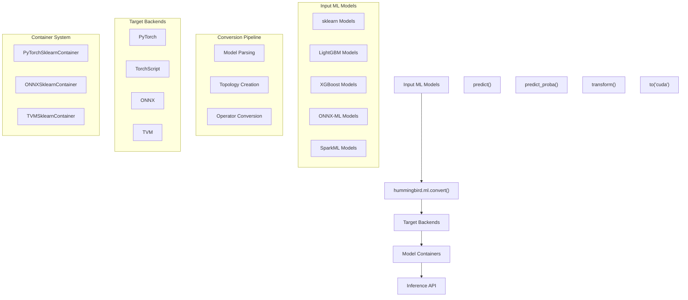
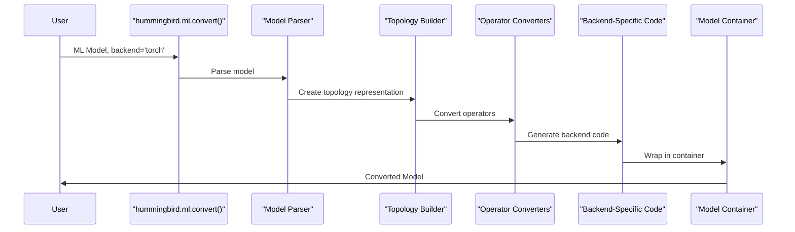
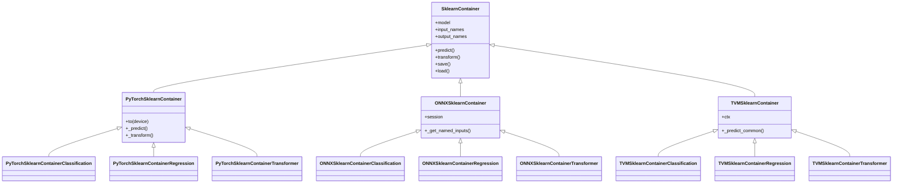
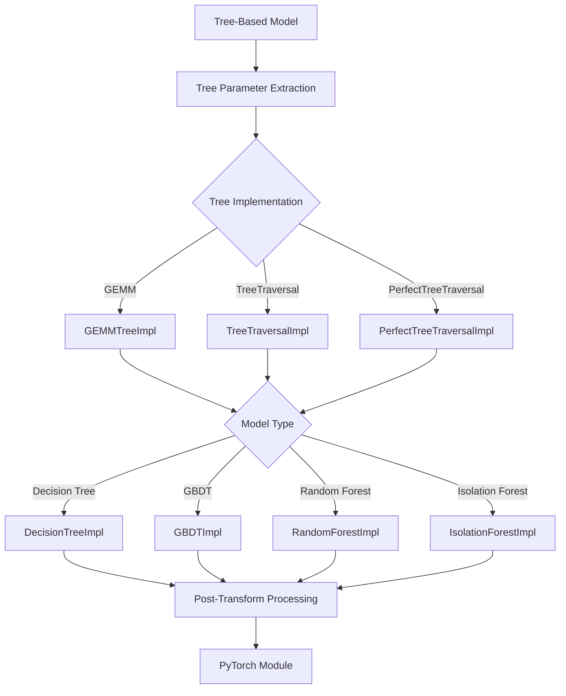

<!-- source: DeepWiki mcp.deepwiki.com · repo microsoft/hummingbird · page 1 Overview · fetched 2026-10-26 -->

# Overview

<details>
<summary>Relevant source files</summary>

The following files were used as context for generating this wiki page:

- [.github/workflows/pythonapp.yml](.github/workflows/pythonapp.yml)
- [README.md](README.md)
- [TROUBLESHOOTING.md](TROUBLESHOOTING.md)
- [hummingbird/__init__.py](hummingbird/__init__.py)
- [hummingbird/ml/_utils.py](hummingbird/ml/_utils.py)
- [hummingbird/ml/containers/sklearn/onnx_containers.py](hummingbird/ml/containers/sklearn/onnx_containers.py)
- [hummingbird/ml/containers/sklearn/pytorch_containers.py](hummingbird/ml/containers/sklearn/pytorch_containers.py)
- [hummingbird/ml/containers/sklearn/tvm_containers.py](hummingbird/ml/containers/sklearn/tvm_containers.py)
- [notebooks/LGBM-example.ipynb](notebooks/LGBM-example.ipynb)
- [notebooks/XGB-example.ipynb](notebooks/XGB-example.ipynb)
- [notebooks/blog_example.ipynb](notebooks/blog_example.ipynb)
- [notebooks/sklearn-random-forest-example.ipynb](notebooks/sklearn-random-forest-example.ipynb)
- [setup.cfg](setup.cfg)
- [setup.py](setup.py)
- [tests/test_backends.py](tests/test_backends.py)
- [website/sphinx/conf.py](website/sphinx/conf.py)

</details>


Hummingbird is a library that converts traditional machine learning models into tensor computations for faster inference. This overview introduces the core architecture, components, and workflow of Hummingbird, providing a high-level understanding of how the system transforms models from frameworks like scikit-learn, LightGBM, and XGBoost into neural network frameworks such as PyTorch, TorchScript, ONNX, and TVM.

Sources: [README.md:15-16](), [setup.py:46-49]()

## Purpose and Benefits

Hummingbird bridges the gap between traditional machine learning frameworks and neural network execution environments. By converting trained ML models into tensor computations, Hummingbird enables:

1. Leveraging optimizations implemented in neural network frameworks
2. Native hardware acceleration (CPU/GPU)
3. Unified platform for both traditional and neural network models
4. Maintaining the original model API (no re-engineering required)

For detailed installation instructions, see [Installation and Setup](#2).

Sources: [README.md:16-19](), [setup.py:45-53]()

## System Architecture

Hummingbird's architecture consists of several key components organized in a conversion pipeline:

### High-level Architecture



Sources: [README.md:18-19](), [hummingbird/ml/_utils.py:22-34]()

The architecture shows the main workflow in Hummingbird:
1. Input models from various ML frameworks are passed to `hummingbird.ml.convert()`
2. The conversion pipeline parses the model, creates a topology representation, and converts operators
3. Models are converted to the target backend (PyTorch, TorchScript, ONNX, TVM)
4. Converted models are wrapped in containers that provide a consistent API

## Conversion Process

The conversion process transforms a trained traditional ML model into a model that runs on neural network frameworks:

### Conversion Workflow



Sources: [hummingbird/__init__.py:8-14](), [README.md:90-118]()

The conversion process starts with the `convert()` function, which:
1. Identifies the type of input model and backend requested
2. Creates an internal topology representation of the model
3. Applies appropriate operator converters for each component of the model
4. Generates code for the target backend
5. Wraps the converted model in a container that mirrors the original API

## Container System

Converted models are wrapped in containers that provide a unified API regardless of the target backend:

### Container Class Hierarchy



Sources: [hummingbird/ml/containers/sklearn/pytorch_containers.py:36-102](), [hummingbird/ml/containers/sklearn/onnx_containers.py:34-107](), [hummingbird/ml/containers/sklearn/tvm_containers.py:35-128]()

The container system:
1. Provides a consistent API (`predict()`, `predict_proba()`, `transform()`) matching the original model
2. Handles backend-specific operations (moving to different devices, serialization)
3. Supports different model types (classifiers, regressors, transformers)
4. Implements persistence methods (`save()`, `load()`) for model storage and retrieval

## Tree-Based Model Conversion Strategies

Hummingbird implements sophisticated strategies to convert tree-based models (like Random Forests, GBDTs) into tensor computations:

### Tree Conversion Strategies



Sources: [README.md:25-63]()

Hummingbird implements multiple strategies for tree conversion:

1. **GEMM (GEneric Matrix Multiplication)**: 
   - Converts tree traversal into matrix multiplications
   - Highly efficient for batch processing on GPUs
   - Default strategy for dense datasets

2. **TreeTraversal**:
   - Implements traditional if-then-else logic for tree traversal
   - Better for sparse datasets or specific path conditions

3. **PerfectTreeTraversal**:
   - Optimized for balanced trees with uniform depth
   - Provides faster inference for models with regular structure

The README provides a detailed explanation of how GEMM works for decision trees, including step-by-step matrix transformations.

## Usage Example

Here's a basic example demonstrating how to use Hummingbird to convert and accelerate a scikit-learn Random Forest model:

```python
import numpy as np
from sklearn.ensemble import RandomForestClassifier
from hummingbird.ml import convert, load

# Create and train a model
X = np.random.rand(100000, 28)
y = np.random.randint(2, size=100000)
skl_model = RandomForestClassifier(n_estimators=10, max_depth=10)
skl_model.fit(X, y)

# Convert to PyTorch
model = convert(skl_model, 'pytorch')

# Run predictions on CPU
model.predict(X)

# Run predictions on GPU
model.to('cuda')
model.predict(X)

# Save the model
model.save('hb_model')

# Load the model back
model = load('hb_model')
```

Sources: [README.md:90-118](), [notebooks/blog_example.ipynb:18-26]()

## Supported Backends

Hummingbird supports the following target backends:

| Backend | Description | Device Support | Serialization |
|---------|-------------|----------------|---------------|
| `'torch'` or `'pytorch'` | PyTorch backend | CPU, GPU | Yes |
| `'torch.jit'` or `'torchscript'` | TorchScript backend | CPU, GPU | Yes |
| `'onnx'` | ONNX Runtime backend | CPU, GPU | Yes |
| `'tvm'` | TVM backend | CPU, GPU | Yes |

Sources: [tests/test_backends.py:60-81](), [README.md:18]()

Each backend requires specific dependencies installed, which can be added using:

```bash
# For basic installation
pip install hummingbird-ml

# For ONNX support
pip install hummingbird-ml[onnx]

# For additional ML frameworks (LightGBM, XGBoost)
pip install hummingbird-ml[extra]
```

Sources: [setup.py:33-44](), [README.md:73-79]()

## Version and Dependencies

Hummingbird requires:
- Python 3.9, 3.10, or 3.11
- PyTorch >= 1.7.0
- scikit-learn
- numpy >= 1.15
- onnxconverter-common >= 1.6.0

Optional dependencies include:
- XGBoost >= 0.90, < 2.0.0
- LightGBM >= 2.2
- ONNX Runtime >= 1.0.0, < 1.18.0

Sources: [setup.py:22-44](), [.github/workflows/pythonapp.yml:31-36]()

## Conclusion

Hummingbird bridges traditional machine learning frameworks and neural network execution environments, enabling acceleration without API changes. By converting models to tensor computations, it leverages GPU acceleration and optimizations from neural network frameworks, while maintaining the familiar interface of the original models.

For more detailed information, see:
- [Model Conversion Pipeline](#3.1) for the detailed conversion process
- [Supported Models and Backends](#4) for information on supported models
- [API Reference](#5) for the complete API documentation

---

