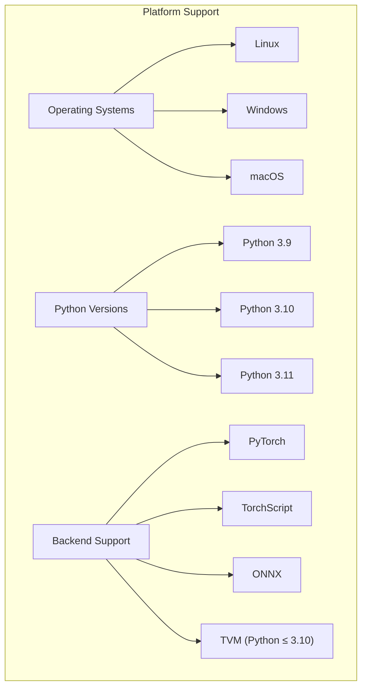
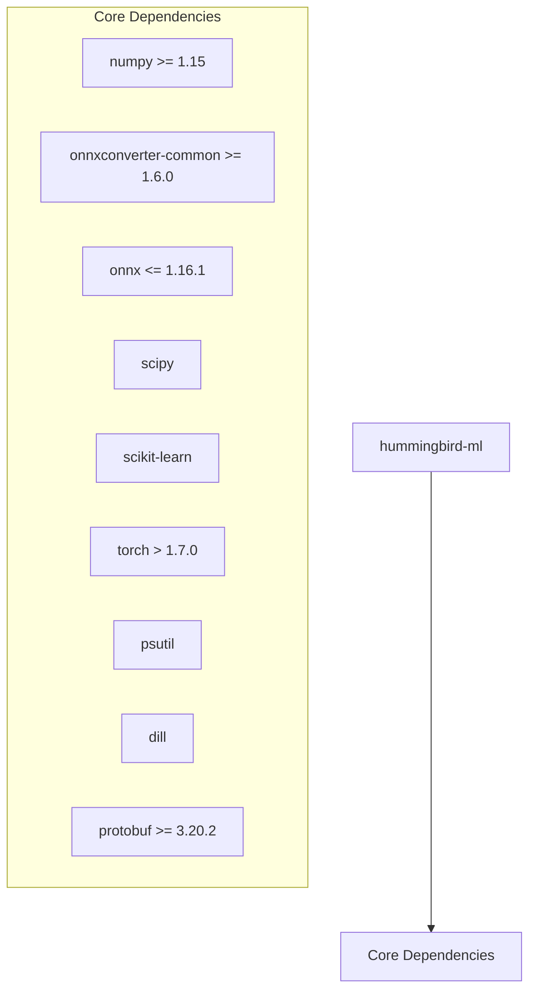
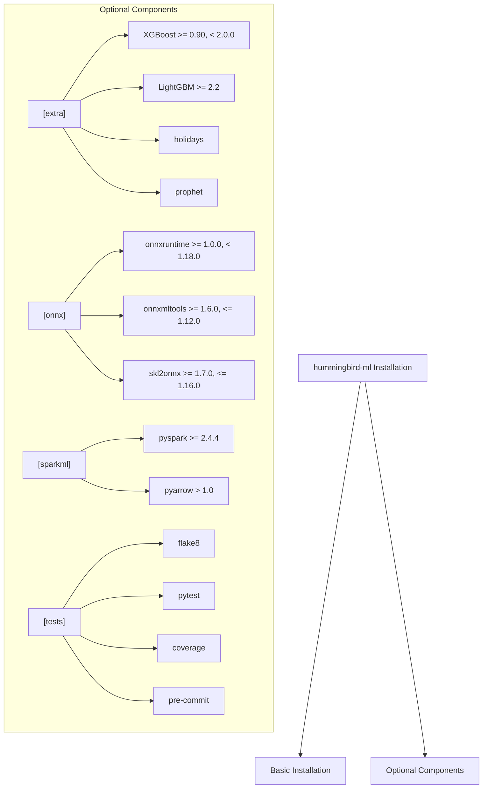
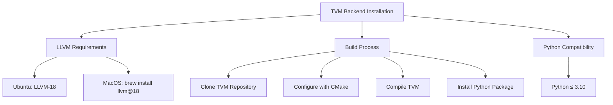
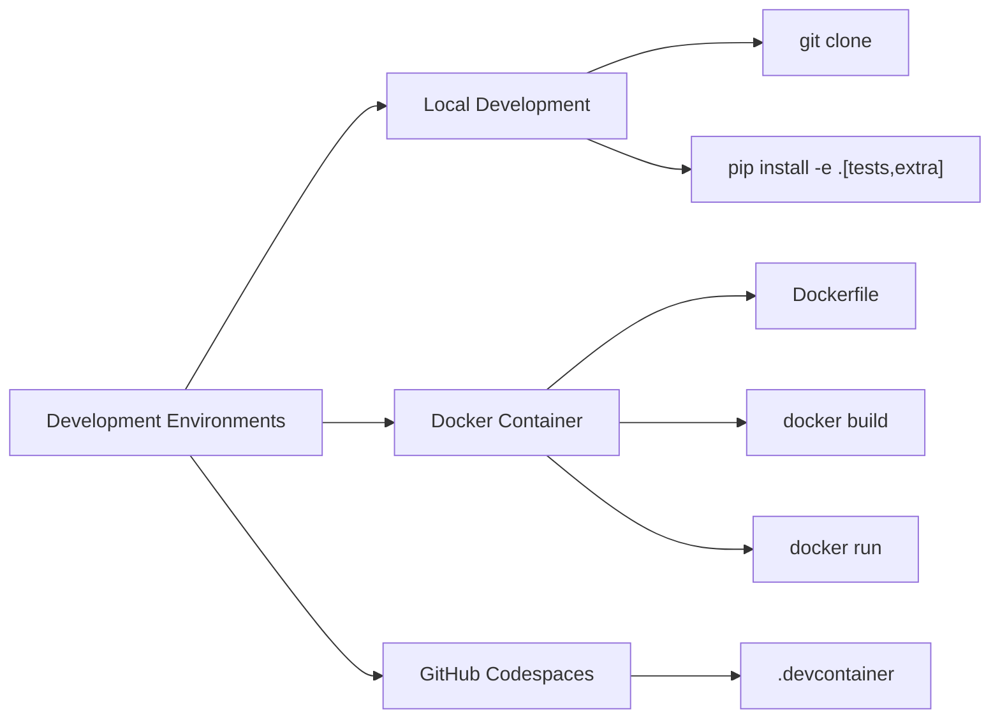

<!-- source: DeepWiki mcp.deepwiki.com · repo microsoft/hummingbird · page 2 Installation and Setup · fetched 2026-10-26 -->

# Installation and Setup

<details>
<summary>Relevant source files</summary>

The following files were used as context for generating this wiki page:

- [.devcontainer/Dockerfile](.devcontainer/Dockerfile)
- [.devcontainer/devcontainer.json](.devcontainer/devcontainer.json)
- [.github/workflows/pythonapp.yml](.github/workflows/pythonapp.yml)
- [CONTRIBUTING.md](CONTRIBUTING.md)
- [Dockerfile](Dockerfile)
- [README.md](README.md)
- [TROUBLESHOOTING.md](TROUBLESHOOTING.md)
- [hummingbird/__init__.py](hummingbird/__init__.py)
- [setup.cfg](setup.cfg)
- [setup.py](setup.py)
- [tests/test_no_extra_install.py](tests/test_no_extra_install.py)
- [website/sphinx/conf.py](website/sphinx/conf.py)

</details>


This document provides detailed instructions for installing and configuring Hummingbird. It covers basic installation, dependencies, platform-specific considerations, and troubleshooting common issues. For information on building from source and development setup, see [Development Guide](#6).

## System Requirements

Hummingbird has been tested on the following environments:

| Component | Requirements |
|-----------|--------------|
| Python | 3.9, 3.10, 3.11 (minimum 3.8) |
| Operating Systems | Linux, Windows, MacOS |
| PyTorch | ≥ 1.6.0 (currently tested with 2.4.1) |



Sources: [README.md:65-67](), [setup.py:72](), [.github/workflows/pythonapp.yml:31-36]()

## Basic Installation

### Prerequisites

Before installing Hummingbird, ensure you have PyTorch installed. PyTorch installation varies based on your platform and hardware requirements.

```bash
# Visit https://pytorch.org/ for specific installation instructions for your platform
# Example for CPU-only installation
python -m pip install torch==2.4.1
```

### Installing Hummingbird

The simplest way to install Hummingbird is through pip:

```bash
python -m pip install hummingbird-ml
```

This installs Hummingbird with the core dependencies:



Sources: [README.md:69-74](), [setup.py:22-32]()

## Optional Dependencies

Hummingbird supports several optional components that can be installed based on your needs:

### Extra ML Frameworks

To use Hummingbird with XGBoost, LightGBM, and other ML frameworks:

```bash
python -m pip install hummingbird-ml[extra]
```

### ONNX Backend

For ONNX runtime support:

```bash
python -m pip install hummingbird-ml[onnx]
```

### Spark ML Support

For Apache Spark ML pipeline support:

```bash
python -m pip install hummingbird-ml[sparkml]
```

### Complete Installation

For a complete installation with all dependencies:

```bash
python -m pip install hummingbird-ml[extra,onnx,sparkml]
```

For development and testing:

```bash
python -m pip install hummingbird-ml[tests,extra,onnx,sparkml]
```



Sources: [setup.py:33-64](), [.github/workflows/pythonapp.yml:84-86]()

## TVM Backend Setup

TVM (Tensor Virtual Machine) is an optional backend with additional installation requirements:

1. TVM requires LLVM
2. TVM is only compatible with Python ≤ 3.10
3. Installation process differs by platform



Sources: [.github/workflows/pythonapp.yml:87-143]()

## Platform-Specific Considerations

### Linux

- PyTorch CPU installation requires an extra index URL:
  ```bash
  python -m pip install torch==2.4.1 --extra-index-url https://download.pytorch.org/whl/cpu
  ```

- For LightGBM on Linux with Yum-based systems:
  ```bash
  yum install libgomp
  ```

### macOS

- LightGBM on macOS requires OpenMP:
  ```bash
  brew install libomp
  ```

- XGBoost installation might require CMake:
  ```bash
  brew install cmake
  ```

### Windows

- PyTorch installation might need to be done manually from the official PyTorch website
- Follow platform-specific instructions on the PyTorch website

Sources: [.github/workflows/pythonapp.yml:52-58](), [TROUBLESHOOTING.md:8-25]()

## Development Environment Setup

### Local Development

For development purposes, clone the repository and install in development mode:

```bash
mkdir hummingbird
cd hummingbird
git clone https://github.com/microsoft/hummingbird.git .
python -m pip install -e .[tests,extra]
```

### Docker Development Environment

A Docker image is provided for development:

```bash
docker build git://github.com/microsoft/hummingbird -t hb-dev
docker run -it hb-dev
```

### GitHub Codespaces

Hummingbird provides configuration for GitHub Codespaces, allowing you to develop in a web-based environment without local setup.



Sources: [CONTRIBUTING.md:32-42](), [Dockerfile:1-24](), [.devcontainer/Dockerfile:1-24](), [.devcontainer/devcontainer.json:1-14]()

## Troubleshooting Common Issues

### PyTorch GPU Support

To use Hummingbird with PyTorch on GPU:

1. Uninstall existing PyTorch: `python -m pip uninstall torch`
2. Reinstall PyTorch with CUDA support (see PyTorch website for specific installation command)

### Common Installation Problems

| Platform | Issue | Solution |
|----------|-------|----------|
| macOS | XGBoost: `cmake: command not found` | `brew install cmake` |
| macOS | LightGBM: `Library not loaded: libomp.dylib` | `brew install libomp` |
| Linux | LightGBM: `libgomp.so.1: cannot open shared object file` | `yum install libgomp` |
| Windows | PyTorch: `Could not find a version that satisfies the requirement` | Install PyTorch manually from the PyTorch website |

Sources: [TROUBLESHOOTING.md:1-25]()

## Verifying Installation

You can verify that Hummingbird and its dependencies are correctly installed with this simple example:

```python
import numpy as np
from sklearn.ensemble import RandomForestClassifier
from hummingbird.ml import convert

# Create a simple model and convert it
X = np.array([[0, 1], [1, 1], [2, 0]])
y = np.array([0, 1, 0])
model = RandomForestClassifier(n_estimators=2, max_depth=1)
model.fit(X, y)

# Convert to PyTorch with Hummingbird
pytorch_model = convert(model, 'pytorch')

# Make predictions
pytorch_model.predict(X)
```

Sources: [README.md:88-119]()

---

