<!-- source: DeepWiki mcp.deepwiki.com · repo microsoft/hummingbird · page 3 Architecture · fetched 2026-10-26 -->

# Architecture

Relevant source files

The following files were used as context for generating this wiki page:

- [hummingbird/ml/__init__.py](hummingbird/ml/__init__.py)
- [hummingbird/ml/_parse.py](hummingbird/ml/_parse.py)
- [hummingbird/ml/_topology.py](hummingbird/ml/_topology.py)
- [hummingbird/ml/convert.py](hummingbird/ml/convert.py)
- [hummingbird/ml/operator_converters/constants.py](hummingbird/ml/operator_converters/constants.py)
- [hummingbird/ml/operator_converters/sklearn/bagging.py](hummingbird/ml/operator_converters/sklearn/bagging.py)
- [tests/test_extra_conf.py](tests/test_extra_conf.py)
- [tests/test_onnxml_one_hot_encoder_converter.py](tests/test_onnxml_one_hot_encoder_converter.py)
- [tests/test_sklearn_bagging.py](tests/test_sklearn_bagging.py)
- [tests/test_sklearn_pipeline.py](tests/test_sklearn_pipeline.py)

This document describes the architectural design of Hummingbird, a compiler that translates traditional machine learning models into neural network frameworks for faster inference. 

Hummingbird's architecture is designed for extensibility, allowing it to support multiple input model formats and output backends while maintaining a consistent conversion pipeline. For information about specific operator converters, see [Operator Converters](#4.1). For API usage information, see [API Reference](#5).

## High-Level Architecture Overview

Hummingbird follows a compile-time conversion approach, translating source models into tensor computations that can be executed efficiently on hardware accelerators.

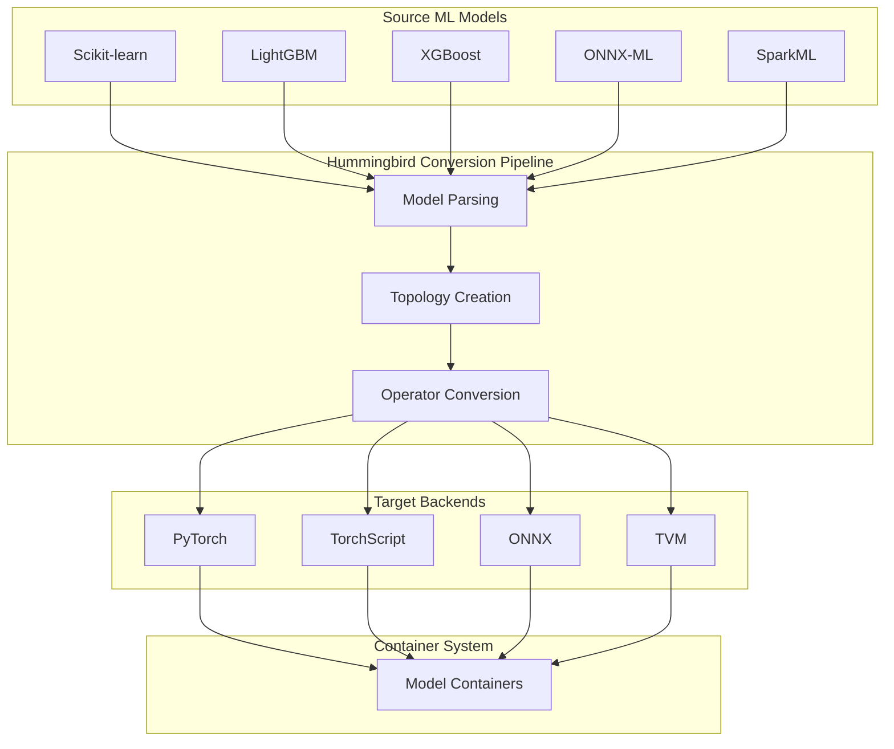

Sources: [hummingbird/ml/convert.py:1-444](), [hummingbird/ml/_topology.py:1-445]()

## Conversion Process

The conversion process begins with the `convert` function, which serves as the main entry point for Hummingbird.

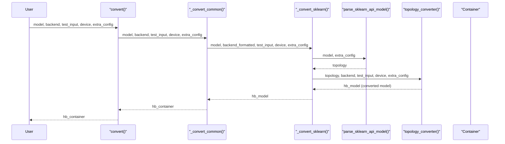

Sources: [hummingbird/ml/convert.py:408-444](), [hummingbird/ml/convert.py:295-406](), [hummingbird/ml/convert.py:95-113]()

### Conversion Flow Details

The conversion flow consists of several key steps:

1. **Input processing**: The input model is checked and the extra configurations are normalized
2. **Model routing**: The model is routed to the appropriate converter based on type (scikit-learn, LightGBM, XGBoost, ONNX, SparkML)
3. **Model parsing**: The model is parsed into Hummingbird's internal topology representation
4. **Operator conversion**: Operators are converted to tensor operations
5. **Container wrapping**: The converted model is wrapped in a container with a consistent API

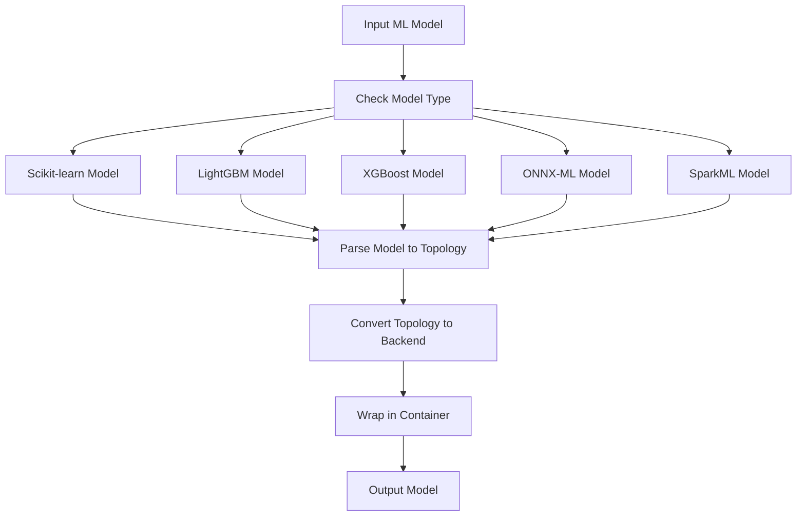

Sources: [hummingbird/ml/convert.py:94-406](), [hummingbird/ml/_parse.py:41-71](), [hummingbird/ml/_topology.py:178-444]()

## Topology System

At the core of Hummingbird's design is the `Topology` class, which provides an intermediate representation of models during conversion. The Topology serves as a bridge between source model formats and target backends.

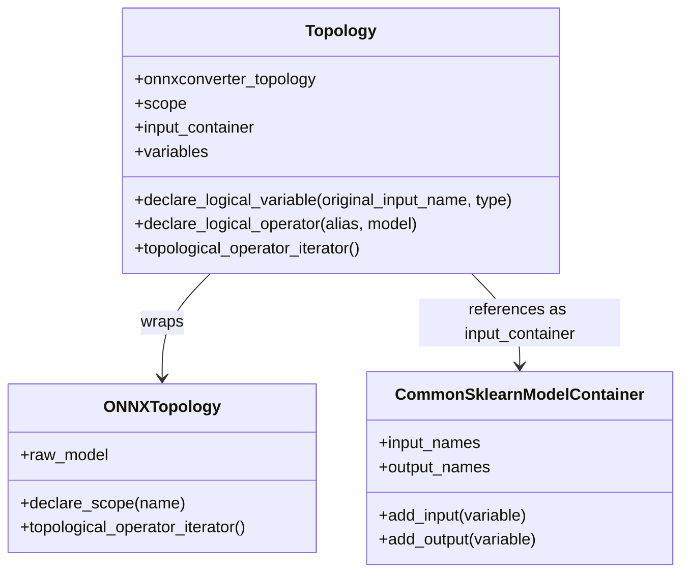

Sources: [hummingbird/ml/_topology.py:50-93](), [hummingbird/ml/_parse.py:41-71]()

### Topology Creation Process

During model parsing, Hummingbird creates a `Topology` object that captures the structure of the input model:

1. The input model is wrapped in a container (e.g., `CommonSklearnModelContainer`)
2. A `Topology` is created with the container
3. Input variables are declared based on the model inputs
4. The model is parsed into logical operators and variables
5. Output variables are declared based on the model outputs

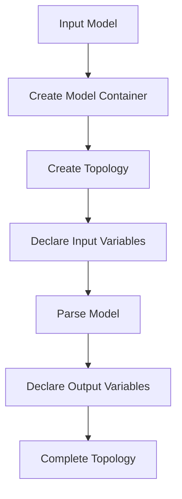

Sources: [hummingbird/ml/_parse.py:41-71](), [hummingbird/ml/_parse.py:148-213]()

## Operator Conversion

Hummingbird converts source model operators (e.g., decision trees, linear models) into their tensor-based equivalents. This conversion happens within the `topology_converter` function.

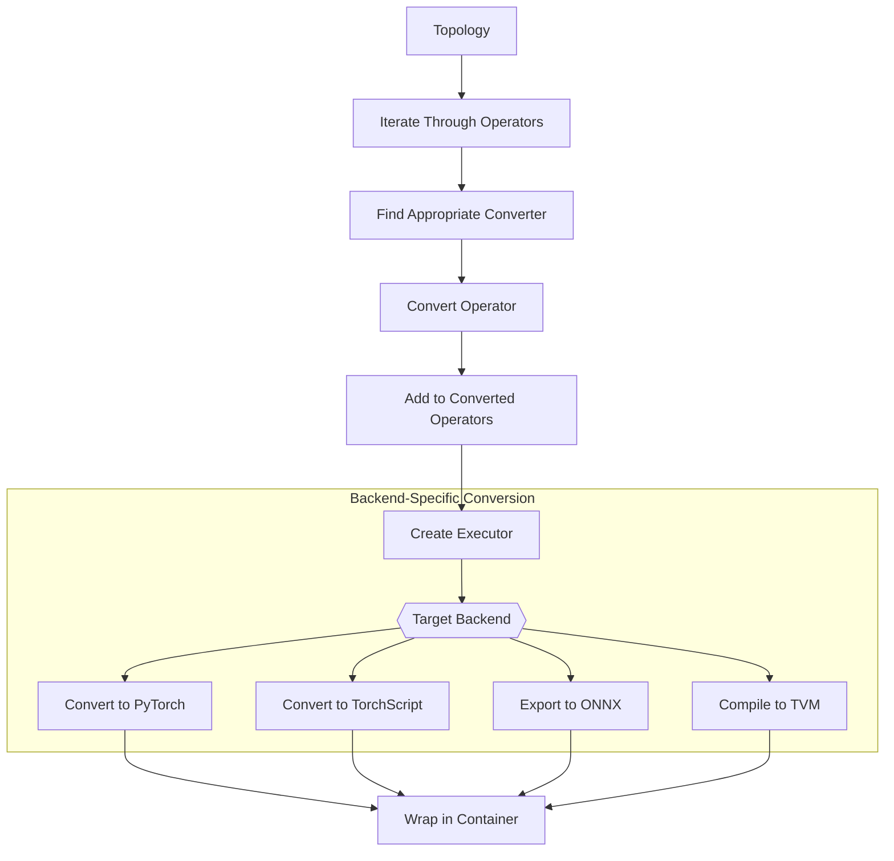

Sources: [hummingbird/ml/_topology.py:178-444](), [hummingbird/ml/convert.py:95-113]()

## Container System

After conversion, models are wrapped in a container that provides a consistent API regardless of the backend. This allows users to interact with converted models in a uniform way.

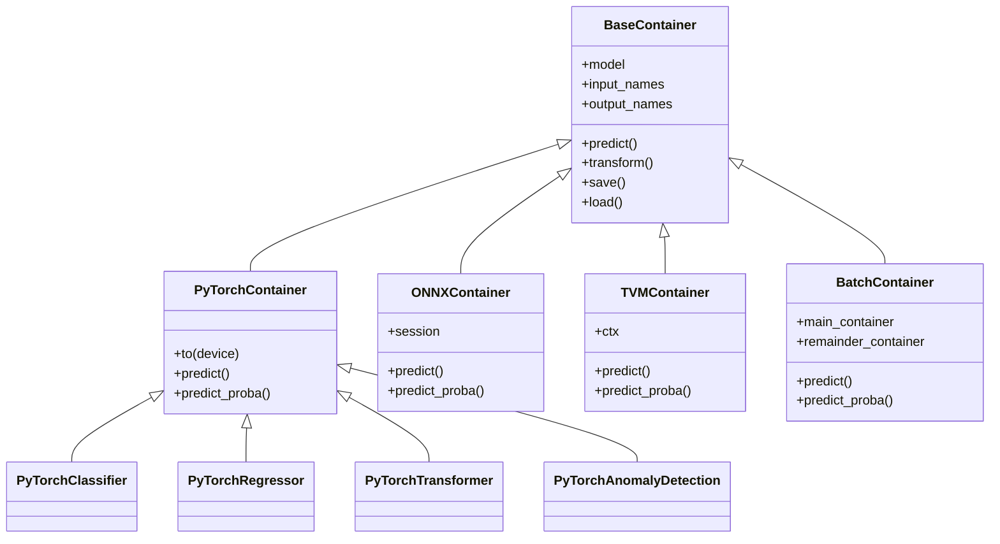

Sources: [hummingbird/ml/_topology.py:20-38](), [hummingbird/ml/_topology.py:423-444]()

## End-to-End Conversion Flow

This diagram illustrates the complete end-to-end flow from an input model to a deployed backend model:

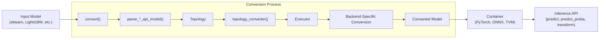

Sources: [hummingbird/ml/convert.py:408-444](), [hummingbird/ml/_topology.py:178-444]()

## Backend-Specific Implementations

Hummingbird supports multiple backends, each with its own conversion process:

### PyTorch Backend

For the PyTorch backend, operators are converted to torch.nn.Module instances that are composed into an Executor.

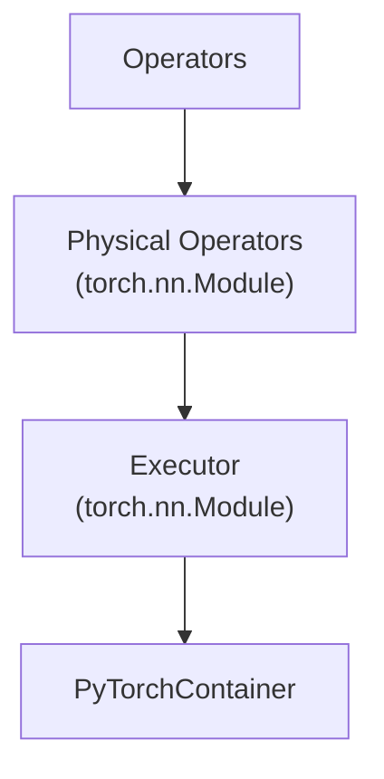

Sources: [hummingbird/ml/_topology.py:333-345]()

### TorchScript Backend

For the TorchScript backend, the PyTorch model is first created and then traced using torch.jit.trace.

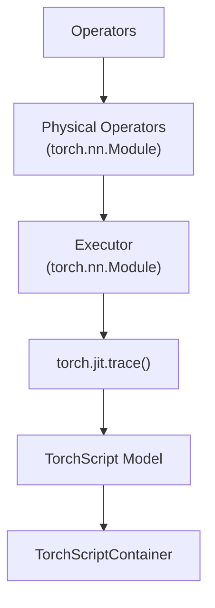

Sources: [hummingbird/ml/_topology.py:95-105](), [hummingbird/ml/_topology.py:340-343]()

### ONNX Backend

For the ONNX backend, the PyTorch model is first created and then exported to ONNX using torch.onnx.export.

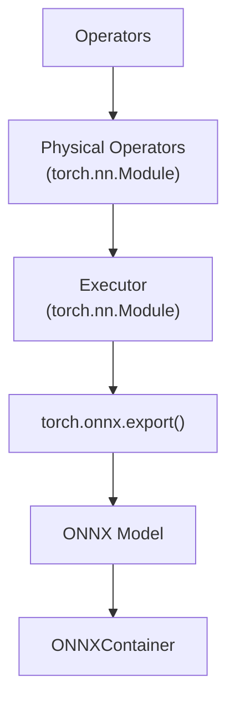

Sources: [hummingbird/ml/_topology.py:265-297]()

### TVM Backend

For the TVM backend, the PyTorch model is first created, then traced to TorchScript, and finally compiled to TVM.

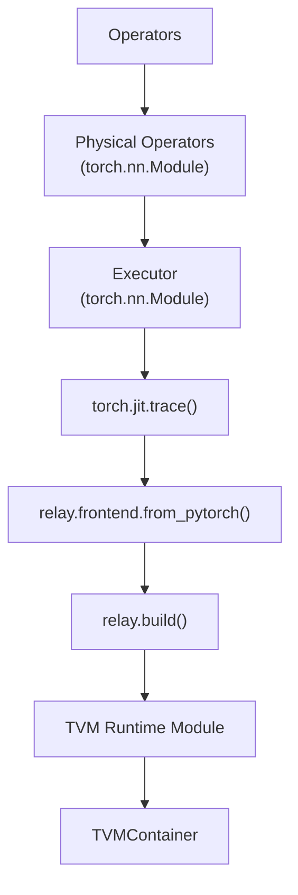

Sources: [hummingbird/ml/_topology.py:149-175](), [hummingbird/ml/_topology.py:298-332]()

## Configuration System

Hummingbird uses an `extra_config` dictionary to pass configuration options throughout the conversion process. This allows for customization of the conversion process and the resulting model.

Key configuration options include:

| Configuration Parameter | Description |
|-------------------------|-------------|
| `constants.N_THREADS`   | Number of threads to use for inference |
| `constants.TEST_INPUT`  | Test input for model tracing |
| `constants.N_FEATURES`  | Number of features in the input data |
| `constants.CONTAINER`   | Whether to wrap the model in a container |
| `constants.REMAINDER_SIZE` | Size of remainder batch for batch conversion |

Sources: [hummingbird/ml/operator_converters/constants.py:1-102](), [hummingbird/ml/convert.py:302-317]()

## Batch Conversion

Hummingbird provides a special `convert_batch` function that creates models capable of processing data in batches. This is particularly useful for TVM backend where the input shape must be fixed.

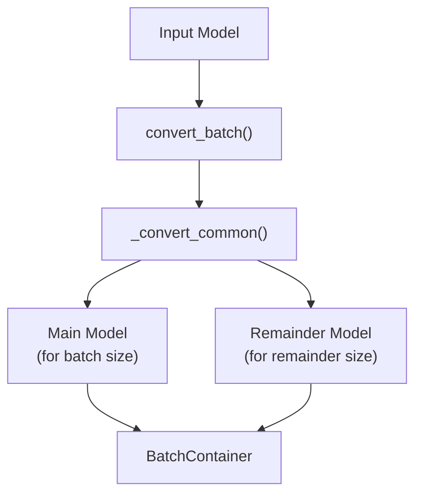

Sources: [hummingbird/ml/convert.py:447-481](), [hummingbird/ml/_topology.py:428-442]()

## Extensibility Points

Hummingbird is designed to be extensible, with clear points for adding support for new model types, operators, and backends:

1. **New Model Types**: Add new parsers in `_parse.py` and register them in `convert.py`
2. **New Operators**: Add new converters in the `operator_converters` package
3. **New Backends**: Add new backend-specific conversion in `_topology.py`

This modular architecture allows Hummingbird to evolve and support a wider range of models and backends over time.

Sources: [hummingbird/ml/_parse.py:41-71](), [hummingbird/ml/_parse.py:215-389](), [hummingbird/ml/convert.py:95-113]()

---

