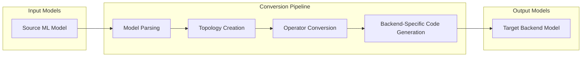
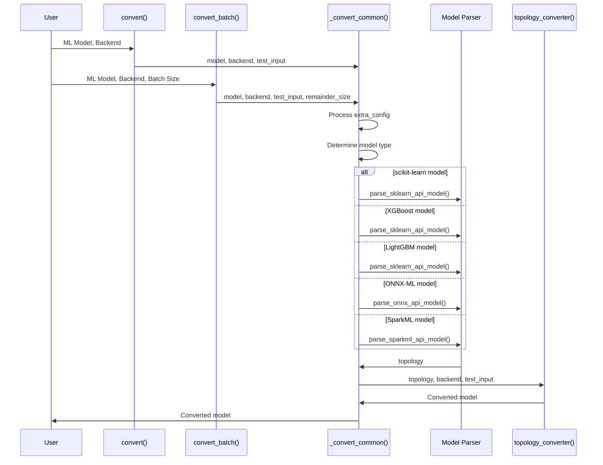
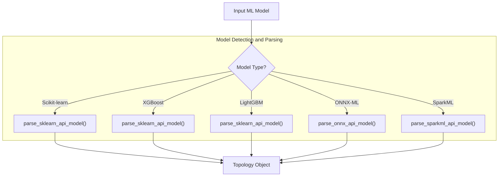
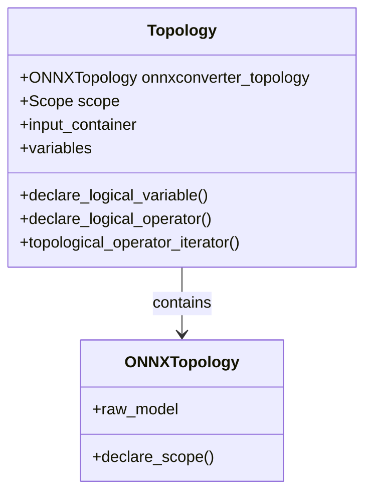
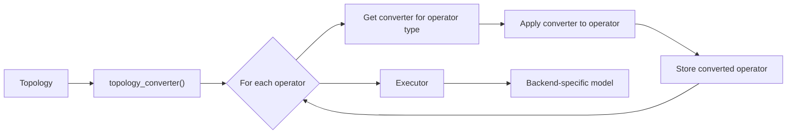
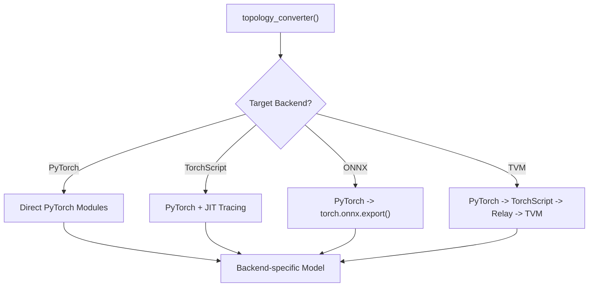
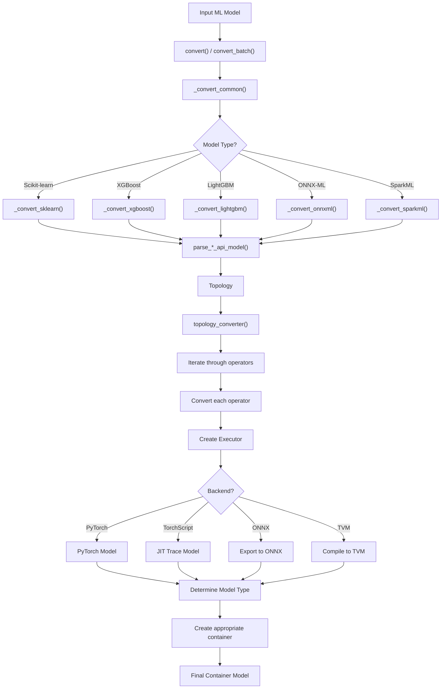

<!-- source: DeepWiki mcp.deepwiki.com · repo microsoft/hummingbird · page 3.1 Model Conversion Pipeline · fetched 2026-10-26 -->

# Model Conversion Pipeline

<details>
<summary>Relevant source files</summary>

The following files were used as context for generating this wiki page:

- [hummingbird/ml/__init__.py](hummingbird/ml/__init__.py)
- [hummingbird/ml/_parse.py](hummingbird/ml/_parse.py)
- [hummingbird/ml/_topology.py](hummingbird/ml/_topology.py)
- [hummingbird/ml/convert.py](hummingbird/ml/convert.py)
- [hummingbird/ml/operator_converters/constants.py](hummingbird/ml/operator_converters/constants.py)
- [hummingbird/ml/operator_converters/sklearn/bagging.py](hummingbird/ml/operator_converters/sklearn/bagging.py)
- [tests/test_extra_conf.py](tests/test_extra_conf.py)
- [tests/test_onnxml_one_hot_encoder_converter.py](tests/test_onnxml_one_hot_encoder_converter.py)
- [tests/test_sklearn_bagging.py](tests/test_sklearn_bagging.py)
- [tests/test_sklearn_pipeline.py](tests/test_sklearn_pipeline.py)

</details>


This document details the end-to-end process of converting machine learning models from their source frameworks (such as scikit-learn, XGBoost, or ONNX-ML) to target tensor computation backends (such as PyTorch, TorchScript, ONNX, or TVM) in Hummingbird. For information about the overall architecture, see [Architecture](#3), and for container details after conversion, see [Container System](#3.3).

## Pipeline Overview

The conversion pipeline is the core of Hummingbird's functionality, transforming traditional ML models into tensor computation representations for accelerated inference. The pipeline consists of four major stages:



Sources: [hummingbird/ml/convert.py:408-444](), [hummingbird/ml/_topology.py:178-444]()

## Conversion Entry Points

The conversion process begins with one of two main API functions:

1. `convert()` - Standard conversion for models
2. `convert_batch()` - Conversion supporting batch-by-batch prediction

Both functions ultimately call the internal `_convert_common()` function, which handles the conversion workflow.



Sources: [hummingbird/ml/convert.py:294-481]()

## Input Processing and Configuration

The conversion process begins by normalizing the inputs and setting up the conversion environment:

1. **Input Validation**: Ensures the model and backend are valid
2. **Extra Configuration Setup**: Sets default configurations and normalizes test inputs
3. **Backend Formatting**: Standardizes backend names for internal use
4. **Model Type Detection**: Determines the type of source model

```python
# Key configuration parameters include:
constants.TEST_INPUT      # Test data for tracing models
constants.N_THREADS       # Number of threads for parallel execution
constants.CONTAINER       # Whether to wrap the model in a container
constants.N_FEATURES      # Number of features in the input data
constants.REMAINDER_SIZE  # For batch conversion
```

Sources: [hummingbird/ml/convert.py:295-304](), [hummingbird/ml/operator_converters/constants.py:77-100]()

## Model Parsing Stage

The first major stage of conversion is parsing the source model into Hummingbird's internal representation.



The parsing process creates a `Topology` object, which is a universal representation of the model's computational graph regardless of the source framework.

Sources: [hummingbird/ml/_parse.py:41-292](), [hummingbird/ml/convert.py:94-292]()

### Framework-Specific Parsing

Each supported ML framework has a specialized parsing function:

| Framework | Parser Function | Description |
|-----------|----------------|-------------|
| Scikit-learn | `_convert_sklearn()` | Handles scikit-learn's estimators, pipelines, and transformers |
| XGBoost | `_convert_xgboost()` | Handles XGBoost models with special feature count extraction |
| LightGBM | `_convert_lightgbm()` | Handles LightGBM models |
| ONNX-ML | `_convert_onnxml()` | Parses ONNX-ML models and extracts input/output information |
| SparkML | `_convert_sparkml()` | Handles Spark ML models |

Sources: [hummingbird/ml/convert.py:94-292](), [hummingbird/ml/_parse.py:41-145]()

## Topology System

The `Topology` class is a central abstraction in Hummingbird's conversion pipeline, representing the computational graph of the model. It wraps the `ONNXTopology` from `onnxconverter_common`.



A topology consists of:
- Variables (inputs and outputs)
- Operators (computational nodes)
- Connections between operators

Sources: [hummingbird/ml/_topology.py:50-93](), [hummingbird/ml/_parse.py:57-69]()

## Operator Conversion

After creating the topology, the next stage converts each operator in the model to its backend-specific implementation.



Key aspects of operator conversion:
1. Operators are processed in topological order
2. Each operator type has a specific converter
3. Converters are registered and retrieved using `get_converter()`
4. Converted operators are assembled into an execution graph

Sources: [hummingbird/ml/_topology.py:178-223]()

## Backend Code Generation

The final stage of the pipeline generates code for the target backend. This process varies by backend:

### PyTorch Backend

For PyTorch, the conversion process:
1. Creates PyTorch modules for each operator
2. Assembles them into an `Executor` object
3. Optionally moves the model to the specified device (CPU/CUDA)

### TorchScript Backend

For TorchScript:
1. The PyTorch model is created first
2. The model is traced using `torch.jit.trace()` with the provided test input
3. Optimizations are applied to the traced model

```python
# TorchScript conversion using JIT tracing
def _jit_trace(executor, trace_input, device, extra_config):
    if device != "cpu":
        if type(trace_input) is tuple:
            for input_ in trace_input:
                input_.to(device)
        else:
            trace_input.to(device)
    return torch.jit.trace(executor, trace_input).eval()
```

Sources: [hummingbird/ml/_topology.py:95-105]()

### ONNX Backend

For ONNX:
1. A PyTorch model is created first
2. `torch.onnx.export()` is used to convert to ONNX format
3. Dynamic axes are configured to support variable batch sizes
4. The model is loaded back using `onnx.load()`

Sources: [hummingbird/ml/_topology.py:244-297]()

### TVM Backend

For TVM:
1. The PyTorch model is converted to TorchScript
2. TVM's `relay.frontend.from_pytorch()` converts to Relay format
3. Relay is built into a graph runtime model



Sources: [hummingbird/ml/_topology.py:149-175](), [hummingbird/ml/_topology.py:333-346]()

## Model Containerization

The final step in the conversion pipeline wraps the converted model in an appropriate container. The container type is determined by:

1. The model's task type (classification, regression, anomaly detection, or transformation)
2. The target backend (PyTorch, TorchScript, ONNX, or TVM)

```mermaid
flowchart TD
    A["Converted Model"] --> B{"Model Type?"}
    
    B -->|"Transformer"| C{"Backend?"}
    B -->|"Classifier"| D{"Backend?"}
    B -->|"Regressor"| E{"Backend?"}
    B -->|"Anomaly Detector"| F{"Backend?"}
    
    C -->|"PyTorch"| G["PyTorchSklearnContainerTransformer"]
    C -->|"TorchScript"| H["TorchScriptSklearnContainerTransformer"]
    C -->|"ONNX"| I["ONNXSklearnContainerTransformer"]
    C -->|"TVM"| J["TVMSklearnContainerTransformer"]
    
    D -->|"PyTorch"| K["PyTorchSklearnContainerClassification"]
    D -->|"TorchScript"| L["TorchScriptSklearnContainerClassification"]
    D -->|"ONNX"| M["ONNXSklearnContainerClassification"]
    D -->|"TVM"| N["TVMSklearnContainerClassification"]
    
    E -->|"PyTorch"| O["PyTorchSklearnContainerRegression"]
    E -->|"TorchScript"| P["TorchScriptSklearnContainerRegression"]
    E -->|"ONNX"| Q["ONNXSklearnContainerRegression"]
    E -->|"TVM"| R["TVMSklearnContainerRegression"]
    
    F -->|"PyTorch"| S["PyTorchSklearnContainerAnomalyDetection"]
    F -->|"TorchScript"| T["TorchScriptSklearnContainerAnomalyDetection"]
    F -->|"ONNX"| U["ONNXSklearnContainerAnomalyDetection"]
    F -->|"TVM"| V["TVMSklearnContainerAnomalyDetection"]
    
    G & H & I & J & K & L & M & N & O & P & Q & R & S & T & U & V --> W["Final Container Model"]
```



For batch conversion, the models are wrapped in a `BatchContainer` which manages both the main container and the remainder container.

Sources: [hummingbird/ml/_topology.py:348-443](), [hummingbird/ml/convert.py:447-481]()

## Examples

Below are simplified examples of how the conversion pipeline is used:

### Basic Model Conversion

```python
# Convert a scikit-learn model to PyTorch
from sklearn.ensemble import RandomForestClassifier
import hummingbird.ml

# Create and train a model
rf = RandomForestClassifier(n_estimators=10, max_depth=5)
rf.fit(X_train, y_train)

# Convert to PyTorch
pytorch_model = hummingbird.ml.convert(rf, 'torch')

# Use the converted model
predictions = pytorch_model.predict(X_test)
```

### Batch Conversion

```python
# Convert a model with batch processing support
from sklearn.ensemble import GradientBoostingRegressor
import hummingbird.ml

# Create and train a model
gbr = GradientBoostingRegressor(n_estimators=10, max_depth=5)
gbr.fit(X_train, y_train)

# Convert with batch processing
batch_size = 100
remainder_size = X_train.shape[0] % batch_size
batch_model = hummingbird.ml.convert_batch(
    gbr, 'tvm', X_train[:batch_size], remainder_size=remainder_size
)

# Process data in batches
predictions = batch_model.predict(X_test)
```

Sources: [hummingbird/ml/convert.py:408-444](), [hummingbird/ml/convert.py:447-481]()

## Pipeline Configurations

The conversion pipeline can be customized through the `extra_config` parameter, which supports various options:

| Configuration | Description |
|---------------|-------------|
| `constants.TEST_INPUT` | Test data for tracing models (required for some backends) |
| `constants.N_THREADS` | Number of threads for parallel execution |
| `constants.CONTAINER` | Whether to wrap the model in a container |
| `constants.N_FEATURES` | Number of features in the input data |
| `constants.REMAINDER_SIZE` | For batch conversion, size of the remainder data |
| `constants.TREE_IMPLEMENTATION` | Implementation strategy for tree-based models |
| `constants.MAX_STRING_LENGTH` | Maximum length for string inputs |

Sources: [hummingbird/ml/operator_converters/constants.py:10-102](), [hummingbird/ml/convert.py:295-318]()

## Complete Conversion Flow

The following diagram illustrates the complete conversion flow from input model to final container:



Sources: [hummingbird/ml/convert.py:294-481](), [hummingbird/ml/_topology.py:178-444](), [hummingbird/ml/_parse.py:41-292]()

---

