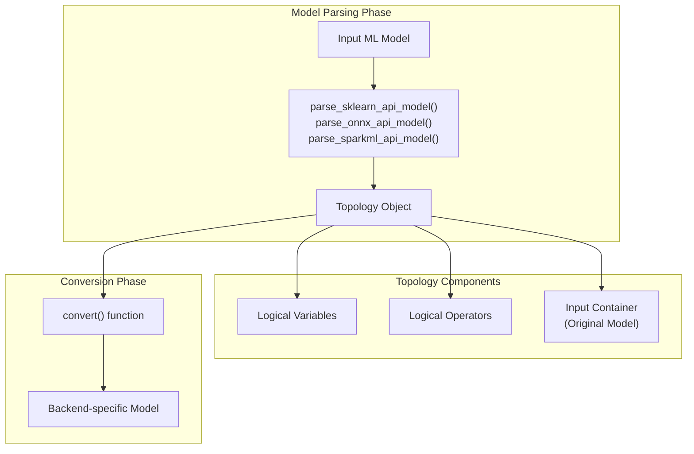
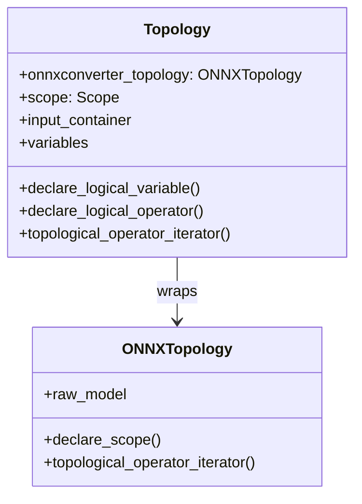
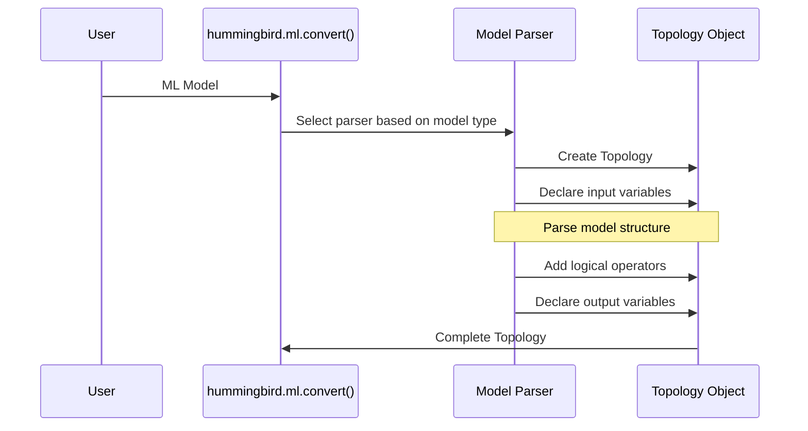
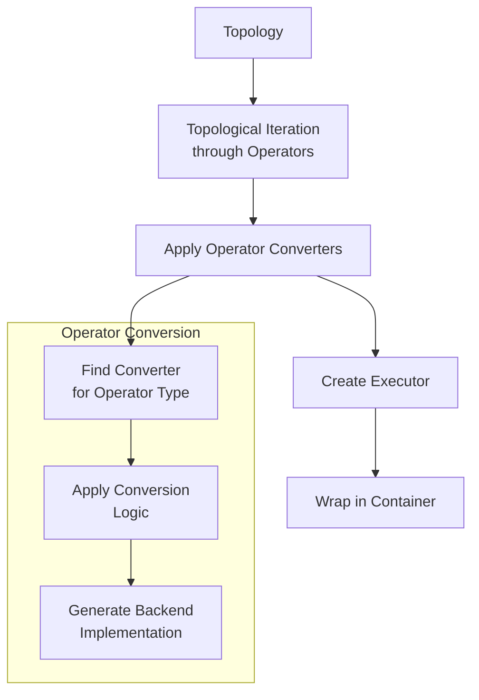
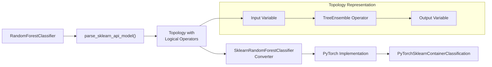

<!-- source: DeepWiki mcp.deepwiki.com · repo microsoft/hummingbird · page 3.2 Topology System · fetched 2026-10-26 -->

# Topology System

Relevant source files

The following files were used as context for generating this wiki page:

- [hummingbird/ml/__init__.py](hummingbird/ml/__init__.py)
- [hummingbird/ml/_parse.py](hummingbird/ml/_parse.py)
- [hummingbird/ml/_topology.py](hummingbird/ml/_topology.py)
- [hummingbird/ml/operator_converters/constants.py](hummingbird/ml/operator_converters/constants.py)
- [hummingbird/ml/operator_converters/sklearn/bagging.py](hummingbird/ml/operator_converters/sklearn/bagging.py)
- [tests/test_sklearn_bagging.py](tests/test_sklearn_bagging.py)
- [tests/test_sklearn_pipeline.py](tests/test_sklearn_pipeline.py)

The Topology System in Hummingbird serves as the core internal representation mechanism during model conversion. It provides an abstract representation of machine learning models from various frameworks, enabling their transformation into tensor-based execution frameworks. This page explains how models are represented internally during the conversion process. For information about the overall conversion pipeline, see [Model Conversion Pipeline](#3.1).

## Purpose and Role

The Topology System creates a unified, framework-agnostic representation of machine learning models. This intermediate representation serves as a bridge between:
- **Input**: Models from scikit-learn, LightGBM, XGBoost, ONNX-ML, or SparkML
- **Output**: Tensor computation backends like PyTorch, TorchScript, ONNX, or TVM

## Architecture

Sources: [hummingbird/ml/_topology.py:50-93](), [hummingbird/ml/_parse.py:41-145]()

## Core Components

The Topology System consists of several key components that work together to represent a machine learning model in an abstract way:

### 1. Topology Class

The `Topology` class is the central component, wrapping the `ONNXTopology` class from the onnxconverter-common library. It provides methods to:
- Declare logical variables representing inputs, intermediates, and outputs
- Declare logical operators representing model operations
- Iterate through operators in topological order

Sources: [hummingbird/ml/_topology.py:50-93]()

### 2. Input Container

The input container wraps the original input model and maintains the input and output information:
- For scikit-learn models: `CommonSklearnModelContainer`
- For ONNX models: `CommonONNXModelContainer`
- For SparkML models: `CommonSparkMLModelContainer`

Sources: [hummingbird/ml/_parse.py:26-26](), [hummingbird/ml/_topology.py:59-64]()

### 3. Logical Variables

Logical variables represent all data flowing through the model:
- Input features
- Intermediate values
- Output predictions

Variables are created using the `declare_logical_variable` method, which assigns them a name and optional type information.

Sources: [hummingbird/ml/_topology.py:73-79](), [hummingbird/ml/_parse.py:149-198]()

### 4. Logical Operators

Logical operators represent the computational operations in the model:
- Each operator has an alias identifying its type (e.g., "TreeEnsemble")
- Operators have input and output connections to logical variables
- Operators retain a reference to the original model component

Sources: [hummingbird/ml/_topology.py:81-85](), [hummingbird/ml/_parse.py:215-260]()

## Creating a Topology

The process of creating a Topology differs depending on the source framework of the input model:

Sources: [hummingbird/ml/_parse.py:41-71](), [hummingbird/ml/_parse.py:73-102](), [hummingbird/ml/_parse.py:105-145]()

### Scikit-learn Models

For scikit-learn models, the `parse_sklearn_api_model` function:
1. Creates a `CommonSklearnModelContainer` to wrap the model
2. Initializes a new `Topology` with the container
3. Declares input variables based on the provided input data
4. Parses the model structure, creating logical operators
5. Connects the operators with logical variables
6. Declares output variables

The parsing process handles different scikit-learn structures:
- Single estimators (e.g., `DecisionTreeClassifier`)
- Pipelines
- Feature unions
- Column transformers
- Ensemble models

Sources: [hummingbird/ml/_parse.py:41-71](), [hummingbird/ml/_parse.py:215-260](), [hummingbird/ml/_parse.py:263-277]()

### ONNX Models

For ONNX models, the `parse_onnx_api_model` function:
1. Creates a `CommonONNXModelContainer` to wrap the model
2. Initializes a new `Topology` with the container
3. Declares input variables from the ONNX graph input
4. Parses the ONNX graph structure, creating logical operators
5. Declares output variables from the ONNX graph output

Sources: [hummingbird/ml/_parse.py:105-145](), [hummingbird/ml/_parse.py:603-635]()

### SparkML Models

For SparkML models, the `parse_sparkml_api_model` function follows a similar process to scikit-learn but with specific handling for SparkML's API differences.

Sources: [hummingbird/ml/_parse.py:73-102](), [hummingbird/ml/_parse.py:672-732]()

## Converting from Topology to Backend

Once a Topology is constructed, it's passed to the `convert` function, which:

1. Iterates through the logical operators in topological order
2. Applies the appropriate converter for each operator type
3. Creates an execution plan for the target backend
4. Wraps the converted model in a container providing a consistent API

Sources: [hummingbird/ml/_topology.py:178-444]()

The conversion process handles:
- Operator-specific transformations
- Backend-specific code generation
- Optimizations specific to the target backend
- Selection of the appropriate container type based on model task

## Handling Complex Models

The Topology System provides specialized handling for complex model types:

### Pipelines and Ensemble Models

For scikit-learn pipelines and ensemble models, the parsing process:
1. Recursively parses each component or stage
2. Connects the outputs of one stage to the inputs of the next
3. Creates a coherent flow through the topology

Sources: [hummingbird/ml/_parse.py:263-277](), [hummingbird/ml/operator_converters/sklearn/bagging.py:19-60](), [tests/test_sklearn_pipeline.py:40-737](), [tests/test_sklearn_bagging.py:13-88]()

### Column Transformers

For column transformers, the parsing process:
1. Extracts column indices or names for each transformer
2. Slices the input variables accordingly
3. Applies each transformer to its slice
4. Concatenates the results

Sources: [hummingbird/ml/_parse.py:392-473](), [tests/test_sklearn_pipeline.py:105-607]()

## Practical Example Flow

Below is a concrete example of how a scikit-learn RandomForest model flows through the Topology System:

Sources: [hummingbird/ml/_parse.py:41-71](), [hummingbird/ml/_topology.py:178-444]()

## Constants and Configuration

The Topology System uses various constants defined in the `constants.py` file to control its behavior, including:
- Input/output name configuration
- Backend-specific parameters
- Batch size settings
- Threading configuration

Sources: [hummingbird/ml/operator_converters/constants.py:7-102]()

## Summary

The Topology System is the core representation mechanism in Hummingbird that enables model conversion between different ML frameworks and backend execution environments. It provides:

1. **Abstraction**: A unified representation independent of source and target frameworks
2. **Flexible parsing**: Specialized parsing for different model types and frameworks
3. **Structured conversion**: A systematic process for converting models to target backends
4. **Consistent interface**: A standardized way to represent model structure and data flow

This intermediate representation is crucial for Hummingbird's ability to handle diverse ML models and target multiple execution environments.

---

