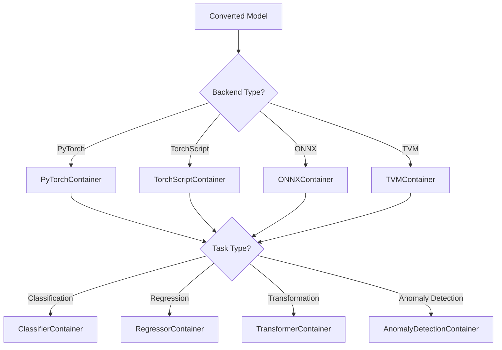
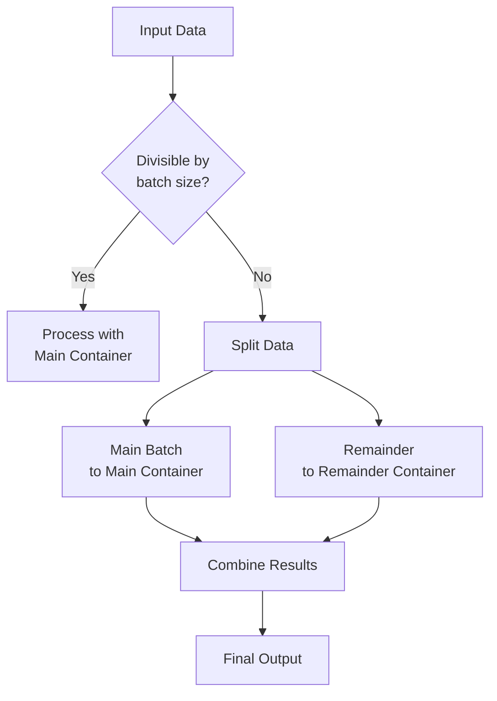
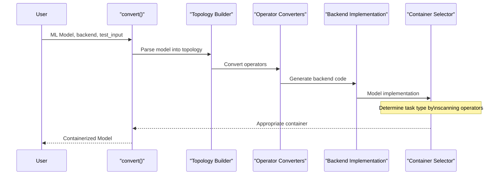

<!-- source: DeepWiki mcp.deepwiki.com · repo microsoft/hummingbird · page 3.3 Container System · fetched 2026-10-26 -->

# Container System

<details>
<summary>Relevant source files</summary>

The following files were used as context for generating this wiki page:

- [hummingbird/ml/__init__.py](hummingbird/ml/__init__.py)
- [hummingbird/ml/_topology.py](hummingbird/ml/_topology.py)
- [hummingbird/ml/_utils.py](hummingbird/ml/_utils.py)
- [hummingbird/ml/containers/sklearn/onnx_containers.py](hummingbird/ml/containers/sklearn/onnx_containers.py)
- [hummingbird/ml/containers/sklearn/pytorch_containers.py](hummingbird/ml/containers/sklearn/pytorch_containers.py)
- [hummingbird/ml/containers/sklearn/tvm_containers.py](hummingbird/ml/containers/sklearn/tvm_containers.py)
- [hummingbird/ml/operator_converters/constants.py](hummingbird/ml/operator_converters/constants.py)
- [tests/test_backends.py](tests/test_backends.py)

</details>


The Hummingbird Container System wraps converted machine learning models to provide a consistent API regardless of the backend framework (PyTorch, TorchScript, ONNX, or TVM). This page explains the container architecture, how containers are created during the conversion process, and how they're used to interact with converted models.

For information about the overall conversion pipeline, see [Model Conversion Pipeline](#3.1). For the internal model representation, see [Topology System](#3.2).

## Purpose and Role

Containers serve several key purposes in Hummingbird:

1. Provide a **consistent, framework-agnostic API** to interact with converted models
2. Support various machine learning tasks (classification, regression, transformation, anomaly detection)
3. Enable **model persistence** through save/load functionality
4. Handle **hardware acceleration** by providing device management
5. Manage **batch processing** for optimized inference

Sources: [hummingbird/ml/_topology.py:423-444](), [hummingbird/ml/containers/sklearn/pytorch_containers.py:36-106]()

## Container Class Hierarchy

```mermaid
classDiagram
    class "BaseContainer" {
        +model
        +input_names
        +output_names
        +predict()
        +transform()
        +save()
        +load()
    }
    
    class "PyTorchContainer" {
        +to(device)
        +save()
        +load()
    }
    
    class "ONNXContainer" {
        +session
        +save()
        +load()
    }
    
    class "TVMContainer" {
        +ctx
        +save()
        +load()
    }
    
    class "BatchContainer" {
        +main_container
        +remainder_container
    }
    
    "BaseContainer" <|-- "PyTorchContainer"
    "BaseContainer" <|-- "ONNXContainer"
    "BaseContainer" <|-- "TVMContainer"
    "BaseContainer" <|-- "BatchContainer"
    
    "PyTorchContainer" <|-- "PyTorchClassifier"
    "PyTorchContainer" <|-- "PyTorchRegressor"
    "PyTorchContainer" <|-- "PyTorchTransformer"
    "PyTorchContainer" <|-- "PyTorchAnomalyDetector"
    
    "ONNXContainer" <|-- "ONNXClassifier"
    "ONNXContainer" <|-- "ONNXRegressor"
    "ONNXContainer" <|-- "ONNXTransformer"
    "ONNXContainer" <|-- "ONNXAnomalyDetector"
    
    "TVMContainer" <|-- "TVMClassifier"
    "TVMContainer" <|-- "TVMRegressor"
    "TVMContainer" <|-- "TVMTransformer"
    "TVMContainer" <|-- "TVMAnomalyDetector"
```

Sources: [hummingbird/ml/_topology.py:383-422](), [hummingbird/ml/containers/sklearn/pytorch_containers.py:36-106](), [hummingbird/ml/containers/sklearn/tvm_containers.py:35-226](), [hummingbird/ml/containers/sklearn/onnx_containers.py:34-274]()

## Container Selection Process

The container selection process happens in the conversion pipeline, after a model has been converted to the target backend. Hummingbird determines the appropriate container type based on:

1. The **target backend** (PyTorch, TorchScript, ONNX, or TVM)
2. The **task type** (classification, regression, transformation, or anomaly detection)



Sources: [hummingbird/ml/_topology.py:346-422]()

## Backend-Specific Containers

Each backend has specialized container implementations to handle backend-specific functionality.

### PyTorch Containers

These containers wrap PyTorch models and provide methods to interact with them. Key features include:

- Direct model invocation through PyTorch
- Device management (GPU/CPU support) through `to(device)` method
- Support for both PyTorch models and TorchScript models

```python
# Example usage
hb_model = hummingbird.ml.convert(sklearn_model, 'torch')
hb_model.to('cuda')  # Move to GPU
predictions = hb_model.predict(X_test)
```

Sources: [hummingbird/ml/containers/sklearn/pytorch_containers.py:36-195]()

### ONNX Containers

ONNX containers wrap ONNX models and use ONNX Runtime for inference:

- Use ONNX Runtime's `InferenceSession` for model execution
- Manage named inputs and outputs for ONNX inference
- Thread control through ONNX Runtime session options

Sources: [hummingbird/ml/containers/sklearn/onnx_containers.py:34-274]()

### TVM Containers

TVM containers wrap compiled TVM models:

- Handle TVM's context-based execution model (CPU/GPU)
- Manage input/output tensor conversions
- Support batch processing with padding if needed

Sources: [hummingbird/ml/containers/sklearn/tvm_containers.py:35-226]()

## Task-Specific Container Types

For each backend, Hummingbird provides specialized containers for different machine learning tasks:

| Task Type | Container Type | Main Methods |
|-----------|---------------|--------------|
| Classification | `ClassifierContainer` | `predict()`, `predict_proba()` |
| Regression | `RegressorContainer` | `predict()` |
| Transformation | `TransformerContainer` | `transform()` |
| Anomaly Detection | `AnomalyDetectionContainer` | `predict()`, `decision_function()`, `score_samples()` |

Sources: [hummingbird/ml/containers/sklearn/pytorch_containers.py:198-357](), [hummingbird/ml/containers/sklearn/onnx_containers.py:220-274](), [hummingbird/ml/containers/sklearn/tvm_containers.py:254-290]()

## Batch Container

The `BatchContainer` is a special container that manages two models:

1. A **main container** optimized for processing complete batches
2. A **remainder container** for handling smaller remainder batches

This design improves performance when processing data in batches that don't perfectly divide the total dataset.



Sources: [hummingbird/ml/_topology.py:428-436]()

## Model Persistence

Containers provide save and load functionality to persist converted models:

### Saving a Model

The save operation:
1. Serializes the model according to the backend type
2. Records model configuration and versions
3. Creates a zip archive with all necessary files
4. Generates a digest for model verification

```python
# Example of saving a model with digest for verification
model_digest = hb_model.save("my_model")
print(f"Saved model with digest: {model_digest}")
```

### Loading a Model

The load operation:
1. Verifies the model digest (if provided)
2. Unpacks the zip archive
3. Checks version compatibility
4. Loads the model according to the backend type
5. Reconstructs the container with the model

```python
# Example of loading a model with digest verification
loaded_model = hummingbird.ml.load("my_model.zip", digest=model_digest)
```

Each backend has specific serialization formats:

| Backend | Serialization Format |
|---------|---------------------|
| PyTorch | PyTorch model state |
| TorchScript | Scripted model file |
| ONNX | ONNX protobuf file |
| TVM | TVM library, graph, and parameters |

Sources: [hummingbird/ml/containers/sklearn/pytorch_containers.py:41-191](), [hummingbird/ml/containers/sklearn/onnx_containers.py:55-196](), [hummingbird/ml/containers/sklearn/tvm_containers.py:57-225](), [hummingbird/ml/_utils.py:244-302]()

## Container Creation in the Conversion Pipeline

The container system is a key part of the conversion process. Here's how containers are created:



The container selection logic examines the properties of converted operators to determine the model's task type (classification, regression, etc.) and selects the appropriate container type for that task and backend.

Sources: [hummingbird/ml/_topology.py:346-422]()

## Container Interface

All containers provide a consistent interface regardless of the backend:

### Core Methods

| Method | Description |
|--------|-------------|
| `predict()` | Make predictions (classifiers/regressors) |
| `predict_proba()` | Get probability estimates (classifiers) |
| `transform()` | Transform data (transformers) |
| `decision_function()` | Get decision scores (anomaly detectors) |
| `save(location)` | Save the model to a file |
| `load(location, [digest])` | Load a model from a file |

### Backend-Specific Methods

Some container types offer additional backend-specific methods:

- **PyTorch Containers**: `to(device)` to move the model between devices
- **TVM Containers**: Context management for different hardware targets
- **ONNX Containers**: Session configuration for inference optimization

Sources: [hummingbird/ml/containers/sklearn/pytorch_containers.py:193-195](), [hummingbird/ml/containers/sklearn/tvm_containers.py:227-251](), [hummingbird/ml/containers/sklearn/onnx_containers.py:198-218]()

## Summary

The Container System is a crucial component of Hummingbird that:

1. Provides a **uniform interface** to interact with converted models regardless of the backend
2. Supports different **ML tasks** through specialized container types
3. Enables **model persistence** through standardized save/load functionality
4. Manages **hardware acceleration** through backend-specific optimizations
5. Facilitates **batch processing** for efficient inference

This abstraction layer allows users to work with converted models in a consistent way, regardless of the target backend, while still benefiting from the performance advantages of tensor-based computation frameworks.

---

