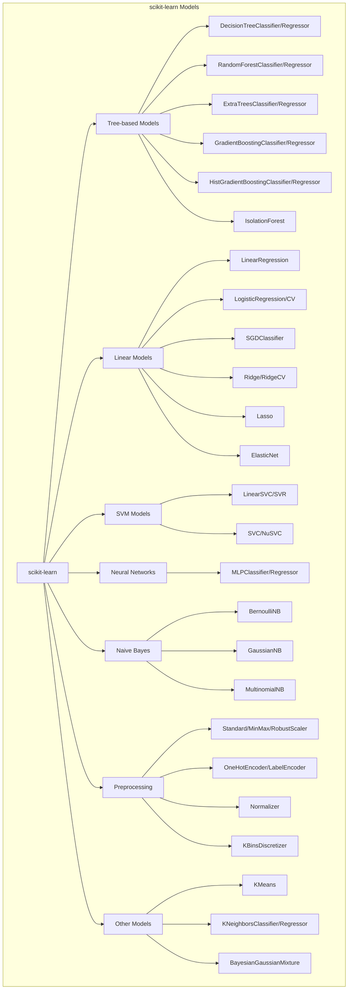
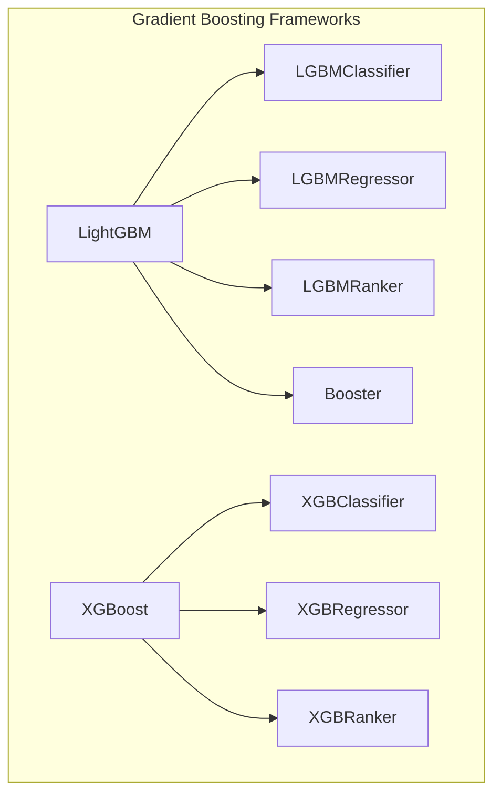
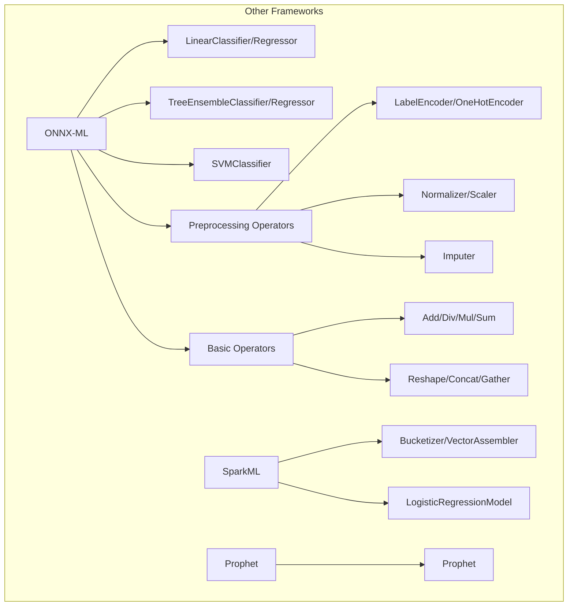
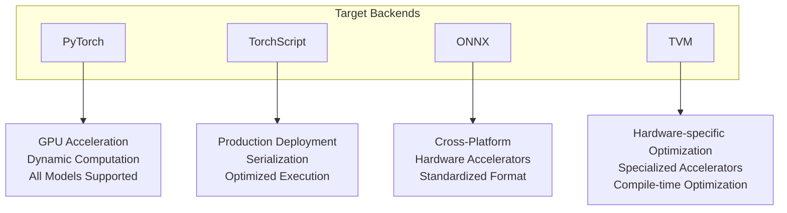
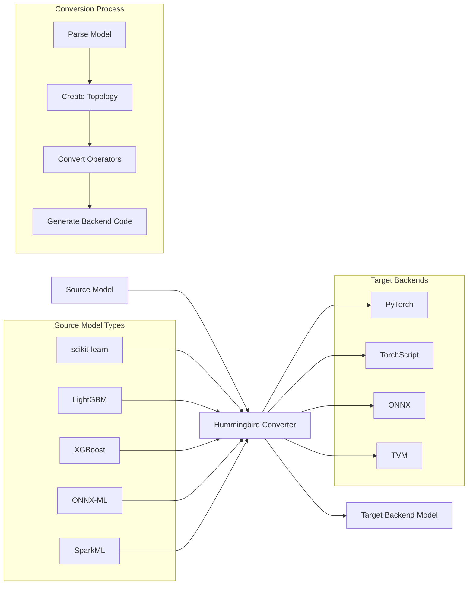
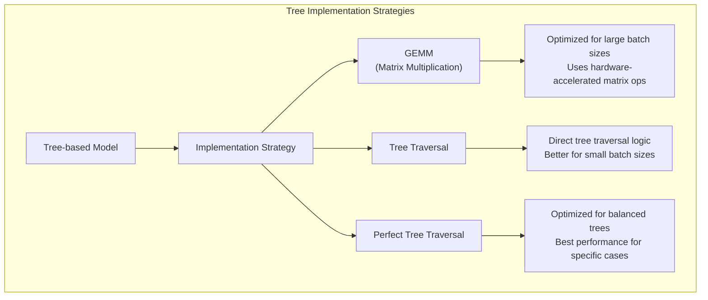
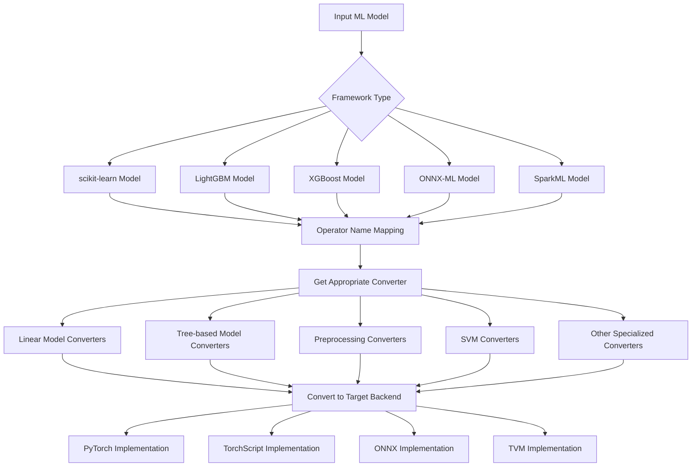
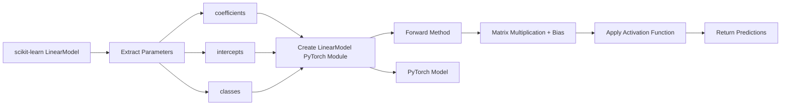

<!-- source: DeepWiki mcp.deepwiki.com · repo microsoft/hummingbird · page 4 Supported Models and Backends · fetched 2026-10-26 -->

# Supported Models and Backends

<details>
<summary>Relevant source files</summary>

The following files were used as context for generating this wiki page:

- [hummingbird/ml/operator_converters/__init__.py](hummingbird/ml/operator_converters/__init__.py)
- [hummingbird/ml/operator_converters/_linear_implementations.py](hummingbird/ml/operator_converters/_linear_implementations.py)
- [hummingbird/ml/operator_converters/sklearn/linear.py](hummingbird/ml/operator_converters/sklearn/linear.py)
- [hummingbird/ml/supported.py](hummingbird/ml/supported.py)
- [tests/test_lightgbm_converter.py](tests/test_lightgbm_converter.py)
- [tests/test_sklearn_decision_tree_converter.py](tests/test_sklearn_decision_tree_converter.py)
- [tests/test_sklearn_isolation_forest_converter.py](tests/test_sklearn_isolation_forest_converter.py)
- [tests/test_sklearn_linear_converter.py](tests/test_sklearn_linear_converter.py)
- [tests/test_sklearn_scaler_converter.py](tests/test_sklearn_scaler_converter.py)
- [tests/test_sklearn_sv_converter.py](tests/test_sklearn_sv_converter.py)
- [tests/test_xgboost_converter.py](tests/test_xgboost_converter.py)

</details>


This document provides a comprehensive overview of the machine learning models that Hummingbird can convert and the target backends it supports. Hummingbird serves as a bridge between traditional ML frameworks and neural network execution environments, enabling faster inference while maintaining the familiar training interfaces. For details about how the conversion process works, see [Model Conversion Pipeline](#3.1).

## Supported Input Models

Hummingbird can convert a wide variety of machine learning models from popular frameworks into tensor-based representations for efficient inference.

### scikit-learn Models



Sources: [hummingbird/ml/supported.py:17-71](hummingbird/ml/supported.py:17-71), [hummingbird/ml/supported.py:123-285]()

### Gradient Boosting Frameworks



Sources: [hummingbird/ml/supported.py:73-81](hummingbird/ml/supported.py:73-81), [hummingbird/ml/supported.py:310-329](), [tests/test_lightgbm_converter.py](), [tests/test_xgboost_converter.py]()

### Other Supported Frameworks



Sources: [hummingbird/ml/supported.py:83-107](hummingbird/ml/supported.py:83-107), [hummingbird/ml/supported.py:289-307](), [hummingbird/ml/supported.py:334-373]()

## Supported Target Backends

Hummingbird converts the source ML models into one of several neural network inference frameworks:



Sources: [hummingbird/ml/supported.py:10-15](hummingbird/ml/supported.py:10-15), [hummingbird/ml/supported.py:387-412]()

## Conversion Process Flow



Sources: [hummingbird/ml/supported.py](), [hummingbird/ml/operator_converters/__init__.py]()

## Tree-Based Model Implementation Strategies

Tree-based models (such as Random Forests, Decision Trees, Gradient Boosting models, etc.) can be implemented in different ways in Hummingbird, each with different performance characteristics:



The implementation strategy can be selected using the `tree_implementation` configuration parameter:

```python
# Example usage
import hummingbird.ml
# Convert using GEMM implementation
model_gemm = hummingbird.ml.convert(model, "torch", 
                                   extra_config={"tree_implementation": "gemm"})
# Convert using tree traversal implementation
model_trav = hummingbird.ml.convert(model, "torch", 
                                   extra_config={"tree_implementation": "tree_trav"})
# Convert using perfect tree traversal implementation
model_perf = hummingbird.ml.convert(model, "torch", 
                                   extra_config={"tree_implementation": "perf_tree_trav"})
```

Sources: [hummingbird/ml/supported.py:526-527](hummingbird/ml/supported.py:526-527), [tests/test_lightgbm_converter.py:30-35](), [tests/test_xgboost_converter.py:35-42](), [tests/test_sklearn_decision_tree_converter.py:31-39](), [tests/test_sklearn_isolation_forest_converter.py:26-30]()

## Configuration Options

Hummingbird provides several configuration options that can be specified during conversion:

| Configuration Option | Description | Possible Values |
|----------------------|-------------|----------------|
| `tree_implementation` | Tree implementation strategy | "gemm", "tree_trav", "perf_tree_trav" |
| `tree_op_precision_dtype` | Data type for tree thresholds | "float32", "float64" |
| `onnx_model_name` | Name for output ONNX model | Any string |
| `onnx_target_opset` | Target ONNX opset version | Integer (default: 11) |
| `tvm_max_fuse_depth` | Maximum operation fusion depth for TVM | Integer (default: 50) |
| `tvm_pad_prediction_inputs` | Pad inputs for variable batch sizes in TVM | Boolean |
| `input_names` | Names for input tensors | List of strings |
| `output_names` | Names for output tensors | List of strings |
| `container` | Return container or just model | Boolean |
| `n_threads` | Number of threads for scoring | Integer |
| `batch_size` | Batch size for inference partitioning | Integer |
| `remainder_size` | Maximum size for remainder model | Integer |
| `max_string_length` | Maximum string feature length | Integer |

These configuration options can be passed to the `convert` function through the `extra_config` parameter:

```python
# Example usage
import hummingbird.ml
# Convert with custom configuration
model_converted = hummingbird.ml.convert(
    model, 
    "torch",
    extra_config={
        "tree_implementation": "gemm",
        "n_threads": 4
    }
)
```

Sources: [hummingbird/ml/supported.py:524-569](hummingbird/ml/supported.py:524-569)

## Operator Conversion Process



Sources: [hummingbird/ml/supported.py:461-505](), [hummingbird/ml/operator_converters/__init__.py:19-58](hummingbird/ml/operator_converters/__init__.py:19-58)

## Example Linear Model Conversion

This example shows how a scikit-learn linear model is converted to a PyTorch implementation:



Sources: [hummingbird/ml/operator_converters/sklearn/linear.py:18-114](hummingbird/ml/operator_converters/sklearn/linear.py:18-114), [hummingbird/ml/operator_converters/_linear_implementations.py:16-84](hummingbird/ml/operator_converters/_linear_implementations.py:16-84)

## Compatibility Matrix

The following table summarizes the compatibility between input model types and target backends:

| Input Model Type | PyTorch | TorchScript | ONNX | TVM |
|------------------|---------|-------------|------|-----|
| scikit-learn     | ✓       | ✓           | ✓    | ✓   |
| LightGBM         | ✓       | ✓           | ✓    | ✓   |
| XGBoost          | ✓       | ✓           | ✓    | ✓   |
| ONNX-ML          | ✓       | ✓           | ✓    | ✓   |
| SparkML          | ✓       | ✓           | ✓    | ✓   |
| Prophet          | ✓       | ✓           | ✗    | ✗   |

Sources: [hummingbird/ml/supported.py](), [tests/test_lightgbm_converter.py:349-444](), [tests/test_xgboost_converter.py:272-337](), [tests/test_sklearn_decision_tree_converter.py:504-535]()

## Conclusion

Hummingbird supports a wide range of machine learning models from various frameworks and can convert them to multiple target backends for efficient inference. The library provides flexible configuration options, particularly for tree-based models, allowing users to optimize for specific use cases.

For more detailed information about specific converters and their implementations, see [Operator Converters](#4.1).

---

