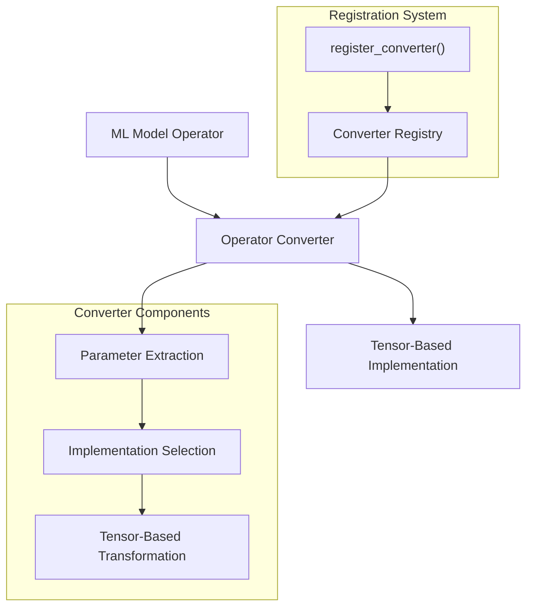
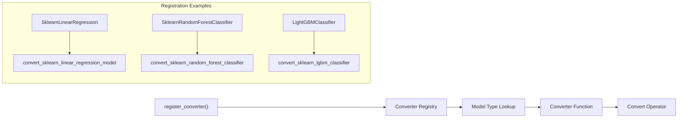
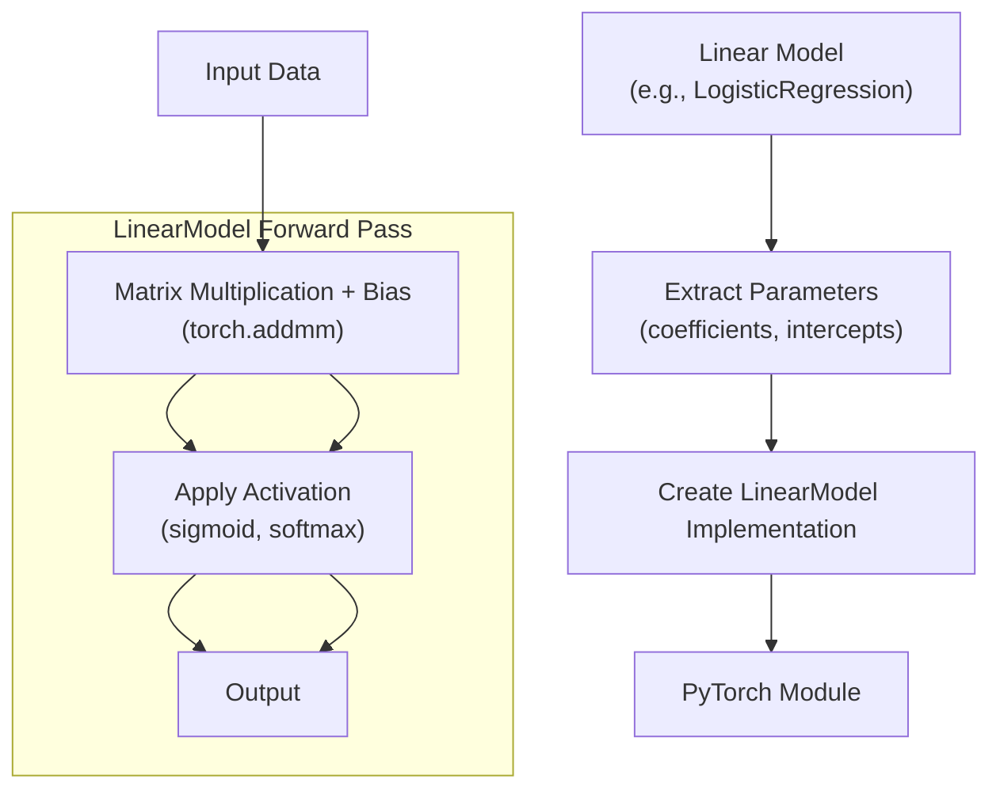
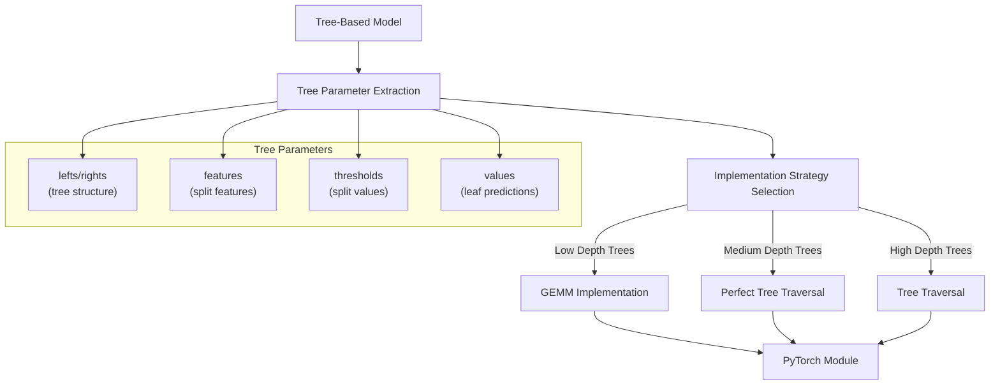
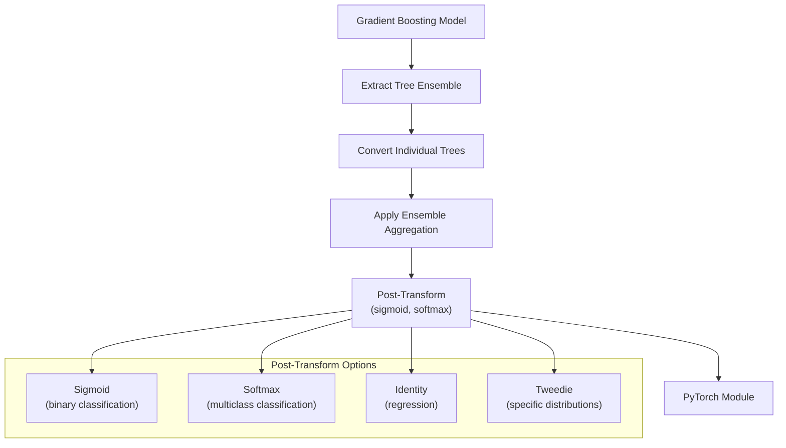
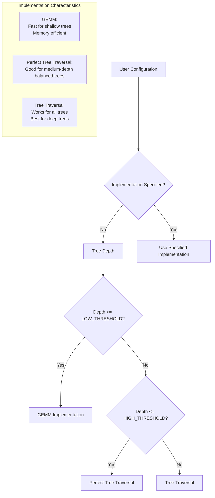
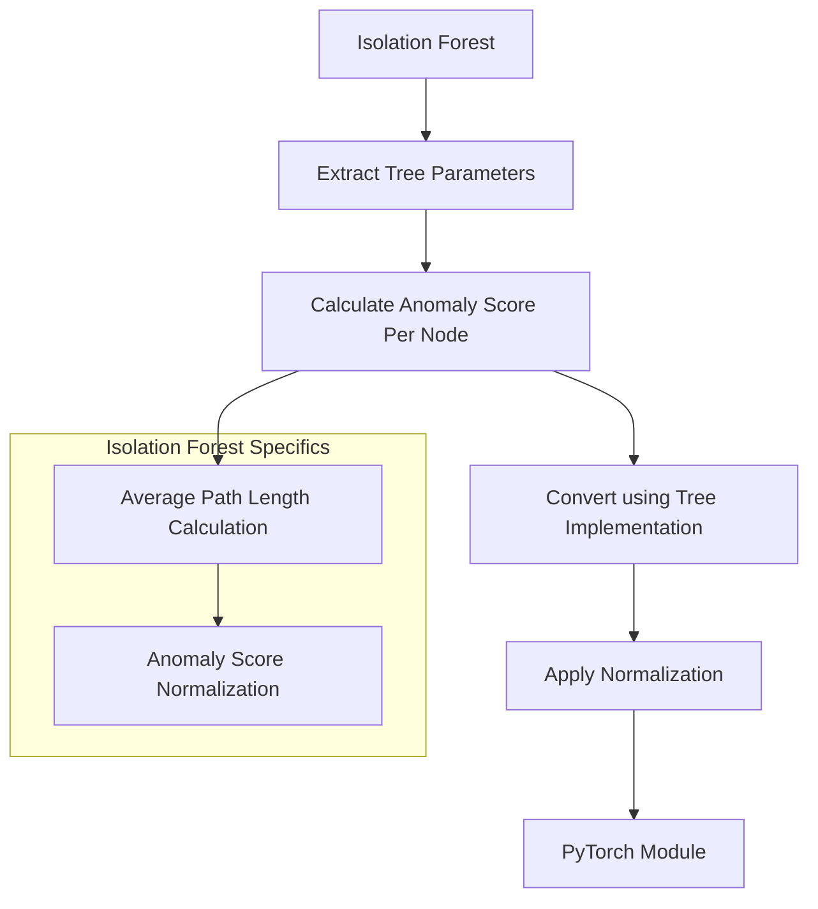
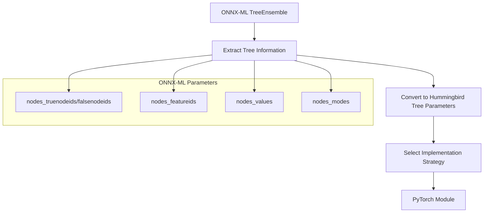

<!-- source: DeepWiki mcp.deepwiki.com · repo microsoft/hummingbird · page 4.1 Operator Converters · fetched 2026-10-26 -->

# Operator Converters

Relevant source files

The following files were used as context for generating this wiki page:

- [hummingbird/ml/operator_converters/_gbdt_commons.py](hummingbird/ml/operator_converters/_gbdt_commons.py)
- [hummingbird/ml/operator_converters/_linear_implementations.py](hummingbird/ml/operator_converters/_linear_implementations.py)
- [hummingbird/ml/operator_converters/_tree_commons.py](hummingbird/ml/operator_converters/_tree_commons.py)
- [hummingbird/ml/operator_converters/_tree_implementations.py](hummingbird/ml/operator_converters/_tree_implementations.py)
- [hummingbird/ml/operator_converters/lightgbm.py](hummingbird/ml/operator_converters/lightgbm.py)
- [hummingbird/ml/operator_converters/onnx/tree_ensemble.py](hummingbird/ml/operator_converters/onnx/tree_ensemble.py)
- [hummingbird/ml/operator_converters/sklearn/decision_tree.py](hummingbird/ml/operator_converters/sklearn/decision_tree.py)
- [hummingbird/ml/operator_converters/sklearn/gbdt.py](hummingbird/ml/operator_converters/sklearn/gbdt.py)
- [hummingbird/ml/operator_converters/sklearn/iforest.py](hummingbird/ml/operator_converters/sklearn/iforest.py)
- [hummingbird/ml/operator_converters/sklearn/linear.py](hummingbird/ml/operator_converters/sklearn/linear.py)
- [hummingbird/ml/operator_converters/xgb.py](hummingbird/ml/operator_converters/xgb.py)
- [tests/test_sklearn_linear_converter.py](tests/test_sklearn_linear_converter.py)
- [tests/test_sklearn_sv_converter.py](tests/test_sklearn_sv_converter.py)

This page describes the operator converter system in Hummingbird, which is responsible for transforming traditional machine learning operators from their original framework representation into tensor-based implementations for neural network frameworks. For information about the overall conversion pipeline, see [Model Conversion Pipeline](#3.1).

## Overview of Operator Converters

Operator converters are the core components that translate specific machine learning operators (e.g., decision trees, linear models) from their original framework representation to equivalent tensor computation implementations. Each operator type requires specialized conversion logic to maintain its functionality while leveraging tensor operations.

The operator converters follow a plugin architecture where each converter is registered with the system. When a model is submitted for conversion, Hummingbird identifies the appropriate converter based on the model type and uses it to transform the model into its tensor-based equivalent.

Sources: [hummingbird/ml/operator_converters/sklearn/linear.py:18-67](). [hummingbird/ml/operator_converters/sklearn/linear.py:102-114]().

## Converter Registration System

Hummingbird uses a registration mechanism to associate model types with their respective converters. Each converter is registered using the `register_converter` function, which maps the model type string to the converter function.

All converters take three standard parameters:
- `operator`: The operator to be converted
- `device`: The target device for the converted model (e.g., CPU, CUDA)
- `extra_config`: Additional configuration options

Sources: [hummingbird/ml/operator_converters/sklearn/linear.py:102-114](). [hummingbird/ml/operator_converters/lightgbm.py:125-129](). [hummingbird/ml/operator_converters/sklearn/decision_tree.py:130-135]().

## Categories of Operator Converters

Hummingbird includes converters for several types of ML operators:

### Linear Model Converters

Linear model converters transform linear algorithms like LinearRegression, LogisticRegression, and SVMs into tensor operations.

The `LinearModel` class implements linear models using matrix multiplication followed by the appropriate activation function based on the model type.

Sources: [hummingbird/ml/operator_converters/_linear_implementations.py:16-84](). [hummingbird/ml/operator_converters/sklearn/linear.py:18-67]().

### Tree-Based Model Converters

Tree-based model converters handle decision trees, random forests, and gradient boosting models. These converters are more complex due to the variety of tree algorithms and implementation strategies.

Hummingbird supports three main implementation strategies for tree models:

1. **GEMM (General Matrix Multiplication)**: Converts trees to a series of matrix multiplications. Optimal for shallow trees.
2. **Tree Traversal**: Implements traditional tree traversal in PyTorch. Works for all tree types.
3. **Perfect Tree Traversal**: An optimized version for balanced trees with medium depth.

The strategy is selected based on tree depth and user configuration.

Sources: [hummingbird/ml/operator_converters/_tree_commons.py:181-208](). [hummingbird/ml/operator_converters/_tree_implementations.py:114-183](). [hummingbird/ml/operator_converters/_tree_implementations.py:211-306](). [hummingbird/ml/operator_converters/_tree_implementations.py:309-455]().

### Gradient Boosting Model Converters

Gradient boosting models (like XGBoost, LightGBM, and scikit-learn's gradient boosting) are converted using specialized converters that handle their unique characteristics.

Gradient boosting converters extract the tree ensemble, convert each tree, and apply the appropriate aggregation and post-transform functions.

Sources: [hummingbird/ml/operator_converters/_gbdt_commons.py:28-183](). [hummingbird/ml/operator_converters/xgb.py:84-150](). [hummingbird/ml/operator_converters/lightgbm.py:56-101]().

## Tree Implementation Strategies

The choice of tree implementation strategy significantly affects performance. Hummingbird selects the strategy based on tree depth and user configuration:

### GEMM Implementation

The GEMM implementation converts trees into a series of matrix multiplications:
- First layer: Computes conditions for each split node
- Second layer: Computes path traversals through the tree
- Third layer: Computes leaf node values based on path

### Tree Traversal Implementation

The Tree Traversal implementation more directly mimics traditional tree traversal:
- Maintains tree structure in tensors (lefts, rights, features, thresholds)
- Traverses trees in parallel for batched inputs
- More efficient for deep trees where GEMM would be memory-intensive

### Perfect Tree Traversal Implementation

An optimized version of tree traversal for balanced trees:
- Assumes trees can be represented as perfect binary trees
- Uses efficient indexing for traversal
- Strikes a balance between memory usage and computation efficiency

Sources: [hummingbird/ml/operator_converters/_tree_commons.py:181-208](). [hummingbird/ml/operator_converters/_tree_implementations.py:114-183](). [hummingbird/ml/operator_converters/_tree_implementations.py:211-306](). [hummingbird/ml/operator_converters/_tree_implementations.py:309-455]().

## Specialized Converters

### Isolation Forest Converter

Isolation Forest requires special handling due to its anomaly detection mechanics:

The Isolation Forest converter modifies the tree values to represent anomaly scores and applies specialized normalization.

Sources: [hummingbird/ml/operator_converters/sklearn/iforest.py:24-53](). [hummingbird/ml/operator_converters/sklearn/iforest.py:96-206]().

### ONNX-ML Tree Ensemble Converters

Hummingbird can convert ONNX-ML tree ensemble models (classifiers and regressors):

The ONNX-ML converters extract tree information from the ONNX model and convert it to Hummingbird's internal representation.

Sources: [hummingbird/ml/operator_converters/onnx/tree_ensemble.py:19-180](). [hummingbird/ml/operator_converters/onnx/tree_ensemble.py:207-263]().

## Common Conversion Patterns

Most operator converters follow a similar pattern:

1. **Parameter Extraction**: Extract model parameters from the source model
2. **Parameter Transformation**: Transform parameters to a format suitable for tensor operations
3. **Implementation Selection**: Choose the most appropriate implementation strategy
4. **PyTorch Module Creation**: Create a PyTorch module that implements the model's behavior

This pattern ensures consistency across different model types while allowing for specialization where needed.

## Summary

The operator converter system in Hummingbird enables the translation of traditional ML models into tensor-based implementations. By providing specialized converters for different model types and implementation strategies optimized for different scenarios, Hummingbird can efficiently convert a wide range of ML models for deployment on tensor computation frameworks like PyTorch.

Sources: [hummingbird/ml/operator_converters/_tree_commons.py:443-473](). [hummingbird/ml/operator_converters/_gbdt_commons.py:68-183](). [hummingbird/ml/operator_converters/sklearn/linear.py:18-67]().

---

